# Architektur

NGine ist in Schichten gebaut. Jede Schicht darf nur Schichten unter sich benutzen, nie umgekehrt.
Jedes System ist ein C++-Modul (`ngine.<system>`) mit eigenem CMake-Ziel (`ngine::<system>`).

## Schichten

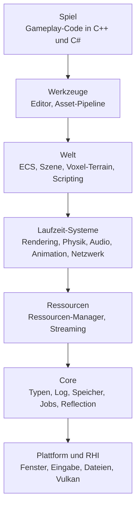

Die Pfeile zeigen „darf benutzen“. Die Werkzeuge stehen über der Welt, weil der Editor die Welt
bearbeitet; das Spiel nutzt die Werkzeuge nur im Editor-Build.

## Module heute

| Modul | CMake-Ziel | Inhalt | Status |
| --- | --- | --- | --- |
| `ngine.core` | `ngine::core` | Partitionen `types`, `log` (Sinks für Konsole, Datei `FileSink` und Ringpuffer `RingSink`), `check`, `version`, `events` (`EventBus` mit Abonnements, sofort oder gesammelt zugestellt); interne Partition `console` stellt die Windows-Konsole auf UTF-8 und öffnet Log-Dateien mit UTF-8-Pfad (`console_windows.cpp`/`console_posix.cpp`) | vorhanden |
| `ngine.math` | `ngine::math` | Eigene Mathematik: `Vec3`, `DVec3`, `Mat4`, `Quat` …, Projektionen und Blickmatrix nach den Konventionen der Engine, `Affine` mit 64-Bit-Verschiebung und `decompose()` ([ADR 0025](adr/0025-own-math-mixed-precision.md)), Strahlen und Schnitte für Treffertests (`:ray`, R2.3) | vorhanden |
| `ngine.memory` | `ngine::memory` | CPU-Allokatoren als `std::pmr::memory_resource` (`LinearAllocator`, `FrameAllocator`, `PoolAllocator`, `ObjectPool`) und Budget pro Kategorie | vorhanden |
| `ngine.jobs` | `ngine::jobs` | Job-System mit Work-Stealing, `Counter`, `TaskGraph`, `parallel_for` ([ADR 0015](adr/0015-own-job-system.md)) | vorhanden |
| `ngine.profile` | `ngine::profile` | Profiling-Zonen, Frame-Marken, Plots, GPU-Zeitleisten mit nachgereichten Zeitstempeln; Adapter für Tracy, Makros in `<ngine/profile.hpp>` ([ADR 0016](adr/0016-profiling-macros.md)) | vorhanden |
| `ngine.filesystem` | `ngine::filesystem` | Dateien lesen und schreiben (atomar über temporäre Datei), Benutzerordner, Ordner der Programmdatei (`executable_dir()`), Ordner auflisten, Pfade normalisieren, `FileWatcher` über Polling (R2.4, [ADR 0034](adr/0034-hot-reload-polling-slang-runtime.md)); Pfade als UTF-8, Plattformcode in `platform_linux.cpp`/`platform_windows.cpp` | vorhanden |
| `ngine.reflect` | `ngine::reflect` | Typinformationen (`TypeRegistry`, `TypeInfo` mit Index der Registrierung, Felder mit Bereich und Hinweis für den Editor, Enums mit Namen, `TypeOps`, Merkmal `transient` für berechnete Komponenten) über eine Builder-API ([ADR 0018](adr/0018-own-reflection.md)) | vorhanden |
| `ngine.serialize` | `ngine::serialize` | JSON (`json::Value`, `parse`, `write`), Binärformat (`BinaryWriter`/`BinaryReader`) und beides für reflektierte Typen ([ADR 0020](adr/0020-scene-format-json.md)) | vorhanden |
| `ngine.world` | `ngine::world` | ECS-Adapter für flecs: `World`, `Entity`, `Query`, Hierarchie, `Schedule` für Systeme ([ADR 0019](adr/0019-systems-on-job-system.md)), Szenen speichern und laden (JSON oder binär `.nscene`, R2.5), Prefabs mit Instanzen und Überschreibungen (`:prefab`, [ADR 0037](adr/0037-prefabs-field-overrides.md)); `Transform`, `WorldTransform` und `update_transforms()` nur für geänderte Teilbäume ([ADR 0025](adr/0025-own-math-mixed-precision.md)), `world_affine()`; Terrain als Komponente (`:terrain`, R3.1: Beschreibung `Terrain` in der Szene, Laufzeitdaten in der transienten `TerrainState`, `update_terrains()` erzeugt und meshet in Jobs; seit R3.2 Form `Procedural` mit Startwert, `generator_desc()`; seit R3.3 endlose Terrains mit `streaming`, `view_distance` und `detail`, Beobachter über die Komponente `TerrainObserver` und `TerrainUpdate`; seit R3.4 Deltas in `TerrainData`, `edit_terrain()`, `raycast_terrain()`, `restore_terrain()`, `terrain_deltas()`/`set_terrain_deltas()` und Regionen-Dateien neben der Szene über `Terrain::deltas`, `save_terrain_deltas()`, `load_terrain_deltas()`); Speicher von flecs im Budget `Category::World` | vorhanden |
| `ngine.asset` | `ngine::asset` | Ressourcen-Schicht: `load_gltf()` liefert `Model` (Meshes mit festem Eckpunktformat, Materialien nach Metallic-Roughness, Texturen, Bilder, Knoten) in reinen CPU-Daten, `decode_image()` RGBA8, Normalen, Tangenten und Kugeln erzeugen, Mip-Ketten auf der CPU (`mip_chain()`); Adapter `gltf_fastgltf.cpp` und `image_stb.cpp` ([ADR 0027](adr/0027-gltf-assets-material-store.md)). Seit R2.4 `AssetId`, `AssetRef` und `AssetDatabase` mit `.meta`-Dateien (`:database`), `ResourceManager` mit `Handle<T>`, Laden im Hintergrund über `ngine.jobs` und Neuladen samt Abhängigkeiten (`:resources`, [ADR 0033](adr/0033-asset-ids-meta-resource-manager.md)). Seit R2.5 gekochte Modelle (`:cooked`: Binärformat, `AssetCache` mit Stempeln der Quellen, `decode_ktx2()` nach BC7 oder RGBA8, Adapter `ktx_libktx.cpp`), Lader mit Bereitschaft (`ready`, TD-30), Assets der Art `Prefab` ([ADR 0036](adr/0036-cooked-assets-ktx2-cache.md)) | vorhanden (ab R1.3) |
| `ngine.cook` | `ngine::cook` | Asset-Pipeline: glTF zu gekochten Modellen (`cook_model()`, `cook_all()`, `model_cooker()` für den Lader des Renderers), Tangenten nach MikkTSpace (`tangents_mikktspace.cpp`), Bilder zu KTX2 mit Basis Universal (`encode_ktx2()`, Adapter `ktx_encode.cpp`), Kochen im Hintergrund über `ngine.jobs` mit Fortschritt (`BackgroundCook`, R3.4); nur Editor, Werkzeug `ngine_cook` und Tests linken es ([ADR 0036](adr/0036-cooked-assets-ktx2-cache.md)) | vorhanden (ab R2.5) |
| `ngine.meshlet` | `ngine::meshlet` | Meshlets ohne GPU (R3.5): `Meshlet` mit höchstens 64 Eckpunkten und 124 Dreiecken, Hüllkugel und Normalenkegel; `build()` teilt ein Netz wie einen k-d-Baum und sortiert seine Indizes um, `compute_bounds()`, `valid()`, `local_data()` für Mesh Shader ([ADR 0043](adr/0043-gpu-driven-meshlets.md)). Genutzt von `ngine.voxel` (Netze der Chunks), `ngine.asset` (Teilnetze), `ngine.cook` (meshoptimizer) und `ngine.render` | vorhanden (ab R3.5) |
| `ngine.voxel` | `ngine::voxel` | Voxel-Terrain ohne GPU (Vektoren aus `ngine.math`): Dichtefeld (`Grid`, 8-Bit-Dichte und Material), Surface Nets (`Mesher`), Pinsel und Strahltest ([ADR 0021](adr/0021-surface-nets-8bit-density.md)); seit R3.1 Chunks (`:chunk`: `ChunkCoord`, `Chunk` mit einheitlichem Wert, `ChunkStore` mit Vormerkung geänderter Chunks, `gather()` mit Randschicht), nahtloses Meshing einzelner Chunks (`Mesher::build_chunk()`) und Meshing und Füllen über `ngine.jobs` (`:meshing`), Pinsel und Strahltest auf dem `ChunkStore` ([ADR 0038](adr/0038-terrain-chunks-shared-geometry.md)); seit R3.2 deterministisches Rauschen (`:noise`: Simplex 2D/3D, fBm, Ridged) und der Generator aus Regeln (`:generator`: `Generator`, `generate_chunks()` in Jobs, `checksum()`), Gewichte der Materialien je Eckpunkt mit Palette pro Netz ([ADR 0039](adr/0039-deterministic-noise-rule-generator.md), [ADR 0040](adr/0040-terrain-materials-weights-triplanar.md)); seit R3.3 LOD (`:lod`: `LodLayout`, `select_lod()`, `LodMesher` und `mesh_leaves()` über Stufengrenzen) und Streaming (`:streaming`: `Streamer` mit Jobs, Budget und Übernahme in einem Schritt, [ADR 0041](adr/0041-lod-octree-surface-nets-streaming.md)); seit R3.4 Deltas gegenüber der Grundwelt (`:delta`: `ChunkDelta`, `TerrainDeltas` mit Momentaufnahmen, `apply_deltas()` für alle Stufen, Regionen-Dateien), Pinsel Ebnen und Bemalen, Strahltest über das `LodLayout` ([ADR 0042](adr/0042-terrain-deltas-region-files.md)) | vorhanden (ab D1) |
| `ngine.script` | `ngine::script` | C#-Scripting: `ScriptRuntime` startet .NET 10 über hostfxr, lädt Skripte in einen entladbaren Kontext, Aufrufe in beide Richtungen ([ADR 0023](adr/0023-dotnet-hosting-hostfxr.md)); Plattformcode in `native_linux.cpp`/`native_windows.cpp`, verwalteter Teil `NGine.Scripting` unter `engine/script/managed/` | vorhanden (Durchstich D2) |
| `ngine.net` | `ngine::net` | Netzwerk-Transport: `Transport` mit Verbindungen, zuverlässigen und unzuverlässigen Nachrichten über UDP; Adapter für GameNetworkingSockets in `transport_gns.cpp` ([ADR 0024](adr/0024-networking-gns-snapshots.md)) | vorhanden (Durchstich D3) |
| `ngine.replication` | `ngine::replication` | Replikation der Welt: Schnappschüsse ausgewählter Komponenten (`encode_snapshot`, `Mirror`), `Server` und `Client` über einem `Transport` ([ADR 0024](adr/0024-networking-gns-snapshots.md)) | vorhanden (Durchstich D3) |
| `ngine.platform` | `ngine::platform` | Fenster und Ereignisse über SDL3 (Tasten nach Scancode mit Loslassen, Texteingabe, Fokus, Maus mit relativem Modus und Zeigerform, Zwischenablage, Bildschirmskalierung, Rückruf zum Zeichnen beim Ziehen des Fensters; nur mit `NGINE_WITH_WINDOW`) | vorhanden |
| `ngine.rhi` | `ngine::rhi` | API-unabhängige Schnittstelle: Device, Texture (Verwendungen, bindlose Indizes), Buffer (Geräteadresse, GPU- oder CPU-Speicher), Sampler (mit Anisotropie), Shader, Grafik-Pipeline (Tiefenvergleich, Tiefenversatz, Überblenden, auch nur mit Tiefe) und Compute-Pipeline, CommandList mit Barrieren über `ResourceState`, Scissor, Push Constants, Zeichnen, Dispatch und Zeitstempeln; `upload()` über Staging, für Texturen mit Mip-Stufen von der GPU; `upload_async()` mit `UploadTicket` über eine eigene Transfer-Queue, wo es eine gibt (R2.4, [ADR 0035](adr/0035-transfer-queue-concurrent-sharing.md)), auch für blockkomprimierte Texturen (BC7, `Capabilities::bc_compression`, R2.5); Rücklesen über Puffer im Speicher `CpuRead` (`copy_texture_to_buffer()`, `Buffer::read()`); Zeitstempel der GPU ohne Warten (`calibrated_timestamp()`); `Capabilities` mit den optionalen `Features` der GPU ([ADR 0026](adr/0026-render-graph-bindless.md)) | vorhanden |
| `ngine.rhi.vulkan` | `ngine::rhi_vulkan` | Vulkan-Backend (Pflicht 1.3, optional 1.4, Mesh Shader, Raytracing; [ADR 0017](adr/0017-platform-baseline-feature-tiers.md)) mit volk und VMA; exportierte Partition `requirements` (Auswertung der Anforderungen, ohne GPU testbar) und `headless_surface()` für Tests, interne Partitionen `common`, `context` (Timeline, Löschliste, bindloser Satz), `instance`, `physical_device`, `resources`, `command_list`, `upload`, `swapchain` | vorhanden |
| `ngine.render` | `ngine::render` | Renderer (Laufzeit-Schicht, kennt die RHI, nie Vulkan): `RenderGraph` mit Passes, importierten und transienten Ressourcen, Plan ohne GPU (`compile()`), `TexturePool` ([ADR 0026](adr/0026-render-graph-bindless.md)); `GpuProfiler` mit einer GPU-Zone pro Pass; Komponenten `Camera`, `MeshRenderer` (Verweise über `AssetRef`, R2.4), `DirectionalLight`, `PointLight` und `SpotLight`, `MeshStore`, `MaterialStore`, gemeinsame Geometriepuffer (`GeometryBuffer` mit `RangeAllocator`, R3.1, TD-23), `TerrainMeshes`, `Renderer` (Schatten der Sonne über Kaskaden, PBR vorwärts mit Lichtliste in ein HDR-Ziel, Terrain mit PBR, Schatten und Auswahl seit R3.1, seit R3.2 mit Materialtabelle `TerrainMaterial` und triplanaren Texturen über `set_terrain_materials()`, Tone Mapping, Debug-Linien, Auswahl per Klick über einen ID-Puffer, Kamera von außen über `camera_override`, Modelle über den Ressourcen-Manager, `reload_shaders()`), `GpuModel`, `upload_model()`, `register_loaders()` (seit R2.5 mit `ModelLoading`: erst aus dem Cache, dann kochen, dann aus den Quellen; BC7-Texturen, wo die GPU sie kann), Lader für einzelne Texturen `ColorTexture` (sRGB) und `DataTexture` (linear, R3.2) und `spawn_model()` ([ADR 0027](adr/0027-gltf-assets-material-store.md), [ADR 0028](adr/0028-lights-cascaded-shadows.md)). Das Innenleben (Zustand `RendererCore` hinter `Renderer::Impl`, Draws) steht seit R3.2 in der internen Partition `:renderer_detail`, verteilt auf `renderer.cpp`, `pipelines.cpp`, `passes.cpp`, `terrain_pass.cpp` und `textures.cpp` (TD-36). Seit R3.5 GPU-getrieben ([ADR 0043](adr/0043-gpu-driven-meshlets.md)): Meshlet-Daten in `MeshStore` und `TerrainMeshes`, Partition `:culling` (`GpuMeshlet`, `GpuInstance`, `GpuView`, `frustum_planes()`, `pack_meshlets()`, Größe des Hi-Z), Instanzen und Gruppen, Prüfen und Hi-Z in `driven.cpp`, Mesh-Shader-Pfad und Rückfallpfad mit indirekten Draws (`use_mesh_shaders`, `occlusion_culling`), Statistik der GPU in `RenderStats`; der `TexturePool` gibt Texturen nach ihrem letzten Pass zurück (TD-16) | vorhanden (ab R1.2) |
| `ngine.shaders` | `ngine::shaders` | Eingebaute Slang-Shader als SPIR-V (Dreieck, Voxel-Test für die RHI, Terrain, Vollbild-Kopie, Testmuster als Compute, PBR mit gemeinsamer Beleuchtung `lighting.slang`, Schatten, Debug-Linien, Tone Mapping, Editor-UI); `bindless.slang` für den gemeinsamen Descriptor-Satz | vorhanden |
| `ngine.shader_compiler` | `ngine::shader_compiler` | Slang-Shader zur Laufzeit nach SPIR-V übersetzen (`Compiler`, Hot Reload); Adapter für die Slang-Bibliothek in `compiler.cpp`; nur Editor und Tests linken es ([ADR 0034](adr/0034-hot-reload-polling-slang-runtime.md)) | vorhanden (ab R2.4) |
| `ngine.editor_ui` | `ngine::editor_ui` | Editor-UI: Adapter für Dear ImGui mit Docking (`:context`, `:widgets`; nur `context.cpp` und `widgets.cpp` kennen ImGui), Zeichenliste in Engine-Typen (`:draw`), `UiRenderer` als Pass im Render-Graph über die RHI (`:pass`), Log-Konsole (`:console`) und Viewport-Größe (`:viewport`), Zeichnen von Linien, Formen und Text in die Zeichenliste eines Fensters (R2.3); ohne Fenster und GPU testbar ([ADR 0029](adr/0029-editor-imgui-over-rhi.md)) | vorhanden (ab R2.1) |
| `ngine.edit` | `ngine::edit` | Editor-Logik ohne UI und GPU: `SceneDocument` mit stabilen Entity-Kennungen, Verlauf (`CommandStack`) und Datei, Befehle mit reflektierten Werten (`:commands`), Auswahl, Modelle für Szenenbaum und Inspector; Ereignisse über `events::EventBus` ([ADR 0030](adr/0030-undo-commands-reflected-values.md)); Gizmos und `ViewCamera` (`:gizmo`, [ADR 0031](adr/0031-gizmos-own-math-ui-draw-list.md)), Spielen über eine Sicherung im Dokument ([ADR 0032](adr/0032-play-in-editor-binary-snapshot.md)), Einfügen von Teilbäumen (`insert_entities()`, R2.4), Prefabs verknüpfen, aufbrechen und einfügen (`:prefabs`, R2.5), Terrain-Pinsel mit Befehlen über Deltas, ein Strich ein Schritt im Verlauf (`:terrain`: `TerrainBrushTool`, `terrain_edit()`, R3.4) | vorhanden (ab R2.2) |

Die Durchstiche D1 bis D3 haben die geplanten Module der Ausarbeitung angelegt. In R1 kommen
`ngine.math` (R1.1), der Renderer `ngine.render` (ab R1.2) und `ngine.asset` (R1.3) dazu, in R2
`ngine.editor_ui` (R2.1) und `ngine.edit` (R2.2) für den Editor, `ngine.shader_compiler` (R2.4) für Hot Reload und `ngine.cook` (R2.5) für die Asset-Pipeline.

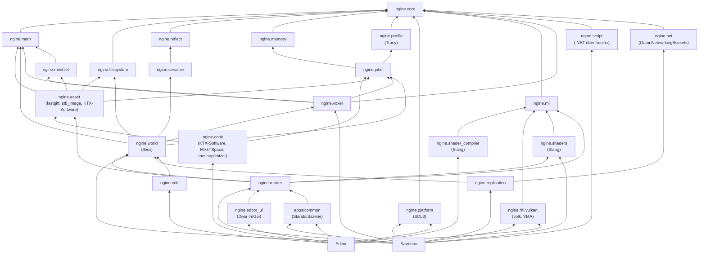

Plattform und RHI kennen sich nicht. Sandbox und Editor verbinden sie: Sie übergeben der RHI eine
`SurfaceDesc`, deren Funktionen das Fenster bereitstellt ([ADR 0013](adr/0013-rhi-design.md)).
Ebenso kennen sich Plattform und Editor-UI nicht; der Editor übersetzt Ereignisse des Fensters in
Eingaben der UI (`apps/editor/input.cppm`).

### Feature-Stufen der GPU

Beim Start prüft das Vulkan-Backend jede GPU gegen die Mindestanforderung und erkennt die optionalen
Stufen ([ADR 0017](adr/0017-platform-baseline-feature-tiers.md)). Der Renderer fragt
`device.capabilities().features` ab und wählt danach seinen Pfad; Vulkan-Typen sieht er dabei nicht.

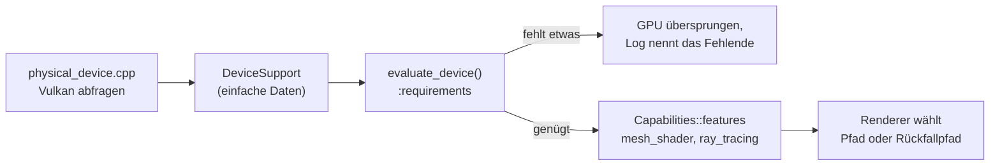

`DeviceDesc::disabled_features` schaltet Stufen ab, auch wenn die GPU sie kann. So laufen Tests und
die Sandbox (`--baseline`) auf jeder Hardware auch über die Rückfallpfade.

### Geometrie und Puffer

Pipelines haben keine Vertex-Attribute. Der Vertex-Shader liest seine Eckpunkte selbst über die
Geräteadresse eines `Buffer` (Vertex Pulling, [ADR 0022](adr/0022-vertex-pulling-bda.md)); die
Adresse und kleine Daten pro Draw kommen über Push Constants (128 Bytes pro Pipeline). Indizes
bleiben ein gebundener Indexpuffer mit 32 Bit.

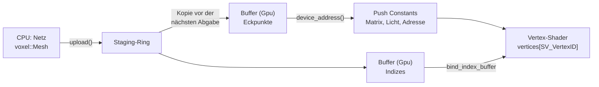

Seit R3.1 haben Netze keine eigenen Puffer mehr (TD-23, [ADR 0038](adr/0038-terrain-chunks-shared-geometry.md)):
Der `GeometryBuffer` des Renderers hält Blöcke zu 32 MiB (Storage und Index), ein `RangeAllocator`
pro Block vergibt Bereiche nach first fit und verschmilzt freie Nachbarn. Modelle (`MeshStore`) und
Terrain-Chunks (`TerrainMeshes`) bekommen je einen Bereich für Eckpunkte und einen für Indizes; ein
Draw nutzt die Geräteadresse des Bereichs und `first_index` im Indexpuffer des Blocks. Freigegebene
Bereiche werden erst `frames_in_flight + 2` Frames später wieder vergeben, damit weder ein Frame im
Flug noch eine Kopie auf der Transfer-Queue sie noch liest (`upload_async()` mit Offset). Seit R3.3
lädt `TerrainMeshes` neue Fassungen höchstens `upload_budget` Bytes pro Frame (8 MiB, mindestens ein
Netz) vorab in eigene Bereiche und tauscht die Draws eines Terrains erst, wenn alle da sind; so
bleibt die Übernahme des Streamings auch über mehrere Frames ohne Risse.

Statische Geometrie liegt im GPU-Speicher (`MemoryUsage::Gpu`) und wird über `Device::upload()`
gefüllt: Die Daten landen in einem Staging-Ring, die Kopien in einem eigenen Command Buffer, der vor
der nächsten Abgabe auf derselben Queue läuft. Barrieren davor und danach sorgen dafür, dass frühere
Frames mit dem Puffer fertig sind und spätere die neuen Daten sehen; die CPU wartet nie.
`MemoryUsage::CpuWrite` bleibt für Daten, die die CPU jeden Frame schreibt; davon hält man einen
Puffer pro Frame im Flug (`Frame::index`).

### Render-Graph, Barrieren und Bindless

Die RHI setzt keine Barrieren von selbst und merkt sich keine Zustände. Wer aufzeichnet, beschreibt
Übergänge mit `ResourceState` vorher und nachher; das Vulkan-Backend übersetzt sie in Stufen,
Zugriffe und Layouts ([ADR 0026](adr/0026-render-graph-bindless.md)). Im Renderer übernimmt das der
Render-Graph:

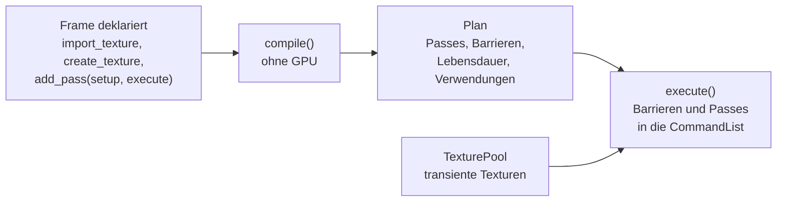

- `compile()` verwirft Passes ohne Abnehmer (nur Schreiben auf Ressourcen, die niemand braucht),
  setzt vor jedem Pass die nötigen Barrieren (Zustandswechsel und jedes Schreiben nach einem
  Schreiben) und am Ende die Endzustände importierter Ressourcen, z. B. `Present` für den
  Backbuffer.
- Transiente Texturen beschreibt man nur mit Größe und Format; die Verwendungen folgen aus den
  Zuständen. Der `TexturePool` gibt dieselbe Textur im nächsten Frame wieder aus.
- Shader erreichen Texturen und Sampler über einen bindlosen Descriptor-Satz (`bindless.slang`):
  Satz 0 mit Texturen zum Lesen, Samplern und Storage-Texturen. Die Indizes vergibt die RHI beim
  Erzeugen (`sampled_index()`, `storage_index()`, `Sampler::index()`).

### Welt zeichnen: Kamera, Meshes, Materialien

Der `Renderer` zeichnet, was in der Welt steht (REND-07, REND-08, REND-11). Gezeichnet wird von der
ersten aktiven `Camera` aus, mit umgekehrter Tiefe und unendlich fernem Horizont
(`perspective_reverse_z()`, Tiefentest „größer“). Jede Entity mit `MeshRenderer` und
`WorldTransform` wird ein Draw pro Teilnetz; ihre Matrix entsteht relativ zur Kamera in 64 Bit
([ADR 0012](adr/0012-64bit-world-coordinates.md)).

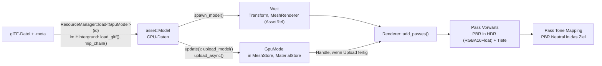

- Seit R2.4 verweisen `MeshRenderer` über `AssetRef` auf ein Modell und einen Teil davon. Der
  Renderer fragt den Ressourcen-Manager (`set_resources()`) nach dem `GpuModel`, hält es über ein
  Handle und lässt es los, wenn es zwei Frames nicht gezeichnet wurde. Ein Modell, das noch lädt
  oder dessen Uploads noch laufen, zählt als `stats().waiting` und wird nicht gezeichnet.
  Programme, die Modelle selbst erzeugen (Standardszene), melden sie mit `ResourceManager::add()`
  unter einer festen Kennung (`generated_id()`) an ([ADR 0033](adr/0033-asset-ids-meta-resource-manager.md)).
- Push Constants eines Draws: Modellmatrix in drei Zeilen, die Adressen der Eckpunkte, der
  Frame-Daten (Kamera, Sonne, Himmel- und Bodenfarbe; ein Puffer pro Frame im Flug) und des
  Materialfelds sowie der Index des Materials. Texturen und Sampler stehen als bindlose Indizes im
  Material ([ADR 0027](adr/0027-gltf-assets-material-store.md)).
- Umgebungslicht aus Himmel- und Bodenfarbe (`Renderer::lighting`), diffus entlang der Normale und
  glänzend entlang der Spiegelung; bildbasiertes Licht kommt mit dem Himmel in R3. Sonne und
  weitere Lichter siehe unten.
- Undurchsichtige Materialien zuerst, Alpha-Maske über `discard`, durchsichtige danach ohne
  Sortierung (TD-20). Vier Pipelines: mit und ohne Überblenden, mit und ohne Rückseiten.
- GPU-Zonen: Der `GpuProfiler` schreibt vor und nach jedem Pass des Graphs einen Zeitstempel; die
  Werte kommen über `Frame::timestamps`, wenn der Platz unter den Frames im Flug wieder dran ist,
  und gehen über `ngine.profile` an Tracy.

### Licht, Schatten und Debug-Zeichnen

Lichter sind Komponenten (REND-09, [ADR 0028](adr/0028-lights-cascaded-shadows.md)) und leuchten
entlang der lokalen -z-Achse. `collect_lights()` macht daraus pro Frame die Sonne (erstes aktives
`DirectionalLight`) und eine Liste aller übrigen Lichter, kamerarelativ in einem Puffer pro Frame
im Flug. Vor dem Vorwärts-Pass zeichnen vier Pässe die Schattenkarten der Sonne.

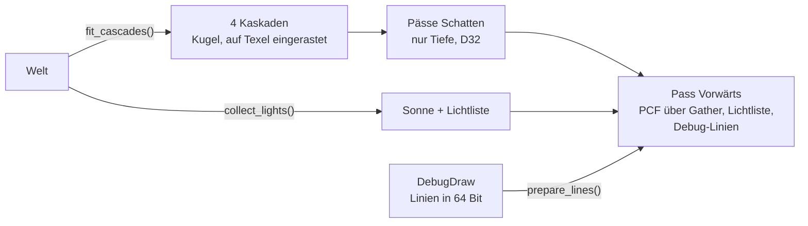

- `fit_cascades()` (`:shadows`) ist reine Rechnung: Aufteilung des Stumpfs, kleinste Kugel um
  jeden Ausschnitt, Einrasten des Mittelpunkts in 64 Bit, Matrix von kamerarelativen
  Weltkoordinaten in den Raum der Schattenkarte. Werfer prüft `Cascade::may_cast()` über
  Hüllkugeln; durchsichtige Materialien werfen keine Schatten.
- Der Vorwärts-Pass wählt die Kaskade nach der Entfernung entlang der Blickrichtung, filtert mit
  PCF und geht am Ende jeder Kaskade weich in die nächste über. `Renderer::show_cascades` färbt
  die Kaskaden zur Prüfung ein. `ShadowSettings` steuert Entfernung, Auflösung und Versatz.
- `DebugDraw` (`Renderer::debug()`, REND-15) sammelt Linien, Quader, Kugeln und Achsenkreuze für
  einen Frame. Der Renderer schneidet sie an der nahen Ebene ab und zeichnet sie im Vorwärts-Pass
  mit Tiefentest; der Vertex-Shader zieht jede Linie zu einem Rechteck fester Pixelbreite auf.
  Texte in der Welt (`DebugDraw::text()`, R2.3) zeichnet der Renderer nicht, weil die Engine keine
  Schrift hat: Die Anwendung liest `texts()` vor `add_passes()` und zeichnet sie mit ihrer UI (der
  Editor über die Zeichenliste von ImGui); `add_passes()` leert beide Listen.
- Die Szenen-Shader teilen ihre Datenstrukturen über `scene.slang` (Eckpunkt, Material, Licht,
  Frame, Push Constants).

### Editor und Editor-UI

Der Editor ist eine eigene Anwendung ([ADR 0029](adr/0029-editor-imgui-over-rhi.md)). Jeder Frame
baut zuerst die UI, dann zeichnet der Render-Graph die Szene in die Viewport-Textur und die UI in
den Backbuffer:

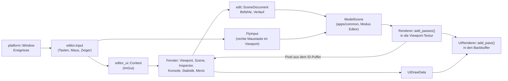

- Die Viewport-Textur (`RGBA8Srgb`, RenderTarget und Sampled) wird importiert: neu angelegt im
  Zustand Undefined, danach ShaderRead am Anfang und Ende jedes Frames. Der UI-Pass liest sie im
  Zustand ShaderRead; die Barriere setzt der Graph.
- Die Größe folgt dem Fenster mit einem Frame Verzug (`editor_ui::ViewportSize`): Die Zeichenliste
  eines Frames zeigt auf die Textur, die beim Aufbau der UI galt.
- Texturen der UI selbst (Schriftatlas) legt der `UiRenderer` als `TextureHost` an; die Kennung ist
  der bindlose Index plus eins.
- Die Konsole liest einen `log::RingSink`, der vor allem anderen eingetragen wird; dazu schreibt
  ein `log::FileSink` nach `editor.log` im Benutzerordner. Lage und Andocken der Fenster speichert
  ImGui in `editor.ini` daneben.
- **Dokument und Verlauf** (R2.2, [ADR 0030](adr/0030-undo-commands-reflected-values.md)): Alle
  Änderungen der Fenster laufen als Befehle über `edit::SceneDocument::execute()`. Befehle kennen
  Entities nur über stabile `EntityId`s und halten Werte als Bytes im Binärformat der Reflection.
  Solange ein Eingabefeld aktiv ist, verschmelzen Änderungen desselben Feldes; danach versiegelt
  die Hauptschleife den Verlauf.
- **Ereignisse:** Dokument und Auswahl melden `EntityChanged`, `DocumentReset`, `DirtyChanged` und
  `SelectionChanged` über einen `events::EventBus`. Die Fenster kennen sich nicht; die Auswahl
  prüft sich nach Änderungen selbst, der Fenstertitel folgt `dirty()`.
- **Inspector aus der Reflection:** `edit::inspect()` liefert Zeilen mit Art des Eingabefelds,
  Zahlentyp und Bereich; das Fenster zeichnet sie und gibt neue Werte über `edit::commit()`
  zurück. Kein Code pro Komponente.
- **Auswahl per Klick:** Der Editor fragt beim Renderer ein Pixel an (`request_pick()`). Im
  nächsten Frame zeichnet ein Pass alle Meshes mit dem unteren Teil ihrer Entity-Kennung in eine
  transiente `R32Uint`-Textur, ein zweiter kopiert das Pixel in einen Rücklesepuffer des Frames im
  Flug. Ist derselbe Platz wieder an der Reihe, ist die GPU fertig; `take_pick()` liefert die
  Entity (`World::entity_from_index()`).
- **Kamera des Editors** gehört nicht zur Szene: `ModelScene` im Modus `Editor` setzt
  `Renderer::camera_override`, damit gespeicherte Szenen keine Editor-Kamera enthalten. Szenen aus
  Dateien haben bis R2.4 keine Meshes; Hilfslinien (`editor.overlay`) zeigen Raster, Lichter und
  die Auswahl, dazu Namen als Text in der Welt.
- **Gizmos** (R2.3, [ADR 0031](adr/0031-gizmos-own-math-ui-draw-list.md)): `edit::Gizmo` prüft
  Treffer über Strahlen aus `edit::ViewCamera` (gleiche Projektion wie der Renderer) gegen Achsen,
  Ringe und eine Kugel in der Mitte und setzt beim Ziehen `Transform` über einen
  zusammenfassenden Befehl; die Hauptschleife versiegelt den Verlauf erst nach dem Loslassen.
  `editor.viewport_tools` projiziert die Form und zeichnet sie über die Zeichenliste der UI über
  das Viewport-Bild, also immer über der Szene. Klicks auf den Gizmo gehen nicht an die Auswahl.
- **Spielen** (R2.3, [ADR 0032](adr/0032-play-in-editor-binary-snapshot.md)):
  `SceneDocument::begin_play()` sichert die Welt im Binärformat und sperrt das Dokument
  (`read_only()`), die Hauptschleife ruft `ModelScene::simulate()` auf (Schedule mit dem System
  „Kreisbahnen“), `end_play()` stellt die Welt mit denselben Kennungen im Dokument und in derselben
  Reihenfolge wieder her. Der Verlauf gilt danach weiter.
- **Aufteilung des Editors:** `main.cpp` hält Schleife, Eingaben und Fenster, `editor.menu` Menü,
  Dialoge, Kurzbefehle und `PlayControls`, `editor.viewport_tools` die Werkzeuge des Viewports.

### Lebensdauer von GPU-Ressourcen

Jede Abgabe an die Queue signalisiert den nächsten Wert eines Timeline Semaphores. Daran hängen
die Frames im Flug (ein Frame wartet auf den Wert seines Vorgängers mit demselben Platz), der
Staging-Speicher und die Löschliste: Zerstört der Aufrufer eine Ressource, gibt das Backend sie und
ihren bindlosen Index erst frei, wenn die GPU alle Abgaben bis dahin abgearbeitet hat. Die
Präsentation deckt die Timeline nicht ab. Mit `VK_EXT_swapchain_maintenance1` bekommt deshalb
jede Präsentation eine Fence; eine alte Swapchain kommt nach einem Neuaufbau erst in die
Löschliste, wenn alle Präsentationen an sie fertig sind. Ohne die Extension wartet sie dort zwei
Abgaben länger. `vkDeviceWaitIdle` gibt es nur noch beim Beenden.

## Regeln

- **Abhängigkeiten nur nach unten.** Ein Modul darf kein Modul einer höheren Schicht importieren.
- **Fremdbibliotheken nur in Adaptern** ([ADR 0009](adr/0009-third-party-behind-interfaces.md)). Ein
  Adapter bindet die Bibliothek im globalen Modulfragment ein und exportiert nur Engine-Typen.
- **Headless zuerst.** Alles unterhalb des Renderings muss ohne Fenster und GPU laufen, weil der
  dedizierte Server so startet ([ADR 0007](adr/0007-server-authoritative-multiplayer.md)).
- **Daten im ECS.** Spielzustand lebt in ECS-Komponenten, damit Speichern, Netzwerk und Editor ihn
  einheitlich behandeln ([ADR 0003](adr/0003-ecs-flecs.md)).
- **Plattformcode nur in der Plattformschicht.** Keine `#ifdef _WIN32` außerhalb von Adaptern.
- **Große Module teilen.** Was nur das Modul selbst braucht, steht in internen Partitionen
  (`module ngine.<system>:<teil>;` ohne `export`). CMake führt sie in einem privaten
  `CXX_MODULES`-File-Set; außerhalb des Moduls sind sie unsichtbar. Eine Datei soll eine Aufgabe haben.

## Verzeichnisse

| Pfad | Inhalt |
| --- | --- |
| `engine/<system>/` | Ein Engine-System |
| `apps/sandbox/` | Testanwendung, an der jede Iteration sichtbar wird |
| `apps/editor/` | Editor (ab R2.1) |
| `apps/common/` | Gemeinsamer Code von Sandbox und Editor (Standardszene) |
| `tests/<system>/` | Catch2-Tests, gespiegelt zur Engine |
| `cmake/` | Gemeinsame CMake-Funktionen |
| `docs/` | Diese Dokumentation |

## Speicher

CPU-Speicher, der häufig oder in großen Mengen angefordert wird, kommt aus den Allokatoren von
`ngine.memory`. Sie erben von `std::pmr::memory_resource`, damit Standardcontainer wie
`std::pmr::vector` sie direkt nutzen können.

| Allokator | Lebensdauer | Threads |
| --- | --- | --- |
| `LinearAllocator` | bis `reset()` oder `rewind()` | ein Thread |
| `FrameAllocator` | ein Frame, ein Bereich pro Frame im Flug | Anfordern lock-frei aus allen Threads |
| `PoolAllocator`, `ObjectPool<T>` | einzeln freigebbar, feste Blockgröße | ein Thread |
| `TrackingResource` | wie der darunterliegende Allokator | wie der darunterliegende Allokator |

Jeder Allokator verbucht seinen Speicher in einer `memory::Category`. Pro Kategorie gibt es
aktuellen Verbrauch, Spitze und ein optionales Budget, dessen Überschreitung das Log meldet. GPU-Speicher
verwaltet weiterhin VMA in der RHI.

## Jobs

Parallele Arbeit läuft über `ngine.jobs` ([ADR 0015](adr/0015-own-job-system.md)). Die Anwendung
erzeugt ein `JobSystem`; es startet einen Worker pro Kern minus eins.

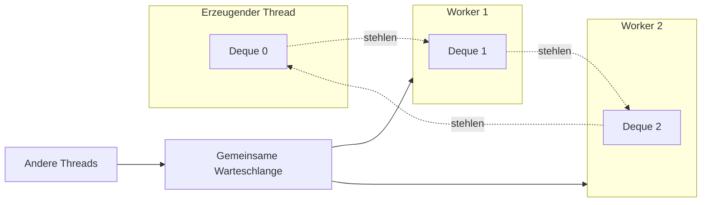

- `run(f, &counter)` legt einen Job in die Deque des aufrufenden Threads; `wait(counter)` arbeitet
  Jobs ab, bis der Zähler null ist.
- `TaskGraph` beschreibt Aufgaben mit Vorgängern und kann jeden Frame erneut laufen.
- `parallel_for(count, grain, f)` teilt einen Bereich auf.
- Jobs sollen kurz sein und nicht auf E/A warten. Ein Funktionsobjekt darf höchstens 80 Bytes groß
  sein; größere Daten übergibt man per Zeiger.

## Welt

Spielzustand lebt in `ngine.world` ([ADR 0003](adr/0003-ecs-flecs.md)). Dahinter steckt flecs;
nur `engine/world/world.cpp` bindet die Bibliothek ein.

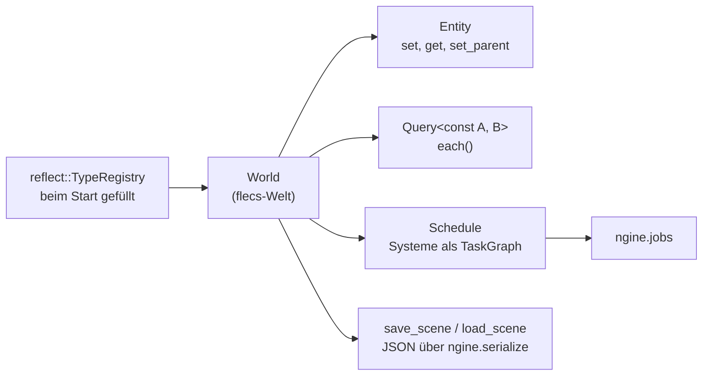

- **Komponenten** sind Structs, die in der Reflection registriert sind
  ([ADR 0018](adr/0018-own-reflection.md)). Die Welt meldet sie beim ersten Gebrauch bei flecs an
  und gibt flecs die Konstruktoren, Kopier- und Verschiebefunktionen aus dem `TypeInfo`.
  Anzeigenamen sind die Komponente `world::Name`; `world::register_types()` registriert sie.
- **Entities** sind Griffe aus Welt und 64-Bit-Kennung. Kennungen tragen eine Generation, alte
  Griffe werden nach `destroy()` nicht wieder lebendig.
- **Hierarchie** über die `ChildOf`-Beziehung von flecs: ein Elternteil pro Entity, Kinder
  verschwinden mit dem Elternteil.
- **Transforms** ([ADR 0025](adr/0025-own-math-mixed-precision.md)): `Transform` ist die Lage
  relativ zum Elternteil mit 64-Bit-Position und wird gespeichert. `WorldTransform` (ein
  `math::Affine`) kommt über `World::require()` automatisch dazu, ist `transient` und wird von
  `update_transforms()` nach `Schedule::run()` berechnet: eine Abfrage mit Cascade besucht Eltern
  vor Kindern. Seit R2.3 nur geänderte Teilbäume (`World::for_each_parent_first_changed()`): Die
  Änderungserkennung von flecs meldet Tabellen, deren `Transform` geschrieben wurde oder die neue,
  umgehängte oder gelöschte Entities haben; flecs sieht keine Änderung beim Elternteil, deshalb
  merkt sich der Durchlauf die geschriebenen Bereiche von `WorldTransform` und rechnet Kinder
  neu, deren Elternteil darin liegt. Wer `Transform` über `get_mut()` ändert, ruft danach
  `modified()`; `set()`, Befehle und Systeme im Schedule tun das von selbst. `world_affine()`
  rechnet die Weltlage einer einzelnen Entity direkt aus den Transforms der Vorfahren.
- **Abfragen** (`world.query<const A, B>()`) merken sich ihre Tabellen. Strukturänderungen in
  `each()` werden aufgeschoben und nach der Schleife ausgeführt.
- **Systeme** plant `Schedule` ([ADR 0019](adr/0019-systems-on-job-system.md)): Aus `const`
  ergeben sich Lese- und Schreibzugriffe, Systeme ohne Konflikt laufen parallel. Vor dem Lauf
  sammelt der Hauptthread die Chunks; in Jobs ruft niemand flecs auf. Während der Systeme sind
  Änderungen über die Welt verboten.
- **Szenen** sind JSON ([ADR 0020](adr/0020-scene-format-json.md)) mit Datei-IDs, Eltern und
  Komponenten nach Namen. Unbekannte Komponenten und Felder werden übersprungen, Komponenten mit
  `transient` gar nicht erst geschrieben.

Eine Welt gehört einem Thread. Die Registry muss die Welt überleben und darf nach dem Start nicht
mehr wachsen.

### Kamerarelatives Zeichnen

Weltpositionen sind 64 Bit ([ADR 0012](adr/0012-64bit-world-coordinates.md)); die GPU rechnet in
32 Bit. Die Grenze liegt in `math::Affine::relative_to(kamera)`: Die Differenz zwischen Objekt und
Kamera entsteht in 64 Bit, erst das kleine Ergebnis wird gerundet. Die Blickmatrix enthält nur die
Drehung der Kamera.

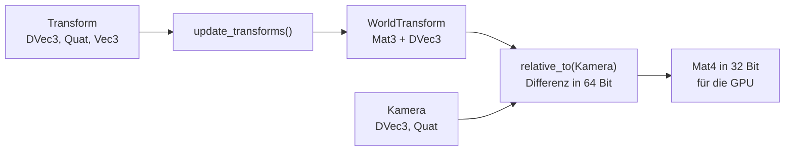

## GPU-getriebenes Zeichnen

Seit R3.5 zeichnet der Renderer jedes Netz als Instanz aus Meshlets
([ADR 0043](adr/0043-gpu-driven-meshlets.md)). Die CPU sammelt nur Instanzen (Teilnetze der
MeshRenderer, Chunks der Terrains) und ordnet ihre Meshlets in Gruppen zu 32; welche Meshlets
gezeichnet werden, entscheidet die GPU.

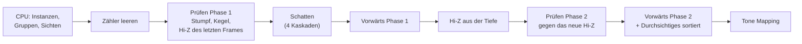

- Mit Mesh Shadern prüft ein Task-Shader je Gruppe und startet je sichtbarem Meshlet einen
  Mesh-Shader; das Prüfen steckt im Draw selbst. Ohne die Stufe schreibt ein Compute-Shader je
  sichtbarem Meshlet einen indirekten Draw, gezeichnet mit `draw_indexed_indirect_count()` je
  Kategorie und Geometrieblock. Beide Pfade lesen dieselben Puffer und dieselben Shader-Funktionen.
- Kategorien: Terrain, undurchsichtig, maskiert, je einseitig und doppelseitig; jede hat ihre
  Pipelines für Vorwärts, Schatten und Auswahl. Durchsichtiges zeichnet die CPU sortiert.
- Zwei Hi-Z-Pyramiden wechseln sich ab. Phase 2 zeichnet nur, was Phase 1 als verdeckt verworfen
  hat und jetzt sichtbar ist; so fehlt nach schnellen Drehungen nichts.

## Voxel-Terrain

`ngine.voxel` hält das Terrain als Dichtefeld und erzeugt daraus Netze
([ADR 0005](adr/0005-smooth-voxel-terrain.md), [ADR 0021](adr/0021-surface-nets-8bit-density.md),
[ADR 0038](adr/0038-terrain-chunks-shared-geometry.md)). Es kennt weder GPU noch Welt, damit der
Server Terrain halten und bearbeiten kann. `ngine.world` macht daraus eine Komponente,
`ngine.render` zeichnet sie.

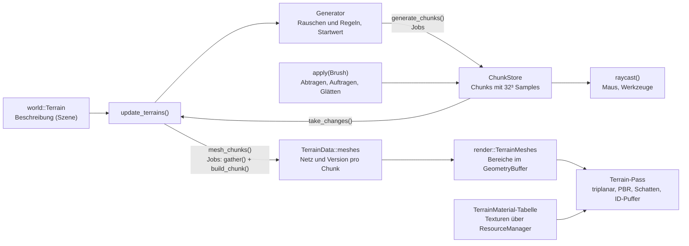

- Ein `Sample` speichert den Abstand zur Oberfläche in 8 Bit (positiv innen, 1/32 Voxel pro
  Schritt) und ein Material (0 ist Luft). Ein Voxel misst 0,5 m.
- Ein `Chunk` besitzt 32³ Samples (16 m); Chunk-Koordinaten sind `i32`, Sample-Koordinaten `i64`,
  die Lage in Metern kommt als `DVec3` aus `chunk_position()`. Leere und volle Chunks halten nur
  einen Wert (`compact()`), Samples außerhalb aller Chunks haben den Wert `outside` des Stores.
- Nahtlos: `gather()` kopiert einen Chunk mit einer Randschicht von je 2 Samples aus den Nachbarn
  in ein Gitter mit 36³ Samples. `Mesher::build_chunk()` legt Eckpunkte in allen Zellen ab, die
  Vierecke berühren, erzeugt Vierecke aber nur für Kanten, die an eigenen Samples beginnen. So
  entsteht jedes Viereck genau einmal, Eckpunkte an der Grenze liegen in beiden Chunks gleich.
- Der Store merkt sich, welche Chunks ein geändertes Sample lesen, auch solche, die es noch nicht
  gibt; am Rand des Terrains entstehen so die Netze, die das Terrain wie einen Block schließen.
- `mesh_chunks()` meshet über `parallel_for`, je Job ein eigener `Mesher` mit eigenem Gitter. Das
  Terrain nutzt nur die Position der Entity; Drehung und Skalierung wirken nicht.
- Der `Generator` (R3.2, [ADR 0039](adr/0039-deterministic-noise-rule-generator.md)) füllt Chunks
  aus Regeln: Höhe aus verzerrten Hügeln und Felsrücken mit Terrassen, Überhänge aus 3D-Rauschen an
  steilen Stellen, Tunnel und Kavernen, Schichten Gras, Erde, Fels und Sand. Er rechnet nur mit
  exakt festgelegten Operationen in `f64` (ohne FMA), damit derselbe Startwert überall bitgleiche
  Chunks ergibt; ein Test prüft die Prüfsumme unter Linux und Windows. 3D-Werte liegen auf einem
  globalen Gitter mit Abstand 4 Samples und werden interpoliert.
- Materialien (R3.2, [ADR 0040](adr/0040-terrain-materials-weights-triplanar.md)): Jeder Eckpunkt
  trägt acht Gewichte zu je 8 Bit für die Palette seines Netzes. Der Terrain-Shader liest jedes
  Material triplanar aus der Tabelle `GpuTerrainMaterial` und mischt nach den Gewichten.
- LOD und Streaming (R3.3, [ADR 0041](adr/0041-lod-octree-surface-nets-streaming.md)): Ein
  endloses Terrain (`Terrain::streaming`) hält einen Baum von Chunks; ein Chunk der Stufe n deckt
  32·2ⁿ Voxel mit 32³ Samples ab. `select_lod()` wählt die Blätter um alle Beobachter (Entities mit
  `TerrainObserver` und `TerrainUpdate::observers`), 2:1 ausgeglichen. Der `Streamer` erzeugt
  fehlende Chunks und ihre Netze im Job-System und übernimmt eine Auswahl erst, wenn alle da sind;
  der `LodMesher` schließt die Grenzen zwischen Stufen mit Nahtpolygonen. Terrains fester Größe nutzen
  weiter `mesh_chunks()`.

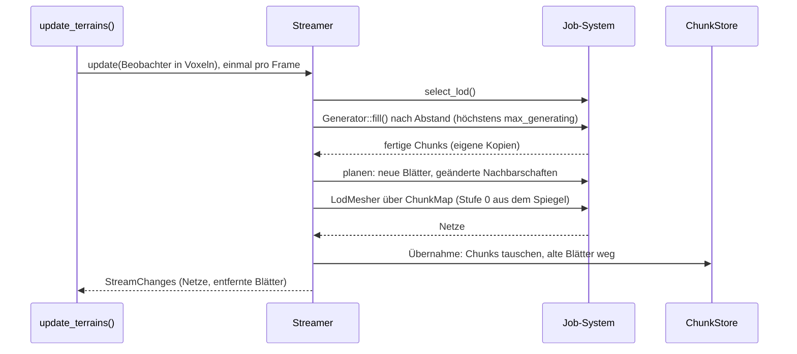

- Laufzeitdaten (Chunks, Netze) liegen in der transienten Komponente `TerrainState` und werden
  nicht gespeichert; nach dem Laden entsteht das Terrain neu aus der Beschreibung und seinen
  Deltas.
- Deltas (R3.4, [ADR 0042](adr/0042-terrain-deltas-region-files.md)): Pinsel ändern Samples der
  Stufe 0. `TerrainDeltas` hält pro Chunk der Stufe 0 die Abweichung von der Grundwelt als
  unveränderliches `ChunkDelta` (Lauflängen mit Varints). Jobs bekommen eine Momentaufnahme der
  Tabelle, der Hauptthread kopiert beim Schreiben. Beim Erzeugen rechnet `apply_deltas()` sie in
  jede Stufe ein: grobe Chunks übernehmen geänderte Samples, die auf ihrem Raster liegen. Nach
  einem Pinsel erzeugt der `Streamer` betroffene grobe Blätter neu (`invalidate()`), Chunks, die
  gerade erzeugt werden, gelten bei der Übernahme als veraltet und werden nachgebaut.
- Gespeichert werden nur die Deltas, als Regionen-Dateien (16³ Chunks je Datei) im Ordner
  `<Szene>.terrain` neben der Szene; `Terrain::deltas` nennt den Ordner. Im Editor sind Pinsel
  Befehle mit den Deltas vorher und nachher; Spielen, Löschen und Undo behalten sie über die
  Sicherung im Dokument.

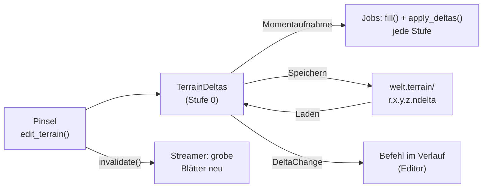

## Scripting

`ngine.script` bettet .NET 10 ein ([ADR 0006](adr/0006-csharp-scripting-dotnet.md),
[ADR 0023](adr/0023-dotnet-hosting-hostfxr.md)). Nur `engine/script/runtime.cpp` kennt hostfxr.

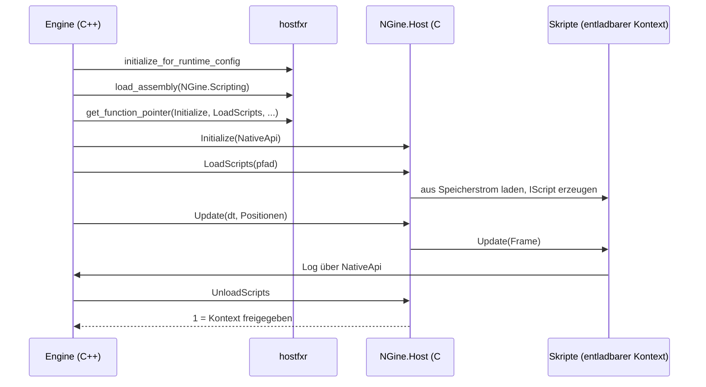

- Es gibt höchstens eine Laufzeit pro Prozess; .NET lässt sich nicht entladen. Neu geladen werden
  nur die Skripte.
- Aufrufe laufen über Funktionszeiger (`[UnmanagedCallersOnly]` bzw. `delegate* unmanaged`), ohne
  Marshalling: Texte sind UTF-8 mit Länge, gemeinsame Daten blittable Structs.
- Die Assemblies baut `cmake/NgineDotnet.cmake` mit dem .NET-SDK nach `build/<preset>/dotnet/`.
  Ohne SDK baut der C++-Teil weiter, und `ScriptRuntime::create()` meldet die fehlende Assembly.

## Netzwerk

`ngine.net` und `ngine.replication` laufen ohne Fenster und GPU, damit der dedizierte Server
dieselbe Engine nutzt ([ADR 0007](adr/0007-server-authoritative-multiplayer.md),
[ADR 0024](adr/0024-networking-gns-snapshots.md)). Nur `engine/net/transport_gns.cpp` kennt
GameNetworkingSockets.

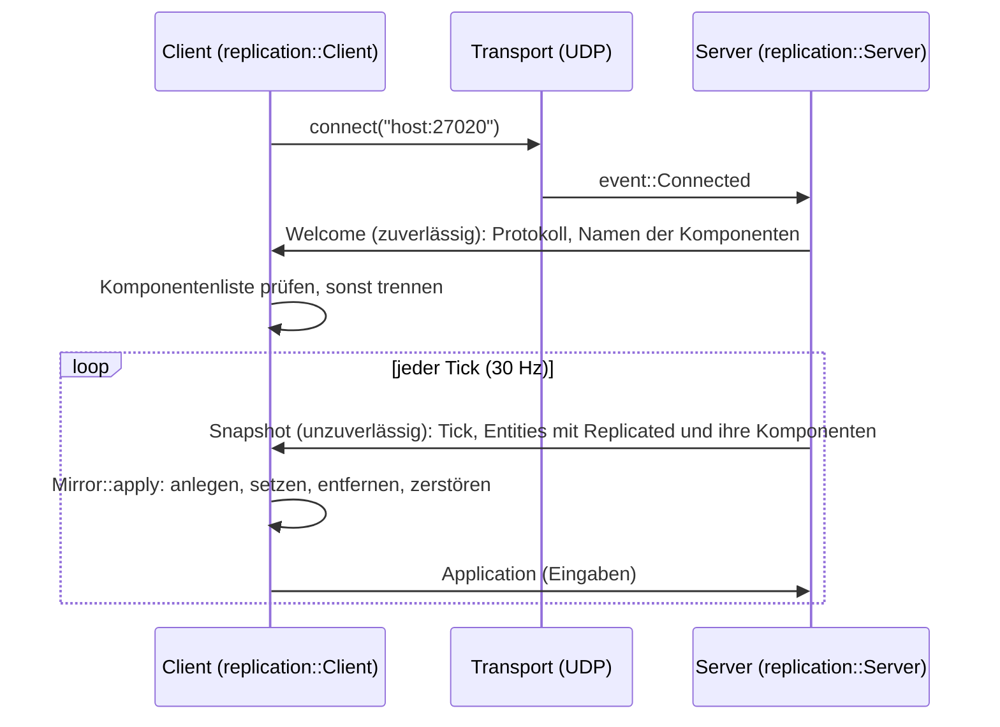

- Ein `Transport` ist Server (`listen`), Client (`connect`) oder beides. `poll()` liefert
  Verbindungs- und Nachrichtenereignisse; Rückrufe der Bibliothek laufen nur darin, im Thread des
  Aufrufers. Port 0 wählt einen zufälligen freien Port.
- Repliziert werden Entities mit der Komponente `Replicated`, und von ihnen nur die Komponenten der
  Liste, die Server und Client gleich festlegen. Die Felder schreibt `serialize::write_binary`
  über die Reflection; neue Komponenten brauchen keinen Netzwerkcode.
- Der Client hält eine Zuordnung von Server-Kennungen zu eigenen Entities (`Mirror`). Eigene
  Entities des Clients (Kamera, UI) bleiben unberührt; gespiegelte tragen
  `Replicated::server_id`.
- Jeder Schnappschuss enthält den vollen Zustand. Geht einer verloren, korrigiert ihn der nächste;
  ältere, die zu spät kommen, werden verworfen. Deltas, Relevanz und Vorhersage kommen in R5.
