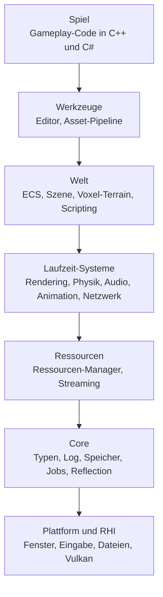
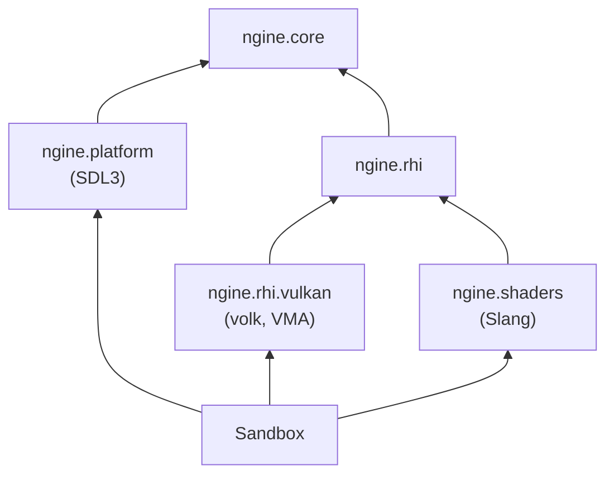

# Architektur

NGine ist in Schichten gebaut. Jede Schicht darf nur Schichten unter sich benutzen, nie umgekehrt.
Jedes System ist ein C++-Modul (`ngine.<system>`) mit eigenem CMake-Ziel (`ngine::<system>`).

## Schichten

Die Pfeile zeigen „darf benutzen“. Die Werkzeuge stehen über der Welt, weil der Editor die Welt
bearbeitet; das Spiel nutzt die Werkzeuge nur im Editor-Build.

## Module heute

| Modul | CMake-Ziel | Inhalt | Status |
| --- | --- | --- | --- |
| `ngine.core` | `ngine::core` | Partitionen `types`, `log`, `check`, `version` | vorhanden |
| `ngine.platform` | `ngine::platform` | Fenster und Ereignisse über SDL3 (nur mit `NGINE_WITH_WINDOW`) | vorhanden |
| `ngine.rhi` | `ngine::rhi` | API-unabhängige Schnittstelle: Device, Texture, Shader, Pipeline, CommandList | vorhanden |
| `ngine.rhi.vulkan` | `ngine::rhi_vulkan` | Vulkan-1.4-Backend mit volk und VMA; interne Partitionen `common`, `instance`, `physical_device`, `resources`, `command_list`, `swapchain` | vorhanden |
| `ngine.shaders` | `ngine::shaders` | Eingebaute Slang-Shader als SPIR-V | vorhanden |

Geplante Module, in der Reihenfolge der [Roadmap](roadmap.md): `ngine.jobs`, `ngine.world`,
`ngine.voxel`, `ngine.script`, `ngine.net`.

Plattform und RHI kennen sich nicht. Die Sandbox verbindet sie: Sie übergibt der RHI eine
`SurfaceDesc`, deren Funktionen das Fenster bereitstellt ([ADR 0013](adr/0013-rhi-design.md)).

## Regeln

- **Abhängigkeiten nur nach unten.** Ein Modul darf kein Modul einer höheren Schicht importieren.
- **Fremdbibliotheken nur in Adaptern** ([ADR 0009](adr/0009-third-party-behind-interfaces.md)). Ein
  Adapter bindet die Bibliothek im globalen Modulfragment ein und exportiert nur Engine-Typen.
- **Headless zuerst.** Alles unterhalb des Renderings muss ohne Fenster und GPU laufen, weil der
  dedizierte Server so startet ([ADR 0007](adr/0007-server-authoritative-multiplayer.md)).
- **Daten im ECS.** Spielzustand lebt in ECS-Komponenten, damit Speichern, Netzwerk und Editor ihn
  einheitlich behandeln ([ADR 0003](adr/0003-ecs-flecs.md)).
- **Plattformcode nur in der Plattformschicht.** Keine `#ifdef _WIN32` außerhalb von Adaptern.
- **Große Module teilen.** Was nur das Modul selbst braucht, steht in internen Partitionen
  (`module ngine.<system>:<teil>;` ohne `export`). CMake führt sie in einem privaten
  `CXX_MODULES`-File-Set; außerhalb des Moduls sind sie unsichtbar. Eine Datei soll eine Aufgabe haben.

## Verzeichnisse

| Pfad | Inhalt |
| --- | --- |
| `engine/<system>/` | Ein Engine-System |
| `apps/sandbox/` | Testanwendung, an der jede Iteration sichtbar wird |
| `apps/editor/` | Editor (ab R2) |
| `tests/<system>/` | Catch2-Tests, gespiegelt zur Engine |
| `cmake/` | Gemeinsame CMake-Funktionen |
| `docs/` | Diese Dokumentation |
