# Architektur

NGine ist in Schichten gebaut. Jede Schicht darf nur Schichten unter sich benutzen, nie umgekehrt.
Jedes System ist ein C++-Modul (`ngine.<system>`) mit eigenem CMake-Ziel (`ngine::<system>`).

## Schichten

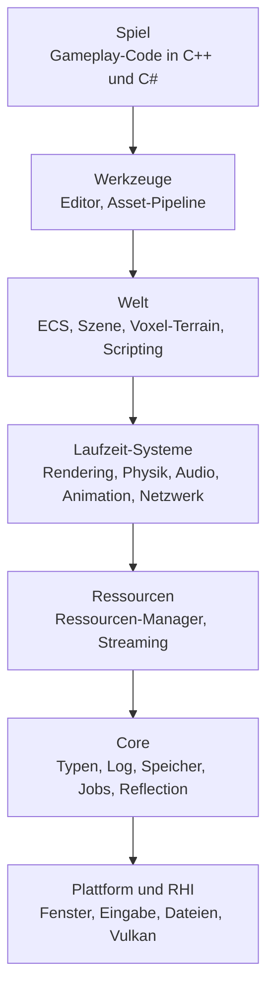

Die Pfeile zeigen „darf benutzen“. Die Werkzeuge stehen über der Welt, weil der Editor die Welt
bearbeitet; das Spiel nutzt die Werkzeuge nur im Editor-Build.

## Module heute

| Modul | CMake-Ziel | Inhalt | Status |
| --- | --- | --- | --- |
| `ngine.core` | `ngine::core` | Partitionen `types`, `log`, `check`, `version`; interne Partition `console` stellt die Windows-Konsole auf UTF-8 (`console_windows.cpp`/`console_posix.cpp`) | vorhanden |
| `ngine.math` | `ngine::math` | Eigene Mathematik: `Vec3`, `DVec3`, `Mat4`, `Quat` …, Projektionen und Blickmatrix nach den Konventionen der Engine, `Affine` mit 64-Bit-Verschiebung ([ADR 0025](adr/0025-own-math-mixed-precision.md)) | vorhanden |
| `ngine.memory` | `ngine::memory` | CPU-Allokatoren als `std::pmr::memory_resource` (`LinearAllocator`, `FrameAllocator`, `PoolAllocator`, `ObjectPool`) und Budget pro Kategorie | vorhanden |
| `ngine.jobs` | `ngine::jobs` | Job-System mit Work-Stealing, `Counter`, `TaskGraph`, `parallel_for` ([ADR 0015](adr/0015-own-job-system.md)) | vorhanden |
| `ngine.profile` | `ngine::profile` | Profiling-Zonen, Frame-Marken, Plots; Adapter für Tracy, Makros in `<ngine/profile.hpp>` ([ADR 0016](adr/0016-profiling-macros.md)) | vorhanden |
| `ngine.filesystem` | `ngine::filesystem` | Dateien lesen und schreiben (atomar über temporäre Datei), Benutzerordner; Pfade als UTF-8, Plattformcode in `user_dir_linux.cpp`/`user_dir_windows.cpp` | vorhanden |
| `ngine.reflect` | `ngine::reflect` | Typinformationen (`TypeRegistry`, `TypeInfo`, Felder, `TypeOps`, Merkmal `transient` für berechnete Komponenten) über eine Builder-API ([ADR 0018](adr/0018-own-reflection.md)) | vorhanden |
| `ngine.serialize` | `ngine::serialize` | JSON (`json::Value`, `parse`, `write`), Binärformat (`BinaryWriter`/`BinaryReader`) und beides für reflektierte Typen ([ADR 0020](adr/0020-scene-format-json.md)) | vorhanden |
| `ngine.world` | `ngine::world` | ECS-Adapter für flecs: `World`, `Entity`, `Query`, Hierarchie, `Schedule` für Systeme ([ADR 0019](adr/0019-systems-on-job-system.md)), Szenen speichern und laden; `Transform`, `WorldTransform` und `update_transforms()` ([ADR 0025](adr/0025-own-math-mixed-precision.md)) | vorhanden |
| `ngine.voxel` | `ngine::voxel` | Voxel-Terrain ohne GPU (Vektoren aus `ngine.math`): Dichtefeld (`Grid`, 8-Bit-Dichte und Material), Surface Nets (`Mesher`), Pinsel und Strahltest ([ADR 0021](adr/0021-surface-nets-8bit-density.md)) | vorhanden (Durchstich D1) |
| `ngine.script` | `ngine::script` | C#-Scripting: `ScriptRuntime` startet .NET 10 über hostfxr, lädt Skripte in einen entladbaren Kontext, Aufrufe in beide Richtungen ([ADR 0023](adr/0023-dotnet-hosting-hostfxr.md)); Plattformcode in `native_linux.cpp`/`native_windows.cpp`, verwalteter Teil `NGine.Scripting` unter `engine/script/managed/` | vorhanden (Durchstich D2) |
| `ngine.net` | `ngine::net` | Netzwerk-Transport: `Transport` mit Verbindungen, zuverlässigen und unzuverlässigen Nachrichten über UDP; Adapter für GameNetworkingSockets in `transport_gns.cpp` ([ADR 0024](adr/0024-networking-gns-snapshots.md)) | vorhanden (Durchstich D3) |
| `ngine.replication` | `ngine::replication` | Replikation der Welt: Schnappschüsse ausgewählter Komponenten (`encode_snapshot`, `Mirror`), `Server` und `Client` über einem `Transport` ([ADR 0024](adr/0024-networking-gns-snapshots.md)) | vorhanden (Durchstich D3) |
| `ngine.platform` | `ngine::platform` | Fenster und Ereignisse über SDL3 (Tastatur, Maus; nur mit `NGINE_WITH_WINDOW`) | vorhanden |
| `ngine.rhi` | `ngine::rhi` | API-unabhängige Schnittstelle: Device, Texture (Verwendungen, bindlose Indizes), Buffer (Geräteadresse, GPU- oder CPU-Speicher), Sampler, Shader, Grafik- und Compute-Pipeline, CommandList mit Barrieren über `ResourceState`, Push Constants, Zeichnen und Dispatch; `upload()` über Staging; `Capabilities` mit den optionalen `Features` der GPU ([ADR 0026](adr/0026-render-graph-bindless.md)) | vorhanden |
| `ngine.rhi.vulkan` | `ngine::rhi_vulkan` | Vulkan-Backend (Pflicht 1.3, optional 1.4, Mesh Shader, Raytracing; [ADR 0017](adr/0017-platform-baseline-feature-tiers.md)) mit volk und VMA; exportierte Partition `requirements` (Auswertung der Anforderungen, ohne GPU testbar) und `headless_surface()` für Tests, interne Partitionen `common`, `context` (Timeline, Löschliste, bindloser Satz), `instance`, `physical_device`, `resources`, `command_list`, `upload`, `swapchain` | vorhanden |
| `ngine.render` | `ngine::render` | Renderer (Laufzeit-Schicht, kennt nur die RHI): `RenderGraph` mit Passes, importierten und transienten Ressourcen, Plan ohne GPU (`compile()`), `TexturePool` ([ADR 0026](adr/0026-render-graph-bindless.md)) | vorhanden (ab R1.2) |
| `ngine.shaders` | `ngine::shaders` | Eingebaute Slang-Shader als SPIR-V (Dreieck, Voxel-Terrain, Vollbild-Kopie, Testmuster als Compute); `bindless.slang` für den gemeinsamen Descriptor-Satz | vorhanden |

Die Durchstiche D1 bis D3 haben die geplanten Module der Ausarbeitung angelegt. In R1 kommen
`ngine.math` (R1.1) und der Renderer `ngine.render` (ab R1.2) dazu.

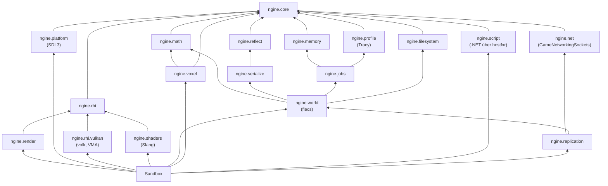

Plattform und RHI kennen sich nicht. Die Sandbox verbindet sie: Sie übergibt der RHI eine
`SurfaceDesc`, deren Funktionen das Fenster bereitstellt ([ADR 0013](adr/0013-rhi-design.md)).

### Feature-Stufen der GPU

Beim Start prüft das Vulkan-Backend jede GPU gegen die Mindestanforderung und erkennt die optionalen
Stufen ([ADR 0017](adr/0017-platform-baseline-feature-tiers.md)). Der Renderer fragt
`device.capabilities().features` ab und wählt danach seinen Pfad; Vulkan-Typen sieht er dabei nicht.

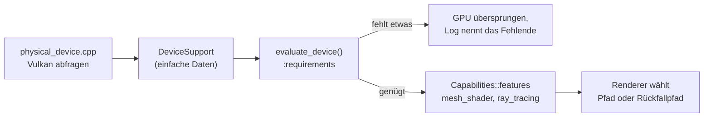

`DeviceDesc::disabled_features` schaltet Stufen ab, auch wenn die GPU sie kann. So laufen Tests und
die Sandbox (`--baseline`) auf jeder Hardware auch über die Rückfallpfade.

### Geometrie und Puffer

Pipelines haben keine Vertex-Attribute. Der Vertex-Shader liest seine Eckpunkte selbst über die
Geräteadresse eines `Buffer` (Vertex Pulling, [ADR 0022](adr/0022-vertex-pulling-bda.md)); die
Adresse und kleine Daten pro Draw kommen über Push Constants (128 Bytes pro Pipeline). Indizes
bleiben ein gebundener Indexpuffer mit 32 Bit.

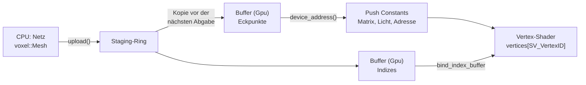

Statische Geometrie liegt im GPU-Speicher (`MemoryUsage::Gpu`) und wird über `Device::upload()`
gefüllt: Die Daten landen in einem Staging-Ring, die Kopien in einem eigenen Command Buffer, der vor
der nächsten Abgabe auf derselben Queue läuft. Barrieren davor und danach sorgen dafür, dass frühere
Frames mit dem Puffer fertig sind und spätere die neuen Daten sehen; die CPU wartet nie.
`MemoryUsage::CpuWrite` bleibt für Daten, die die CPU jeden Frame schreibt; davon hält man einen
Puffer pro Frame im Flug (`Frame::index`).

### Render-Graph, Barrieren und Bindless

Die RHI setzt keine Barrieren von selbst und merkt sich keine Zustände. Wer aufzeichnet, beschreibt
Übergänge mit `ResourceState` vorher und nachher; das Vulkan-Backend übersetzt sie in Stufen,
Zugriffe und Layouts ([ADR 0026](adr/0026-render-graph-bindless.md)). Im Renderer übernimmt das der
Render-Graph:

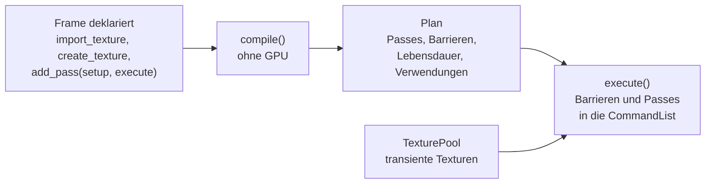

- `compile()` verwirft Passes ohne Abnehmer (nur Schreiben auf Ressourcen, die niemand braucht),
  setzt vor jedem Pass die nötigen Barrieren (Zustandswechsel und jedes Schreiben nach einem
  Schreiben) und am Ende die Endzustände importierter Ressourcen, z. B. `Present` für den
  Backbuffer.
- Transiente Texturen beschreibt man nur mit Größe und Format; die Verwendungen folgen aus den
  Zuständen. Der `TexturePool` gibt dieselbe Textur im nächsten Frame wieder aus.
- Shader erreichen Texturen und Sampler über einen bindlosen Descriptor-Satz (`bindless.slang`):
  Satz 0 mit Texturen zum Lesen, Samplern und Storage-Texturen. Die Indizes vergibt die RHI beim
  Erzeugen (`sampled_index()`, `storage_index()`, `Sampler::index()`).

### Lebensdauer von GPU-Ressourcen

Jede Abgabe an die Queue signalisiert den nächsten Wert eines Timeline Semaphores. Daran hängen
die Frames im Flug (ein Frame wartet auf den Wert seines Vorgängers mit demselben Platz), der
Staging-Speicher und die Löschliste: Zerstört der Aufrufer eine Ressource, gibt das Backend sie und
ihren bindlosen Index erst frei, wenn die GPU alle Abgaben bis dahin abgearbeitet hat. Auch die
alte Swapchain kommt nach einem Neuaufbau in die Löschliste, mit zwei Abgaben Abstand für die
Präsentation (TD-18); `vkDeviceWaitIdle` gibt es nur noch beim Beenden.

## Regeln

- **Abhängigkeiten nur nach unten.** Ein Modul darf kein Modul einer höheren Schicht importieren.
- **Fremdbibliotheken nur in Adaptern** ([ADR 0009](adr/0009-third-party-behind-interfaces.md)). Ein
  Adapter bindet die Bibliothek im globalen Modulfragment ein und exportiert nur Engine-Typen.
- **Headless zuerst.** Alles unterhalb des Renderings muss ohne Fenster und GPU laufen, weil der
  dedizierte Server so startet ([ADR 0007](adr/0007-server-authoritative-multiplayer.md)).
- **Daten im ECS.** Spielzustand lebt in ECS-Komponenten, damit Speichern, Netzwerk und Editor ihn
  einheitlich behandeln ([ADR 0003](adr/0003-ecs-flecs.md)).
- **Plattformcode nur in der Plattformschicht.** Keine `#ifdef _WIN32` außerhalb von Adaptern.
- **Große Module teilen.** Was nur das Modul selbst braucht, steht in internen Partitionen
  (`module ngine.<system>:<teil>;` ohne `export`). CMake führt sie in einem privaten
  `CXX_MODULES`-File-Set; außerhalb des Moduls sind sie unsichtbar. Eine Datei soll eine Aufgabe haben.

## Verzeichnisse

| Pfad | Inhalt |
| --- | --- |
| `engine/<system>/` | Ein Engine-System |
| `apps/sandbox/` | Testanwendung, an der jede Iteration sichtbar wird |
| `apps/editor/` | Editor (ab R2) |
| `tests/<system>/` | Catch2-Tests, gespiegelt zur Engine |
| `cmake/` | Gemeinsame CMake-Funktionen |
| `docs/` | Diese Dokumentation |

## Speicher

CPU-Speicher, der häufig oder in großen Mengen angefordert wird, kommt aus den Allokatoren von
`ngine.memory`. Sie erben von `std::pmr::memory_resource`, damit Standardcontainer wie
`std::pmr::vector` sie direkt nutzen können.

| Allokator | Lebensdauer | Threads |
| --- | --- | --- |
| `LinearAllocator` | bis `reset()` oder `rewind()` | ein Thread |
| `FrameAllocator` | ein Frame, ein Bereich pro Frame im Flug | Anfordern lock-frei aus allen Threads |
| `PoolAllocator`, `ObjectPool<T>` | einzeln freigebbar, feste Blockgröße | ein Thread |
| `TrackingResource` | wie der darunterliegende Allokator | wie der darunterliegende Allokator |

Jeder Allokator verbucht seinen Speicher in einer `memory::Category`. Pro Kategorie gibt es
aktuellen Verbrauch, Spitze und ein optionales Budget, dessen Überschreitung das Log meldet. GPU-Speicher
verwaltet weiterhin VMA in der RHI.

## Jobs

Parallele Arbeit läuft über `ngine.jobs` ([ADR 0015](adr/0015-own-job-system.md)). Die Anwendung
erzeugt ein `JobSystem`; es startet einen Worker pro Kern minus eins.

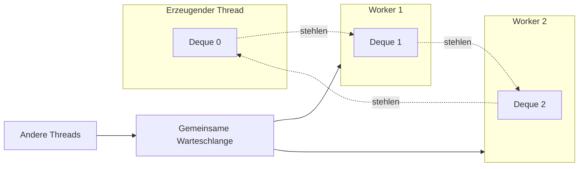

- `run(f, &counter)` legt einen Job in die Deque des aufrufenden Threads; `wait(counter)` arbeitet
  Jobs ab, bis der Zähler null ist.
- `TaskGraph` beschreibt Aufgaben mit Vorgängern und kann jeden Frame erneut laufen.
- `parallel_for(count, grain, f)` teilt einen Bereich auf.
- Jobs sollen kurz sein und nicht auf E/A warten. Ein Funktionsobjekt darf höchstens 80 Bytes groß
  sein; größere Daten übergibt man per Zeiger.

## Welt

Spielzustand lebt in `ngine.world` ([ADR 0003](adr/0003-ecs-flecs.md)). Dahinter steckt flecs;
nur `engine/world/world.cpp` bindet die Bibliothek ein.

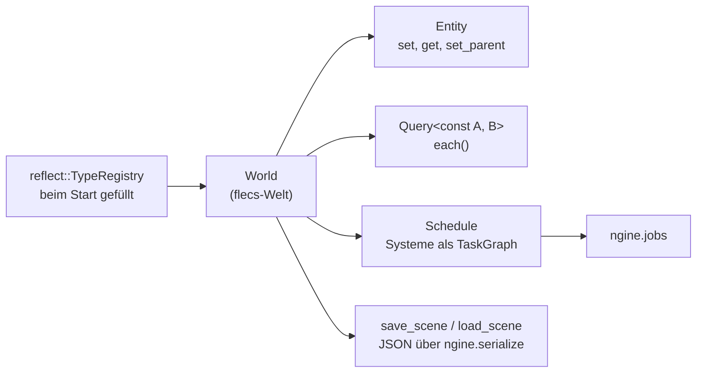

- **Komponenten** sind Structs, die in der Reflection registriert sind
  ([ADR 0018](adr/0018-own-reflection.md)). Die Welt meldet sie beim ersten Gebrauch bei flecs an
  und gibt flecs die Konstruktoren, Kopier- und Verschiebefunktionen aus dem `TypeInfo`.
  Anzeigenamen sind die Komponente `world::Name`; `world::register_types()` registriert sie.
- **Entities** sind Griffe aus Welt und 64-Bit-Kennung. Kennungen tragen eine Generation, alte
  Griffe werden nach `destroy()` nicht wieder lebendig.
- **Hierarchie** über die `ChildOf`-Beziehung von flecs: ein Elternteil pro Entity, Kinder
  verschwinden mit dem Elternteil.
- **Transforms** ([ADR 0025](adr/0025-own-math-mixed-precision.md)): `Transform` ist die Lage
  relativ zum Elternteil mit 64-Bit-Position und wird gespeichert. `WorldTransform` (ein
  `math::Affine`) kommt über `World::require()` automatisch dazu, ist `transient` und wird von
  `update_transforms()` nach `Schedule::run()` berechnet: eine Abfrage mit Cascade
  (`World::for_each_parent_first()`) besucht Eltern vor Kindern.
- **Abfragen** (`world.query<const A, B>()`) merken sich ihre Tabellen. Strukturänderungen in
  `each()` werden aufgeschoben und nach der Schleife ausgeführt.
- **Systeme** plant `Schedule` ([ADR 0019](adr/0019-systems-on-job-system.md)): Aus `const`
  ergeben sich Lese- und Schreibzugriffe, Systeme ohne Konflikt laufen parallel. Vor dem Lauf
  sammelt der Hauptthread die Chunks; in Jobs ruft niemand flecs auf. Während der Systeme sind
  Änderungen über die Welt verboten.
- **Szenen** sind JSON ([ADR 0020](adr/0020-scene-format-json.md)) mit Datei-IDs, Eltern und
  Komponenten nach Namen. Unbekannte Komponenten und Felder werden übersprungen, Komponenten mit
  `transient` gar nicht erst geschrieben.

Eine Welt gehört einem Thread. Die Registry muss die Welt überleben und darf nach dem Start nicht
mehr wachsen.

### Kamerarelatives Zeichnen

Weltpositionen sind 64 Bit ([ADR 0012](adr/0012-64bit-world-coordinates.md)); die GPU rechnet in
32 Bit. Die Grenze liegt in `math::Affine::relative_to(kamera)`: Die Differenz zwischen Objekt und
Kamera entsteht in 64 Bit, erst das kleine Ergebnis wird gerundet. Die Blickmatrix enthält nur die
Drehung der Kamera.

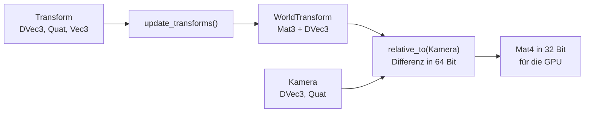

## Voxel-Terrain

`ngine.voxel` hält das Terrain als Dichtefeld und erzeugt daraus Netze
([ADR 0005](adr/0005-smooth-voxel-terrain.md), [ADR 0021](adr/0021-surface-nets-8bit-density.md)).
Es kennt weder GPU noch Welt, damit der Server Terrain halten und bearbeiten kann.

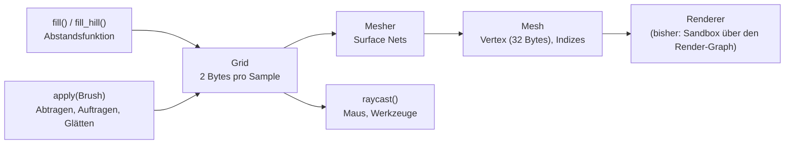

- Ein `Sample` speichert den Abstand zur Oberfläche in 8 Bit (positiv innen, 1/32 Voxel pro
  Schritt) und ein Material (0 ist Luft). Koordinaten sind Sample-Indizes; ein Chunk mit 32 Voxeln
  hat 33 Samples pro Achse.
- `Grid::version()` steigt mit jeder Änderung; der Aufrufer meshet neu, wenn sie sich ändert.
- Der `Mesher` behält seine Zwischenspeicher und gehört einem Thread. Am Rand des Gitters bleibt
  das Netz offen; nahtlose Chunks, Meshing in Jobs und LOD kommen in R3.

## Scripting

`ngine.script` bettet .NET 10 ein ([ADR 0006](adr/0006-csharp-scripting-dotnet.md),
[ADR 0023](adr/0023-dotnet-hosting-hostfxr.md)). Nur `engine/script/runtime.cpp` kennt hostfxr.

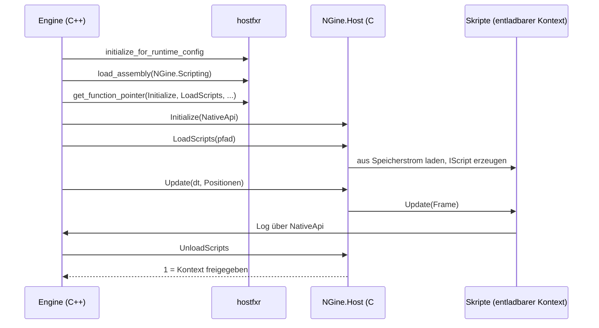

- Es gibt höchstens eine Laufzeit pro Prozess; .NET lässt sich nicht entladen. Neu geladen werden
  nur die Skripte.
- Aufrufe laufen über Funktionszeiger (`[UnmanagedCallersOnly]` bzw. `delegate* unmanaged`), ohne
  Marshalling: Texte sind UTF-8 mit Länge, gemeinsame Daten blittable Structs.
- Die Assemblies baut `cmake/NgineDotnet.cmake` mit dem .NET-SDK nach `build/<preset>/dotnet/`.
  Ohne SDK baut der C++-Teil weiter, und `ScriptRuntime::create()` meldet die fehlende Assembly.

## Netzwerk

`ngine.net` und `ngine.replication` laufen ohne Fenster und GPU, damit der dedizierte Server
dieselbe Engine nutzt ([ADR 0007](adr/0007-server-authoritative-multiplayer.md),
[ADR 0024](adr/0024-networking-gns-snapshots.md)). Nur `engine/net/transport_gns.cpp` kennt
GameNetworkingSockets.

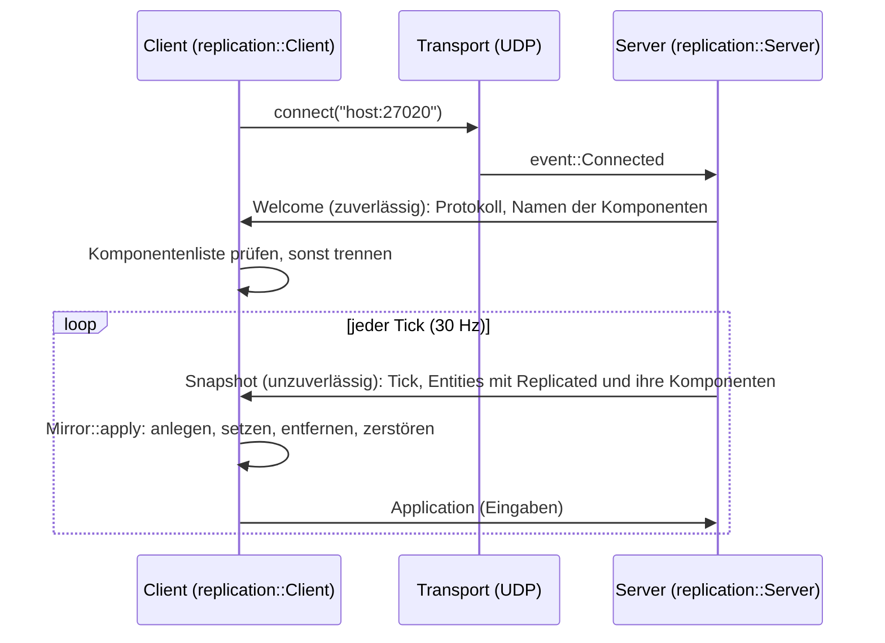

- Ein `Transport` ist Server (`listen`), Client (`connect`) oder beides. `poll()` liefert
  Verbindungs- und Nachrichtenereignisse; Rückrufe der Bibliothek laufen nur darin, im Thread des
  Aufrufers. Port 0 wählt einen zufälligen freien Port.
- Repliziert werden Entities mit der Komponente `Replicated`, und von ihnen nur die Komponenten der
  Liste, die Server und Client gleich festlegen. Die Felder schreibt `serialize::write_binary`
  über die Reflection; neue Komponenten brauchen keinen Netzwerkcode.
- Der Client hält eine Zuordnung von Server-Kennungen zu eigenen Entities (`Mirror`). Eigene
  Entities des Clients (Kamera, UI) bleiben unberührt; gespiegelte tragen
  `Replicated::server_id`.
- Jeder Schnappschuss enthält den vollen Zustand. Geht einer verloren, korrigiert ihn der nächste;
  ältere, die zu spät kommen, werden verworfen. Deltas, Relevanz und Vorhersage kommen in R5.
