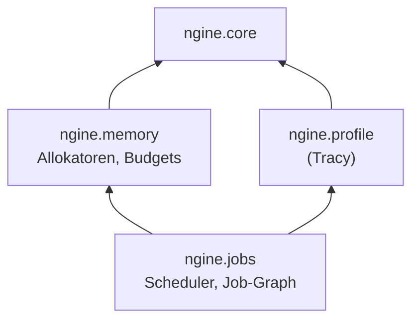

# A3: Job-System und Speicher

- **Phase:** Ausarbeitung
- **Status:** in Arbeit
- **Pull Requests:** #5 (TD-01 und Plan), weitere folgen

## Vorarbeit

Nach der Regel „Nicht anhäufen“ aus dem [Prozess](../process.md#technische-schulden) beginnt A3 mit
dem Abbau von TD-01: `engine/rhi/vulkan/device.cpp` ist in interne Partitionen des Moduls
`ngine.rhi.vulkan` aufgeteilt (`:common`, `:instance`, `:physical_device`, `:resources`,
`:command_list`, `:swapchain`). Swapchain und Instanz sind jetzt eigene Klassen; `device.cpp` setzt
die Teile nur noch zusammen und hat gut 400 statt über 1300 Zeilen. Das Verhalten ist unverändert.

## Plan

**Ziel:** Die Engine verteilt Arbeit über ein eigenes Job-System auf alle Kerne, verwaltet
CPU-Speicher über eigene Allokatoren mit Budget, und Tracy zeigt Threads und Zonen.

**Features:** CORE-05 (Job-System), CORE-06 (Speicher-Allokatoren), CORE-07 (Profiling, zunächst
CPU; GPU-Zonen kommen mit dem Render-Graph in R1). Dazu TD-04 und TD-05 aus dem
[Schuldenregister](../tech-debt.md), beide mit Frist A3.

PLAT-04 (Dateisystem) stand im Katalog ebenfalls bei A3, gehört aber nicht zum Ziel. Vorschlag: nach
A4 verschieben, wo „Szene speichern und laden“ es zum ersten Mal braucht.

### Entwurf

**`ngine.memory`** (Core-Schicht)

- Alle Allokatoren erben von `std::pmr::memory_resource`. So funktionieren sie mit den
  Standardcontainern (`std::pmr::vector` usw.), ohne dass wir eigene Container brauchen.
- `LinearAllocator`: schiebt nur einen Zeiger weiter, gibt alles auf einmal frei (`reset()`).
- `FrameAllocator`: ein linearer Speicher pro Frame im Flug, threadsicher über einen atomaren Zeiger,
  wird zu Beginn des Frames zurückgesetzt. Für Daten, die nur einen Frame leben.
- `PoolAllocator`: Blöcke fester Größe mit Freiliste, Anfordern und Freigeben in O(1). Für viele
  gleich große Objekte (später z. B. Jobs, Voxel-Chunks, Netzwerkpakete).
- Budget-Tracking: Jede Allokation gehört zu einer Kategorie (z. B. Rendering, Welt, Jobs). Pro
  Kategorie zählen wir aktuellen Verbrauch, Spitze und ein optionales Budget; Überschreitungen
  melden sich im Log. Der Verbrauch geht später an Tracy und den Editor.

**`ngine.jobs`** (Core-Schicht)

- Eigener Scheduler statt Bibliothek (ADR folgt): Das Job-System ist das Herz jeder modernen Engine,
  bestimmt die Leistung beim Voxel-Meshing und ist der Kern des Lernziels.
- Ein Worker-Thread pro Kern minus eins; der Hauptthread arbeitet mit.
- Work-Stealing: Jeder Worker hat eine lock-freie Chase-Lev-Deque, untätige Worker stehlen von
  anderen. Jobs von außerhalb der Worker landen in einer gemeinsamen Warteschlange.
- Abhängigkeiten auf zwei Ebenen: ein Zähler (`JobCounter`), auf den man warten kann, und ein
  Job-Graph, in dem ein Job erst startet, wenn alle Vorgänger fertig sind.
- Warten blockiert nicht, sondern arbeitet andere Jobs ab, bis der Zähler null ist.
- `parallel_for` teilt einen Bereich in Stücke auf.
- Kein Heap pro Job: Jobs speichern kleine Funktionsobjekte inline und kommen aus einem Pool.
- Keine Fibers: Sie wären plattformspezifisch (eigener Assembler bzw. Windows-Fibers) und machen
  Debugging und Tracy schwieriger. Falls lange Wartezeiten in Jobs zum Problem werden, prüfen wir
  sie später erneut.

**`ngine.profile`** (Core-Schicht, Adapter für Tracy)

- Tracy über vcpkg, abschaltbar mit `NGINE_WITH_TRACY`. Ohne Tracy kosten die Zonen nichts.
- Tracy braucht pro Zone statische Daten zur Quellstelle, und das geht nur mit Makros. Module
  exportieren keine Makros, deshalb braucht es eine kleine Header-Datei mit Makros
  (`NGINE_PROFILE_ZONE` usw.) als Ausnahme von der Modulregel. Diese Ausnahme halten wir in einem ADR
  fest.
- Worker-Threads bekommen Namen, damit Tracy sie unterscheidet.

**Sandbox:** Mit `--jobs-demo` verteilt sie eine messbare Last (z. B. viele kleine Berechnungen mit
Abhängigkeiten) auf alle Kerne und meldet die Zeit. In Tracy sind die Worker und ihre Zonen zu sehen.

**CI:** Ein zusätzlicher Lauf unter Linux mit ThreadSanitizer prüft Job-System und Allokatoren auf
Datenrennen.

### Pull Requests

1. TD-01 und dieser Plan.
2. `ngine.memory` mit Tests.
3. `ngine.jobs` mit Tests und ThreadSanitizer in der CI.
4. `ngine.profile` mit Tracy, Sandbox-Demo.
5. TD-04 und TD-05 (CI-Werkzeuge); kann in einen der vorigen PRs wandern.

**Risiken:**

- Fehler in der lock-freien Deque zeigen sich nur selten und nur unter Last. Gegenmittel:
  Speicherordnung nach Lê et al. (2013), Stresstests und ThreadSanitizer in der CI.
- Tracy und C++-Module: Makros, Header im globalen Modulfragment und die Einbindung unter MSVC.
- Die CI-Runner haben wenige Kerne; Aussagen zur Skalierung liefert erst der PC mit der RTX 3060 Ti.

**Abnahme:**

- Tests zeigen parallele Jobs mit Abhängigkeiten, auch unter Last; ThreadSanitizer meldet nichts.
- Allokatoren und Budget-Tracking sind getestet.
- Tracy zeigt beim Lauf von `--jobs-demo` die Worker-Threads mit ihren Zonen (Test auf dem PC).
- `--headless` startet weiterhin; CI ist grün unter Linux und Windows.
- TD-04 und TD-05 sind abgebaut.

## Review

Folgt nach dem letzten Merge.
