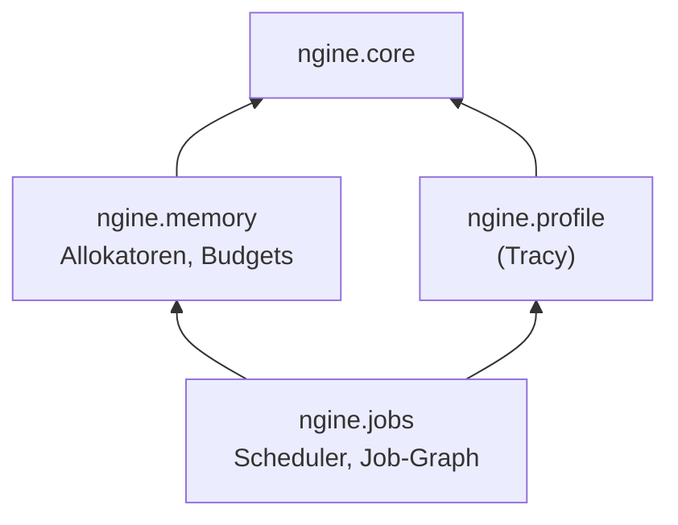

# A3: Job-System und Speicher

- **Phase:** Ausarbeitung
- **Status:** abgeschlossen
- **Pull Requests:** #5 (enthält #6), #7 (Review), #8 (Test auf dem PC)

## Vorarbeit

Nach der Regel „Nicht anhäufen“ aus dem [Prozess](../process.md#technische-schulden) beginnt A3 mit
dem Abbau von TD-01: `engine/rhi/vulkan/device.cpp` ist in interne Partitionen des Moduls
`ngine.rhi.vulkan` aufgeteilt (`:common`, `:instance`, `:physical_device`, `:resources`,
`:command_list`, `:swapchain`). Swapchain und Instanz sind jetzt eigene Klassen; `device.cpp` setzt
die Teile nur noch zusammen und hat gut 400 statt über 1300 Zeilen. Das Verhalten ist unverändert.

## Plan

**Ziel:** Die Engine verteilt Arbeit über ein eigenes Job-System auf alle Kerne, verwaltet
CPU-Speicher über eigene Allokatoren mit Budget, und Tracy zeigt Threads und Zonen.

**Features:** CORE-05 (Job-System), CORE-06 (Speicher-Allokatoren), CORE-07 (Profiling, zunächst
CPU; GPU-Zonen kommen mit dem Render-Graph in R1). Dazu TD-04 und TD-05 aus dem
[Schuldenregister](../tech-debt.md), beide mit Frist A3.

PLAT-04 (Dateisystem) stand im Katalog ebenfalls bei A3, gehört aber nicht zum Ziel. Vorschlag: nach
A4 verschieben, wo „Szene speichern und laden“ es zum ersten Mal braucht.

### Entwurf

**`ngine.memory`** (Core-Schicht)

- Alle Allokatoren erben von `std::pmr::memory_resource`. So funktionieren sie mit den
  Standardcontainern (`std::pmr::vector` usw.), ohne dass wir eigene Container brauchen.
- `LinearAllocator`: schiebt nur einen Zeiger weiter, gibt alles auf einmal frei (`reset()`).
- `FrameAllocator`: ein linearer Speicher pro Frame im Flug, threadsicher über einen atomaren Zeiger,
  wird zu Beginn des Frames zurückgesetzt. Für Daten, die nur einen Frame leben.
- `PoolAllocator`: Blöcke fester Größe mit Freiliste, Anfordern und Freigeben in O(1). Für viele
  gleich große Objekte (später z. B. Jobs, Voxel-Chunks, Netzwerkpakete).
- Budget-Tracking: Jede Allokation gehört zu einer Kategorie (z. B. Rendering, Welt, Jobs). Pro
  Kategorie zählen wir aktuellen Verbrauch, Spitze und ein optionales Budget; Überschreitungen
  melden sich im Log. Der Verbrauch geht später an Tracy und den Editor.

**`ngine.jobs`** (Core-Schicht)

- Eigener Scheduler statt Bibliothek (ADR folgt): Das Job-System ist das Herz jeder modernen Engine,
  bestimmt die Leistung beim Voxel-Meshing und ist der Kern des Lernziels.
- Ein Worker-Thread pro Kern minus eins; der Hauptthread arbeitet mit.
- Work-Stealing: Jeder Worker hat eine lock-freie Chase-Lev-Deque, untätige Worker stehlen von
  anderen. Jobs von außerhalb der Worker landen in einer gemeinsamen Warteschlange.
- Abhängigkeiten auf zwei Ebenen: ein Zähler (`JobCounter`), auf den man warten kann, und ein
  Job-Graph, in dem ein Job erst startet, wenn alle Vorgänger fertig sind.
- Warten blockiert nicht, sondern arbeitet andere Jobs ab, bis der Zähler null ist.
- `parallel_for` teilt einen Bereich in Stücke auf.
- Kein Heap pro Job: Jobs speichern kleine Funktionsobjekte inline und kommen aus einem Pool.
- Keine Fibers: Sie wären plattformspezifisch (eigener Assembler bzw. Windows-Fibers) und machen
  Debugging und Tracy schwieriger. Falls lange Wartezeiten in Jobs zum Problem werden, prüfen wir
  sie später erneut.

**`ngine.profile`** (Core-Schicht, Adapter für Tracy)

- Tracy über vcpkg, abschaltbar mit `NGINE_WITH_TRACY`. Ohne Tracy kosten die Zonen nichts.
- Tracy braucht pro Zone statische Daten zur Quellstelle, und das geht nur mit Makros. Module
  exportieren keine Makros, deshalb braucht es eine kleine Header-Datei mit Makros
  (`NGINE_PROFILE_ZONE` usw.) als Ausnahme von der Modulregel. Diese Ausnahme halten wir in einem ADR
  fest.
- Worker-Threads bekommen Namen, damit Tracy sie unterscheidet.

**Sandbox:** Mit `--jobs-demo` verteilt sie eine messbare Last (z. B. viele kleine Berechnungen mit
Abhängigkeiten) auf alle Kerne und meldet die Zeit. In Tracy sind die Worker und ihre Zonen zu sehen.

**CI:** Ein zusätzlicher Lauf unter Linux mit ThreadSanitizer prüft Job-System und Allokatoren auf
Datenrennen.

### Schritte

1. TD-01 und dieser Plan.
2. `ngine.memory` mit Tests.
3. `ngine.jobs` mit Tests und ThreadSanitizer in der CI.
4. `ngine.profile` mit Tracy, Sandbox-Demo.
5. TD-04 und TD-05 (CI-Werkzeuge).

**Risiken:**

- Fehler in der lock-freien Deque zeigen sich nur selten und nur unter Last. Gegenmittel:
  Speicherordnung nach Lê et al. (2013), Stresstests und ThreadSanitizer in der CI.
- Tracy und C++-Module: Makros, Header im globalen Modulfragment und die Einbindung unter MSVC.
- Die CI-Runner haben wenige Kerne; Aussagen zur Skalierung liefert erst der PC mit der RTX 3060 Ti.

**Abnahme:**

- Tests zeigen parallele Jobs mit Abhängigkeiten, auch unter Last; ThreadSanitizer meldet nichts.
- Allokatoren und Budget-Tracking sind getestet.
- Tracy zeigt beim Lauf von `--jobs-demo` die Worker-Threads mit ihren Zonen (Test auf dem PC).
- `--headless` startet weiterhin; CI ist grün unter Linux und Windows.
- TD-04 und TD-05 sind abgebaut.

## Stand

- Umgesetzt: `ngine.memory`, `ngine.jobs` ([ADR 0015](../adr/0015-own-job-system.md)),
  `ngine.profile` mit Tracy ([ADR 0016](../adr/0016-profiling-macros.md)), `--jobs-demo` in der
  Sandbox, ThreadSanitizer-Lauf in der CI, TD-04 und TD-05.
- Lokal (4 Kerne, Debug-Build): Die Job-Demo ist mit allen Kernen etwa 4-mal so schnell wie mit
  einem Thread. ThreadSanitizer und AddressSanitizer melden nichts, auch nicht in 100 Durchläufen
  der Job-Tests.
- Abweichung vom Plan: Alle Schritte stecken in PR #5, weil sie aufeinander aufbauen und die CI
  sie so gemeinsam prüft.
- PR #6 (Plattform-Baseline, [ADR 0017](../adr/0017-platform-baseline-feature-tiers.md)) ist in den
  Branch von #5 gemergt und kommt mit ihm nach `main`. Seitdem ist Vulkan 1.3 Pflicht, 1.4 eine
  optionale Stufe; die CI baut mit Clang 20 aus Ubuntu 24.04.
- Tracy auf dem PC und die Skalierung auf der RTX-Maschine sind nach dem Merge geprüft (siehe Review).

## Review

**Ergebnis:** Die Engine hat ein eigenes Job-System (`ngine.jobs`) mit Work-Stealing, `Counter`,
`TaskGraph` und `parallel_for`, eigene Allokatoren mit Budget pro Kategorie (`ngine.memory`) und
Tracy hinter `ngine.profile`. `ngine_sandbox --jobs-demo` verteilt einen Graphen aus 129 Aufgaben pro
Frame auf alle Kerne. TD-01, TD-04 und TD-05 sind abgebaut. Mit PR #6 kam die Plattform-Baseline aus
[ADR 0017](../adr/0017-platform-baseline-feature-tiers.md) dazu (Vulkan 1.3 Pflicht, Ubuntu 24.04,
Clang 20). Die CI ist unter Linux, mit ThreadSanitizer und unter Windows grün und braucht mit Cache
rund 2 Minuten.

Abnahme: Alle Kriterien sind erfüllt. Der Test auf dem PC kam nach dem Merge von #7 (Windows,
Debug-Build aus VS Code, `--jobs-demo --frames 2000`): Tracy zeigt den Hauptthread und die
Worker-Threads. Damit ist [ADR 0016](../adr/0016-profiling-macros.md) angenommen.

| Messung (PC, Windows, Debug) | Wert |
| --- | --- |
| Worker-Threads | 15 (plus Hauptthread) |
| Ein Thread | 71,93 ms pro Frame |
| Alle Kerne | 11,69 ms pro Frame, 6,2-mal so schnell |
| Speicher Welt, Spitze | 16 512 KiB |

Die Worker erschienen in Tracy erst spät. Das ist so gewollt: Die Demo rechnet zuerst alle Frames
auf dem Hauptthread allein (bei 2000 Frames rund 2,5 Minuten) und startet die Worker erst für den
zweiten Durchgang. Die Anleitung in [setup.md](../setup.md) empfiehlt deshalb jetzt 300 Frames und
erklärt das, außerdem, was zu tun ist, wenn Windows den Profiler blockiert.

**Erkenntnisse:**

- Interne Partitionen (`module ngine.rhi.vulkan:foo;` in einem privaten `CXX_MODULES`-File-Set)
  funktionieren mit Clang und MSVC. Anonyme Namespaces gelten nur in einer Datei; was mehrere
  Partitionen teilen, braucht Modul-Linkage, Konstanten `inline constexpr`.
- MSVC stürzte mit C1116 ab, als eine Modulschnittstelle `<thread>` (wegen `std::stop_token`)
  einband und zugleich ein anderes Engine-Modul importierte. Abhilfe war ein Pimpl. Daraus folgt eine
  Faustregel: Modulschnittstellen halten wir frei von schweren Standard-Headern.
- ThreadSanitizer versteht alleinstehende `atomic_thread_fence` nicht. Die Deque nutzt deshalb
  `seq_cst`-Operationen statt Fences, was auf x86 kaum etwas kostet.
- ThreadSanitizer braucht auf neuen Kerneln `vm.mmap_rnd_bits=28`, sonst bricht er beim Start ab.
- Tracy 0.14 hat seine C-API umbenannt; Nachrichten gehen über das Makro `TracyCMessage`.
- Die Validation Layers aus den Quellen zu bauen kostet in der CI rund 25 Minuten. Der vcpkg-Cache
  macht daraus 2 Minuten, solange sich die Pakete nicht ändern (TD-06).

**Anpassungen:** [ADR 0015](../adr/0015-own-job-system.md) und ADR 0016 angenommen,
ADR 0017 aus PR #6. Feature-Katalog: CORE-05 und CORE-06 fertig; CORE-07 bleibt in Arbeit, weil die
GPU-Zonen mit dem Render-Graph in R1 kommen. PLAT-04 (Dateisystem) wandert wie im Plan
vorgeschlagen nach A4, wo „Szene speichern und laden“ es braucht. Schuldenregister: TD-06 und TD-07
neu. CLAUDE.md nennt den ThreadSanitizer-Lauf und die Ausnahme für `<ngine/profile.hpp>`.

**Architektur-Review:**

- Abhängigkeiten zeigen nur nach unten: `ngine.memory` und `ngine.profile` hängen nur an
  `ngine.core`, `ngine.jobs` an `ngine.core` und intern an Speicher und Profiling. Weil die
  Schnittstelle von `ngine.jobs` den Speicher nicht mehr importiert, ist `ngine::memory` jetzt eine
  private Abhängigkeit (in diesem Review umgestellt).
- Tracy steckt nur in `profile_tracy.cpp`; Sandbox und Engine kennen nur `ngine.profile`. Die
  Makro-Header-Datei ist die in ADR 0016 begründete Ausnahme und enthält nur Makros.
- Die Schnittstellen sind schmal: `run`, `wait`, `parallel_for`, `TaskGraph`. Das ECS in A4 kann
  Systeme als `TaskGraph` planen, das Voxel-Meshing in D1 nutzt `parallel_for`. Prioritäten und
  Jobs, die blockieren (Datei-I/O), fehlen noch. Sie kommen mit dem Dateisystem bzw. dem
  Asset-Laden und sind geplant, keine Schuld.
- Keine Datei ist zu groß: Die größte ist `engine/rhi/vulkan/device.cpp` mit gut 400 Zeilen, im
  Job-System `system.cpp` mit gut 260.
- Neue Schuld: TD-07 (Budget-Verbrauch noch nicht in Tracy, Zähler ohne Cache-Line-Abstand).
- Leistung: Die Job-Demo ist im Debug-Build auf 4 Kernen etwa 4-mal so schnell wie mit einem Thread.
  Jobs kommen aus einem Pool pro Thread und brauchen keinen Heap; die Allokatoren melden dem Budget
  nur ganze Speicherblöcke, nicht jede Allokation. Offensichtliche Engpässe gibt es nicht. Auf
  dem PC mit 16 Threads ist sie 6,2-mal so schnell; mehr ist mit SMT-Threads und im Debug-Build
  nicht zu erwarten. Eine Messung im Release-Build holen wir bei Gelegenheit nach.
