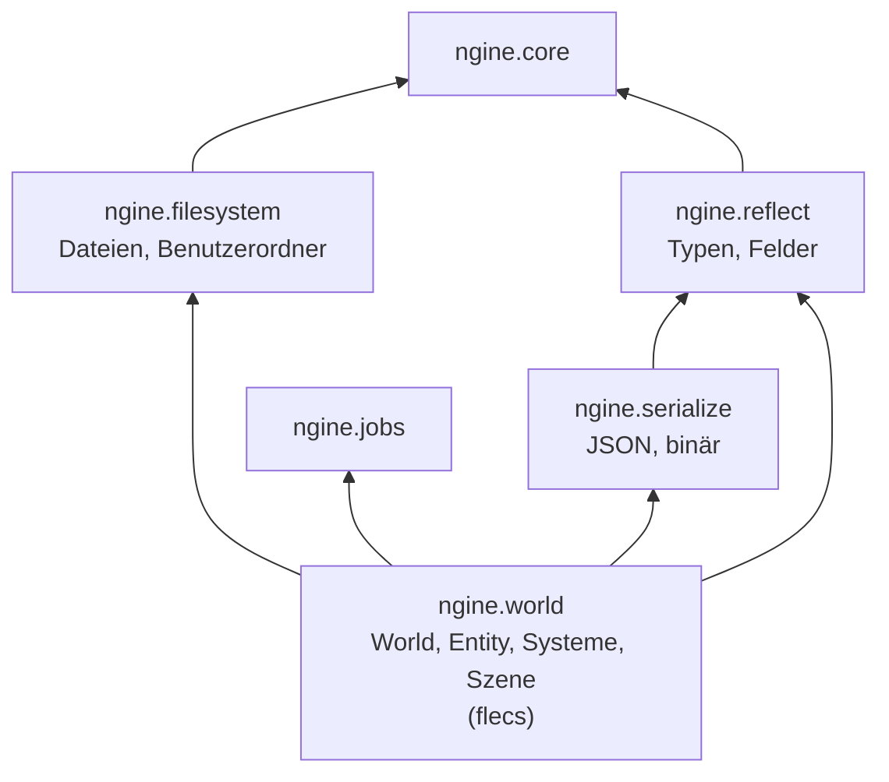

# A4: ECS und Reflection

- **Phase:** Ausarbeitung
- **Status:** abgeschlossen
- **Pull Requests:** #10, #11 (Review)

## Vorarbeit

Nach der Regel „Nicht anhäufen“ aus dem [Prozess](../process.md#technische-schulden) beginnt A4 mit
TD-07 (Frist A4): Die Zähler der Speicherkategorien liegen jetzt jeweils auf einer eigenen
Cache-Line, und die Sandbox meldet `memory::stats()` in jedem Frame als Tracy-Plot pro Kategorie.

## Plan

**Ziel:** Spielzustand lebt in einem ECS hinter einer eigenen Schnittstelle, Komponenten sind über
Reflection beschreibbar, und eine Szene mit Entities und Hierarchie lässt sich als Datei speichern
und wieder laden.

**Features:** WORLD-01 (ECS), WORLD-02 (Entity-API), WORLD-03 (Hierarchie), WORLD-05 (Szenen
speichern und laden), CORE-08 (Reflection), CORE-09 (Serialisierung), PLAT-04 (Dateisystem, aus A3
verschoben). Dazu TD-07 aus dem [Schuldenregister](../tech-debt.md).

Nicht dabei: die Transform-Propagation aus WORLD-03. Sie braucht Vektoren und Quaternionen
(CORE-10, R1) und 64-Bit-Positionen (WORLD-06, R1); sie wandert mit ihnen nach R1. A4 baut die
Eltern-Kind-Beziehung, auf der sie aufsetzt.

### Entwurf

**`ngine.reflect`** (Core-Schicht, [ADR 0018](../adr/0018-own-reflection.md))

- Eigene Reflection statt der von flecs: Editor, Speichern, Netzwerk und C# sollen Typen
  beschreiben können, ohne flecs zu kennen.
- Registrierung über eine kleine Builder-API ohne Makros (Module exportieren keine):
  `types.add<Velocity>("Velocity").field("x", &Velocity::x)`. C++23 hat noch keine statische
  Reflection; mit C++26 lässt sich die Registrierung später automatisch erzeugen.
- Ein `TypeInfo` kennt Name, stabile ID (Hash des Namens), Größe, Ausrichtung, Felder (Name, Typ,
  Offset) und Funktionen zum Erzeugen, Kopieren, Verschieben und Zerstören. Grundtypen (`bool`,
  Ganzzahlen, `f32`, `f64`, `std::string`) sind vorregistriert, eigene Strukturen dürfen andere
  Strukturen enthalten.
- Die Registry wird beim Start aufgebaut und ist danach nur noch lesbar, damit sie ohne Sperre aus
  allen Threads nutzbar ist.

**`ngine.serialize`** (Core-Schicht, [ADR 0020](../adr/0020-scene-format-json.md))

- JSON lesen und schreiben mit eigenem, kleinem Parser (`json::Value`, `json::parse`,
  `json::write`). Gleitkommazahlen gehen über `std::to_chars` und kommen bitgenau zurück.
- Über Reflection: `to_json`/`from_json` für jeden registrierten Typ. Fehlende Felder behalten
  ihren Standardwert, unbekannte werden übersprungen; so überleben Szenen kleine Änderungen an
  Komponenten.
- Binär: `BinaryWriter`/`BinaryReader` (Little Endian) und `write_binary`/`read_binary` über
  Reflection, mit Prüfung der Grenzen beim Lesen. Grundlage für Netzwerk und gekochte Assets.

**`ngine.filesystem`** (Plattform-Schicht, PLAT-04)

- Läuft ohne Fenster und ohne SDL3, damit der Server Szenen laden kann.
- `read_file`, `read_text`, `write_file` mit `std::expected`; Schreiben geht über eine temporäre
  Datei und Umbenennen, damit ein Absturz keine halbe Szene hinterlässt.
- `user_data_dir()`: `$XDG_DATA_HOME` bzw. `~/.local/share` unter Linux, Roaming-AppData unter
  Windows. Plattformcode steckt in je einer eigenen `.cpp`-Datei.
- Pfade sind `std::filesystem::path`; `path_from_utf8()` vermeidet die Codepage-Falle unter Windows.

**`ngine.world`** (Welt-Schicht, Adapter für flecs nach [ADR 0003](../adr/0003-ecs-flecs.md))

- `World` besitzt die flecs-Welt, `Entity` ist ein kleiner Griff (Welt und 64-Bit-ID) mit
  `set`, `get`, `has`, `remove`, `destroy`, `set_parent`, `parent`, `children`. Kein Code außerhalb
  von `world.cpp` sieht flecs.
- Komponenten müssen in der Reflection registriert sein. Die Welt meldet sie bei flecs mit Größe,
  Ausrichtung und den Funktionen aus dem `TypeInfo` an; Templates leiten nur auf Funktionen ohne
  Template weiter.
- Namen sind eine Komponente `Name` statt flecs-Namen, weil flecs Namen pro Elternteil eindeutig
  hält und Spielobjekte oft gleich heißen.
- Abfragen: `world.query<const Velocity, Position>()` mit `each(f)`. `const` heißt nur lesen.
- Hierarchie über die `ChildOf`-Beziehung von flecs: Löscht man ein Elternteil, verschwinden die
  Kinder mit.
- **Systeme** ([ADR 0019](../adr/0019-systems-on-job-system.md)): Ein `Schedule` sammelt Systeme
  mit ihren Abfragen. Aus `const` und nicht-`const` ergeben sich Lese- und Schreibzugriffe; Systeme,
  die sich nicht in die Quere kommen, laufen parallel als `TaskGraph` auf dem Job-System, sonst in
  der Reihenfolge, in der sie dazukamen. Wir nutzen nicht die Pipeline und die Threads von flecs.
  Systeme ändern nur Komponentendaten; Strukturänderungen (Entities anlegen, Komponenten hinzufügen)
  kommen nach dem Schedule. Ein Befehlspuffer dafür folgt, wenn ein Feature ihn braucht.
- **Szene:** `save_scene(world)` schreibt alle Entities mit ihren Komponenten und Eltern als JSON,
  `load_scene(world, text)` baut sie wieder auf. Entities bekommen in der Datei eigene, fortlaufende
  IDs; Eltern stehen vor ihren Kindern. Dazu Varianten für Dateien über `ngine.filesystem`.

**Sandbox:** `--scene-demo` baut eine kleine Szene (Sonne, Planeten mit Monden als Kinder), lässt
einige Frames lang Systeme parallel laufen, speichert die Szene, lädt sie in eine neue Welt und
vergleicht beide. Mit `--scene <pfad>` landet die Datei an einer bestimmten Stelle, sonst im
Benutzerordner. Die CI führt die Demo aus.

**TD-07:** `alignas(64)` für die Zähler pro Kategorie; die Sandbox plottet in jedem Frame den
Verbrauch aller Kategorien (`profile::plot`).

### Schritte

1. TD-07 und dieser Plan.
2. `ngine.filesystem` mit Tests.
3. `ngine.reflect` und `ngine.serialize` mit Tests.
4. `ngine.world` mit flecs, Hierarchie und Systemen, Tests (auch unter ThreadSanitizer).
5. Szene speichern und laden, `--scene-demo`, Doku.

**Risiken:**

- flecs aus vcpkg lässt sich im Cloud-Container nicht laden (403 beim Download der Archive). Lokal
  bauen wir deshalb mit der Amalgamation `flecs.c`/`flecs.h` derselben Version (4.1.6); die volle
  Prüfung macht die CI.
- flecs ist eine große C-Bibliothek. Lebenszyklus der Komponenten (Erzeugen, Verschieben,
  Zerstören von `std::string` in Tabellen) muss stimmen, sonst gibt es Speicherfehler. Gegenmittel:
  Tests mit Komponenten, die Heap-Speicher besitzen, und AddressSanitizer lokal.
- Paralleles Ausführen von Systemen auf flecs-Daten: Wir greifen nur auf Spalten zu, die vorher im
  Hauptthread gesammelt wurden, und rufen in Jobs kein flecs auf. ThreadSanitizer prüft das.
- MSVC und Templates in Modulschnittstellen (siehe C1116 in A3): Schnittstellen bleiben frei von
  schweren Headern.

**Abnahme:**

- Eine Szene mit Entities, Hierarchie und Komponenten lässt sich speichern und laden; das Ergebnis
  ist gleich (Tests und `--scene-demo`, auch in der CI).
- Reflection, JSON, binäre Serialisierung, Dateisystem und Welt sind getestet; Systeme laufen
  parallel, ThreadSanitizer meldet nichts.
- `--headless` startet weiterhin; CI ist grün unter Linux und Windows.
- TD-07 ist abgebaut; Tracy zeigt den Speicher pro Kategorie (Test auf dem PC).

## Stand

- Umgesetzt: TD-07, `ngine.filesystem`, `ngine.reflect` ([ADR 0018](../adr/0018-own-reflection.md)),
  `ngine.serialize` ([ADR 0020](../adr/0020-scene-format-json.md)), `ngine.world` mit `World`,
  `Entity`, `Query`, Hierarchie, `Schedule` ([ADR 0019](../adr/0019-systems-on-job-system.md)) und
  Szenen, `--scene-demo` in der Sandbox, CI führt die Demo aus und prüft `[world]` mit
  ThreadSanitizer.
- Lokal im Cloud-Container (4 Kerne, Clang 20, Debug, flecs 4.1.6 aus der Amalgamation, ohne
  RHI und Tracy): 76 Tests grün, auch unter AddressSanitizer mit UBSan und mehrfach unter
  ThreadSanitizer. Die Szenen-Demo speichert 2018 Entities (knapp 600 KB JSON), lädt sie und
  vergleicht beide Welten.
- Abweichung vom Plan: Kein `World::defer()`. Strukturänderungen aus Systemen heraus sind verboten,
  bis ein Feature einen Befehlspuffer braucht (WORLD-09 im Katalog).
- Erkenntnisse während der Umsetzung (siehe Review):
  - Clang 20 scheitert an `std::format` mit `std::string_view` in einer Implementierungsdatei, wenn
    eine importierte Partition `<filesystem>` im globalen Modulfragment hat. Abhilfe: Die interne
    Partition von `ngine.filesystem` gibt UTF-8-Text statt `std::filesystem::path` zurück.
  - Ein `std::variant`, das `std::vector<Member>` enthält, verglich sich über einen impliziten
    Konstruktor `Value(Object)` endlos selbst. Konstruktoren aus Containern sind jetzt `explicit`,
    der Vergleich ist von Hand geschrieben.
  - Eine Überladung `find(const void*)` neben `find(std::string_view)` nimmt Textliterale: Der
    Zeiger gewinnt gegen die benutzerdefinierte Umwandlung. Deshalb heißt sie `find_key()`.
- CI und Test auf dem PC kamen nach dem Abschluss des Codes (siehe Review).

## Review

**Ergebnis:** Spielzustand lebt jetzt in `ngine.world`: flecs (nur der Kern) hinter `World`,
`Entity` und `Query`, Hierarchie über `ChildOf`, Systeme über `Schedule` auf dem eigenen
Job-System. Komponenten beschreibt die eigene Reflection (`ngine.reflect`), JSON und Binärformat
kommen aus `ngine.serialize`, Dateien aus `ngine.filesystem` (PLAT-04). Szenen lassen sich
speichern und laden; die Hierarchie bleibt erhalten, und dieselbe Welt ergibt immer denselben
Text. TD-07 ist abgebaut. Die CI war in PR #10 im ersten Anlauf grün unter Linux, mit
ThreadSanitizer und unter Windows; unter Windows lud die Szenen-Demo 2018 Entities zurück und fand
sie gleich dem Original.

Abnahme: Alle Kriterien sind erfüllt. Der Test auf dem PC (Windows 11, RTX 3060 Ti, Tracy) zeigte
die Plots „Speicher … (Bytes)“ für jede Kategorie. In der Szenen-Demo trägt nur „Speicher Jobs“
einen Wert (512 KiB: 16 Threads mit je 256 Jobs zu 128 Bytes); die übrigen stehen auf 0. Tracy
zeigt einen konstanten Plot mit einer um 1 höheren Skala an (524 289 statt 524 288, 1 statt 0).
Dass „Speicher Welt“ leer bleibt, liegt an TD-08: flecs fordert seinen Speicher selbst an.

**Erkenntnisse:**

- Clang 20 scheitert an `std::format` mit `std::string_view` in einer Implementierungsdatei, wenn
  eine importierte Partition `<filesystem>` im globalen Modulfragment hat. Faustregel wie in A3:
  Modulschnittstellen, auch interne Partitionen, frei von schweren Standard-Headern halten.
- Rekursive Datentypen mit `std::variant` (JSON) brauchen Sorgfalt: Konstruktoren und
  Standardkonstruktor gehören in die `.cpp`-Datei, solange ein Element noch unvollständig ist, und
  implizite Konstruktoren aus Containern führen beim Vergleich zu endloser Rekursion.
- Eine Überladung mit `const void*` schlägt `std::string_view` bei Textliteralen. Überladungen mit
  Zeigern auf `void` vermeiden.
- flecs ruft Hooks für ganze Bereiche auf und leitet fehlende Kombinationen (`ctor_move_dtor`,
  `move_dtor`) selbst aus Konstruktor, Verschieben und Destruktor ab. Die `TypeOps` der Reflection
  reichen dafür.
- Die Amalgamation `flecs.c`/`flecs.h` lässt sich ohne vcpkg bauen; so war ein lokaler Test im
  Cloud-Container möglich, obwohl vcpkg dort nicht laden kann.
- `f32` über `f64` nach JSON zu schreiben ergibt unlesbare Zahlen (`0.10000000149011612`). Der Umweg
  über die kürzeste Darstellung als `f32` hält Dateien lesbar und bleibt verlustfrei.

**Anpassungen:** ADR 0018, 0019 und 0020 angenommen. Feature-Katalog: CORE-08, CORE-09, PLAT-04,
WORLD-01 und WORLD-05 fertig; WORLD-02 (C#-Seite) und WORLD-03 (Transform-Propagation, R1) bleiben
in Arbeit; WORLD-09 (Befehlspuffer) und WORLD-10 (Phasen für Systeme) neu für R4. Roadmap: R1 nimmt
Mathematik, 64-Bit-Positionen und Transform-Propagation auf. Schuldenregister: TD-07 abgebaut,
TD-08 und TD-09 neu. CLAUDE.md nennt die Regeln für Komponenten und Systeme.

**Architektur-Review:**

- Abhängigkeiten zeigen nur nach unten: `ngine.filesystem` und `ngine.reflect` hängen nur an
  `ngine.core`, `ngine.serialize` an `ngine.reflect`, `ngine.world` an Reflection und Job-System
  und privat an Serialisierung, Dateisystem und Profiling. Plattform und RHI kennen die Welt nicht.
- flecs steckt nur in `engine/world/world.cpp`; Szene und Schedule arbeiten über die Schnittstelle
  ohne Templates (`ensure`, `for_each_component`, `QueryBase::collect`). Plattformcode steckt in
  `user_dir_linux.cpp` und `user_dir_windows.cpp`.
- Die Schnittstellen passen zu den nächsten Iterationen: D2 (C#) kann über `TypeInfo` und die
  Zugriffe ohne Templates auf Komponenten zugreifen, D3 (Netzwerk) über das Binärformat und
  `TypeId`. Es fehlen Entity-Verweise in Komponenten und ein Befehlspuffer; beide sind geplant
  (ADR 0018, WORLD-09), keine Schuld.
- Keine Datei ist zu groß: die größten neuen sind `world.cpp` (420 Zeilen, nur der flecs-Adapter)
  und `json_parse.cpp` (370).
- Neue Schulden: TD-08 (Speicher von flecs nicht im Budget) und TD-09 (Hash-Suchen pro
  Komponentenzugriff).
- Leistung: Die Systeme der Szenen-Demo brauchen im Debug-Build rund 0,02 ms pro Frame für 2000
  Entities (lokal, 4 Kerne) bzw. 0,15 ms (CI unter Windows). Laden einer Szene mit 2000 Entities
  aus JSON dauert etwa 0,1 bis 0,4 s im Debug-Build; für große Welten ist ein gekochtes
  Binärformat vorgesehen (ADR 0020). Offensichtliche Engpässe gibt es nicht.
