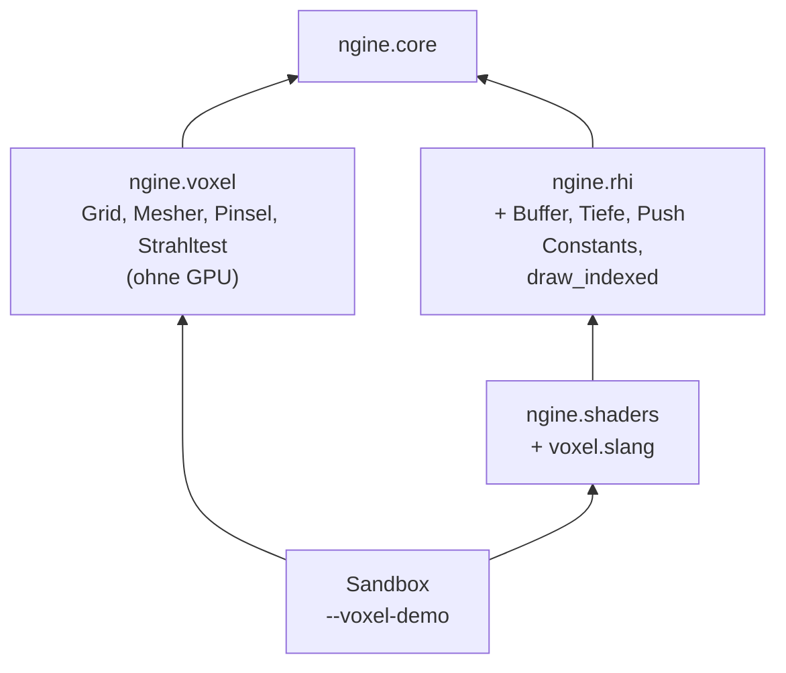
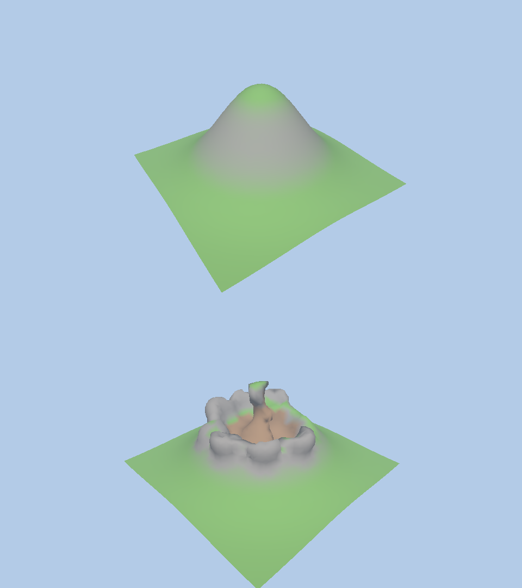

# D1: Durchstich Voxel-Meshing

- **Phase:** Ausarbeitung
- **Status:** in Arbeit
- **Pull Requests:** #12

## Plan

**Ziel:** Ein Chunk Voxel-Terrain mit Dichtefeld wird als glattes Netz gezeichnet und lässt sich
zur Laufzeit verändern. Der Durchstich klärt, welches Meshing-Verfahren wir nehmen, wie wir Dichte
und Material speichern und wie Geometrie in den Shader kommt.

**Features:** VOX-01 (Dichtefeld), VOX-02 (Meshing), VOX-03 (Bearbeiten zur Laufzeit), dazu als
Unterbau PLAT-02 (Maus) und Teile von REND-08 (Kamera, als Wegwerf-Code in der Sandbox).

**Offene Frage aus [ADR 0005](../adr/0005-smooth-voxel-terrain.md):** Surface Nets oder Dual
Contouring. Der Durchstich baut Surface Nets, misst und hält die Entscheidung in
[ADR 0021](../adr/0021-surface-nets-8bit-density.md) fest.

### Entwurf

**`ngine.voxel`** (Welt-Schicht, läuft ohne GPU, damit auch der Server Terrain halten kann)

- `Grid`: Dichtefeld mit Material, ein `Sample` aus 2 Bytes: Dichte als vorzeichenbehafteter
  Abstand zur Oberfläche in 8 Bit (positiv innen, 1/32 Voxel pro Schritt, Bereich rund ±4 Voxel)
  und Material (0 ist Luft). Trilinear interpolierter Abstand und Gradient für Normalen und
  Strahltest. `fill()` füllt aus einer Abstandsfunktion, `fill_hill()` baut den Hügel der Demo.
- `Mesher`: Naive Surface Nets in einem Durchlauf. Ein Eckpunkt pro Voxel mit Vorzeichenwechsel
  (Mittel der Kantenschnitte), ein Viereck pro Gitterkante mit Vorzeichenwechsel. Normalen aus dem
  Gradienten der Dichte, Material von der festen Ecke nächst der Oberfläche. Zwischenspeicher
  bleiben erhalten, damit wiederholtes Meshing nichts neu anfordert.
- `apply(grid, Brush)`: Kugel-Pinsel zum Abtragen (Minimum), Auftragen (Maximum) und Glätten
  (gewichtetes Mittel der Nachbarn). Liefert den geänderten Bereich und erhöht die Version des
  Gitters.
- `raycast()`: Strahl in Viertel-Voxel-Schritten mit linearer Verfeinerung, für die Maus.

**RHI** (nötig, um beliebige Netze zu zeichnen; Grundlage für R1)

- `Buffer` mit `device_address()` und `write()`. Geometrie kommt per Vertex Pulling über Buffer
  Device Address in den Shader, ohne Vertex-Attribute ([ADR 0022](../adr/0022-vertex-pulling-bda.md)).
  Puffer liegen vorerst immer im CPU-sichtbaren Speicher (TD-11).
- Tiefenpuffer (`Format::D32Float`), `RenderingDesc` mit Farbe und Tiefe, Back-Face-Culling,
  128 Bytes Push Constants pro Pipeline, `bind_index_buffer` und `draw_indexed`.
- `Frame::index` und `Device::frames_in_flight()`, damit die Anwendung pro Frame im Flug eigene
  Puffer halten kann.

**Plattform:** Mausbewegung, Maustasten, Mausrad und die Leertaste als Ereignisse (PLAT-02).

**Sandbox:** `--voxel-demo` zeigt einen Chunk mit 32³ Voxeln und einem Hügel. Die Kamera kreist,
die linke Maustaste trägt ab, die rechte auf, die mittlere glättet, das Mausrad zoomt, die
Leertaste hält die Kamera an. Mit `--frames` ändert ein Skript das Terrain automatisch (CI). Mit
`--headless` läuft alles ohne GPU und misst das Meshing für 32³, 64³ und 128³ Voxel; mit
`--image <pfad>` zeichnet die Demo offscreen und speichert ein PPM-Bild.

### Schritte

1. `ngine.voxel` mit Tests (Kugel geschlossen und richtig orientiert, Pinsel, Strahltest).
2. RHI: Puffer, Tiefe, Push Constants, indiziertes Zeichnen; GPU-Test mit lavapipe.
3. `voxel.slang` und `--voxel-demo` mit Maus, ohne GPU und offscreen.
4. ADR 0021 und 0022, Doku, CI.

**Risiken:**

- 8-Bit-Dichte könnte sichtbare Stufen erzeugen. Gegenmittel: Test, der die Abweichung einer Kugel
  misst.
- Surface Nets glätten scharfe Kanten weg. Für Terrain gewollt; für gebaute Strukturen prüfen wir
  es in R3 erneut (siehe ADR 0021).
- Neues Meshing bei jeder Änderung könnte ruckeln. Gegenmittel: messen, Zwischenspeicher behalten.
- Puffer ändern, während die GPU noch zeichnet. Gegenmittel: ein Puffer pro Frame im Flug.
- SDL3 und die Fenster-Demo lassen sich im Cloud-Container nicht bauen (vcpkg lädt dort keine
  Quellen). Die offscreen-Demo zeigt das Ergebnis trotzdem; Fenster und Maus prüft die CI unter
  Xvfb und der Test auf dem PC.

**Abnahme:**

- Ein glatter Hügel ist sichtbar und lässt sich mit der Maus abtragen, auftragen und glätten (Test
  auf dem PC).
- Surface Nets, Pinsel und Strahltest sind getestet; das Netz einer Kugel ist geschlossen.
- Die CI führt die Demo ohne GPU, offscreen und im Fenster (Xvfb, mit und ohne optionale Stufen)
  aus; die Validation Layers melden nichts.
- ADR 0021 entscheidet die offene Frage aus ADR 0005.

## Stand

- Umgesetzt: `ngine.voxel`, RHI-Erweiterungen, `voxel.slang`, Mausereignisse, `--voxel-demo` mit
  drei Modi, CI-Schritte, ADR 0021 und 0022 (vorgeschlagen).
- Lokal im Cloud-Container (4 Kerne, Clang 20, ohne SDL3 und Tracy, lavapipe): 103 Tests grün,
  darunter der neue GPU-Test für Tiefe, Puffer, Push Constants und Culling.
- Messung Surface Nets, Hügel, Release-Build, ein Kern:

  | Voxel | Zeit | Dreiecke | Netz | Dichtefeld |
  | --- | --- | --- | --- | --- |
  | 32³ | 0,45 ms | 3 698 | 103 KiB | 70 KiB |
  | 64³ | 2,7 ms | 14 962 | 413 KiB | 536 KiB |
  | 128³ | 16 ms | 60 162 | 1,6 MiB | 4,1 MiB |

  Im Debug-Build ist alles etwa zehnmal langsamer (32³: rund 7 ms vor der Optimierung).
  Mit 177 Änderungen hintereinander braucht ein Chunk 32³ im Mittel 0,65 ms, höchstens 1,1 ms.
- Die größte Abweichung einer Kugel mit Radius 6 von der echten Oberfläche liegt trotz 8-Bit-Dichte
  unter 0,15 Voxel.
- Offscreen-Bild der Demo, oben vor, unten nach 40 automatischen Änderungen (lavapipe):

  

- Erkenntnisse während der Umsetzung:
  - Der erste Mesher mit zwei Durchläufen (Eckpunkte, dann alle Gitterkanten) brauchte 1,3 ms für
    32³. Ein Durchlauf, der die Vierecke an der unteren Ecke jedes Oberflächen-Voxels erzeugt, und
    ein Vorzeichentest direkt auf den 8-Bit-Werten brachten Faktor drei.
  - Material pro Eckpunkt ohne Interpolation ergibt Zacken an Materialgrenzen. Die Farbe pro
    Eckpunkt zu berechnen und zu interpolieren macht die Übergänge weich; Fels an steilen Hängen
    entscheidet der Shader über die Normale statt eines eigenen Materials.
  - Die Ecke mit der größten Dichte gehört an Hängen oft schon zur Erde darunter. Das Material
    kommt deshalb von der festen Ecke, die der Oberfläche am nächsten liegt.
  - Ein Tiefenpuffer für alle Frames im Flug braucht eine Barriere vor jedem Löschen. Der Übergang
    aus `UNDEFINED` bei jedem `clear_depth` sorgt dafür.

## Review

Folgt nach dem Merge und dem Test auf dem PC.
