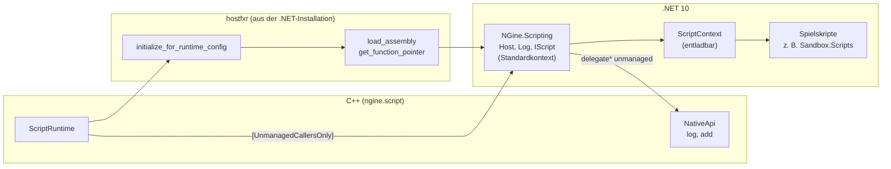

# D2: Durchstich C#-Hosting

- **Phase:** Ausarbeitung
- **Status:** abgeschlossen
- **Pull Requests:** #13 (zusammen mit D3)

## Plan

**Ziel:** Die Engine startet .NET selbst, ruft C# auf und C# ruft die Engine auf. Ein C#-Skript
loggt über die Engine, ändert Daten der Engine ohne Kopie und lässt sich entladen und neu laden.

**Features:** SCR-01 (.NET-Hosting), Vorarbeit für SCR-03 (Skript-Komponenten) und SCR-04 (Hot
Reload).

**Fragen, die der Durchstich klären soll:**

- Wie finden und starten wir .NET unter Linux und Windows, ohne das SDK beim Spieler vorauszusetzen?
- Wie kommen Funktionszeiger in beide Richtungen, und was kostet ein Aufruf?
- Lassen sich Skripte wirklich entladen (Voraussetzung für Hot Reload, [ADR 0006](../adr/0006-csharp-scripting-dotnet.md))?
- Wie bauen wir C# mit CMake, ohne die Quellen mit `obj/` und `bin/` zu füllen?

### Entwurf

**`ngine.script`** (Welt-Schicht, läuft ohne Fenster und GPU)

- `ScriptRuntime::create()` sucht hostfxr (`DOTNET_ROOT`, dann die üblichen Orte), lädt es
  dynamisch und startet .NET über `NGine.Scripting.runtimeconfig.json`. Die Funktionstypen von
  hostfxr stehen im Adapter; nethost linken wir nicht.
- `NGine.Scripting` kommt über `load_assembly` in den Standardkontext, die Einstiege von
  `NGine.Host` über `get_function_pointer` als `[UnmanagedCallersOnly]`-Methoden.
- C# bekommt eine Tabelle mit C++-Funktionen (`NativeApi`: Log, eine Testfunktion) als
  `delegate* unmanaged`.
- `load_scripts()` lädt eine Assembly aus einem Speicherstrom in einen entladbaren
  `AssemblyLoadContext` und erzeugt jede Klasse mit `IScript`. `unload_scripts()` entlädt und
  meldet, ob der GC den Kontext wirklich freigegeben hat.
- `update(dt, positions)` übergibt einen Bereich von `Position` direkt; C# sieht ihn als
  `Span<Position>`.
- Plattformcode (dlopen bzw. LoadLibraryW, Installationsorte) in `native_linux.cpp` und
  `native_windows.cpp`.

**Bauen:** `cmake/NgineDotnet.cmake` ruft `dotnet build` mit `--artifacts-path` im
Build-Verzeichnis auf; alle Assemblies landen in `build/<preset>/dotnet/`. Ohne .NET-SDK baut der
C++-Teil trotzdem (`NGINE_WITH_DOTNET` schaltet sich mit Warnung ab). Linux nimmt
`dotnet-sdk-10.0` aus Ubuntu 24.04 ([ADR 0017](../adr/0017-platform-baseline-feature-tiers.md)),
Windows das SDK von Microsoft.

**Sandbox:** `--script-demo` startet .NET, lädt `Sandbox.Scripts.dll` (ein Skript lässt 1000
Positionen kreisen und loggt), läuft einige Frames, entlädt, lädt neu und misst die Aufrufkosten.

### Schritte

1. `NGine.Scripting` (C#) und `ngine.script` (C++) mit Tests.
2. CMake-Anbindung, `--script-demo`, CI mit .NET 10 unter Linux und Windows.
3. ADR 0023, Doku.

**Risiken:**

- hostfxr meldet Fehler nur über Rückgabecodes. Gegenmittel: Fehlerausgabe von hostfxr ins Log.
- Der Standardweg `load_assembly_and_get_function_pointer` lädt in einen isolierten Kontext; dann
  wären `IScript` im Host und in den Skripten verschiedene Typen. Gegenmittel: `load_assembly`
  plus `get_function_pointer` (ab .NET 8).
- Entladen scheitert still, wenn irgendwo ein Verweis bleibt. Gegenmittel: schwacher Verweis auf
  den Kontext und ein Test, der das Freigeben prüft.
- .NET lässt sich pro Prozess nur einmal starten. Tests teilen sich eine Laufzeit.

**Abnahme:**

- Ein C#-Skript loggt über die Engine (Test und `--script-demo`, auch in der CI unter Linux und
  Windows).
- C++ ruft C# auf und umgekehrt; Skripte ändern Daten der Engine ohne Kopie.
- Skripte lassen sich entladen und neu laden.
- Der Build ohne .NET-SDK funktioniert weiter.

## Stand

- Umgesetzt: `ngine.script`, `NGine.Scripting`, Test-Skripte, `--script-demo`,
  `cmake/NgineDotnet.cmake`, CI mit .NET 10, [ADR 0023](../adr/0023-dotnet-hosting-hostfxr.md)
  (vorgeschlagen).
- Lokal im Cloud-Container (Clang 20, `dotnet-sdk-10.0` 10.0.114 aus Ubuntu 24.04, .NET 10.0.14):
  108 Tests grün, darunter fünf `[script]`-Tests.
- Messung (Debug-Build, `--script-demo`):

  | Was | Zeit |
  | --- | --- |
  | .NET starten (hostfxr laden, Laufzeit, NGine.Scripting) | rund 40 ms |
  | Skript-Assembly laden (erstes / zweites Mal) | 2,4 ms / 0,5 ms |
  | Update eines Skripts über 1000 Positionen | 0,014 bis 0,025 ms pro Frame |
  | Ein Aufruf C++ → C# | 11 bis 13 ns |
  | Ein Aufruf C# → C++ | rund 10 ns |
  | Skripte entladen, bis der GC den Kontext freigibt | rund 2 ms |

- Erkenntnisse während der Umsetzung:
  - Der Kontext von hostfxr (`hostfxr_handle`) wird nach dem Holen der Delegates nicht mehr
    gebraucht. Hält man ihn bis zum Prozessende und schließt ihn in einem statischen Destruktor,
    hat hostfxr seinen Zustand schon aufgeräumt und meldet „Invalid host context handle“, mitten
    im Abbau des Logs. Wir schließen ihn deshalb gleich nach dem Start.
  - Scheitert das Laden einer Skript-Assembly, muss der halb gefüllte Kontext sofort entladen
    werden; sonst blockiert er jeden weiteren Versuch. Der Test für eine fehlende Datei hat das
    gefunden.
  - `dotnet build --artifacts-path` hält `obj/` und `bin/` aus den Quellen heraus. Projekte, die
    auf `NGine.Scripting` verweisen, bauen mit `BuildProjectReferences=false` nach dessen Ziel,
    damit Ninja nicht zwei Builds gleichzeitig in dieselben Dateien schreiben lässt.
  - In XML-Kommentaren der `.csproj`-Dateien ist `--` verboten (`--script-demo` brach den Build).

## Review

**Ergebnis:** Die Engine startet .NET 10 selbst über hostfxr, lädt `NGine.Scripting` in den
Standardkontext und ruft C# über `[UnmanagedCallersOnly]`-Methoden auf; C# ruft die Engine über
`delegate* unmanaged` zurück. Skripte laufen in einem entladbaren `AssemblyLoadContext`, lassen
sich entladen und neu laden, und ein Test prüft, dass der GC den Kontext wirklich freigibt. C#
ändert Daten der Engine ohne Kopie (`Span<Position>`). Die CI baut die Assemblies unter Linux
(.NET aus Ubuntu 24.04) und Windows und startet die Skript-Demo; PR #13 wurde nach zwei
Korrekturen (fehlender Import, fehlendes Include) überall grün.

Abnahme: Alle Kriterien sind erfüllt. Die Tests auf dem PC (Windows) verliefen erfolgreich.

**Erkenntnisse:**

- Ein Aufruf in jede Richtung kostet rund 10 bis 13 ns, der Start rund 40 ms. Für Skripte pro
  Entity und Frame ist das kein Hindernis; teurer wird erst Marshalling, das wir vermeiden.
- `load_assembly` plus `get_function_pointer` (ab .NET 8) hält den Host im Standardkontext; der
  ältere Weg hätte zwei verschiedene `IScript`-Typen erzeugt.
- Den Kontext von hostfxr nach dem Holen der Funktionszeiger sofort schließen. In einem statischen
  Destruktor ist hostfxr schon abgebaut.
- Scheitert das Laden einer Assembly, muss der halb gefüllte Kontext sofort entladen werden.
- `dotnet build --artifacts-path` hält die Quellen sauber; abhängige Projekte bauen mit
  `BuildProjectReferences=false`, damit Ninja nicht zwei Builds in dieselben Dateien schreiben
  lässt.
- Profiling-Makros brauchen `import ngine.profile;` auch dann, wenn ein Build ohne Tracy nichts
  davon merkt. Die CI mit Tracy hat den fehlenden Import gefunden.

**Anpassungen:** ADR 0023 angenommen. Feature-Katalog: SCR-01 und SCR-04 bleiben bis R4 in Arbeit
(Skript-Komponenten, Dateiüberwachung). Schuldenregister: TD-12 bleibt bis R2.

**Architektur-Review:**

- `ngine.script` hängt nur an `ngine.core` und privat an `ngine.profile`. Die Welt kennt Skripte
  noch nicht; die Anbindung über Komponenten (SCR-03) kommt in R4.
- hostfxr steckt nur in `runtime.cpp`, Plattformcode (dlopen, LoadLibraryW, Installationsorte) in
  `native_linux.cpp` und `native_windows.cpp`.
- Die Schnittstelle ist für den Durchstich schmal (`load_scripts`, `start`, `update` mit
  Positionen). Für R4 muss sie Komponenten über die Reflection an C# geben statt eines festen
  Typs.
- Größte Datei: `runtime.cpp` (rund 390 Zeilen), ein Adapter mit einer Aufgabe.
- Neue Schulden: TD-12 (fest einkompilierter Pfad zu den Assemblies).
- Leistung: siehe Messungen oben; keine Engpässe.
