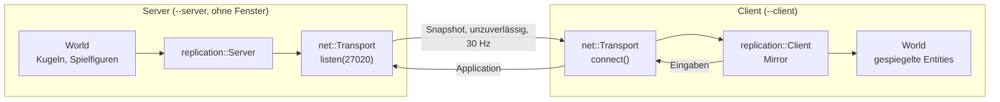

# D3: Durchstich Netzwerk

- **Phase:** Ausarbeitung
- **Status:** in Arbeit
- **Pull Requests:** #13 (zusammen mit D2)

## Plan

**Ziel:** Ein dedizierter Server ohne Fenster und GPU und ein Client verbinden sich über
GameNetworkingSockets. Mindestens eine Komponente wird vom Server zum Client repliziert, und der
Client steuert etwas auf dem Server.

**Features:** NET-01 (Transport), NET-02 (dedizierter Server), NET-04 (Replikation), jeweils als
erste Fassung für R5.

**Fragen, die der Durchstich klären soll:**

- Passt GameNetworkingSockets (vcpkg, Linux und Windows, ohne Steam) als Transport?
- Wie kommt Spielzustand aus dem ECS ins Netz, ohne für jede Komponente Netzwerkcode zu schreiben?
- Was kostet ein Schnappschuss in Bytes, und wo wird es eng?
- Lässt sich das in der CI ohne echtes Netz prüfen?

### Entwurf

**`ngine.net`** (läuft ohne Fenster und GPU)

- `Transport::create()`, `listen(port)`, `connect("adresse:port")`, `send(verbindung, daten,
  Delivery::Reliable | Unreliable)`, `disconnect()`, `poll(events)` mit den Ereignissen
  `Connected`, `Disconnected` und `Message`, dazu `stats()` (Ping, Qualität, Datenraten).
- Nur `transport_gns.cpp` kennt GameNetworkingSockets. Die Bibliothek ist ein Singleton pro
  Prozess; Transporte zählen Referenzen, damit Server und Client im selben Prozess laufen können
  (Tests, später Listen-Server).

**`ngine.replication`** (Welt-Schicht)

- `Replicated` markiert Entities auf dem Server und trägt auf dem Client die Server-Kennung.
- `encode_snapshot()` schreibt alle markierten Entities mit den Komponenten einer festen Liste über
  die Reflection; `Mirror::apply()` legt Entities an, setzt und entfernt Komponenten und zerstört,
  was fehlt. Beides ohne Netzwerk testbar.
- `Server` und `Client` verbinden das mit einem `Transport`: Begrüßung mit Prüfung der
  Komponentenliste, Schnappschüsse, Nutzdaten der Anwendung (Eingaben).

**Sandbox:** `--net-demo` startet Server und Client im selben Prozess und vergleicht am Ende die
Welten. `--server [--port n]` ist der dedizierte Server, `--client adresse` ein Client ohne
Fenster. Der Server lässt 32 Kugeln kreisen und legt für jeden Client eine Spielfigur an, die der
Client mit Eingaben im Kreis laufen lässt.

### Schritte

1. `ngine.net` mit Tests über localhost.
2. `ngine.replication` mit Tests ohne und mit Netzwerk.
3. Sandbox, CI (Demo im Prozess und zwei Prozesse unter Linux und Windows).
4. [ADR 0024](../adr/0024-networking-gns-snapshots.md), Doku.

**Risiken:**

- GameNetworkingSockets braucht Protobuf und OpenSSL; der erste Build in der CI dauert länger.
  Gegenmittel: vcpkg-Cache, Feature `ice` abgeschaltet.
- Tests mit echten Sockets können in der CI an Ports oder Firewalls scheitern. Gegenmittel: nur
  localhost, zufällige Ports, kurze Zeitlimits.

**Abnahme:**

- Server und Client verbinden sich über localhost, in einem Prozess und in zwei Prozessen (Tests
  und CI unter Linux und Windows).
- Eine Komponente (Position) kommt beim Client an und stimmt mit dem Server überein.
- Eine Eingabe des Clients ändert den Zustand auf dem Server.
- Der Server läuft mit `--server` ohne Fenster und GPU.

## Stand

- Umgesetzt: `ngine.net`, `ngine.replication`, `--net-demo`, `--server`, `--client`, CI-Schritte,
  [ADR 0024](../adr/0024-networking-gns-snapshots.md) (vorgeschlagen).
- Lokal im Cloud-Container (Clang 20, GameNetworkingSockets 1.6.1): 116 Tests grün, darunter drei
  `[net]`- und fünf `[replication]`-Tests; die Netzwerktests sind auch mit AddressSanitizer sauber.
- Messung (Debug-Build, `--net-demo` und zwei Prozesse über localhost):

  | Was | Wert |
  | --- | --- |
  | Verbindungsaufbau bis zur Begrüßung | rund 15 bis 20 ms |
  | Schnappschuss mit 33 Entities (Name und Position) | rund 1260 Bytes |
  | Datenrate pro Client bei 30 Hz, laut GameNetworkingSockets | rund 40 KB/s |
  | Angewendete Schnappschüsse | alle (localhost verliert nichts) |

- Erkenntnisse während der Umsetzung:
  - GameNetworkingSockets lehnt Port 0 ab („Must specify local port“). `listen(0)` probiert
    deshalb zufällige Ports aus dem dynamischen Bereich.
  - Rückrufe für Statusänderungen gelten pro Verbindung (Konfigurationswert), die Benutzerdaten der
    Verbindung zeigen auf den Transport. Angenommene Verbindungen erben beides vom Listen-Socket.
  - Qualität und Datenraten misst die Bibliothek erst nach einigen Sekunden.
  - Debug-Builds von GameNetworkingSockets melden gelegentlich „Assertion Failed:
    pSock->m_callback.m_fnCallback“, wenn ein Socket geschlossen wird, während der Dienst-Thread
    gerade pollt. Die Bibliothek räumt geschlossene Sockets absichtlich später auf, die Prüfung
    im Dienst-Thread rechnet damit aber nicht. Die Meldung ist harmlos, die Tests laufen weiter.
  - Schon 33 Entities überschreiten mit vollen Schnappschüssen ein UDP-Paket; die Bibliothek
    zerlegt die Nachricht, verliert aber die ganze, wenn ein Teil fehlt. Deltas sind deshalb früh
    in R5 nötig ([TD-13](../tech-debt.md)).

## Review

Folgt nach dem Merge.
