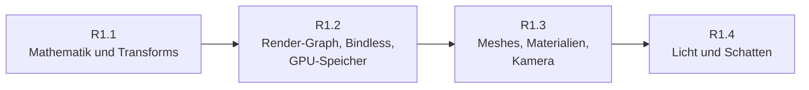

# R1: Rendering-Grundlagen

- **Phase:** Konstruktion
- **Status:** in Arbeit
- **Pull Requests:** …

R1 ist der erste Reifegrad der Konstruktion und zu groß für eine Iteration, die in wenigen Abenden
machbar ist ([Prozess](../process.md#iterationen)). Wir teilen ihn deshalb in vier Iterationen,
jede mit eigenem Dokument, eigenem PR und eigener Abnahme auf dem PC. Dieses Dokument hält den
Plan für den ganzen Reifegrad und am Ende sein Review.

## Plan

**Ziel:** Die Sandbox zeigt eine Szene aus glTF-Modellen mit PBR-Materialien, Sonne mit Schatten
und einigen Punktlichtern, durch die man mit einer freien Kamera fliegt. Positionen sind 64 Bit
und werden relativ zur Kamera gezeichnet; der Renderer baut jeden Frame als Render-Graph, der die
Barrieren selbst setzt.

**Features:** CORE-10, WORLD-03 (Propagation), WORLD-06, REND-05, REND-06, REND-16 (Abschluss),
CORE-07 (GPU-Zonen), REND-07, REND-08, ASSET-01, ASSET-02 (ohne KTX2), REND-09, REND-11 (nur Tone
Mapping), REND-15. Dazu die Schulden mit Frist R1: TD-02, TD-03, TD-10, TD-11.

### Aufteilung

| Iteration | Inhalt | Features und Schulden | Abnahme |
| --- | --- | --- | --- |
| [R1.1](R1.1-mathematik-und-transforms.md) Mathematik und Transforms | Modul `ngine.math` (Vektoren, Matrizen, Quaternionen, 64-Bit-Vektoren); `Transform` mit 64-Bit-Position, Propagation durch die Hierarchie als System; kamerarelative Matrizen. Voxel und Sandbox stellen auf die neuen Typen um | CORE-10, WORLD-03, WORLD-06, TD-10 | Tests ohne GPU; Voxel-Demo sieht aus wie vorher; ein Objekt 10 000 km vom Ursprung zittert nicht |
| [R1.2](R1.2-render-graph-bindless-gpu-speicher.md) Render-Graph, Bindless, GPU-Speicher | Modul `ngine.render` mit Render-Graph (Passes, Ressourcen, Barrieren, transiente Texturen); ein bindloser Descriptor-Satz für Texturen und Sampler; Puffer im GPU-Speicher mit Upload über Staging und Timeline Semaphores; Swapchain-Neuaufbau ohne Komplett-Stopp; GPU-Zonen in Tracy | REND-05, REND-06, REND-16, CORE-07, TD-02, TD-03, TD-11 | Barrieren und Reihenfolge ohne GPU getestet; Voxel-Demo läuft über den Graph ohne Meldungen der Validation Layers; Fenstergröße ändern ohne Ruckler |
| R1.3 Meshes, Materialien, Kamera | glTF über fastgltf, Bilder über stb_image mit Mipmaps auf der GPU; Mesh- und Material-Ressourcen; PBR (Metallic-Roughness, GGX) mit HDR-Ziel und Tone Mapping; Kamera-Komponente und freie Steuerung | ASSET-01, ASSET-02, REND-07, REND-08, REND-11 | Ein Khronos-Beispielmodell sieht aus wie im glTF-Viewer; Kugelraster mit Metallic und Roughness |
| R1.4 Licht und Schatten | Sonne mit Cascaded Shadow Maps, Punkt- und Spotlichter als Komponenten (Liste im Puffer, einfaches Forward-Shading); Debug-Linien und -Boxen | REND-09, REND-15 | Szene mit Sonne, Schatten über Kaskaden ohne sichtbare Nähte, acht bewegte Punktlichter |

Nicht in R1, damit der Reifegrad in überschaubarer Zeit fertig wird:

- **Mesh Shader und GPU-Culling** (REND-13, REND-10): bauen auf Render-Graph und Bindless auf und
  lohnen sich erst mit großen Szenen. Vorschlag: eigene Iteration R1.5 nach dem Review von R1.4
  oder Verschiebung nach R3, wo das Terrain viel Geometrie bringt.
- **Bloom, Farbkorrektur, Himmel und Atmosphäre** (Rest von REND-11, NAT-04): nach R3, wo die
  Natur dazukommt.
- **Hot Reload und KTX2** (PLAT-06, KTX2 aus ASSET-02): mit der Asset-Pipeline in R2.

### Leitlinien für alle vier Iterationen

- Der Renderer ist ein neues Modul in der Laufzeit-Schicht. Er kennt nur die RHI, nie Vulkan;
  was er von der GPU braucht, bekommt die RHI als schmale Erweiterung.
- Alles, was ohne GPU geht, ist ohne GPU testbar: Mathematik, Transforms, die Planung des
  Render-Graphs (Reihenfolge, Barrieren, Lebensdauer), das Laden von glTF in CPU-Daten.
- Jede Iteration bringt einen GPU-Test über lavapipe, der ein Bild rendert und Stichproben prüft.
- Die Sandbox bleibt Schaufenster: Jede Iteration ist dort mit einer Demo sichtbar, die alte
  Voxel-Demo zieht mit auf den neuen Renderer um.

**Risiken:**

- Der Render-Graph wird zu allgemein und frisst R1.2. Gegenmittel: nur, was R1.3 und R1.4
  brauchen (Grafik- und Compute-Passes, Texturen und Puffer, eine Queue); asynchrones Compute und
  Aliasing von Speicher später.
- Bindless und Upload über eine zweite Queue zeigen Fehler oft nur auf echter Hardware.
  Gegenmittel: Validation Layers mit Synchronisationsprüfung in den GPU-Tests, Test auf dem PC
  nach jeder Iteration.
- Beispielmodelle sind groß und stehen unter eigenen Lizenzen. Gegenmittel: kleine Testmodelle
  erzeugen die Tests selbst; die Sandbox lädt Khronos-Modelle von der Platte, eingecheckt wird
  keines.
- lavapipe ist langsam; Schatten und PBR in GPU-Tests nur mit kleinen Bildern.

**Abnahme:** die Abnahmen der vier Iterationen, dazu am Ende ein Review des ganzen Reifegrads mit
Architektur-Review und Messung der Frame-Zeit auf dem PC.

## Review

Folgt nach R1.4.
