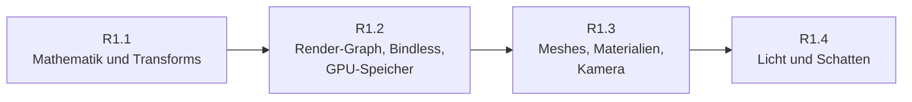

# R1: Rendering-Grundlagen

- **Phase:** Konstruktion
- **Status:** abgeschlossen
- **Pull Requests:** …

R1 ist der erste Reifegrad der Konstruktion und zu groß für eine Iteration, die in wenigen Abenden
machbar ist ([Prozess](../process.md#iterationen)). Wir teilen ihn deshalb in vier Iterationen,
jede mit eigenem Dokument, eigenem PR und eigener Abnahme auf dem PC. Dieses Dokument hält den
Plan für den ganzen Reifegrad und am Ende sein Review.

## Plan

**Ziel:** Die Sandbox zeigt eine Szene aus glTF-Modellen mit PBR-Materialien, Sonne mit Schatten
und einigen Punktlichtern, durch die man mit einer freien Kamera fliegt. Positionen sind 64 Bit
und werden relativ zur Kamera gezeichnet; der Renderer baut jeden Frame als Render-Graph, der die
Barrieren selbst setzt.

**Features:** CORE-10, WORLD-03 (Propagation), WORLD-06, REND-05, REND-06, REND-16 (Abschluss),
CORE-07 (GPU-Zonen), REND-07, REND-08, ASSET-01, ASSET-02 (ohne KTX2), REND-09, REND-11 (nur Tone
Mapping), REND-15. Dazu die Schulden mit Frist R1: TD-02, TD-03, TD-10, TD-11.

### Aufteilung

| Iteration | Inhalt | Features und Schulden | Abnahme |
| --- | --- | --- | --- |
| [R1.1](R1.1-mathematik-und-transforms.md) Mathematik und Transforms | Modul `ngine.math` (Vektoren, Matrizen, Quaternionen, 64-Bit-Vektoren); `Transform` mit 64-Bit-Position, Propagation durch die Hierarchie als System; kamerarelative Matrizen. Voxel und Sandbox stellen auf die neuen Typen um | CORE-10, WORLD-03, WORLD-06, TD-10 | Tests ohne GPU; Voxel-Demo sieht aus wie vorher; ein Objekt 10 000 km vom Ursprung zittert nicht |
| [R1.2](R1.2-render-graph-bindless-gpu-speicher.md) Render-Graph, Bindless, GPU-Speicher | Modul `ngine.render` mit Render-Graph (Passes, Ressourcen, Barrieren, transiente Texturen); ein bindloser Descriptor-Satz für Texturen und Sampler; Puffer im GPU-Speicher mit Upload über Staging und Timeline Semaphores; Swapchain-Neuaufbau ohne Komplett-Stopp; GPU-Zonen in Tracy | REND-05, REND-06, REND-16, CORE-07, TD-02, TD-03, TD-11 | Barrieren und Reihenfolge ohne GPU getestet; Voxel-Demo läuft über den Graph ohne Meldungen der Validation Layers; Fenstergröße ändern ohne Ruckler |
| [R1.3](R1.3-meshes-materialien-kamera.md) Meshes, Materialien, Kamera | glTF über fastgltf, Bilder über stb_image mit Mipmaps auf der GPU; Mesh- und Material-Ressourcen; PBR (Metallic-Roughness, GGX) mit HDR-Ziel und Tone Mapping; Kamera-Komponente und freie Steuerung | ASSET-01, ASSET-02, REND-07, REND-08, REND-11 | Ein Khronos-Beispielmodell sieht aus wie im glTF-Viewer; Kugelraster mit Metallic und Roughness |
| [R1.4](R1.4-licht-und-schatten.md) Licht und Schatten | Sonne mit Cascaded Shadow Maps, Punkt- und Spotlichter als Komponenten (Liste im Puffer, einfaches Forward-Shading); Debug-Linien und -Boxen | REND-09, REND-15 | Szene mit Sonne, Schatten über Kaskaden ohne sichtbare Nähte, acht bewegte Punktlichter |

Nicht in R1, damit der Reifegrad in überschaubarer Zeit fertig wird:

- **Mesh Shader und GPU-Culling** (REND-13, REND-10): bauen auf Render-Graph und Bindless auf und
  lohnen sich erst mit großen Szenen. Nach dem Review von R1.4 entschieden: Verschiebung nach R3,
  wo das Terrain viel Geometrie bringt.
- **Bloom, Farbkorrektur, Himmel und Atmosphäre** (Rest von REND-11, NAT-04): nach R3, wo die
  Natur dazukommt.
- **Hot Reload und KTX2** (PLAT-06, KTX2 aus ASSET-02): mit der Asset-Pipeline in R2.

### Leitlinien für alle vier Iterationen

- Der Renderer ist ein neues Modul in der Laufzeit-Schicht. Er kennt nur die RHI, nie Vulkan;
  was er von der GPU braucht, bekommt die RHI als schmale Erweiterung.
- Alles, was ohne GPU geht, ist ohne GPU testbar: Mathematik, Transforms, die Planung des
  Render-Graphs (Reihenfolge, Barrieren, Lebensdauer), das Laden von glTF in CPU-Daten.
- Jede Iteration bringt einen GPU-Test über lavapipe, der ein Bild rendert und Stichproben prüft.
- Die Sandbox bleibt Schaufenster: Jede Iteration ist dort mit einer Demo sichtbar, die alte
  Voxel-Demo zieht mit auf den neuen Renderer um.

**Risiken:**

- Der Render-Graph wird zu allgemein und frisst R1.2. Gegenmittel: nur, was R1.3 und R1.4
  brauchen (Grafik- und Compute-Passes, Texturen und Puffer, eine Queue); asynchrones Compute und
  Aliasing von Speicher später.
- Bindless und Upload über eine zweite Queue zeigen Fehler oft nur auf echter Hardware.
  Gegenmittel: Validation Layers mit Synchronisationsprüfung in den GPU-Tests, Test auf dem PC
  nach jeder Iteration.
- Beispielmodelle sind groß und stehen unter eigenen Lizenzen. Gegenmittel: kleine Testmodelle
  erzeugen die Tests selbst; die Sandbox lädt Khronos-Modelle von der Platte, eingecheckt wird
  keines.
- lavapipe ist langsam; Schatten und PBR in GPU-Tests nur mit kleinen Bildern.

**Abnahme:** die Abnahmen der vier Iterationen, dazu am Ende ein Review des ganzen Reifegrads mit
Architektur-Review und Messung der Frame-Zeit auf dem PC.

## Review

**Ergebnis:** Die Sandbox zeigt eine Szene aus glTF-Modellen oder PBR-Kugeln mit Sonne, Schatten
über vier Kaskaden und acht bewegten Punktlichtern, durch die man mit einer freien Kamera fliegt.
Positionen sind 64 Bit und werden relativ zur Kamera gezeichnet, auch 10 000 km vom Ursprung ohne
Zittern. Der Renderer baut jeden Frame als Render-Graph, der Barrieren, transiente Texturen und
GPU-Zonen selbst verwaltet; Shader erreichen Texturen bindlos, Geometrie und Materialien liegen im
GPU-Speicher.

| Iteration | Pull Requests | Ergebnis |
| --- | --- | --- |
| [R1.1](R1.1-mathematik-und-transforms.md) Mathematik und Transforms | siehe Iteration | `ngine.math`, `Transform` mit 64-Bit-Position, Propagation, kamerarelative Matrizen |
| [R1.2](R1.2-render-graph-bindless-gpu-speicher.md) Render-Graph, Bindless, GPU-Speicher | #17, #18 | Render-Graph, bindloser Satz, Uploads und Swapchain ohne Warten |
| [R1.3](R1.3-meshes-materialien-kamera.md) Meshes, Materialien, Kamera | #19, #20 | glTF, PBR, HDR mit Tone Mapping, Kamera, freie Steuerung, GPU-Zonen |
| [R1.4](R1.4-licht-und-schatten.md) Licht und Schatten | #21, #22 | Lichter als Komponenten, Cascaded Shadow Maps, Debug-Zeichnen |

Abnahme: Die Abnahmen aller vier Iterationen sind erfüllt, jede mit grüner CI auf Linux, unter
ThreadSanitizer und auf Windows sowie einem Test auf dem PC; die Frame-Zeit auf dem PC ist
gemessen (siehe Leistung).

Abweichungen vom Plan:

- Die GPU-Zonen (CORE-07) wanderten wie vorgesehen von R1.2 nach R1.3.
- Die Voxel-Demo nutzt Kamera und umgekehrte Tiefe des Renderers, zeichnet aber weiter mit
  eigener Pipeline. Sie zieht mit dem Voxel-Ausbau in R3 ganz auf den Renderer um.
- Mesh Shader und GPU-Culling (REND-13, REND-10) wandern nach R3, wo das Terrain viel Geometrie
  bringt; eine eigene Iteration R1.5 gibt es nicht.

**Erkenntnisse:**

- Vier Iterationen mit je eigenem PR und Test auf dem PC hielten den Reifegrad überschaubar. Jede
  Iteration war in einem PR prüfbar, und Fehler kamen früh ans Licht (Barriere vor der
  Präsentation in R1.2, Schreib-nach-Schreib-Gefahr in R1.3, Zeichnen beim Ziehen unter Windows).
- Die Synchronisationsprüfung der Validation Layers in allen GPU-Tests ist das wertvollste
  Werkzeug für Vulkan gewesen; lavapipe reicht für Bilder und Stichproben in der CI.
- Was ohne GPU testbar ist (Mathematik, Planung des Graphs, glTF, Kaskaden, Lichtliste), wurde so
  gebaut; die GPU-Tests prüfen nur noch das Zusammenspiel.
- Bildvergleiche (`--far`, `--baseline`) sind billige Wächter für kamerarelatives Zeichnen und
  Rückfallpfade; Referenzbilder auf der Platte wären zwischen Treibern zu empfindlich.

**Architektur-Review des Reifegrads:**

- Schichten wie geplant: `ngine.render` kennt nur die RHI, die RHI keine Vulkan-Typen in ihrer
  Schnittstelle; fastgltf und stb_image stecken in Adaptern von `ngine.asset`. Neue ADRs: 0026
  (Render-Graph und Bindless), 0027 (glTF und Materialien), 0028 (Licht und Schatten).
- Größte Dateien: `renderer.cpp` (rund 770 Zeilen), `device.cpp` (rund 550), `rhi.cppm` (rund
  440). Der Renderer ist der erste Kandidat zum Aufteilen.
- Schulden: TD-02, TD-03, TD-10, TD-11 und TD-19 abgebaut; offen aus R1 sind TD-16 bis TD-18 und
  TD-20 bis TD-25, alle mit Frist R2 oder R3.
- 171 Tests, davon die GPU-Tests über lavapipe; Debug- und Release-Build ohne Warnung.

**Leistung:** Frame-Zeit der Standardszene auf dem PC, gemessen in Tracy (Windows 11, NVIDIA
GeForce RTX 3060 Ti, Debug-Build, `--no-vsync`):

| Auflösung | Frame-Zeit |
| --- | --- |
| 1280 × 720 | etwa 2,3 bis 3,9 ms |
| 1920 × 1009 (maximiert) | etwa 2,5 bis 5,0 ms |

Damit bleibt selbst der Debug-Build weit unter 16,7 ms (60 Bilder pro Sekunde). Die Zeit wächst
mit der Auflösung nur wenig; der Großteil hängt also nicht an den Pixeln, sondern an festen
Kosten wie den vier Schattenkarten und der Arbeit auf der CPU. Die GPU-Zonen pro Pass in Tracy
zeigen genauer, welcher Pass wie viel kostet; ein Vergleich mit dem Release-Build folgt bei
Bedarf. Auf lavapipe sind Zeiten nicht aussagekräftig.
