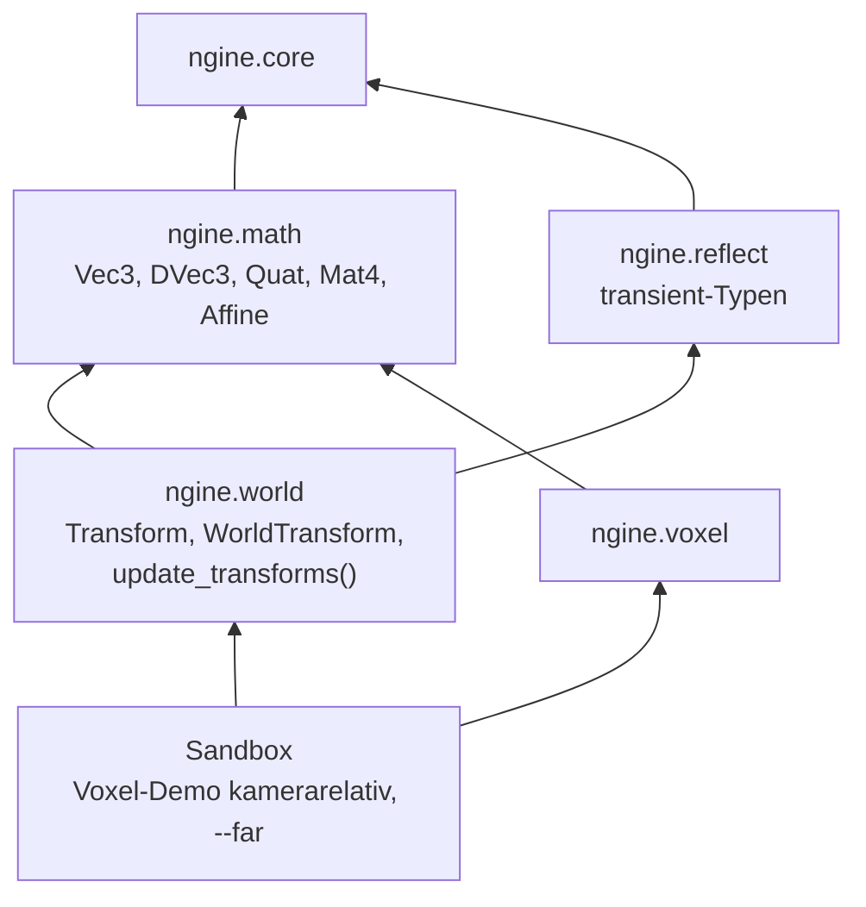

# R1.1: Mathematik und Transforms

- **Phase:** Konstruktion (Reifegrad [R1](R1-rendering-grundlagen.md))
- **Status:** abgeschlossen
- **Pull Requests:** #15 (R1.1 und R1.1b), #16 (Review)

## Plan

**Ziel:** Die Engine hat eine Mathematik-Bibliothek, Entities haben eine Lage mit 64-Bit-Position,
die sich durch die Hierarchie fortpflanzt, und gezeichnet wird relativ zur Kamera, sodass auch
10 000 km vom Ursprung nichts zittert.

**Features:** CORE-10 (Mathematik), WORLD-03 (Transform-Propagation), WORLD-06 (64-Bit-
Weltpositionen). Dazu TD-10 aus dem [Schuldenregister](../tech-debt.md), soweit es die Mathematik
betrifft; die Kamera wandert erst mit REND-08 in R1.3 in den Renderer.

### Entwurf

**`ngine.math`** (Core-Schicht, [ADR 0025](../adr/0025-own-math-mixed-precision.md))

- Erste Fassung: GLM aus vcpkg, nur im globalen Modulfragment von `ngine.math`; in R1.1b durch
  eine eigene Implementierung mit derselben Schnittstelle ersetzt (siehe unten). Exportiert werden Aliase
  (`Vec2`, `Vec3`, `Vec4`, `IVec2`, `IVec3`, `DVec3`, `Mat3`, `Mat4`, `DMat3`, `Quat`) und die
  genutzten Funktionen; Namen in camelCase bekommen eine Fassung in snake_case (`angle_axis`,
  `look_rotation`, `look_at`, `to_mat3`).
- Konventionen an einer Stelle: rechtshändig, y oben, Blick entlang -z, Tiefe 0 bis 1.
  `perspective_reverse_z()` (umgekehrte Tiefe, unendliche Ferne) liegt für R1.3 bereit.
- `Affine`: `Mat3` in 32 Bit und Verschiebung in 64 Bit; Verkettung, Umkehrung und
  `relative_to(origin)` für die kamerarelative Matrix der GPU.
- `near()` vergleicht Zahlen, Vektoren, Quaternionen und Matrizen mit Toleranz.

**`ngine.world`**

- `Transform` (lokal zum Elternteil: Position `DVec3`, Drehung `Quat`, Skalierung `Vec3`) ist in
  der Reflection registriert und wird in Szenen gespeichert.
- `WorldTransform` (ein `Affine`) kommt über `World::require()` automatisch mit `Transform` dazu.
  Er ist als `transient` markiert (neues Merkmal der Reflection); Szenen speichern ihn nicht.
- `update_transforms(World&)` berechnet alle Weltlagen, Eltern vor Kindern. Dafür bekommt die
  Welt `for_each_parent_first()`: eine Abfrage von flecs mit Cascade, die die Komponente des
  nächsten Vorfahren mitliefert. Ein Vorfahr ohne `Transform` wird übersprungen.

**`ngine.voxel` und Sandbox**

- Der eigene `voxel::Vec3` entfällt, das Voxel-Modul nutzt `math::Vec3`.
- Die Voxel-Demo verliert ihre eigenen Matrizen. Die Kamera hat eine 64-Bit-Position und eine
  Drehung; die Blickmatrix enthält nur die Drehung, das Gitter wird in 64 Bit um die Kamera
  verschoben. `--far` legt das Gitter 10 000 km vom Ursprung; die CI vergleicht das Bild mit dem
  im Ursprung.

### Schritte

1. `ngine.math` mit Tests.
2. `Transform`, `WorldTransform`, Propagation, `transient` in Reflection und Szene, Tests.
3. Voxel und Sandbox umstellen, `--far`, CI-Vergleich der Bilder.
4. [ADR 0025](../adr/0025-own-math-mixed-precision.md), Doku.

**Risiken:**

- GLM in einem C++-Modul: Operatoren müssen über ADL in importierenden Modulen sichtbar sein,
  MSVC und Clang behandeln das globale Modulfragment unterschiedlich. Gegenmittel: Operatoren im
  Namensraum `glm` exportieren, wie es GLM in seinem eigenen Modul tut; CI unter beiden Compilern.
- Die Reihenfolge von flecs mit Cascade gilt nur für zwischengespeicherte Abfragen. Gegenmittel:
  Test mit Kindern, die vor ihren Eltern angelegt werden.

**Abnahme:**

- Tests für Mathematik und Transforms ohne GPU, darunter Genauigkeit 10 000 km vom Ursprung.
- Die Voxel-Demo sieht aus wie vorher und lässt sich wie vorher bedienen.
- `--voxel-demo --far` sieht genauso aus und zittert nicht, auch wenn sich die Kamera dreht.

## Stand

- Umgesetzt: `ngine.math`, `Transform`/`WorldTransform`/`update_transforms()`, `transient` in der
  Reflection, Umstellung von Voxel und Sandbox, `--far`, CI-Vergleich,
  [ADR 0025](../adr/0025-own-math-mixed-precision.md) (vorgeschlagen).
- Lokal im Cloud-Container (Clang 20, GLM 1.0.3, Slang 2026.20, lavapipe): 129 Tests grün,
  darunter acht `[math]`- und fünf `[transform]`-Tests.
- `--voxel-demo --image` mit und ohne `--far` liefert byte-gleiche Bilder; gegenüber dem Stand
  vor R1.1 weichen 22 von rund 1,5 Millionen Bytes ab (Rundung in der neuen Matrixrechnung).
- Erkenntnisse während der Umsetzung:
  - Operatoren von GLM findet der Compiler in einem importierenden Modul nur, wenn sie exportiert
    sind und das Modul `ngine.math` importiert ist. `ngine.voxel` und `ngine.world` reichen
    `ngine.math` deshalb mit `export import` weiter, weil ihre Schnittstellen dessen Typen nutzen.
  - `glm::epsilonEqual` vergleicht mit „kleiner“, nicht „kleiner gleich“; mit Toleranz 0 ist
    nichts gleich. `math::near()` vergleicht deshalb selbst.
  - flecs liefert mit Cascade die Komponente des nächsten Vorfahren, der sie hat; damit überspringt
    die Propagation Gruppen-Entities ohne `Transform` ohne Sonderfall.

## R1.1b: eigene Mathematik

Nach dem ersten Stand hat viiez entschieden, die Mathematik sofort selbst zu implementieren, solange
erst Voxel, Transforms und Sandbox daran hängen. Gründe und Abwägung stehen in
[ADR 0025](../adr/0025-own-math-mixed-precision.md).

- `ngine.math` hat jetzt die Partitionen `:scalar`, `:vector`, `:matrix`, `:quaternion`,
  `:transform` und `:affine`, zusammen rund 780 Zeilen ohne Fremdbibliothek. Vektoren und Matrizen
  sind Vorlagen über dem Zahlentyp, Operatoren versteckte Freunde der Typen.
- Die Schnittstelle blieb gleich: Außerhalb von `engine/math/` haben sich nur zwei Kommentare
  geändert.
- GLM ist nur noch Abhängigkeit der Tests. `math_oracle_tests.cpp` vergleicht mit festem Startwert
  je 200 zufällige Fälle für Matrixprodukte, Umkehrmatrizen (3×3 und 4×4, auch nicht affine),
  Determinanten, Quaternionen (Achse und Winkel, Drehen, Produkt, Matrix, `slerp`,
  `look_rotation`), Blick- und Projektionsmatrizen und Vektorfunktionen.
- Lokal: 133 Tests grün (4436 Prüfungen in `[math]`). Das Bild der Voxel-Demo ist byte-gleich mit
  dem der GLM-Fassung, mit und ohne `--far`.

## Review

**Ergebnis:** Die Engine hat eine eigene Mathematik-Bibliothek ohne Fremdbibliothek, gegen GLM
getestet. Entities haben mit `Transform` eine Lage mit 64-Bit-Position; `update_transforms()`
berechnet daraus `WorldTransform` entlang der Hierarchie. Die Voxel-Demo zeichnet relativ zur
Kamera und sieht 10 000 km vom Ursprung genauso aus wie im Ursprung; die CI prüft das per
Bildvergleich.

Abnahme: Alle Kriterien sind erfüllt. Der Test auf dem PC (Windows, `--voxel-demo --far` im
Fenster) verlief erfolgreich, beim Drehen zittert nichts.

**Erkenntnisse:**

- GLM in C++-Modulen ist möglich, aber mühsam: Operatoren müssen im Namensraum `glm` exportiert
  werden, die Schalter (`GLM_FORCE_XYZW_ONLY`, `GLM_FORCE_CTOR_INIT`) schalten SIMD ab bzw. müssen
  überall gleich sein. Eigene Typen mit Operatoren als versteckten Freunden haben diese Probleme
  nicht.
- Eine Bibliothek als Testorakel ist ein günstiger Weg, eigene Formeln abzusichern: Die
  Vergleichstests fanden auf Anhieb keine Abweichung, hätten aber jeden Vorzeichenfehler in
  Umkehrmatrix oder Projektion sofort gezeigt.
- Zwei Schritte mit derselben Schnittstelle (erst GLM, dann eigene Typen) haben den Austausch
  billig gemacht: Außerhalb von `engine/math/` änderten sich nur zwei Kommentare.
- `update_transforms()` braucht im Release-Build rund 6 ms für 101 000 Entities in drei Ebenen
  (ein Thread, alle Entities in jedem Aufruf). Für die Sandbox reicht das; für große Szenen nicht
  (TD-15).

**Anpassungen:** ADR 0025 angenommen. Feature-Katalog: CORE-10 und WORLD-06 fertig, WORLD-03
fertig (Hierarchie und Propagation). Schuldenregister: TD-10 bleibt bis R1.3 (Kamera), TD-15 neu.

**Architektur-Review:**

- `ngine.math` hängt nur an `ngine.core`; `ngine.world` und `ngine.voxel` reichen es mit
  `export import` weiter, weil ihre Schnittstellen seine Typen nutzen. Keine Abhängigkeit nach
  oben, Plattform und RHI sind nicht beteiligt.
- Keine neue Fremdbibliothek in der Engine; GLM steckt nur in `tests/`.
- Die Schnittstellen passen zu R1.2 und R1.3: `Affine::relative_to()` liefert die Matrix pro
  Objekt, `perspective_reverse_z()` liegt für die Kamera bereit. `World::require()` und
  `for_each_parent_first()` sind allgemein genug für weitere berechnete Komponenten (z. B.
  Bounding Boxes in Weltkoordinaten).
- Größte neue Datei ist `matrix.cppm` mit rund 200 Zeilen; `voxel_demo.cppm` (rund 520 Zeilen)
  bleibt Wegwerf-Code, bis Kamera und Hochladen in den Renderer wandern (R1.2, R1.3).
- Neue Schulden: TD-15 (Propagation ohne Änderungserkennung und in einem Thread).
- Leistung: siehe Messung oben; die Mathematik selbst fällt im Profil der Voxel-Demo nicht auf.
