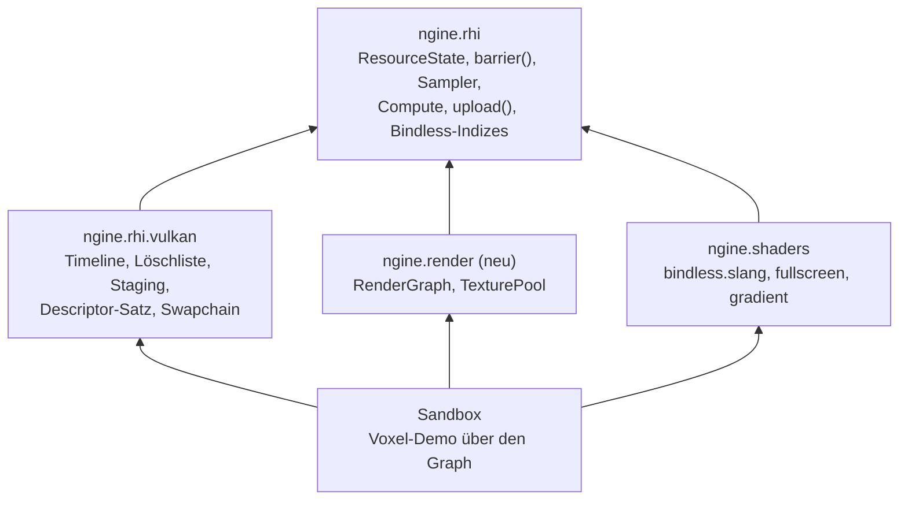

# R1.2: Render-Graph, Bindless, GPU-Speicher

- **Phase:** Konstruktion (Reifegrad [R1](R1-rendering-grundlagen.md))
- **Status:** abgeschlossen
- **Pull Requests:** #17, #18 (Review)

## Plan

**Ziel:** Der Renderer baut jeden Frame als Render-Graph, der Barrieren und transiente Texturen
selbst verwaltet. Shader erreichen Texturen über Indizes in einem einzigen bindlosen
Descriptor-Satz. Statische Geometrie liegt im GPU-Speicher, und weder Hochladen noch
Fenstergröße ändern hält die GPU an.

**Features:** REND-05 (Render-Graph), REND-06 (Bindless), REND-16 (Abschluss: Puffer im
GPU-Speicher), CORE-07 (GPU-Zonen in Tracy, letzter Schritt, siehe Risiken). Dazu TD-02, TD-03
und TD-11 aus dem [Schuldenregister](../tech-debt.md).

### Entwurf



**`ngine.rhi`: schmale Erweiterungen**

- **Zustände und Barrieren (TD-02):** `ResourceState` beschreibt, wie eine Ressource gerade
  benutzt wird (`Undefined`, `ColorTarget`, `DepthTarget`, `DepthRead`, `ShaderRead`,
  `ShaderWrite`, `IndexRead`, `TransferSrc`, `TransferDst`, `Present`).
  `CommandList::barrier()` bekommt Übergänge mit Vorher und Nachher; das Backend leitet daraus
  Stufen, Zugriffe und Layouts ab. `begin_rendering()` setzt keine Barrieren mehr, das Backend
  merkt sich keine Layouts mehr.
- **Texturen:** Verwendungen als Flags (`RenderTarget`, `Sampled`, `Storage`, `TransferSrc`,
  `TransferDst`), neue Formate `RGBA16Float` und `R32Float`. Eine Textur mit `Sampled` oder
  `Storage` hat einen Index im bindlosen Satz (`sampled_index()`, `storage_index()`).
- **Bindless (REND-06):** Das Device hält einen Descriptor-Satz mit drei Feldern: Texturen zum
  Lesen, Sampler und Storage-Texturen. Alle Pipelines teilen ein Layout aus diesem Satz und
  128 Bytes Push Constants; der Satz wird einmal pro Command Buffer gebunden. Neu sind
  `create_sampler()` und Compute-Pipelines mit `dispatch()`.
- **GPU-Speicher (TD-11, REND-16):** `BufferDesc::memory` wählt zwischen `Gpu` (schneller
  Speicher, nur über `upload()` beschreibbar) und `CpuWrite` (wie bisher, `write()`).
  `Device::upload()` kopiert Daten in Puffer und Texturen über einen Staging-Ring; die Kopien
  laufen in einem eigenen Command Buffer vor der nächsten Abgabe auf derselben Queue, ohne auf die
  GPU zu warten.
- **Lebensdauer:** Das Device zählt seine Abgaben mit einem Timeline Semaphore. Zerstörte
  Ressourcen kommen in eine Löschliste und werden erst freigegeben, wenn die GPU alle Abgaben bis
  dahin abgearbeitet hat. Damit darf der Aufrufer Texturen und Puffer jederzeit zerstören, auch
  wenn ein Frame im Flug sie noch benutzt.
- **Swapchain (TD-03):** Der Neuaufbau übergibt die alte Swapchain als `oldSwapchain` und legt sie
  samt Bildern und Semaphoren in die Löschliste, statt mit `vkDeviceWaitIdle` alles anzuhalten.
  Die Frames im Flug warten auf die Timeline statt auf Fences.
- **Tests:** `rhi::vulkan::headless_surface()` liefert eine Surface ohne Fenster
  (`VK_EXT_headless_surface`), damit Swapchain und Größenänderung in der CI laufen. Die
  Validation Layers prüfen jetzt auch die Synchronisation.

**`ngine.render`** (Laufzeit-Schicht, kennt nur die RHI, [ADR 0026](../adr/0026-render-graph-bindless.md))

```cpp
render::RenderGraph graph;
auto backbuffer = graph.import_texture("Backbuffer", frame.backbuffer,
                                       rhi::ResourceState::Undefined, rhi::ResourceState::Present);
auto depth = graph.create_texture("Tiefe", {.extent = extent, .format = rhi::Format::D32Float});
graph.add_pass("Voxel",
    [&](render::PassBuilder& pass) {
        pass.write(backbuffer, rhi::ResourceState::ColorTarget);
        pass.write(depth, rhi::ResourceState::DepthTarget);
    },
    [&](render::PassContext& context) { /* begin_rendering, draw … */ });
graph.execute(frame.commands, pool);
```

- Passes deklarieren, welche Texturen und Puffer sie in welchem Zustand lesen oder schreiben.
  `compile()` arbeitet ohne GPU: Es verwirft Passes, deren Ergebnis niemand braucht, berechnet die
  Barrieren vor jedem Pass und am Ende (Endzustand importierter Ressourcen) und die Lebensdauer
  transienter Texturen. Die Reihenfolge bleibt die der Deklaration.
- Transiente Texturen beschreibt man nur mit Größe und Format; die Verwendungen leitet der Graph
  aus den Zuständen ab. `TexturePool` hält sie über Frames hinweg vor. Aliasing von Speicher kommt
  später.
- Eine Queue, Grafik- und Compute-Passes. Asynchrones Compute, Puffer als transiente Ressourcen und
  Umordnen von Passes sind ausdrücklich nicht dabei.

**Shader und Sandbox**

- `bindless.slang` deklariert den Satz für alle Shader. `fullscreen.slang` zeichnet eine Textur
  über das ganze Ziel (Grundlage für Tone Mapping in R1.3), `gradient.slang` ist ein Compute-Shader
  als Testmuster.
- Die Voxel-Demo zeichnet über den Graph: Backbuffer importiert, Tiefenpuffer transient, das Netz
  in einem Puffer im GPU-Speicher, den `upload()` nach jeder Änderung füllt. Die Kopien pro Frame
  im Flug entfallen.

### Schritte

1. RHI: Zustände, Barrieren, Texturverwendungen, Formate; Timeline, Löschliste. Bestehende Tests
   und Sandbox setzen ihre Barrieren selbst.
2. RHI: Bindless-Satz, Sampler, Compute, GPU-Test „Compute schreibt, Grafik liest“.
3. RHI: Puffer im GPU-Speicher, `upload()` über Staging, GPU-Test.
4. Swapchain ohne Komplett-Stopp, `headless_surface()`, GPU-Test mit Größenänderung.
5. `ngine.render` mit Tests ohne GPU (Reihenfolge, Barrieren, Verwerfen, Lebensdauer, Fehler) und
   einem GPU-Test; Voxel-Demo umstellen.
6. GPU-Zonen pro Pass in Tracy über Timestamp-Queries (nach R1.3 verschoben, siehe Stand).
7. ADR 0026, Doku.

**Risiken:**

- Bindless und Synchronisation zeigen Fehler oft nur auf echter Hardware. Gegenmittel:
  Synchronisationsprüfung der Validation Layers in allen GPU-Tests, Test auf dem PC.
- Die alte Swapchain und ihre Semaphoren freizugeben, ohne dass die Präsentation sicher fertig
  ist, ist ohne `VK_EXT_swapchain_maintenance1` nur über die Timeline der Abgaben möglich.
  Gegenmittel: Freigabe erst nach `frames_in_flight` weiteren Abgaben, Test mit headless Surface
  unter den Validation Layers und auf dem PC.
- Der Render-Graph wird zu allgemein. Gegenmittel: nur, was R1.3 und R1.4 brauchen (siehe oben).
- GPU-Zonen in Tracy brauchen kalibrierte Zeitstempel. Wird der Schritt zu groß, wandert er als
  eigener Punkt in R1.3; CORE-07 bleibt dann in Arbeit.

**Abnahme:**

- Tests ohne GPU für die Planung des Graphs: Reihenfolge, Barrieren, verworfene Passes,
  Lebensdauer und Fehlerfälle.
- GPU-Tests über lavapipe: Compute schreibt eine Storage-Textur, ein Grafik-Pass liest sie bindlos;
  Upload in Puffer und Textur; Swapchain mit Größenänderung. Alles ohne Meldung der Validation
  Layers, auch nicht der Synchronisationsprüfung.
- Die Voxel-Demo läuft über den Graph, sieht aus wie vorher (Bildvergleich in der CI) und meldet
  keine Fehler der Validation Layers.
- Auf dem PC: Fenstergröße ändern ohne Ruckler und ohne Meldungen.

## Stand

- Umgesetzt: Schritte 1 bis 5 und 7. `ngine.rhi` mit Zuständen, Barrieren, Texturverwendungen,
  Samplern, Compute, `MemoryUsage` und `upload()`; im Vulkan-Backend Timeline, Löschliste,
  bindloser Satz, Staging-Ring, Swapchain ohne `vkDeviceWaitIdle` und `headless_surface()`;
  `ngine.render` mit `RenderGraph` und `TexturePool`; Shader `bindless.slang`, `fullscreen.slang`,
  `gradient.slang`; Voxel-Demo und Dreieck der Sandbox über den Graph;
  [ADR 0026](../adr/0026-render-graph-bindless.md) (vorgeschlagen).
- **GPU-Zonen (Schritt 6) verschoben nach R1.3.** Der PR ist mit RHI, Backend und neuem Modul
  schon groß, und ob die Zeitstempel in Tracy richtig ankommen, lässt sich nur auf dem PC mit dem
  Tracy-Viewer prüfen. CORE-07 bleibt in Arbeit.
- Lokal im Cloud-Container (Clang 20, lavapipe, Validation Layers 1.4 mit Synchronisationsprüfung):
  145 Tests grün, davon neu sechs `[render]`-Tests ohne GPU, ein GPU-Test des Graphs und fünf
  GPU-Tests der RHI (Upload in Textur und Puffer, Wiederverwendung bindloser Plätze, Storage-Format,
  Swapchain mit dreimaliger Größenänderung über eine headless Surface). Debug- und Release-Build
  ohne Warnung.
- `--voxel-demo --image` liefert mit und ohne `--far` ein Bild, das byte-gleich mit dem von R1.1
  ist. Unter Xvfb läuft die Demo im Fenster 120 Frames ohne Meldung der Validation Layers, inklusive
  eines Neuaufbaus der Swapchain beim Start.
- Erkenntnisse während der Umsetzung:
  - Die Synchronisationsprüfung fand sofort einen echten Fehler: Die Barriere zum Zustand `Present`
    endete mit der Stufe `NONE`, damit lag der Layout-Wechsel nicht sicher vor dem Semaphor für die
    Präsentation. Jetzt endet sie mit allen Stufen ohne Speicherzugriff.
  - Clang 20 instanziert `std::deque` in einer Modul-Partition nicht vollständig (Linkerfehler für
    `_Deque_base`); die Löschliste nutzt deshalb einen `std::vector`.
  - Slang verlangt für `RWTexture2D<float4>` auch beim reinen Schreiben die Fähigkeit
    `StorageImageReadWithoutFormat`; beide Fähigkeiten sind jetzt Pflicht (ADR 0017).
  - Eine headless Surface (`VK_EXT_headless_surface`, von lavapipe angeboten) macht Swapchain und
    Größenänderung in der CI testbar, ohne Fenster und ohne Xvfb.

## Review

**Ergebnis:** Der Renderer baut jeden Frame als Render-Graph, der Barrieren, verworfene Passes und
transiente Texturen selbst verwaltet; die Planung ist ohne GPU getestet. Shader erreichen Texturen
und Sampler über einen bindlosen Satz. Statische Geometrie liegt im GPU-Speicher, Uploads und der
Neuaufbau der Swapchain warten nicht mehr auf die GPU. Die Voxel-Demo läuft über den Graph und
sieht aus wie vorher.

Abnahme: Alle Kriterien sind erfüllt, bis auf die GPU-Zonen, die wie im Plan vorgesehen nach R1.3
wandern. Die CI war auf Linux, unter ThreadSanitizer und auf Windows mit MSVC grün. Der Test auf
dem PC (Windows, `--voxel-demo` im Fenster, Größe ändern) verlief erfolgreich, ohne Meldungen der
Validation Layers. Beobachtung dabei: Während der Fensterrahmen gezogen wird, zeichnet die Sandbox
nicht; das Bild erscheint erst nach dem Loslassen. Ursache ist die modale Schleife von Windows beim
Ziehen, in der SDL nicht aus der Ereignisabfrage zurückkehrt (TD-19).

**Erkenntnisse:**

- Die Synchronisationsprüfung der Validation Layers lohnt sich: Sie fand beim ersten Lauf eine
  falsche Barriere vor der Präsentation, die auf lavapipe und vermutlich auch auf dem PC nie
  sichtbar geworden wäre.
- Explizite Zustände ohne Gedächtnis im Backend machen Aufrufer etwas länger (Tests setzen ihre
  Barrieren selbst), aber jeder Übergang steht im Code oder im Plan des Graphs; es gibt keinen
  versteckten Zustand mehr.
- Eine headless Surface reicht, um Swapchain und Größenänderung in der CI zu prüfen. Was sie nicht
  zeigt, ist das Verhalten des Fenstersystems, wie die modale Schleife unter Windows.
- Der Graph blieb klein (rund 330 Zeilen Umsetzung), weil Umordnen, Aliasing und mehrere Queues
  bewusst fehlen. Die Lebensdauer im Plan liegt für Aliasing schon bereit (TD-16).

**Anpassungen:** ADR 0026 angenommen. Feature-Katalog: REND-05, REND-06 und REND-16 fertig,
CORE-07 bleibt in Arbeit (GPU-Zonen in R1.3). Schuldenregister: TD-02, TD-03 und TD-11 abgebaut,
TD-16 bis TD-18 neu, dazu TD-19 aus dem Test auf dem PC.

**Architektur-Review:**

- `ngine.render` hängt nur an `ngine.rhi` (und `ngine.profile`); Vulkan kennt er nicht. Die RHI
  wuchs um Zustände, Sampler, Compute und `upload()`, blieb aber ohne Vulkan-Typen.
- Neue Pflicht-Features für Storage-Texturen stehen in ADR 0017; alle Ziel-GPUs erfüllen sie.
- Größte Dateien: `device.cpp` (rund 480 Zeilen) und `rhi.cppm` (rund 370 Zeilen). Das Device setzt
  nur noch zusammen; Timeline, Löschliste, bindloser Satz und Uploads stecken in eigenen
  Partitionen (`:context`, `:upload`).
- Die Sandbox ist schlanker: Tiefenpuffer und Kopien pro Frame im Flug fallen weg, der Frame ist ein
  Graph. Kamera und Hauptschleife bleiben Wegwerf-Code bis R1.3 (TD-10, TD-19).
- Neue Schulden: TD-16 bis TD-19.
- Leistung: auf lavapipe nicht aussagekräftig; die Frame-Zeit auf dem PC misst das Review von R1.
