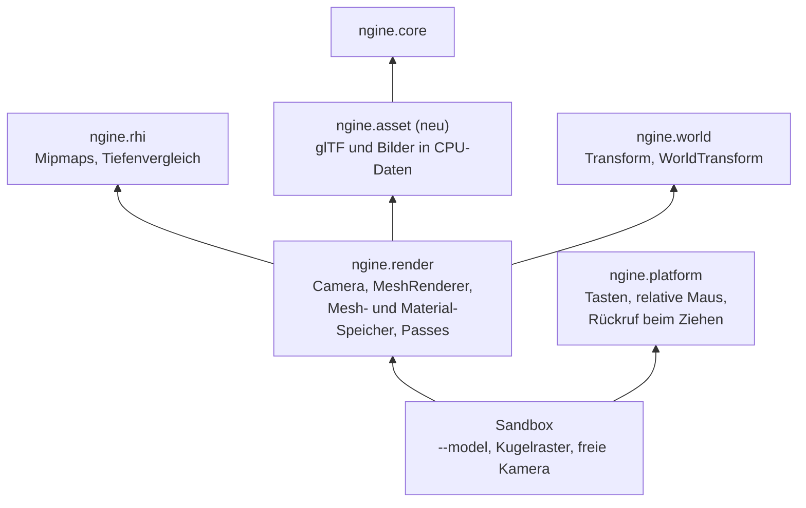

# R1.3: Meshes, Materialien, Kamera

- **Phase:** Konstruktion (Reifegrad [R1](R1-rendering-grundlagen.md))
- **Status:** in Arbeit
- **Pull Requests:** #19

## Plan

**Ziel:** Die Sandbox lädt glTF-Modelle mit ihren Texturen, zeichnet sie mit PBR-Materialien in
ein HDR-Ziel mit Tone Mapping und lässt einen mit einer freien Kamera hindurchfliegen. Die Kamera
ist eine Komponente der Welt; der Renderer zeichnet, was in der Welt steht.

**Features:** ASSET-01 (glTF-Import), ASSET-02 (Quellbilder über stb_image, ohne KTX2), REND-07
(PBR-Materialien), REND-08 (Kamera), REND-11 (nur Tone Mapping), CORE-07 (GPU-Zonen, aus R1.2
verschoben). Dazu TD-10 (Kamera in der Sandbox) und TD-19 (kein Bild beim Ziehen des Fensters
unter Windows) aus dem [Schuldenregister](../tech-debt.md).

### Entwurf

**`ngine.asset`** (Ressourcen-Schicht, neues Modul)

- `load_gltf(path)` liefert ein `asset::Model` in reinen CPU-Daten: Meshes (Positionen, Normalen,
  Tangenten, Texturkoordinaten, 32-Bit-Indizes), Materialien nach glTF Metallic-Roughness
  (Faktoren, Texturen für Grundfarbe, Metallic-Roughness, Normalen, Okklusion, Emission, Alpha-Modus)
  und Knoten mit Transform und Hierarchie. `.gltf` mit externen oder eingebetteten Puffern und
  `.glb`.
- Bilder dekodiert stb_image zu RGBA8; fehlende Tangenten werden erzeugt (pro Dreieck gemittelt,
  MikkTSpace folgt bei Bedarf).
- fastgltf und stb_image stecken nur in den Adaptern `gltf_fastgltf.cpp` und `image_stb.cpp`.
  Ohne GPU testbar: Die Tests schreiben kleine glTF-Dateien selbst.

**`ngine.rhi`**

- Texturen mit Mip-Stufen; `upload()` kann die Stufen auf der GPU erzeugen (Blit von Stufe zu
  Stufe). Sampler mit anisotroper Filterung, falls die GPU sie kann.
- Tiefenvergleich in der Pipeline wählbar, damit die Kamera umgekehrte Tiefe mit unendlicher Ferne
  nutzt (`perspective_reverse_z()` aus R1.1, Vergleich „größer“). Die Voxel-Demo bleibt bei
  „kleiner gleich“ (in der Umsetzung anders, siehe Stand).

**`ngine.render`**

- Komponenten `Camera` (Blickwinkel, nahe Ebene, Belichtung) und `MeshRenderer` (Mesh und Material
  je Teilnetz), registriert in der Reflection. Gezeichnet wird von der ersten aktiven Kamera aus,
  kamerarelativ über `WorldTransform` (ADR 0012).
- `MeshStore` und `MaterialStore`: Geometrie aller Meshes in Puffern im GPU-Speicher (Vertex
  Pulling), Materialien als Feld in einem Puffer mit bindlosen Texturindizes; Shader holen alles
  über Adressen und Indizes aus den Push Constants.
- Passes im Graph: Vorwärts-Pass in ein HDR-Ziel (`RGBA16Float`) mit Tiefe, danach Tone Mapping
  (Khronos PBR Neutral, wie im glTF-Viewer wählbar) in den Backbuffer. Licht: eine Sonne und ein
  einfaches Umgebungslicht aus Himmel- und Bodenfarbe; Punktlichter und Schatten folgen in R1.4,
  bildbasiertes Licht mit dem Himmel in R3.
- PBR nach glTF: GGX-Verteilung, Smith-Schatten, Schlick-Fresnel, Lambert; Alpha-Maske über
  `discard`, durchsichtige Materialien nach den undurchsichtigen und ohne Sortierung (TD).
- GPU-Zonen: Der Graph schreibt vor und nach jedem Pass einen Zeitstempel, das Backend liest sie
  einen Frame später und meldet sie über `ngine.profile` an Tracy.

**Plattform und Sandbox**

- Tasten W, A, S, D, Q, E, Shift, Tastenloslassen und relative Mausbewegung für die freie Kamera
  (gedrückte rechte Maustaste). Die Abbildung auf Aktionen bleibt bei PLAT-02 in R2.
- TD-19: Die Plattform meldet über einen Rückruf, wenn das Fenster während des Ziehens neu
  gezeichnet werden muss; die Sandbox zeichnet dann einen Frame. Dafür wird ihr Frame eine
  eigene Funktion.
- `--model <pfad>` lädt ein glTF-Modell; ohne Pfad zeigt die Sandbox ein Raster aus Kugeln mit
  steigendem Metallic- und Roughness-Wert. Die Voxel-Demo bleibt als `--voxel-demo`.

### Schritte

1. `ngine.asset` mit fastgltf und stb_image, Tests ohne GPU.
2. RHI: Mip-Stufen und ihre Erzeugung, Tiefenvergleich, Anisotropie; GPU-Tests.
3. `Camera`, `MeshRenderer`, Mesh- und Material-Speicher, PBR-Pass, Tone Mapping; GPU-Test mit
   einer Kugel und Stichproben.
4. Plattform (Tasten, relative Maus, Rückruf beim Ziehen), freie Kamera und `--model` in der
   Sandbox; Bildvergleich des Kugelrasters in der CI.
5. GPU-Zonen in Tracy.
6. ADR (glTF und Material-Speicher), Doku.

**Risiken:**

- Die Iteration ist breit (Assets, RHI, Renderer, Plattform). Gegenmittel: Reihenfolge wie oben,
  GPU-Zonen zuletzt; wird es zu viel, wandern sie nach R1.4.
- Ohne bildbasiertes Licht wirken Metalle dunkler als im glTF-Viewer. Gegenmittel: Die Abnahme
  vergleicht die Materialien (Zuordnung der Texturen, Normalen, Roughness), nicht das ganze Bild.
- Khronos-Beispielmodelle stehen unter eigenen Lizenzen und sind groß. Gegenmittel: Eingecheckt
  wird keines; Tests und CI erzeugen ihre Modelle selbst, auf dem PC lädt die Sandbox eines von der
  Platte.
- Unterschiede zwischen Windows und Linux beim Zeichnen während des Ziehens. Gegenmittel: Test auf
  dem PC; unter Linux ändert sich nichts.

**Abnahme:**

- Tests ohne GPU: glTF mit Hierarchie, eingebetteten und externen Puffern, Materialien und Bildern
  wird richtig gelesen; fehlerhafte Dateien liefern eine Meldung statt eines Absturzes.
- GPU-Test über lavapipe: eine Kugel mit PBR-Material und Tone Mapping, Stichproben von Licht- und
  Schattenseite, ohne Meldung der Validation Layers.
- Auf dem PC: ein Khronos-Beispielmodell (z. B. DamagedHelmet) mit richtig zugeordneten Texturen
  und Normalen; das Kugelraster zeigt den Verlauf von Metallic und Roughness; die freie Kamera lässt
  sich steuern; beim Ziehen des Fensters läuft das Bild weiter; GPU-Zonen erscheinen in Tracy.

## Stand

- Umgesetzt: Schritte 1 bis 6.
  - Neues Modul `ngine.asset`: `load_gltf()`, `decode_image()`, `load_image()`, erzeugte Normalen
    und Tangenten, `make_sphere()`.
  - RHI: Mip-Stufen mit Erzeugung über `vkCmdBlitImage2`, Sampler mit Anisotropie und
    Spiegel-Wiederholung, Tiefenvergleich, Alpha-Blending, Zeitstempel (`write_timestamp()`,
    `Frame::timestamps`, `gpu_timestamp()`).
  - `ngine.render`: `Camera`, `MeshRenderer`, `MeshStore`, `MaterialStore`, `Renderer` mit
    Vorwärts-Pass (HDR, Tiefe, umgekehrte Tiefe) und Tone Mapping, `upload_model()` und
    `spawn_model()`, `GpuProfiler`.
  - Shader `pbr.slang` und `tonemap.slang`.
  - Plattform: neue Tasten, `KeyReleased`, relative Maus, Rückruf beim Ziehen (TD-19).
  - Sandbox: Kugelraster, `--model`, freie Kamera, offscreen mit `--image`.
  - [ADR 0027](../adr/0027-gltf-assets-material-store.md) (vorgeschlagen).
- Abweichungen vom Plan:
  - Die Voxel-Demo nutzt jetzt auch `render::CameraView` und `view_projection()` mit umgekehrter
    Tiefe. Zwei Projektionen nebeneinander zu pflegen hätte TD-10 nur halb abgebaut.
  - Das Dreieck aus R1.2 ist entfallen; das Kugelraster ersetzt es als Standard der Sandbox.
  - Tangenten pro Dreieck gemittelt statt MikkTSpace (TD-21); durchsichtige Materialien ohne
    Sortierung (TD-20); GPU-Zeit ohne Kalibrierung gegen die CPU-Uhr (TD-22); ein Puffer pro Mesh
    statt eines gemeinsamen (TD-23).
- Lokal im Cloud-Container (Clang 20, lavapipe, Validation Layers mit Synchronisationsprüfung):
  160 Tests grün in Debug und Release, ohne Warnung. Neu sind acht `[asset]`-Tests ohne GPU, Tests
  der Kamera und des transienten `MeshRenderer`, GPU-Tests für eine PBR-Kugel mit Stichproben,
  Mip-Stufen, Tiefenvergleich, Zeitstempel und GPU-Zonen.
- Das Kugelraster als Bild ist mit `--far` und mit `--baseline` byte-gleich; die CI prüft das und
  lädt die Bilder als Artefakt hoch. Unter Xvfb laufen Kugelraster, `--baseline` und Voxel-Demo im
  Fenster ohne Meldung der Validation Layers.
- DamagedHelmet aus den Khronos-Beispielen (nicht eingecheckt) zeichnet offscreen mit richtig
  zugeordneten Texturen, Normalen und Emission. Metalle wirken ohne bildbasiertes Licht dunkler,
  wie erwartet.
- Erkenntnisse während der Umsetzung:
  - Die Synchronisationsprüfung fand eine Schreib-nach-Schreib-Gefahr beim wiederholten
    `read_texture()`: Die Kopie in den Lesepuffer lief ohne Barriere zur vorigen. Jetzt steht eine
    volle Barriere davor.
  - DamagedHelmet hängt an einem gedrehten Knoten; ohne dessen Drehung schaut man auf die
    Unterseite. Die Knotentransformation wird deshalb über `WorldTransform` übernommen, nicht nur
    die Geometrie.
- Offen: Abnahme auf dem PC (Modell, Kugelraster, freie Kamera, Zeichnen beim Ziehen unter Windows,
  GPU-Zonen in Tracy).
