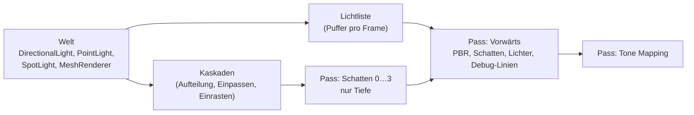

# R1.4: Licht und Schatten

- **Phase:** Konstruktion (Reifegrad [R1](R1-rendering-grundlagen.md))
- **Status:** in Arbeit
- **Pull Requests:** …

## Plan

**Ziel:** Lichter sind Komponenten der Welt. Die Sonne wirft Schatten über Cascaded Shadow Maps,
Punkt- und Spotlichter beleuchten die Szene vorwärts aus einer Liste im GPU-Speicher. Linien und
Boxen lassen sich zur Fehlersuche in die Welt zeichnen. Damit ist der Reifegrad R1 inhaltlich
vollständig.

**Features:** REND-09 (Licht und Schatten), REND-15 (Debug-Zeichnen, ohne Text).

### Entwurf

**Licht als Komponenten** (`ngine.render`)

- `DirectionalLight`, `PointLight`, `SpotLight` mit Farbe, Stärke, Reichweite und Kegelwinkeln,
  angelehnt an glTF `KHR_lights_punctual`. Lage und Richtung kommen aus `WorldTransform`: Lichter
  leuchten entlang ihrer lokalen -z-Achse.
- Das erste aktive gerichtete Licht ist die Sonne und wirft Schatten; weitere gerichtete Lichter
  kommen ohne Schatten in die Liste. `Renderer::lighting` behält nur das Umgebungslicht aus
  Himmel- und Bodenfarbe.
- Abfall mit dem Quadrat der Entfernung und weichem Ende an der Reichweite wie in glTF.
- Die Lichtliste liegt in einem Puffer pro Frame im Flug; der Shader geht alle Lichter durch.
  Für die Szenen von R1 (einige Dutzend Lichter) reicht das, Clustered Shading folgt bei Bedarf.

**Cascaded Shadow Maps**

- Vier Kaskaden bis zu einer einstellbaren Entfernung, aufgeteilt zwischen logarithmisch und
  gleichmäßig. Jede Kaskade ist eine eigene Tiefentextur im Graph.
- Jede Kaskade umschließt ihren Ausschnitt des Kamerastumpfs mit einer Kugel. Ihr Radius hängt
  nicht von der Blickrichtung ab, und der Mittelpunkt rastet in 64 Bit auf ganze Texel ein. So
  flimmern Schattenkanten nicht, wenn sich die Kamera dreht oder bewegt, auch weit vom Ursprung.
- Gegen Schattenakne hilft ein Tiefenversatz in der Pipeline und ein Versatz entlang der Normale
  beim Lesen. Gefiltert wird mit PCF über `Gather`, ohne Vergleichs-Sampler.
- Gegen sichtbare Nähte geht jede Kaskade am Ende weich in die nächste über, und hinter der
  letzten blendet der Schatten aus. Eine Ansicht mit eingefärbten Kaskaden hilft beim Prüfen.
- Werfer werden pro Kaskade gegen deren Quader geprüft (Hüllkugel des Meshes).

**RHI**

- Pipelines und `begin_rendering()` nur mit Tiefe, ohne Farbziel und ohne Fragment-Shader.
- Tiefenversatz (konstant und nach Steigung) in der Pipeline.
- Tiefentexturen lassen sich im Shader lesen (Zustand `ShaderRead`).

**Debug-Zeichnen**

- `DebugDraw` im Renderer sammelt pro Frame Linien in 64-Bit-Weltkoordinaten, dazu Boxen,
  Hüllquader, Kugeln und Achsenkreuze. Der Renderer schneidet sie an der nahen Ebene ab, rechnet
  sie relativ zur Kamera um und zeichnet sie im Vorwärts-Pass mit Tiefentest.
- Linien werden im Vertex-Shader zu schmalen Rechtecken aufgezogen, damit sie auf jeder GPU
  gleich breit sind und die RHI keine weitere Topologie braucht.
- Text in der Welt folgt mit der Editor-UI.

**Sandbox**

- Die Standardszene steht auf einem Boden: das Kugelraster, eine Reihe Säulen bis in 60 m
  Entfernung (alle Kaskaden im Bild), die Sonne und acht bewegte farbige Punktlichter mit kleinen
  leuchtenden Kugeln, dazu ein Spotlicht. Ein Modell über `--model` steht ebenfalls auf einem
  Boden in der Sonne.
- F1 schaltet Debug-Zeichnen um (Hüllquader, Lichter, Achsenkreuz), F2 die eingefärbten Kaskaden.
  `--debug-draw` schaltet es von Anfang an ein.

### Schritte

1. Plan, RHI (nur Tiefe, Tiefenversatz, lesbare Tiefe) mit GPU-Test.
2. Licht-Komponenten und Lichtliste, Shader mit Punkt- und Spotlichtern; Tests ohne GPU für die
   Liste.
3. Kaskaden: Aufteilung und Einpassen ohne GPU getestet, Schatten-Pässe, Lesen im Vorwärts-Pass.
4. Debug-Zeichnen; Tests ohne GPU für Linien und Abschneiden.
5. Sandbox-Szene, Tasten F1 und F2, Bildprüfung in der CI; GPU-Tests mit Schatten, Punktlicht und
   Debug-Linie.
6. ADR (Licht und Schatten), Doku.

**Risiken:**

- Schattenakne und Peter-Panning hängen von Versatzwerten ab, die auf jeder GPU etwas anders
  wirken. Gegenmittel: Versatz pro Texelgröße der Kaskade statt fester Werte, Prüfung auf dem PC.
- lavapipe ist mit vier Schattenkarten zu 2048² langsam. Gegenmittel: Tests mit kleineren Karten,
  die Auflösung ist einstellbar.
- Der Bildvergleich mit `--far` wird an Schattenkanten nicht mehr byte-gleich, weil die Texel in
  absoluten Weltkoordinaten einrasten. Gegenmittel: Die CI erlaubt einen kleinen Anteil
  abweichender Bytes und prüft weiter, dass das Bild nicht zerfällt.

**Abnahme:**

- Tests ohne GPU: Aufteilung der Kaskaden, Einpassen und Einrasten (gleiche Matrix bei kleiner
  Kamerabewegung bis auf ganze Texel), Lichtliste aus der Welt, Linien von Debug-Formen und
  Abschneiden an der nahen Ebene.
- GPU-Tests über lavapipe: Schatten eines Quaders auf dem Boden, Punktlicht im Dunkeln,
  Debug-Linie, nur-Tiefe-Pipeline mit lesbarer Tiefe, ohne Meldung der Validation Layers.
- Auf dem PC: Standardszene mit Sonne und Schatten über alle Kaskaden ohne sichtbare Nähte (F2
  zeigt die Kaskaden), acht bewegte Punktlichter, Schattenkanten flimmern beim Drehen der Kamera
  nicht; Debug-Zeichnen mit F1.

## Stand

- Umgesetzt: Schritte 1 bis 6.
  - RHI: Pipelines und `begin_rendering()` nur mit Tiefe (ohne Farbziel, ohne Fragment-Shader),
    Tiefenversatz, lesbare Tiefentexturen.
  - `ngine.render`: Komponenten `DirectionalLight`, `PointLight`, `SpotLight`; Partitionen
    `:lights` (`collect_lights()`), `:shadows` (`cascade_splits()`, `fit_cascades()`) und
    `:debug_draw` (`DebugDraw`, `clip_line()`, `prepare_lines()`); im `Renderer` vier
    Schatten-Pässe, Lichtliste und Debug-Linien im Vorwärts-Pass, `ShadowSettings`,
    `show_cascades`, `debug()`.
  - Shader `scene.slang` (gemeinsame Strukturen), `shadow.slang`, `debug.slang`; `pbr.slang` mit
    Schatten und Lichtliste.
  - `asset::make_box()`; Tasten F1 und F2 in der Plattform.
  - Sandbox: Standardszene mit Boden, Säulen, acht kreisenden Punktlichtern und Spotlicht; ein
    Modell über `--model` steht auf einem Boden; `--debug-draw`.
  - [ADR 0028](../adr/0028-lights-cascaded-shadows.md) (vorgeschlagen).
- Abweichungen vom Plan: keine im Umfang. `Renderer::lighting` hat die Sonne verloren; wer sie
  vorher dort einstellte, legt jetzt ein `DirectionalLight` an (Tests und Sandbox umgestellt).
- Lokal im Cloud-Container (Clang 20, lavapipe, Validation Layers mit Synchronisationsprüfung):
  171 Tests grün in Debug und Release, ohne Warnung. Neu sind Tests ohne GPU für Aufteilung,
  Abdeckung und Einrasten der Kaskaden, die Lichtliste, Debug-Formen, das Abschneiden an der nahen
  Ebene und `make_box()`, dazu GPU-Tests für Schatten eines Würfels, ein Punktlicht im Dunkeln,
  eine Debug-Linie und die Pipeline nur mit Tiefe.
- Die Standardszene als Bild: mit `--baseline` byte-gleich; mit `--far` weichen knapp 1 % der Bytes
  ab, davon unter 0,1 % um mehr als 8 Stufen (Schattenkanten auf verschobenem Texelgitter). Die
  CI prüft beides und lädt Bild und Bild mit Debug-Zeichnen hoch. Unter Xvfb laufen Standardszene
  mit `--debug-draw` und Voxel-Demo im Fenster ohne Meldung der Validation Layers.
- Erkenntnisse während der Umsetzung:
  - Gemeinsame Strukturen in `scene.slang` verhindern, dass Frame und Push Constants zwischen drei
    Shadern auseinanderlaufen; `GpuFrame` prüft seine Größe mit `static_assert`.
  - Die Indizes der Schattenkarten kennt erst die Ausführung des Graphs (transiente Texturen). Der
    Vorwärts-Pass trägt sie deshalb beim Aufzeichnen in den Frame-Puffer nach, der erst danach
    abgeschickt wird.
- Offen: Abnahme auf dem PC (Schatten ohne Nähte und ohne Flimmern, Punktlichter, F1 und F2).

