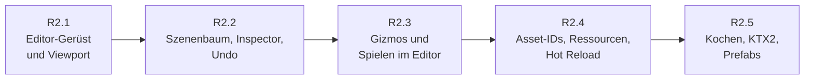
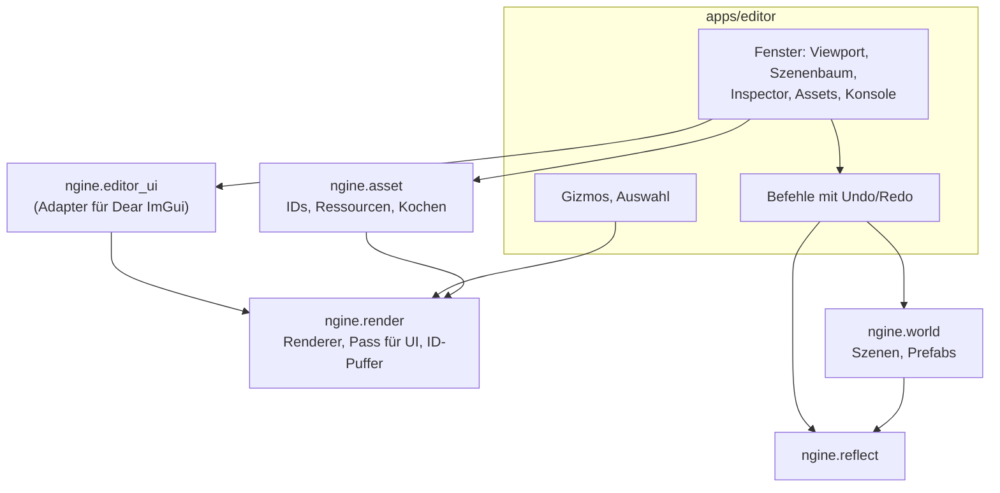

# R2: Welt und Editor

- **Phase:** Konstruktion
- **Status:** abgeschlossen
- **Pull Requests:** siehe Review

R2 ist der zweite Reifegrad der Konstruktion. Wie R1 ist er zu groß für eine Iteration; wir teilen
ihn in fünf Iterationen, jede mit eigenem Dokument, eigenem PR und eigener Abnahme auf dem PC.
Dieses Dokument hält den Plan für den ganzen Reifegrad und am Ende sein Review.

## Plan

**Ziel:** Es gibt einen eigenen Editor (`apps/editor/`), in dem man eine Szene öffnet, im Viewport
durchfliegt, Entities im Szenenbaum auswählt, ihre Komponenten im Inspector und mit Gizmos
bearbeitet, jede Änderung rückgängig macht, die Szene speichert und kurz „spielen“ lässt. Modelle
und Texturen kommen über stabile Asset-IDs aus einer Asset-Pipeline, die Quelldateien in
Laufzeitformate kocht und Änderungen an Dateien zur Laufzeit nachlädt.

**Features:** EDIT-01, EDIT-02, EDIT-03, EDIT-04, EDIT-05, EDIT-06 (ohne C#, siehe unten), EDIT-07,
EDIT-09, EDIT-10, CORE-11, CORE-12, REND-15 (Text), ASSET-02 (KTX2), ASSET-03, ASSET-04,
ASSET-05, PLAT-06, WORLD-04. Dazu die Schulden mit Frist R2: TD-08, TD-09, TD-12, TD-15, TD-17,
TD-18, TD-21, TD-22.

### Aufteilung

| Iteration | Inhalt | Features und Schulden | Abnahme |
| --- | --- | --- | --- |
| R2.1 Editor-Gerüst und Viewport | Neue Anwendung `apps/editor/` mit Dear ImGui (Docking) hinter `ngine.editor_ui`. ImGui zeichnet über einen eigenen Pass im Render-Graph mit der RHI (Vertex Pulling, Schrift als bindlose Textur), Eingabe kommt aus `platform::Window`; weder Vulkan- noch SDL-Backend von ImGui. Der Renderer zeichnet in eine Textur, die das Viewport-Fenster zeigt; Größe folgt dem Fenster. Editor-Kamera mit derselben freien Steuerung wie die Sandbox. Log-Konsole als Sink, dazu ein Sink in eine Datei. `renderer.cpp` aufteilen | EDIT-01, EDIT-02, EDIT-10, CORE-12 ([R2.1](R2.1-editor-geruest-und-viewport.md)) | Editor startet unter Windows und Linux, Fenster andocken und wieder lösen, Standardszene im Viewport ohne Meldungen der Validation Layers; GPU-Test zeichnet ein ImGui-Fenster über lavapipe |
| R2.2 Szenenbaum, Inspector, Undo | Szenenbaum mit Hierarchie, Umbenennen und Umhängen per Ziehen; Auswahl per Klick im Viewport über einen ID-Puffer (Pass, der Entity-IDs in eine `R32_UINT`-Textur schreibt, ein Pixel wird zurückgelesen). Inspector baut Eingabefelder allein aus der Reflection; die Reflection lernt dafür Enums und Bereichsangaben. Undo und Redo als Befehle, die alte und neue Werte über die Reflection binär festhalten. Szene öffnen und speichern, Ereignisse zwischen Editor-Teilen (Auswahl, Änderungen) | EDIT-03, EDIT-04, EDIT-07, CORE-11, TD-08, TD-09, TD-18, TD-22 (aus R2.1) ([R2.2](R2.2-szenenbaum-inspector-undo.md)) | Szene laden, Lichter und Transforms im Inspector ändern, alles rückgängig machen; gespeicherte Szene ist textgleich mit der geladenen, wenn nichts geändert wurde; Undo-Stapel und Inspector-Logik ohne GPU getestet |
| R2.3 Gizmos und Spielen im Editor | Gizmos für Verschieben, Drehen und Skalieren, selbst gebaut aus `ngine.math` und dem Debug-Zeichnen (Treffer über Strahlen gegen Achsen und Ringe), lokal und global, mit Raster. Text in der Welt für Namen und Werte (über die Zeichenliste von ImGui). „Spielen“ sichert die Welt binär, lässt den Schedule laufen und stellt beim Stoppen den Stand wieder her. Transform-Propagation nur für geänderte Teilbäume | EDIT-05, EDIT-06, REND-15, TD-15, dazu TD-28 aus R2.2 ([R2.3](R2.3-gizmos-und-spielen.md)) | Objekte mit Gizmos bewegen, drehen und skalieren, jeweils mit Undo; Spielen und Stoppen hinterlässt die Welt bitgenau wie vorher; Treffertests und Sichern/Wiederherstellen ohne GPU getestet |
| R2.4 Asset-IDs, Ressourcen, Hot Reload | Jede Quelldatei bekommt eine stabile ID (`.meta`-Datei daneben); `MeshRenderer` und Materialien verweisen über IDs statt Indizes, damit Szenen mit Modellen vollständig speicherbar sind. Ressourcen-Manager mit Handles, Referenzzählung und Laden im Hintergrund über das Job-System; Uploads über eine eigene Transfer-Queue. Dateien beobachten und Shader, Texturen und Modelle zur Laufzeit neu laden. Asset-Browser im Editor mit Ziehen in die Szene | ASSET-04, ASSET-05, PLAT-06, EDIT-09, TD-12, TD-17 ([R2.4](R2.4-asset-ids-ressourcen-hot-reload.md)) | Modell aus dem Browser in die Szene ziehen, speichern, Editor neu starten, Szene sieht gleich aus; Shader oder Textur ändern und das Bild ändert sich ohne Neustart |
| R2.5 Kochen, KTX2, Prefabs | Asset-Pipeline kocht glTF in ein binäres Mesh-Format und Bilder in KTX2 mit Basis Universal (KTX-Software); gekochte Daten liegen in einem Cache und werden nur bei Änderung neu erzeugt. Tangenten nach MikkTSpace beim Kochen. Prefabs: Vorlage als Datei, Instanzen mit Überschreibungen, im Editor anlegen und aufbrechen. Szenen optional binär | ASSET-02, ASSET-03, WORLD-04, TD-21 ([R2.5](R2.5-kochen-ktx2-prefabs.md)) | Standardszene lädt aus dem Cache spürbar schneller als aus den Quellen (gemessen); Prefab ändern und alle Instanzen ziehen nach, Überschreibungen bleiben |

Nicht in R2, damit der Reifegrad in überschaubarer Zeit fertig wird:

- **C#-Skripte im Spielmodus** (Teil von EDIT-06): „Spielen“ in R2.3 lässt nur die C++-Systeme
  laufen; Skripte kommen mit dem vollständigen Scripting in R4 dazu.
- **Virtuelles Dateisystem und Archive** (PLAT-05): erst, wenn wir Pakete ausliefern (Übergabe);
  der Ressourcen-Manager liest bis dahin aus Ordnern.
- **Raytracing** (REND-14): gehört zum Rendering, nicht zu Welt und Editor. Im Katalog und in der
  [Roadmap](../roadmap.md) als „nach R3“ vermerkt; spätestens das Review von R3 legt die Iteration fest.
- **Phasen für Systeme und Befehlspuffer** (WORLD-09, WORLD-10): bleiben in R4, solange der
  Editor ohne sie auskommt.

### Entwurf

- Der Editor ist eine eigene Anwendung neben der Sandbox. Was nicht nur der Editor braucht
  (Ressourcen-Manager, Asset-IDs, Pass für den ID-Puffer, Text in der Welt), liegt in der Engine.
- **Dear ImGui hinter `ngine.editor_ui`:** Nur der Adapter kennt ImGui. Wir nutzen ImGui im
  Editor zwar sehr direkt, deshalb exportiert der Adapter eine schmale Schicht im Stil von ImGui
  (Fenster, Felder, Bäume, Ziehen und Ablegen), keine eigene UI-Bibliothek. Das Zeichnen
  übernimmt ein eigener Pass über die RHI; so bleibt die Regel „nur die RHI kennt Vulkan“ und der
  Pass läuft später auch mit D3D12.
- **Inspector und Undo allein aus der Reflection:** Kein Code pro Komponente. Ein Befehl hält
  Entity, Komponente, Feldpfad und den alten und neuen Wert als Bytes aus dem Binärformat fest;
  dasselbe nutzt später die Replikation.
- **Spielen im Editor** sichert die Welt im Binärformat (Szene plus Laufzeitkomponenten) statt
  eine zweite Welt zu kopieren. Das ist einfach und deckt Fehler im Serialisieren früh auf.
- Voraussichtliche ADRs: Editor-Architektur und ImGui-Anbindung (R2.1), Undo über Befehle mit
  reflektierten Werten (R2.2), Asset-IDs und Ressourcen-Manager (R2.4), Format gekochter Assets
  und KTX2 (R2.5).

### Leitlinien für alle fünf Iterationen

- Editor-Logik (Befehle, Auswahl, Inspector-Modell, Treffertests der Gizmos, Asset-Datenbank)
  ist von der UI getrennt und ohne Fenster und GPU testbar. Die Fenster sind dünn.
- Die Engine bleibt ohne Editor lauffähig; `--headless` und `NGINE_WITH_WINDOW=OFF` bauen und
  starten weiter. Der Editor selbst braucht ein Fenster und wird ohne SDL3 nicht gebaut.
- Jede Iteration ist im Editor sichtbar; die Sandbox bleibt Schaufenster für Engine-Features und
  bekommt keine Editor-Fenster.
- Szenen bleiben JSON nach [ADR 0020](../adr/0020-scene-format-json.md); alles, was der Editor
  speichert, ist in Diffs lesbar.

**Risiken:**

- ImGui als Fremdbibliothek über Module: viele Makros und Header. Gegenmittel: ImGui nur im
  globalen Modulfragment des Adapters, ein früher Build unter MSVC und Clang in R2.1.
- Mehrere Viewports von ImGui (Fenster außerhalb des Hauptfensters) brauchen mehrere Swapchains.
  Gegenmittel: in R2.1 nur Docking im Hauptfenster; eigene Fenster für Panels erst bei Bedarf.
- Undo über Bytes bricht, wenn sich die Struktur der Welt ändert (Entity gelöscht und neu
  angelegt). Gegenmittel: Befehle verweisen auf stabile Entity-IDs der Szene, nicht auf
  flecs-IDs; Tests für Löschen und Wiederherstellen.
- Asset-IDs ändern das Szenenformat (`MeshRenderer`). Bis R2.4 kann der Editor Szenen mit
  Modellen nur zusammen mit dem Modellpfad laden, nicht vollständig speichern. Das steht so in der
  Abnahme von R2.2 und verschwindet mit R2.4.
- KTX-Software und Basis Universal sind groß; Bauzeit in der CI. Gegenmittel: Kochen nur im
  Editor-Build und im Werkzeug, nicht in Spiel und Server.

**Abnahme:** die Abnahmen der fünf Iterationen, dazu am Ende ein Review des ganzen Reifegrads mit
Architektur-Review und einem kurzen Szenario auf dem PC: Editor starten, Modell aus dem
Asset-Browser platzieren, mit Gizmos ausrichten, Licht im Inspector einstellen, alles einmal
rückgängig machen und wiederholen, speichern, spielen, stoppen, neu starten.

### Zur Abstimmung

1. **Reihenfolge:** Vorschlag ist Editor zuerst (R2.1 bis R2.3), Asset-Pipeline danach. Das macht
   früh etwas sichtbar und die Editor-Architektur ist das größere Risiko. Andersherum wären
   Szenen mit Modellen ab R2.2 vollständig speicherbar.
2. **Gizmos selbst bauen** statt ImGuizmo: Vorschlag selbst bauen, weil `ngine.math`,
   Debug-Zeichnen und Strahlen schon da sind und es lehrreich ist. ImGuizmo wäre schneller
   fertig, bringt aber eigene Mathematik mit.
3. **Spielen im Editor** zieht im Katalog von R4 nach R2.3 vor, ohne C#. Mit C# wird es in R4
   vollständig.
4. **Raytracing** (REND-14) verlässt R2.

## Review

**Ergebnis:** Es gibt einen eigenen Editor. Man öffnet darin eine Szene, fliegt im Viewport durch
und wählt Entities im Szenenbaum oder per Klick aus. Ihre Komponenten bearbeitet man im Inspector
und mit Gizmos, jede Änderung lässt sich rückgängig machen. Die Szene wird als JSON oder binär
gespeichert und kann im Editor gespielt und gestoppt werden. Modelle und Texturen kommen über
stabile Asset-IDs aus einem Ressourcen-Manager, der im Hintergrund lädt und geänderte Dateien zur
Laufzeit nachlädt. Die Asset-Pipeline kocht glTF in ein binäres Format mit KTX2-Texturen in einen
Cache. Prefabs mit Überschreibungen lassen sich im Editor anlegen, aufbrechen und übernehmen.

| Iteration | Pull Requests | Ergebnis |
| --- | --- | --- |
| [R2.1](R2.1-editor-geruest-und-viewport.md) Editor-Gerüst und Viewport | #24, #25, #26 | Editor mit Dear ImGui über die RHI, Docking, Viewport als Textur, Log-Konsole und Log-Datei |
| [R2.2](R2.2-szenenbaum-inspector-undo.md) Szenenbaum, Inspector, Undo | #27, #28 | Szenenbaum, Auswahl über den ID-Puffer, Inspector aus der Reflection, Undo mit reflektierten Werten, Ereignisse |
| [R2.3](R2.3-gizmos-und-spielen.md) Gizmos und Spielen im Editor | #29, #30 | Gizmos aus `ngine.math`, Text in der Welt, Spielen mit binärer Sicherung, Propagation nur geänderter Teilbäume |
| [R2.4](R2.4-asset-ids-ressourcen-hot-reload.md) Asset-IDs, Ressourcen, Hot Reload | #31, #32 | `.meta`-Dateien mit IDs, Ressourcen-Manager mit Laden im Hintergrund, Transfer-Queue, Hot Reload, Asset-Browser |
| [R2.5](R2.5-kochen-ktx2-prefabs.md) Kochen, KTX2, Prefabs | #33, #34 | Gekochte Modelle mit KTX2 und BC7 im Cache, MikkTSpace, Prefabs mit Überschreibungen, binäre Szenen |

Abnahme: Alle fünf Iterationen sind abgenommen, jede mit grüner CI auf Linux, unter
ThreadSanitizer und auf Windows sowie einem Test auf dem PC. Auch das Szenario für den ganzen
Reifegrad lief auf dem PC ohne Fehler: Editor starten, Modell aus dem Asset-Browser platzieren,
mit Gizmos ausrichten, Licht im Inspector einstellen, alles einmal rückgängig machen und
wiederholen, speichern, spielen, stoppen, neu starten.

Abweichungen vom Plan:

- Raytracing (REND-14) verließ R2 wie abgestimmt und steht in der Roadmap nach R3.
- C#-Skripte im Spielmodus fehlen wie geplant; sie kommen mit dem Scripting in R4.
- Szenen sind weiter JSON nach [ADR 0020](../adr/0020-scene-format-json.md); das binäre Format
  `.nscene` aus R2.5 ist eine Option zum Laden, keine Ablösung.
- Der Cache gekochter Modelle legt die BC7-Fassung der Texturen gleich mit ab. Geplant war nur
  KTX2; ohne die fertige Fassung brachte der Cache kaum Zeit, weil das Umwandeln beim Laden
  überwog ([ADR 0036](../adr/0036-cooked-assets-ktx2-cache.md)).

**Erkenntnisse:**

- Die Trennung von Editor-Logik (`ngine.edit`) und dünnen Fenstern hat sich gelohnt: Befehle,
  Undo, Inspector-Modell, Treffertests der Gizmos, Prefab-Befehle und Asset-Datenbank sind ohne
  Fenster und GPU getestet. Fehler fanden sich fast nur noch im Zusammenspiel auf dem PC.
- Undo über reflektierte Bytes und stabile Entity-IDs trug durch alle fünf Iterationen; Gizmos,
  Prefabs und Einfügen aus dem Asset-Browser sind nur neue Befehle.
- Windows mit MSVC und Modulen bleibt die häufigste Bruchstelle (schwere Header in
  Schnittstellen in R2.1, `_DEBUG` aus KTX-Software in R2.5). Ein früher Windows-Build in jeder
  Iteration hat sich bewährt.
- Messen vor dem Abhaken: Erst die gemessene Ladezeit zeigte, dass der Cache ohne fertige
  BC7-Texturen kaum etwas bringt.

**Architektur-Review des Reifegrads:**

- Schichten wie geplant: Nur `ngine.editor_ui` kennt Dear ImGui, nur die Adapter in `ngine.asset`
  und `ngine.cook` kennen KTX-Software und MikkTSpace. Gekocht wird nur im Editor und im Werkzeug
  `ngine_cook`, Sandbox und Server lesen den Cache. `--headless` und `NGINE_WITH_WINDOW=OFF`
  bauen und starten weiter.
- Neue ADRs: 0029 (Editor und ImGui über die RHI), 0030 (Undo über Befehle mit reflektierten
  Werten), 0031 (Gizmos), 0032 (Spielen mit binärer Sicherung), 0033 (Asset-IDs und
  Ressourcen-Manager), 0034 (Hot Reload), 0035 (Transfer-Queue), 0036 (gekochte Assets und KTX2),
  0037 (Prefabs mit Überschreibungen pro Feld).
- Größte Dateien: `renderer.cpp` (rund 850 Zeilen), `apps/editor/main.cpp` (rund 750),
  `device.cpp` (rund 720), `apps/common/model_scene.cppm` (rund 715). `main.cpp` des Editors und
  `model_scene.cppm` sind in R2 gewachsen und die nächsten Kandidaten zum Aufteilen.
- Schulden: Alle mit Frist R2 sind abgebaut (TD-08, TD-09, TD-12, TD-15, TD-17, TD-18, TD-21,
  TD-22, dazu TD-28 und TD-30). Neu und offen aus R2 sind TD-26, TD-27, TD-29 und TD-31 bis
  TD-35, mit Frist R3, R6 oder bei Bedarf.
- 278 Tests, davon die GPU-Tests über lavapipe; Debug- und Release-Build ohne Warnung.

**Leistung:** Ladezeit der Standardszene in der Sandbox (Linux, lavapipe), gemessen in R2.5:

| Build | Aus dem Cache | Aus den Quellen |
| --- | --- | --- |
| Release | 14 ms | 93 bis 109 ms |
| Debug | 15 ms | 495 bis 543 ms |
