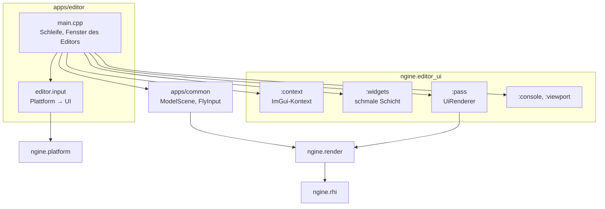

# R2.1: Editor-Gerüst und Viewport

- **Phase:** Konstruktion (Reifegrad [R2](R2-welt-und-editor.md))
- **Status:** abgeschlossen
- **Pull Requests:** #24, #25 (Review)

## Plan

**Ziel:** Es gibt einen eigenen Editor (`apps/editor/`) mit Dear ImGui und Docking. Das
Viewport-Fenster zeigt die Standardszene, die der Renderer in eine Textur zeichnet, und lässt sich
mit derselben freien Kamera wie die Sandbox durchfliegen. Eine Konsole zeigt das Log, das
zusätzlich in eine Datei geht.

**Features:** EDIT-01 (Editor-Gerüst), EDIT-02 (Viewport), EDIT-10 (Log-Konsole), CORE-12
(Log-Datei). TD-18 und TD-22 ziehen nach R2.2 um (siehe unten).

### Entwurf

**Editor-UI** (`ngine.editor_ui`, [ADR 0029](../adr/0029-editor-imgui-over-rhi.md))

- Dear ImGui 1.93 aus dem Docking-Zweig über vcpkg, ohne die Backends von ImGui. Nur
  `context.cpp` und `widgets.cpp` binden ImGui ein.
- `:draw`: Zeichenliste in Engine-Typen (`UiVertex` wie `ImDrawVert`, `UiCommand` mit Beschneidung
  in Pixeln, Indizes als `u32` über alle Fenster verschoben), `TextureHost` für Texturen der UI.
- `:context`: Kontext mit Docking, Eingaben in eigenen Typen, Zwischenablage über Rückrufe,
  Mauszeiger als Wunsch, Skalierung für hohe Pixeldichte, Lage der Fenster in einer ini-Datei.
  Texturen über `ImGuiBackendFlags_RendererHasTextures`.
- `:widgets`: Fenster, Menüs, Text, Bild, Knöpfe, Eingabefelder, Bereiche mit Scrollen,
  geclippte Zeilen, Andockfläche mit Standardanordnung.
- `:pass`: `UiRenderer` zeichnet die Zeichenliste als Pass im Render-Graph mit `ui.slang` (Vertex
  Pulling, Textur bindlos, Farben sRGB → linear, bei Unorm-Ziel selbst kodiert). Er ist der
  `TextureHost`; die Kennung einer Textur ist ihr bindloser Index plus eins.
- `:console`: `LogConsole` über einem `log::RingSink` mit Filter nach Stufe und Text.
- `:viewport`: `ViewportSize` lässt das Bild der Fenstergröße mit einem Frame Verzug folgen.

**Engine**

- RHI: `CommandList::set_scissor()` (Ursprung oben links, unabhängig vom gespiegelten Viewport).
- Log: `log::FileSink` (UTF-8-Pfad, ab Error sofort auf die Platte), `log::RingSink` (letzte
  Meldungen im Speicher, Kopie zum Anzeigen), `log::remove_sink()`, `log::format_line()`.
- Plattform: Tasten nach Scancode für Buchstaben, Ziffern, F1 bis F12, Navigation und
  Umschalttasten; Ereignisse `TextInput` und `FocusChanged`; Mausrad waagerecht; Zeigerform,
  Texteingabe an und aus, Zwischenablage, Bildschirmskalierung.
- `renderer.cpp` aufgeteilt: Reflection und Kamera in `scene.cpp`, Modelle in `models.cpp`.

**Anwendungen**

- `apps/common/`: Die Standardszene der Sandbox (`ModelScene`, `FlyInput`) zieht hierher, damit
  der Editor sie zeigt; sie gibt Welt und Renderer frei.
- `apps/editor/`: Menü (Datei, Ansicht mit Fenstern und „Layout zurücksetzen“), Andockfläche,
  Fenster Viewport, Konsole und Statistik. Rechte Maustaste im Viewport halten fliegt die Kamera
  (W/A/S/D, E/Q, Shift); solange gehören Maus und Tasten der Kamera, nicht der UI. Optionen
  `--model`, `--frames`, `--no-vsync`, `--baseline`, `--no-ini`. Log-Datei und Lage der Fenster
  liegen im Benutzerordner (`editor.log`, `editor.ini`). Mit Fehlern der Validation Layers endet
  er mit Code 1.

### Schritte

1. RHI-Scissor, Log-Sinks, Erweiterungen der Plattform; `renderer.cpp` aufteilen; Standardszene
   nach `apps/common`.
2. `ngine.editor_ui` mit Kontext, Widgets und Pass; Shader `ui.slang`.
3. Editor mit Viewport, Konsole und Statistik.
4. Tests: UI ohne GPU (Zeichenliste, Schriftatlas über den Host, Klicks, Texteingabe, Bild,
   Andocken), Konsole, Viewport-Größe, Log-Sinks; GPU-Test des UI-Passes. CI startet den Editor
   unter Xvfb.
5. ADR 0029, Doku.

**Verschoben nach R2.2:** TD-18 (Present-Fences über `VK_EXT_swapchain_maintenance1`) und TD-22
(regelmäßiger Abgleich der Zeitachsen über kalibrierte Zeitstempel). Beide ändern Swapchain bzw.
Profiler und lassen sich nur auf echter Hardware sinnvoll prüfen; R2.1 ist schon breit genug.

**Risiken:**

- ImGui über Module: viele Makros und Header. Gegenmittel: ImGui nur im globalen Modulfragment
  zweier Implementierungsdateien; früher Build unter Clang und MSVC.
- Eingaben teilen sich UI und Kamera. Gegenmittel: Beim Fliegen bekommt die UI keine Maus und
  keine gedrückten Tasten; Loslassen bekommen beide, damit keine Taste hängen bleibt.
- Die Viewport-Textur wechselt beim Ändern der Größe, während ein Frame sie noch zeigt.
  Gegenmittel: neue Größe erst im nächsten Frame, alte Textur über die Löschliste.

**Abnahme:**

- Tests ohne GPU: Zeichenliste und Schriftatlas, Klick und Texteingabe über die Eingaben,
  Bild mit eigener Kennung, Andocken nach Standardanordnung, Filter der Konsole, Viewport-Größe,
  Datei- und Ringpuffer-Sink.
- GPU-Test über lavapipe: ImGui-Fenster mit Text und Bild, Pixel des Bildes und der Löschfarbe
  geprüft, ohne Meldung der Validation Layers.
- CI: Editor startet unter Xvfb und zeichnet 60 Frames ohne Meldung der Validation Layers, auch
  mit `--baseline`.
- Auf dem PC (Windows und Linux): Editor startet, Fenster andocken und wieder lösen, Standardszene
  im Viewport, Kamera fliegen, Viewport-Größe folgt dem Fenster, Konsole zeigt das Log, keine
  Meldungen der Validation Layers.

## Stand

- Umgesetzt: Schritte 1 bis 5.
- Lokal im Cloud-Container ließ sich vcpkg nicht nutzen (GitHub-Archive für fremde Repos
  gesperrt). Geprüft wurde deshalb mit Abhängigkeiten aus git: Alle Module, `pass.cpp`,
  `window_sdl.cpp`, Editor und Sandbox übersetzen mit Clang 20 und `-Werror`; die Tests der UI,
  der Konsole, der Viewport-Größe und der Log-Sinks laufen grün gegen ImGui 1.93, ebenso der
  GPU-Test des UI-Passes auf lavapipe mit Validation Layers. Den vollständigen Build und den
  Editor unter Xvfb prüft die CI.
- Erkenntnisse während der Umsetzung:
  - Ein neues ImGui-Fenster bleibt im ersten Frame unsichtbar, während ImGui seine Größe misst;
    Tests brauchen deshalb mindestens zwei Frames.
  - Ein Klick in ein Textfeld setzt die Schreibmarke an die Klickstelle, nicht ans Ende.

## Review

**Ergebnis:** NGine hat einen eigenen Editor. Er zeigt die Standardszene in einem Viewport-Fenster,
dessen Bild der Fenstergröße folgt, und fliegt die Kamera mit gehaltener rechter Maustaste wie in
der Sandbox. Fenster lassen sich andocken und wieder lösen, eine Konsole zeigt das Log, das
zusätzlich nach `editor.log` geht. Dear ImGui steckt hinter `ngine.editor_ui` und zeichnet über
einen eigenen Pass im Render-Graph; weder Vulkan noch SDL sind dem Editor bekannt.

Abnahme: Alle Kriterien sind erfüllt. Die CI war auf Linux, unter ThreadSanitizer und auf Windows
mit MSVC grün, inklusive des GPU-Tests des UI-Passes über lavapipe und des Editors unter Xvfb (60
Frames, auch mit `--baseline`). Der Test auf dem PC unter Windows verlief erfolgreich.

**Erkenntnisse:**

- MSVC 14.51 brach beim Import von `ngine.core` mit C1116 in `<stop_token>` ab, nachdem `<mutex>`
  und `<deque>` in die Schnittstelle von `log.cppm` gekommen waren. Clang hatte nichts gemeldet.
  Schwere Header der Standardbibliothek gehören deshalb nicht in Modulschnittstellen, die viele
  importieren; `RingSink` hält sie jetzt hinter einem Pimpl. Nur der Build unter MSVC findet so
  etwas, deshalb bleibt er Pflicht für jeden PR.
- ImGui ließ sich gut hinter Modulen verstecken: Mit ImGui nur im globalen Modulfragment zweier
  Implementierungsdateien gab es keine Probleme mit Makros. `ImGuiBackendFlags_RendererHasTextures`
  passt gut zu bindlosen Texturen.
- Ein neues ImGui-Fenster bleibt im ersten Frame unsichtbar, und ein Klick in ein Textfeld setzt
  die Schreibmarke an die Klickstelle. Tests ohne GPU brauchen deshalb mindestens zwei Frames.
- Im Cloud-Container ließ sich vcpkg nicht nutzen, weil der GitHub-Zugriff der Session auf das
  eigene Repository beschränkt ist. Lokal geprüft wurde mit Abhängigkeiten aus git, den
  vollständigen Build hat die CI übernommen.
- Die Linux-Jobs der CI brauchten 81 und 128 Minuten, fast alles davon beim Installieren der
  apt-Pakete: Der Ubuntu-Spiegel bei Azure lief bei großen Paketen in Zeitüberschreitungen. Bauen
  und Testen dauerten danach rund fünf Minuten. Wir beobachten das im nächsten PR und entscheiden
  dann über einen Cache für die Pakete.

**Anpassungen:** ADR 0029 angenommen. Feature-Katalog: EDIT-01, EDIT-02, EDIT-10 und CORE-12
fertig; PLAT-02 bleibt in Arbeit (Gamepad und Aktionen fehlen). Schuldenregister: TD-26 und TD-27
neu, TD-18 und TD-22 nach R2.2 verschoben.

**Architektur-Review:**

- Die Abhängigkeiten passen zur [Architektur](../architecture.md): `ngine.editor_ui` baut auf
  Core, RHI und Render auf, der Editor auf Editor-UI, Plattform und `apps/common`. Vulkan kennt
  weiter nur die RHI, SDL nur der Plattform-Adapter.
- ImGui steht nur in `context.cpp` und `widgets.cpp`; exportiert werden reine Engine-Typen.
- `renderer.cpp` ist durch die Aufteilung von rund 770 auf 577 Zeilen geschrumpft. Größte Datei
  der Anwendungen ist jetzt `apps/editor/main.cpp` mit rund 480 Zeilen (Schleife, Eingaben und drei
  Fenster). Mit Szenenbaum und Inspector in R2.2 bekommen die Fenster eigene Dateien.
- `:widgets` wächst mit jedem Fenster; bisher bleibt es eine dünne Schicht über ImGui.
- Neue Schulden: TD-26 und TD-27, beide erst bei Bedarf.
- Leistung: Die UI zeichnet pro Befehl der Zeichenliste einen Draw aus Puffern pro Frame im Flug;
  auf dem PC gab es keine Auffälligkeiten. Gemessen haben wir sie nicht, weil die UI bisher klein
  ist.
