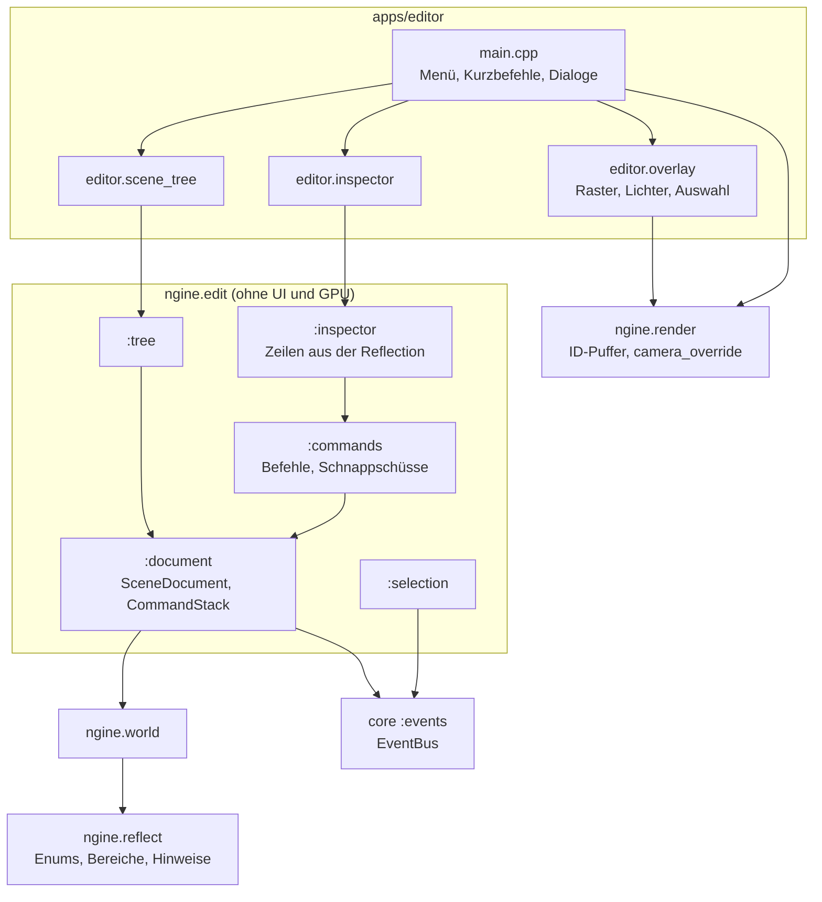

# R2.2: Szenenbaum, Inspector, Undo

- **Phase:** Konstruktion (Reifegrad [R2](R2-welt-und-editor.md))
- **Status:** in Arbeit (umgesetzt, Test auf dem PC und Review stehen aus)
- **Pull Requests:** …

## Plan

**Ziel:** Im Editor öffnet man eine Szene, wählt Entities im Szenenbaum oder per Klick im
Viewport aus, bearbeitet ihre Komponenten im Inspector, macht jede Änderung rückgängig und
speichert die Szene wieder.

**Features:** EDIT-03 (Szenenbaum), EDIT-04 (Inspector), EDIT-07 (Undo und Redo), CORE-11
(Ereignisse). Schulden: TD-08, TD-09, dazu TD-18 und TD-22 aus R2.1.

### Entwurf

**Reflection** (`ngine.reflect`)

- Enums als eigene Art (`Kind::Enum`) mit Namen und Werten (`types.add<E>("E").value("A", E::A)`).
  JSON schreibt den Namen und liest Name oder Zahl, das Binärformat die Zahl.
- Felder bekommen einen Bereich (`.range(min, max, step)`) und einen Hinweis für die Darstellung
  (`.hint(Hint::Color | Rotation | Angle)`). Der Editor klemmt auf den Bereich, das Laden nicht.
- Jeder Typ hat einen Index in der Reihenfolge der Registrierung (`TypeInfo::index`).

**Ereignisse** (CORE-11, `ngine.core:events`)

- `EventBus` mit `subscribe<E>()` (liefert eine `Subscription`, die sich beim Zerstören abmeldet),
  `publish()` (sofort) und `enqueue()` mit `dispatch()` (später, im Editor einmal pro Frame).
  Abmelden und Anmelden während der Zustellung ist erlaubt.

**Editor-Logik** (`ngine.edit`, neues Modul; [ADR 0030](../adr/0030-undo-commands-reflected-values.md))

- `SceneDocument`: Welt, stabile Kennungen (`EntityId`), Verlauf, Pfad der Datei; `open()`,
  `save()`, `clear()`, `dirty()`. Ereignisse `EntityChanged`, `DocumentReset`, `DirtyChanged`.
- `CommandStack` mit Zusammenfassen bis `seal()`, gespeichertem Stand und Obergrenze.
- Befehle: Feld setzen (Feldpfad, alte und neue Werte als Bytes), umbenennen, umhängen (mit
  Prüfung auf Zyklen, behält die lokale Lage), Entity anlegen, Teilbaum löschen (Schnappschuss
  aller speicherbaren Komponenten), Komponente hinzu und weg, Gruppen.
- `Selection` meldet `SelectionChanged`.
- Szenenbaum-Modell: Zeilen mit Tiefe in der Reihenfolge der Hierarchie, Anzeigename, ob Umhängen
  erlaubt ist.
- Inspector-Modell: Zeilen pro Feld (Gruppe, Checkbox, Zahl, Vektor, Farbe, Rotation als
  Eulerwinkel, Winkel in Grad, Text, Enum), Komponenten in der Reihenfolge der Registrierung,
  Laufzeitkomponenten nur lesend; `commit()` klemmt und führt einen zusammenfassenden Befehl aus.

**Engine**

- Welt: Speicher von flecs zählt zum Budget `Category::World` (TD-08, eigene Funktionen für
  `ecs_os_api` mit Größenkopf). Komponenten-ID pro Typ in einem Feld nach `TypeInfo::index` statt in
  zwei Hashtabellen (TD-09). `World::entity_from_index()` für den ID-Puffer.
- Szenen: Komponenten in der Reihenfolge der Registrierung; Laden vergibt die Entities aufsteigend,
  damit eine Szene auch in einer Welt mit wiederverwendeten Kennungen textgleich zurückkommt.
- Mathematik: `from_euler()` und `to_euler()` für Quaternionen.
- RHI: `Format::R32Uint`, Puffer im Speicher `CpuRead` mit `Buffer::read()`, Zustand `HostRead`,
  `CommandList::copy_texture_to_buffer()`; `DeviceDesc::present_fences`,
  `Device::calibrated_timestamp()`.
- Renderer: Auswahl per Klick (`request_pick()`, `take_pick()`): Ein Pass zeichnet alle Meshes mit
  ihrer Entity in eine `R32Uint`-Textur, ein zweiter kopiert ein Pixel in einen Puffer pro Frame im
  Flug; gelesen wird, wenn der Platz wieder an der Reihe ist. `camera_override` für eine Kamera,
  die nicht zur Szene gehört.
- Vulkan: Present-Fences über `VK_EXT_swapchain_maintenance1` (TD-18): Eine alte Swapchain wird
  frei, sobald alle Präsentationen an sie fertig sind; ohne die Extension bleibt der feste
  Abstand. Kalibrierte Zeitstempel über `VK_KHR_calibrated_timestamps` bzw. die EXT-Variante
  (TD-22): Der `GpuProfiler` gleicht die Zeitachsen alle fünf Sekunden neu ab.
- Editor-UI: Bäume, Ziehen und Ablegen, Popups, Zahlenfelder, Farbwähler, Auswahllisten,
  Kennungen, Abfragen von Tasten und Maus.
- Plattform: `Window::set_title()`.

**Editor**

- Fenster „Szene“: Baum mit Auswahl, Umbenennen (F2 oder Kontextmenü), Umhängen per Ziehen auf
  eine Entity oder die freie Fläche (Wurzel), Anlegen, Löschen (Entf). Bei Auswahl im Viewport
  scrollt der Baum zur Zeile.
- Fenster „Inspector“: Komponenten der Auswahl mit Feldern aus dem Inspector-Modell, Komponente
  hinzufügen und entfernen (Kontextmenü der Überschrift).
- Viewport: Linksklick wählt über den ID-Puffer aus. Hilfslinien für Raster, Lichter und Auswahl,
  weil Szenen aus Dateien bis R2.4 keine Meshes haben.
- Menü Datei (Neu, Öffnen, Speichern, Speichern unter, Beenden) mit Dialog für den Pfad und
  Rückfrage bei ungespeicherten Änderungen; Menü Bearbeiten mit Rückgängig und Wiederholen samt
  Beschriftung des Befehls. Kurzbefehle Strg+Z, Strg+Y (auch Strg+Umschalt+Z), Strg+S, Strg+O,
  Strg+N; nicht, solange ein Eingabefeld aktiv ist. Der Fenstertitel zeigt Datei und `*` bei
  Änderungen.
- Die Kamera des Editors gehört nicht zur Szene (`ModelScene` im Modus `Editor`), die Lichter der
  Standardszene stehen still.
- Optionen `--scene <pfad>` und `--save <pfad>` (beim Beenden speichern, für die CI).

### Schritte

1. Reflection mit Enums, Bereichen und Hinweisen; Ereignisse; `ngine.edit` mit Dokument, Befehlen,
   Auswahl, Baum- und Inspector-Modell; TD-08 und TD-09.
2. ID-Puffer und Rücklesen eines Pixels in RHI und Renderer.
3. Editor-UI erweitern; Fenster Szene und Inspector, Auswahl im Viewport, Öffnen und Speichern.
4. TD-18 und TD-22.
5. Tests, ADR 0030, Doku.

**Risiken:**

- Undo über Bytes bricht, wenn eine Entity gelöscht und neu angelegt wird. Gegenmittel: stabile
  Kennungen im Dokument, Tests für Löschen, Undo und Redo über mehrere Schritte.
- Eulerwinkel springen nahe 90° Neigung. Gegenmittel: Während des Ziehens hält der Inspector die
  eingegebenen Winkel fest und rechnet sie nicht aus dem Quaternion zurück.
- Present-Fences und kalibrierte Zeitstempel lassen sich nur auf echter Hardware sinnvoll prüfen.
  Gegenmittel: Rückfallpfad bleibt, lavapipe kann beides und deckt die Logik ab.

**Abnahme:**

- Tests ohne GPU: Verlauf mit Zusammenfassen und Versiegeln, alle Befehle mit Undo und Redo,
  stabile Kennungen nach Löschen, Gruppen, Ereignisse, Inspector-Zeilen und Klemmen, Eulerwinkel,
  Baum, Auswahl; geöffnete und unverändert gespeicherte Szene ist textgleich.
- GPU-Tests über lavapipe: Renderer liefert die Entity unter einem Pixel; Swapchain-Neuaufbau mit
  und ohne Present-Fences; kalibrierte Zeitstempel laufen mit der Uhr der CPU.
- CI: Editor unter Xvfb speichert die Standardszene, öffnet sie wieder und speichert textgleich.
- Auf dem PC (Windows): Szene laden, Lichter und Transforms im Inspector ändern, alles rückgängig
  machen; Auswahl per Klick; Umbenennen und Umhängen; Fenster größer und kleiner ziehen ohne
  Meldungen der Validation Layers.

## Stand

- Umgesetzt: Schritte 1 bis 5.
- Lokal (Cloud-Container, Abhängigkeiten aus git wie in R2.1): Alle Tests grün außer den
  `[script]`-Tests ohne .NET-SDK; GPU-Tests auf lavapipe mit Validation Layers ohne Meldung.
  Den Editor haben wir unter Xvfb mit simulierter Maus und Tastatur durchgeklickt: Auswahl per
  Klick, Ziehen eines Feldes mit einem Undo-Schritt, Umbenennen, Umhängen per Ziehen, Löschen mit
  Undo, Speichern über den Dialog. Mehrfaches Ändern der Fenstergröße lief mit Present-Fences ohne
  Meldung.
- TD-09: Der versteckte Benchmark `[.benchmark]` misst `Entity::get<T>()` für 2000 Zugriffe; im
  Debug-Build lokal rund 230 µs (etwa 115 ns pro Zugriff). Einen Vergleich im Release-Build und in
  Tracy machen wir auf dem PC.
- Erkenntnisse während der Umsetzung:
  - flecs vergibt Kennungen gelöschter Entities in umgekehrter Reihenfolge wieder. Eine Szene, die
    nach dem Leeren der Welt geladen wurde, kam deshalb in umgekehrter Reihenfolge der Wurzeln
    zurück; `load_scene()` legt jetzt alle Entities vorab an und vergibt sie aufsteigend.
  - Makros von flecs heißen `flecs_malloc` usw.; eigene Funktionen mit diesen Namen kollidieren.
  - Bei wenigen Bildern pro Sekunde (lavapipe) gehen schnelle Klicks unter, die in einem Frame
    gedrückt und losgelassen werden; auf dem PC tritt das nicht auf.
