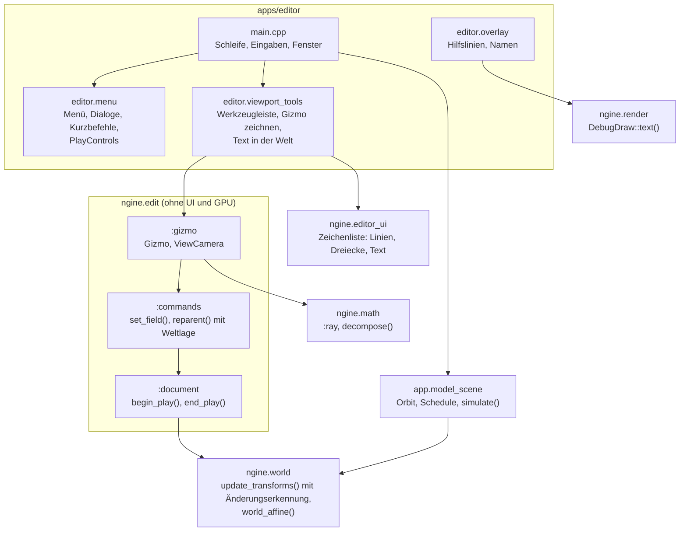

# R2.3: Gizmos und Spielen im Editor

- **Phase:** Konstruktion (Reifegrad [R2](R2-welt-und-editor.md))
- **Status:** abgeschlossen
- **Pull Requests:** [#29](https://github.com/viiez/ngine/pull/29), Review in einem eigenen PR

## Plan

**Ziel:** Im Editor lassen sich Objekte mit Gizmos verschieben, drehen und skalieren, jeweils mit
Undo; Namen und Werte stehen als Text in der Welt; „Spielen“ lässt die Systeme der Szene laufen
und „Stoppen“ stellt die Welt bitgenau wieder her.

**Features:** EDIT-05 (Gizmos), EDIT-06 (Spielen im Editor, ohne C#), REND-15 (Text in der Welt).
Schulden: TD-15 (Transform-Propagation nur für geänderte Teilbäume), dazu aus dem Review von R2.2
TD-28 (Umhängen behält die Weltlage) und das Auslagern von Menü und Dialogen aus
`apps/editor/main.cpp`.

### Entwurf

**Mathematik** (`ngine.math`)

- Neue Partition `:ray`: `Ray`, nächste Punkte zwischen Strahl und Gerade bzw. Strecke, Schnitt mit
  Ebene und Kugel, alles in 64 Bit.
- `decompose()` zerlegt eine `Affine` in Verschiebung, Drehung und Skalierung (Scherung geht
  verloren, Spiegelung landet in `scale.x`).

**Welt** (`ngine.world`, TD-15, TD-28)

- `update_transforms()` rechnet nur noch geänderte Teilbäume neu: Die Abfrage nutzt die
  Änderungserkennung von flecs pro Tabelle (Transform geändert, Entities neu, umgehängt oder
  gelöscht). flecs erkennt keine Änderung beim Elternteil; deshalb merkt sich ein Durchlauf, welche
  Bereiche von `WorldTransform` er geschrieben hat, und rechnet Kinder neu, deren Elternteil darin
  liegt. Liefert die Zahl der neu berechneten Entities.
- Wer `Transform` über `get_mut()` ändert, ruft danach `modified()` auf (neu:
  `Entity::modified<T>()`); `set()`, Befehle des Editors und Systeme im Schedule tun das von
  selbst.
- `world_affine()` berechnet die Weltlage einer Entity direkt aus den Transforms der Vorfahren,
  unabhängig davon, ob `WorldTransform` aktuell ist. Gizmos und Umhängen nutzen sie.

**Editor-Logik** (`ngine.edit`, [ADR 0031](../adr/0031-gizmos-own-math-ui-draw-list.md),
[ADR 0032](../adr/0032-play-in-editor-binary-snapshot.md))

- `edit::Gizmo` mit Modus (Verschieben, Drehen, Skalieren), Raum (Welt oder lokal; Skalieren immer
  lokal) und Raster (0,5 m, 15°, 0,1). `frame()` bestimmt Mittelpunkt, Achsen und Größe (konstant in
  Pixeln), `hit()` den Treffer unter einem Strahl, `shape()` Linien und Griffe zum Zeichnen,
  `update()` verarbeitet die Maus eines Frames und setzt `Transform` über einen zusammenfassenden
  Befehl. Ein Ziehen ist ein Undo-Schritt („Verschieben“, „Drehen“, „Skalieren“).
- `edit::ViewCamera`: Strahl unter einem Pixel, Projektion eines Punktes, Größe eines Pixels in der
  Welt; passend zur Projektion des Renderers.
- `set_field()` nimmt eine eigene Beschriftung für den Verlauf.
- `reparent()` erhält die Weltlage (TD-28): Die neue lokale Lage entsteht aus der alten Weltlage und
  der umgekehrten Weltlage des neuen Elternteils; Undo stellt die alte lokale Lage wieder her.
- Spielen: `SceneDocument::begin_play()` sichert alle Entities mit allen reflektierten Komponenten
  im Binärformat, `end_play()` stellt sie mit denselben Kennungen im Dokument und in derselben
  Reihenfolge in der Welt wieder her. Dazwischen ist das Dokument nur lesbar (`read_only()`).
  Ereignis `PlayStateChanged`.

**Engine**

- `DebugDraw::text()` sammelt Texte in Weltkoordinaten (REND-15). Der Renderer zeichnet sie nicht
  selbst, weil die Engine keine Schrift hat; die Anwendung zeichnet sie mit ihrer UI, bevor
  `add_passes()` die Liste leert.
- Editor-UI: Zeichnen in die Zeichenliste des aktuellen Fensters (`draw_line()`,
  `draw_triangle_filled()`, `draw_rect_filled()`, `draw_circle_filled()`, `draw_text()`,
  `text_size()`), `radio_button()`, `is_mouse_down()`, Tasten W, E, R und F5.

**Standardszene** (`app.model_scene`)

- Komponente `Orbit` (Kreisbahn mit Auf und Ab, Zeit als Teil des Zustands) und ein System
  „Kreisbahnen“ im Schedule auf einem eigenen Job-System. `simulate(dt)` lässt es laufen: in der
  Sandbox in jedem Frame, im Editor nur beim Spielen. Die Lichter der Standardszene kreisen damit;
  im Editor stehen sie still, bis man spielt.

**Editor**

- Werkzeugleiste über dem Viewport: Verschieben (W), Drehen (E), Skalieren (R), Lokal, Raster,
  Spielen/Stopp (F5) und Pause. Strg beim Ziehen kehrt das Raster um.
- Gizmo der Auswahl, gezeichnet über die Zeichenliste der UI über dem Viewport-Bild; die Achse
  unter der Maus leuchtet gelb, beim Ziehen steht der Wert am Mauszeiger („Verschieben x +1.50 m“).
  Ein Klick auf den Gizmo wählt nichts anderes aus.
- Namen der Lichter und der Auswahl als Text in der Welt.
- Spielen: Inspector und Szenenbaum zeigen die laufenden Werte ausgegraut, Menüpunkte zum Ändern
  sind gesperrt, der Titel zeigt „[Spielt]“. Stoppen stellt die Welt wieder her; Undo gilt weiter.
- Menü, Dialoge, Kurzbefehle und `PlayControls` in `menu.cppm`, Werkzeuge des Viewports in
  `viewport_tools.cppm`; neue Menüs „Werkzeug“ und „Spiel“.
- Option `--play <n>`: gleich spielen und nach n Frames stoppen (für die CI).

### Schritte

1. Mathematik (`:ray`, `decompose()`), `world_affine()`, TD-15 und TD-28.
2. `ngine.edit`: Gizmo und Kamera, Spielen im Dokument.
3. `DebugDraw::text()`, Zeichnen in der Editor-UI, `Orbit` und Schedule in der Standardszene.
4. Editor: Menü auslagern, Werkzeugleiste, Gizmos, Text in der Welt, Spielen.
5. Tests, ADR 0031 und 0032, Doku, CI-Schritt für Spielen im Editor.

**Risiken:**

- Änderungserkennung von flecs sieht keine Änderungen beim Elternteil und keine Schreibzugriffe
  über `get_mut()` ohne `modified()`. Gegenmittel: eigene Erkennung für Eltern, Tests für Bewegen
  von Großeltern, Umhängen, neue Entities und Systeme, die `Transform` schreiben.
- Ringe, die man von der Kante sieht, liefern unstete Schnittpunkte. Gegenmittel: Treffer und
  Ziehen ignorieren Ebenen, die fast parallel zum Strahl liegen.
- Bitgenaues Wiederherstellen scheitert an der Reihenfolge, in der flecs Kennungen wiederverwendet.
  Gegenmittel: wie beim Laden einer Szene alle Entities vorab anlegen und aufsteigend vergeben;
  Test vergleicht Bytes und Szenentext.

**Abnahme:**

- Tests ohne GPU: Strahlen, Ebenen, Kugeln und Zerlegen; Treffertests für Achsen, Ringe und Mitte;
  Verschieben, Drehen und Skalieren mit Undo als ein Schritt, mit Raster und unter einem gedrehten,
  skalierten Elternteil; Umhängen mit Weltlage samt Undo; Spielen und Stoppen hinterlassen die Welt
  Byte für Byte und die Szene Text für Text wie vorher, Verlauf und Kennungen gelten weiter;
  `update_transforms()` rechnet nur geänderte Teilbäume und folgt Umhängen, neuen Entities und
  Systemen; Texte im Debug-Zeichnen.
- CI: Editor unter Xvfb spielt 30 Frames, stoppt und speichert; die Szene ist textgleich mit der
  vorher gespeicherten.
- Auf dem PC (Windows): Objekte mit Gizmos bewegen, drehen und skalieren, lokal und global, mit
  Raster, jeweils mit Undo; umhängen ohne Springen; spielen (Lichter kreisen), stoppen, alles steht
  wie vorher.

## Stand

- Umgesetzt: Schritte 1 bis 5.
- Lokal (Cloud-Container, Clang 20, Abhängigkeiten über vcpkg; GitHub-Quellarchive über
  `git archive` nachgebaut, weil der Proxy sie sperrt): Bauen ohne Warnungen, alle 232 Tests
  grün (C#-Tests übersprungen, kein .NET-SDK). Editor unter Xvfb: Speichern, Öffnen und Speichern
  sowie `--play 30` mit Stoppen liefern textgleiche Szenen; Gizmo und Namen in der Welt sind auf
  dem Bild zu sehen.
- Laufzeit der CI (erster Lauf des PR, vcpkg-Cache getroffen), Grundlage für die Entscheidung über
  ein eigenes Container-Image oder einen apt-Cache (TD-06):

  | Job | Gesamt | apt | vcpkg holen + Cache | Konfigurieren | Bauen | Testen | Programme starten |
  | --- | --- | --- | --- | --- | --- | --- | --- |
  | Linux (Clang 20) | 6:16 | 0:38 | 0:23 | 0:25 | 2:27 | 1:20 | 0:53 |
  | Linux (TSan) | 3:33 | 0:33 | 0:24 | 0:15 | 1:58 | 0:15 | – |
  | Windows (MSVC) | 5:03 | – | 0:25 | 0:24 | 2:32 | 1:03 | 0:19 |

  Die Pakete kosten pro Linux-Job gut eine halbe Minute; der Großteil ist Bauen und Testen.

## Review

**Ergebnis:** Im Editor lassen sich Objekte mit Gizmos verschieben, drehen und skalieren, lokal oder
global und mit Raster; jedes Ziehen ist ein Undo-Schritt. Namen stehen als Text in der Welt.
„Spielen“ lässt die Systeme der Standardszene laufen (die Lichter kreisen), „Stoppen“ stellt die
Welt Byte für Byte wieder her, Verlauf und Kennungen gelten weiter. Dazu sind TD-15 und TD-28
abgebaut und Menü, Dialoge und Werkzeuge des Viewports aus `main.cpp` ausgelagert.

Abnahme: Alle Kriterien sind erfüllt. Die CI war auf Linux, unter ThreadSanitizer und auf Windows
mit MSVC grün, inklusive der neuen Prüfung im Editor (30 Frames spielen, stoppen, speichern,
textgleich). Der Test auf dem PC unter Windows verlief erfolgreich.

**Erkenntnisse:**

- Die Änderungserkennung von flecs arbeitet pro Tabelle und sieht Eltern nicht. Eine eigene Liste
  der geschriebenen Bereiche von `WorldTransform` schließt die Lücke mit wenig Code; der Preis ist,
  dass `get_mut()` ohne `modified()` unbemerkt bleibt. Die Tests für Großeltern, Umhängen, neue
  Entities und Systeme halten das fest.
- Gizmos ohne Fremdbibliothek waren überschaubar (rund 400 Zeilen Logik), weil Treffertests und
  Ziehen nur Strahlen, Ebenen und Kugeln brauchen. Dass die Logik in `ngine.edit` ohne UI liegt,
  machte Verschieben, Drehen und Skalieren samt Raster und gedrehtem Elternteil ohne Fenster
  testbar.
- Ein Bild im Viewport braucht einen unsichtbaren Knopf darunter (`image_area()`), sonst verschiebt
  ein Ziehen das Fenster statt den Gizmo.
- Die binäre Sicherung aus R2.2 (Kennungen vorab anlegen, aufsteigend vergeben) trug auch Spielen
  und Stoppen; bitgenaues Wiederherstellen gelang ohne neue Mechanik.
- CI-Laufzeit (siehe „Stand“): Mit getroffenem vcpkg-Cache dauert die Pipeline rund 6 bis
  7,5 Minuten; die apt-Pakete kosten pro Linux-Job gut eine halbe Minute. Ein eigenes
  Container-Image oder ein apt-Cache spart damit wenig; mehr brächte ein Compiler-Cache beim
  Bauen. Das lange Hängen am apt-Spiegel aus R2.2 trat nicht wieder auf.

**Anpassungen:** ADR 0031 und 0032 angenommen. Feature-Katalog: EDIT-05 und REND-15 fertig,
EDIT-06 bleibt bis zu den C#-Skripten (R4) in Arbeit. Schuldenregister: TD-15 und TD-28 abgebaut,
TD-29 neu.

**Architektur-Review:**

- Die Abhängigkeiten passen zur [Architektur](../architecture.md): `ngine.edit` kennt weiter weder
  UI noch Renderer; der Gizmo liefert nur Formen, gezeichnet wird im Editor über `ngine.editor_ui`.
  Die Engine zeichnet keinen Text selbst, `DebugDraw::text()` sammelt nur.
- Fremdbibliotheken: ImGui weiterhin nur in `context.cpp` und `widgets.cpp`, flecs nur in
  `world.cpp` (die Änderungserkennung steckt hinter `for_each_parent_first_changed()`).
- Schnittstellen: Änderungen laufen weiter nur über `SceneDocument::execute()`; während des Spielens
  sperrt `read_only()` alle Befehle. Wer `Transform` über `get_mut()` ändert, muss `modified()`
  aufrufen; das steht in der Architektur.
- Größe: `apps/editor/main.cpp` ist von rund 790 auf rund 600 Zeilen geschrumpft, obwohl Gizmos,
  Spielen und `--play` dazukamen. `renderer.cpp` bleibt bei rund 730 Zeilen.
- Neue Schulden: TD-29 (Transform-Update parallel über das Job-System).
- Leistung: `update_transforms()` rechnet im stehenden Editor keine Entity mehr neu (Zähler in der
  Statistik); auf dem PC gab es keine Auffälligkeiten.
