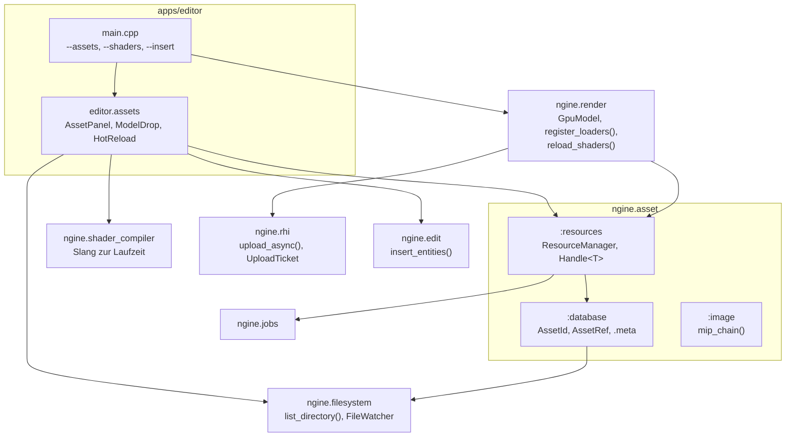

# R2.4: Asset-IDs, Ressourcen und Hot Reload

- **Phase:** Konstruktion (Reifegrad [R2](R2-welt-und-editor.md))
- **Status:** abgeschlossen
- **Pull Requests:** [#31](https://github.com/viiez/ngine/pull/31), Review in einem eigenen PR

## Plan

**Ziel:** Jede Quelldatei hat eine stabile Kennung; `MeshRenderer` verweist darüber auf Modelle, und
Szenen mit Modellen lassen sich vollständig speichern. Ein Ressourcen-Manager lädt Modelle im
Hintergrund, zählt Referenzen und gibt Ungenutztes frei; Uploads laufen über eine eigene
Transfer-Queue. Shader, Texturen und Modelle werden nach dem Speichern ohne Neustart neu geladen.
Im Editor zieht man Modelle aus einem Asset-Browser in die Szene.

**Features:** ASSET-04 (Ressourcen-Manager), ASSET-05 (Asset-IDs), PLAT-06 (Hot Reload von
Dateien), EDIT-09 (Asset-Browser). Schulden: TD-12 (C#-Assemblies über einen festen Pfad), TD-17
(Uploads auf der Grafik-Queue). Aus dem Review von R2.3: TD-29 bleibt für R3; die CI bleibt ohne
eigenes Image und ohne apt-Cache (entschieden nach der Messung in R2.3).

### Entwurf

**Dateisystem** (`ngine.filesystem`, PLAT-06)

- `list_directory()` (auf Wunsch rekursiv, sortiert, ohne versteckte Einträge), `status()`,
  `is_directory()`, `rename()`, `normalize()` (absolut, `/` als Trenner), `relative()`,
  `parent_path()`, `file_name()`, `extension()` (klein geschrieben), `executable_dir()`.
- `FileWatcher` fragt Größe und Änderungszeit ab (Polling, [ADR 0034](../adr/0034-hot-reload-polling-slang-runtime.md))
  und meldet eine Datei erst, wenn sie einen Durchlauf lang gleich geblieben ist.

**Assets** (`ngine.asset`, ASSET-04, ASSET-05, [ADR 0033](../adr/0033-asset-ids-meta-resource-manager.md))

- `AssetId` (64 Bit, zufällig) in einer `.meta`-Datei neben jeder Datei bekannter Art;
  `AssetRef{asset, index}` für Teile (Mesh oder Material einer glTF-Datei); `generated_id(name)`
  für Modelle, die ein Programm selbst erzeugt.
- `AssetDatabase` durchsucht den Asset-Ordner, legt fehlende `.meta`-Dateien an und ersetzt
  doppelte Kennungen.
- `ResourceManager` mit `Handle<T>`, Lesen im Hintergrund auf dem Job-System und Abschluss im
  Hauptthread (`update()`), Freigeben nach `keep_updates` Aufrufen ohne Halter, erzeugten
  Ressourcen (`add()`), Neuladen nach Kennung oder Datei samt Abhängigkeiten.
- `load_gltf()` meldet die Dateien, die ein Modell braucht (`.bin`, Bilder).
- `mip_chain()` rechnet alle Mip-Stufen eines Bildes auf der CPU, in sRGB linear gemittelt.

**RHI** (TD-17, [ADR 0035](../adr/0035-transfer-queue-concurrent-sharing.md))

- Eigene Transfer-Queue, wo die GPU eine Familie nur für Kopien hat; `upload_async()` für Puffer
  und Texturen (mit allen Mip-Stufen) liefert ein `UploadTicket`, `upload_done()` sagt, wann die
  Ressource benutzt werden darf. Ohne Transfer-Queue läuft es wie `upload()`.
- Puffer im GPU-Speicher und Texturen mit `TransferDst` werden dann für beide Familien gemeinsam
  genutzt; die Löschliste wartet auf beide Queues.

**Renderer** (`ngine.render`)

- `MeshRenderer{mesh, material}` aus zwei `AssetRef`, wird mit Szenen gespeichert (bisher
  Laufzeitkomponente). Reflection-Hinweis `Hint::Asset` für den Inspector.
- `GpuModel` besitzt Meshes, Materialien und Texturen eines Modells in den Speichern des Renderers
  und gibt sie beim Zerstören frei; dazu sein Aufbau ohne Eckpunkte und Pixel und das Ticket der
  Uploads. `register_loaders()` meldet glTF-Modelle beim Ressourcen-Manager an (Lesen, Dekodieren
  und Mip-Stufen im Hintergrund, Hochladen im Hauptthread über `upload_async()`).
- Der Renderer löst `AssetRef` über den Ressourcen-Manager auf, hält die Modelle und lässt sie
  nach zwei Frames ohne Zeichnen los. Was noch lädt, zählt als `stats().waiting`.
- `MaterialStore` und `MeshStore` geben einzelne Einträge frei und vergeben die Plätze neu.
- `reload_shaders(source)` übersetzt alle Shader und baut alle Pipelines neu; bei einem Fehler
  bleibt der alte Stand.

**Shader zur Laufzeit** (`ngine.shader_compiler`, neu)

- `Compiler::compile(path, entry, stage)` über die COM-API von Slang mit denselben Optionen wie
  beim Bauen; Meldungen mit Datei und Zeile. Nur Editor und Tests linken das Modul.

**Editor-Logik** (`ngine.edit`)

- `insert_entities(snapshot, label)` legt einen Teilbaum mit vorab reservierten Kennungen an; Undo
  löscht ihn wieder.

**Standardszene** (`app.model_scene`)

- Kugeln, Boden, Säulen und Lampen sind ein erzeugtes Modell mit fester Kennung, `--model` und
  der Boden ebenso. Die Szene besitzt den Ressourcen-Manager und ruft `update()` in jedem Frame.

**Editor** (EDIT-09)

- Fenster „Assets“ (unten neben der Konsole): alle Assets mit Art und Pfad, Filter, Knopf zum neu
  Durchsuchen, Zahl der geladenen Ressourcen. Modelle zieht man ins Viewport; sie landen dort, wo
  die Maus den Boden (y = 0) trifft, sonst 5 m vor der Kamera. Das Einfügen wartet, bis das Modell
  geladen ist, und ist ein Undo-Schritt („‚kiste‘ einfügen“).
- Hot Reload: Der Editor beobachtet den Asset-Ordner und die Shader-Quellen. Geänderte Modelle und
  Texturen werden neu geladen, neue und gelöschte Dateien aktualisieren die Liste, geänderte
  Shader werden mit Slang übersetzt und eingetauscht. Fehler stehen in der Konsole.
- Asset-Ordner und Shader-Quellen sucht der Editor vom Arbeitsverzeichnis aus aufwärts (`assets`,
  `engine/shaders`); `--assets <pfad>` und `--shaders <pfad>` geben sie vor. `--insert <pfad>`
  fügt beim Start ein Modell aus dem Asset-Ordner ein (für die CI).

**C#-Assemblies** (TD-12)

- Die Assemblies werden nach dem Bauen in den Ordner `dotnet` neben das Programm kopiert
  (`ngine_copy_dotnet_assemblies()`); Sandbox und Tests suchen sie relativ zu
  `executable_dir()` statt über einen einkompilierten Pfad.

**Beispiel-Assets**

- `assets/modelle/kiste.gltf` (1-m-Würfel mit Holztextur) samt `.meta`-Dateien.

### Schritte

1. Dateisystem (Auflisten, Pfade, Beobachter), Asset-Datenbank und Ressourcen-Manager.
2. `MeshRenderer` mit `AssetRef`, `GpuModel`, Lader für glTF, Standardszene als erzeugtes Modell.
3. Slang zur Laufzeit und `reload_shaders()`.
4. Editor: Asset-Browser, Ziehen ins Viewport, Hot Reload; `insert_entities()`.
5. TD-12, TD-17 (Transfer-Queue, Mip-Stufen auf der CPU, Tickets im Renderer).
6. Tests, ADR 0033 bis 0035, Doku, CI-Schritt für Einfügen, Speichern und Öffnen.

**Risiken:**

- Slang als Bibliothek ist groß und unter Windows auf weitere DLLs angewiesen. Gegenmittel: nur
  Editor und Tests linken es; `ngine_copy_slang_runtime()` kopiert die DLLs; Test in der CI.
- Ressourcen, die im Hintergrund laden, während der Editor sie freigibt oder neu lädt.
  Gegenmittel: Zähler pro Anfrage verwirft veraltete Ergebnisse; Test mit Job-System unter
  ThreadSanitizer.
- Die Transfer-Queue läuft in der CI nicht (lavapipe hat keine eigene Familie). Gegenmittel:
  Rückfallpfad in der CI, Test mit beiden Einstellungen, Bestätigung auf dem PC.
- Verweise brechen, wenn eine Datei ohne ihre `.meta`-Datei verschoben wird. Gegenmittel: Der
  Editor zählt wartende Modelle sichtbar; das Verhalten steht im ADR.

**Abnahme:**

- Tests ohne GPU: Pfade, rekursives Auflisten, Dateibeobachter (ruhig gewartet, versteckte und
  temporäre Dateien); `.meta`-Dateien, stabile Kennungen beim Verschieben, doppelte Kennungen;
  Ressourcen laden einmal, melden Fehler, werden freigegeben, laden nach geänderten Dateien und
  Abhängigkeiten neu und behalten bei Fehlern den alten Stand, laden im Hintergrund (unter
  ThreadSanitizer); Mip-Ketten; Einfügen mit Undo; `MeshRenderer` in Szenen; Slang übersetzt mit
  Imports und meldet Fehler mit Datei.
- GPU-Tests: Uploads im Hintergrund mit fertigen Mip-Stufen, mit und ohne Transfer-Queue; der
  Renderer lädt `kiste.gltf` über die Asset-ID im Hintergrund und zeichnet sie erst, wenn sie
  fertig ist; Renderer-Shader aus den Quellen neu übersetzen, Fehler lassen alles beim Alten.
- CI: Editor unter Xvfb fügt `modelle/kiste.gltf` ein und speichert; die Szene enthält die
  Asset-ID und ist nach Öffnen und Speichern textgleich.
- Auf dem PC (Windows): Modell aus dem Browser in die Szene ziehen, speichern, Editor neu starten,
  Szene sieht gleich aus; Shader oder Textur ändern und das Bild ändert sich ohne Neustart; im Log
  steht „Transfer-Queue für Uploads im Hintergrund“.

## Stand

- Umgesetzt: Schritte 1 bis 6.
- Lokal (Cloud-Container, Clang 20, lavapipe mit Validation Layers): Bauen ohne Warnungen, alle
  251 Tests grün (C#-Tests übersprungen, kein .NET-SDK). Editor unter Xvfb: Einfügen von
  `modelle/kiste.gltf`, Speichern, Öffnen und Speichern liefern textgleiche Szenen mit der
  Asset-ID; Hot Reload greift nach dem Speichern einer Textur und eines Shaders, ein Shader mit
  Syntaxfehler meldet Datei und Zeile und lässt den alten Stand stehen.
- CI: Der erste Lauf scheiterte unter Windows an einem fehlenden Namensraum im C#-Zweig der
  Sandbox, der ohne .NET-SDK lokal nicht übersetzt wird; nach der Korrektur waren alle drei Jobs
  grün.

## Review

**Ergebnis:** Jede Quelldatei unter `assets/` hat eine stabile Kennung in einer `.meta`-Datei;
`MeshRenderer` verweist darüber auf Modelle, und Szenen mit Modellen sind vollständig speicherbar.
Der Ressourcen-Manager lädt Modelle im Hintergrund über das Job-System, zählt Referenzen, gibt
Ungenutztes frei und lädt nach Änderungen samt Abhängigkeiten neu. Shader, Texturen und Modelle
ändern sich im Editor nach dem Speichern ohne Neustart; Modelle zieht man aus dem Asset-Browser
ins Viewport. Dazu sind TD-12 und TD-17 abgebaut.

Abnahme: Alle Kriterien sind erfüllt. Die CI war auf Linux, unter ThreadSanitizer und auf Windows
mit MSVC grün, inklusive der neuen Prüfung im Editor (Modell einfügen, speichern, öffnen,
speichern, textgleich). Der Test auf dem PC unter Windows verlief erfolgreich: Modell aus dem
Browser ziehen, speichern und neu starten, Shader und Textur zur Laufzeit ändern, Uploads über die
Transfer-Queue.

**Erkenntnisse:**

- Lesen im Hintergrund und Hochladen im Hauptthread als zwei Teile eines Laders hielt den
  Ressourcen-Manager frei von GPU-Wissen und den Renderer frei von Threads. Ein Zähler pro Anfrage
  reichte, um veraltete Ergebnisse beim Neuladen zu verwerfen; ThreadSanitizer fand nichts.
- Job-Funktionen haben wenig Platz; der Auftrag eines Laders liegt deshalb auf dem Heap. Die
  statische Prüfung in `ngine.jobs` hat das sofort gemeldet.
- Für die Transfer-Queue waren gemeinsam genutzte Ressourcen und Mip-Stufen auf der CPU deutlich
  einfacher als Übergaben zwischen Queue-Familien; der Renderer braucht nur ein Ticket pro Modell.
- Code hinter `#if NGINE_WITH_DOTNET` wird im Cloud-Container nicht übersetzt (kein .NET-SDK);
  erst die Windows-CI hat den Fehler darin gefunden. Solche Zweige klein halten.
- Beim Schreiben der Tests fiel ein Fehler in `insert_entities()` auf: Mit schon vergebenen
  Kennungen hätte das Aufräumen bestehende Entities gelöscht. Der Befehl prüft jetzt vorher.
- Polling für den Dateibeobachter ist für die Größe des Asset-Ordners unauffällig; Änderungen
  erscheinen nach etwa einer halben Sekunde.

**Anpassungen:** ADR 0033, 0034 und 0035 angenommen. Feature-Katalog: ASSET-04, ASSET-05 und
PLAT-06 fertig, EDIT-09 bleibt bis zu Vorschaubildern und Import (R2.5) in Arbeit.
Schuldenregister: TD-12 und TD-17 abgebaut, TD-30 und TD-31 neu.

**Architektur-Review:**

- Die Abhängigkeiten passen zur [Architektur](../architecture.md): `ngine.asset` kennt weder GPU
  noch Renderer, der Renderer meldet seine Lader nur an (`register_loaders()`). Slang steckt nur
  in `ngine.shader_compiler`, das allein Editor und Tests linken; der Renderer bekommt eine
  Funktion, die SPIR-V liefert.
- Fremdbibliotheken: fastgltf weiter nur in `gltf_fastgltf.cpp`, stb_image nur in
  `image_stb.cpp`, Slang nur in `compiler.cpp`.
- Schnittstellen: `MeshRenderer` hat sich geändert (Verweise statt Indizes); alte Szenen mit
  Modellen ließen sich vorher ohnehin nicht vollständig speichern. Einfügen läuft über
  `SceneDocument::execute()` und ist ein Undo-Schritt.
- Größe: `renderer.cpp` ist von rund 730 auf rund 850 Zeilen gewachsen (Modelle über den
  Ressourcen-Manager, Shader neu laden), `apps/editor/main.cpp` von rund 600 auf rund 680; die
  Asset-Funktionen des Editors liegen in `assets.cppm`. Beim nächsten Wachstum den Renderer
  aufteilen (z. B. Modelle und Pipelines in eigene Dateien).
- Neue Schulden: TD-30 (neu geladene Modelle flackern kurz), TD-31 (Polling liest den ganzen
  Ordner).
- Leistung: Laden im Hintergrund hält den Editor beim Einfügen bedienbar; auf dem PC gab es keine
  Auffälligkeiten.
