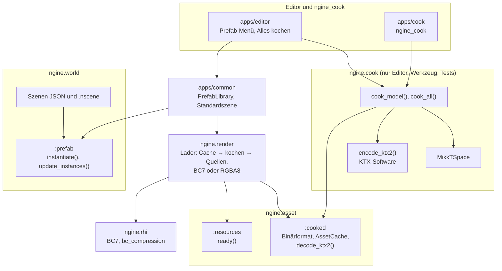

# R2.5: Kochen, KTX2 und Prefabs

- **Phase:** Konstruktion (Reifegrad [R2](R2-welt-und-editor.md))
- **Status:** abgeschlossen
- **Pull Requests:** [#33](https://github.com/viiez/ngine/pull/33), Review in einem eigenen PR

## Plan

**Ziel:** Eine Asset-Pipeline kocht glTF-Modelle in ein binäres Format und ihre Bilder in KTX2 mit
Basis Universal; gekochte Daten liegen in einem Cache und werden nur bei Änderung neu erzeugt.
Tangenten entstehen beim Kochen nach MikkTSpace. Prefabs sind Vorlagen als Datei, Instanzen in
Szenen behalten ihre Überschreibungen, wenn sich die Vorlage ändert; im Editor legt man sie an und
bricht sie auf. Szenen lassen sich binär speichern.

**Features:** ASSET-02 (Texturen, KTX2), ASSET-03 (Asset-Pipeline), WORLD-04 (Prefabs), WORLD-05
(Szenen binär). Schulden: TD-21 (Tangenten nach MikkTSpace). Aus dem Review von R2.4: TD-30
(neu geladene Modelle flackern kurz); `renderer.cpp` aufteilen, falls er weiter wächst.

### Entwurf

**RHI**

- Formate `BC7Unorm` und `BC7Srgb`, `is_compressed()`, `texture_level_size()` in Blöcken aus 4×4
  Pixeln. `Capabilities::bc_compression`, wenn die GPU `textureCompressionBC` und die Formate zum
  Abtasten kann; `DeviceDesc::bc_compression = false` schaltet es zum Testen ab.
- Blockkomprimierte Texturen kommen nur über `upload_async()` mit allen Mip-Stufen auf die GPU.

**Gekochte Assets** (`ngine.asset`, ASSET-03, [ADR 0036](../adr/0036-cooked-assets-ktx2-cache.md))

- `CookedModel`: `Model` mit Eckpunkten und Indizes, Bilder ohne Pixel, dazu die Texturen als
  KTX2 je Bild und Farbraum (samt fertiger BC7-Fassung) und die Stempel aller Quelldateien. `write_cooked_model()` und
  `read_cooked_model()` (prüft alle Querverweise).
- `AssetCache` im Ordner `<assets>/.cache`: `load_model()` liefert nur Aktuelles, `store_model()`
  schreibt atomar. Stempel: Größe und Änderungszeit, im Zweifel FNV-1a über den Inhalt.
- `decode_ktx2()` liest KTX2 über KTX-Software und wandelt Basis Universal nach BC7 oder RGBA8.
- Lader im `ResourceManager` können eine Bereitschaft melden (`ready`); ein neuer Wert ersetzt den
  alten erst, wenn er bereit ist (TD-30).

**Kochen** (`ngine.cook`, neu, TD-21)

- `cook_model()`: glTF laden, Tangenten nach MikkTSpace für Teilnetze ohne Tangenten in der Datei,
  jedes benutzte Bild als KTX2 (UASTC mit zstd), Stempel.
- `cook_all()` kocht alle Modelle der Datenbank, deren Cache veraltet ist; `model_cooker()` gibt
  das Kochen als Funktion an den Lader des Renderers.
- Werkzeug `ngine_cook` (`--force`, `--etc1s`, `--raw`).

**Renderer**

- `register_loaders(resources, renderer, ModelLoading{cache, cook})`: erst aus dem Cache, dann
  kochen (nur mit `cook`) und im Cache ablegen, dann aus den Quellen. Texturen als BC7, wenn die
  GPU es kann. `model_load_counts()` zählt, woher Modelle kamen.
- Ein neu geladenes Modell bleibt beim alten Stand, bis seine Uploads fertig sind.

**Prefabs** (`ngine.world`, WORLD-04, [ADR 0037](../adr/0037-prefabs-field-overrides.md))

- `.prefab`-Dateien im Format einer Szene mit einer Wurzel; Komponenten `PrefabInstance`,
  `PrefabNode`, `PrefabOverrides` (transient).
- `instantiate()`, `prefab_overrides()` (nur abweichende Felder), `update_instances()`
  (Überschreibungen bleiben, neue Knoten kommen dazu, weggefallene gehen), `unpack_instance()`,
  `make_prefab()`.
- Szenen speichern Instanzen als `"prefab"` mit `"overrides"`; Entities unter Knoten einer
  Instanz mit `"parent_node"`. Fehlt die Vorlage, bleibt die Instanz als Wurzel mit den
  Überschreibungen als Text.

**Szenen binär** (WORLD-05)

- `.nscene` mit Kennung `NGSC`, Typtabelle mit Hash des Aufbaus jedes Typs und Komponenten im
  Binärformat der Reflection. `save_scene_file()` wählt das Format nach der Endung,
  `load_scene_file()` erkennt es am Inhalt.

**Editor-Logik** (`ngine.edit`)

- `link_prefab()` und `unpack_prefab()` als Befehle mit Undo, `prefab_snapshot()` für das
  Einfügen einer Instanz; `SceneDocument::set_prefabs()` für Öffnen und Speichern.

**Anwendungen**

- `app.prefabs`: `PrefabLibrary` lädt Vorlagen über den Ressourcen-Manager und zieht Instanzen
  nach, wenn Hot Reload eine Vorlage neu lädt.
- Standardszene: Boden und Säulen aus `modelle/boden.gltf` und `modelle/saeule.gltf` mit Farb- und
  Normalenkarten (Schiefer, Sandstein), vier Laternen als Instanzen von `prefabs/laterne.prefab`,
  eine davon mit kaltem Licht überschrieben. Ohne Asset-Ordner bleibt alles erzeugt.
- Sandbox: liest gekochte Modelle aus dem Cache (`--no-cache` zum Vergleich) und misst, wie lange
  die Modelle der Szene zum Laden brauchen.
- Editor: kocht beim Laden, was fehlt; Menü „Prefab“ (Als Prefab speichern, Änderungen in Vorlage
  übernehmen, Prefab aufbrechen), Menü „Assets“ (Alles kochen, Alles neu kochen), Prefabs aus dem
  Asset-Browser ziehen, Szenen als `.nscene` speichern.

### Schritte

1. RHI: BC7 mit Rückfallpfad.
2. Gekochtes Format, Cache, KTX2 lesen; `ngine.cook` mit MikkTSpace und KTX2 kodieren.
3. Lader des Renderers mit Cache und Kochen, Bereitschaft im Ressourcen-Manager (TD-30).
4. Prefabs und binäre Szenen in `ngine.world`, Befehle in `ngine.edit`.
5. Standardszene mit Assets und Laternen, Sandbox, Editor, `ngine_cook`.
6. Tests, ADR 0036 und 0037, Doku, CI-Schritte für Kochen, Ladezeit und Prefabs.

**Risiken:**

- KTX-Software ist groß und baut Basis Universal mit; der vcpkg-Port muss unter Linux und Windows
  bauen. Gegenmittel: früh bauen, nur hinter zwei Adapterdateien.
- UASTC ist langsam zu kodieren, im Debug-Build erst recht. Gegenmittel: Kochen läuft im
  Hintergrund und nur bei Änderung; Tests nehmen kleine Bilder und die schnellste Stufe.
- lavapipe und manche GPUs können kein BC7. Gegenmittel: Umwandeln nach RGBA8, Test mit beiden
  Einstellungen.
- Überschreibungen gehen beim Nachziehen verloren. Gegenmittel: Abweichungen gegen den alten Stand
  rechnen, bevor der neue gesetzt wird; Tests für geänderte, neue und weggefallene Knoten.

**Abnahme:**

- Tests ohne GPU: gekochtes Format hin und zurück, kaputte Dateien, Stempel und Cache; MikkTSpace
  (Richtung, Nähte); KTX2 roh, UASTC nach BC7 und RGBA8, ETC1S; Kochen eines Modells und eines
  Ordners nur bei Änderung; Bereitschaft im Ressourcen-Manager; Prefabs lesen, instanziieren,
  Überschreibungen, Nachziehen, Aufbrechen; Szenen mit Instanzen und binäre Szenen textgleich;
  Befehle mit Undo.
- GPU-Test: Der Renderer kocht `kiste.gltf` und lädt es danach aus dem Cache, mit BC7 und mit
  RGBA8.
- CI: `ngine_cook` kocht den Asset-Ordner, ein zweiter Lauf kocht nichts; die Sandbox misst die
  Ladezeit aus dem Cache und aus den Quellen; der Editor speichert die Standardszene mit Laternen
  und eine eingefügte Laterne als JSON und `.nscene`, Öffnen und Speichern bleiben textgleich.
- Auf dem PC (Windows): Die Standardszene lädt aus dem Cache spürbar schneller als aus den Quellen
  (Zeiten im Log); `prefabs/laterne.prefab` ändern (z. B. Farbe des Lichts), alle Laternen ziehen
  nach, die kalte Laterne bleibt kalt. Eine Laterne verändern, „Änderungen in Vorlage übernehmen“,
  die anderen ziehen nach.

## Stand

- Umgesetzt: Schritte 1 bis 6.
- Lokal (Cloud-Container, Clang 20, lavapipe mit Validation Layers): Bauen ohne Warnungen, alle
  Tests grün (C#-Tests übersprungen, kein .NET-SDK). `ngine_cook` kocht die drei Modelle des
  Asset-Ordners im Release-Build in rund 4 s (Debug rund 15 s), ein zweiter Lauf findet alles
  aktuell.
- Ladezeit der Modelle der Standardszene (Sandbox `--image`, Zeit bis alle Modelle auf der GPU
  sind, lavapipe mit BC7):

  | Build | aus den Quellen (`--no-cache`) | aus dem Cache |
  | --- | --- | --- |
  | Release | 93 bis 109 ms | 14 ms |
  | Debug | 495 bis 543 ms | 15 ms |

  Der erste Entwurf wandelte beim Laden aus UASTC nach BC7 um und war damit kaum schneller als die
  Quellen (Release 73 bis 90 ms); seitdem liegt die BC7-Fassung fertig im Cache
  ([ADR 0036](../adr/0036-cooked-assets-ktx2-cache.md)).
- Editor unter Xvfb: Standardszene mit vier Laternen und eine eingefügte Laterne als JSON und
  `.nscene` gespeichert und geöffnet, textgleich; nach einer Änderung an `laterne.prefab` zieht
  Hot Reload alle vier Instanzen nach („Prefab …: 4 Instanzen nachgezogen“).
- `renderer.cpp` ist in R2.5 nicht gewachsen (rund 850 Zeilen); das Aufteilen bleibt beim nächsten
  Wachstum fällig. Modelle und Texturen stehen schon in `models.cpp`.
- CI: Der erste Lauf scheiterte unter Windows beim Bauen: `KTX::ktx` reicht im Debug-Build `_DEBUG`
  und `DEBUG` an alle weiter, die es linken, und MSVC bricht dann beim Import von Modulen ab, die
  ohne diese Definitionen übersetzt sind (C5050). Das Ziel `ngine_ktx` reicht seitdem nur
  Bibliothek, Include-Pfad und die übrigen Definitionen weiter; danach waren alle drei Jobs grün.

## Review

**Ergebnis:** Modelle werden gekocht: Eckpunkte und Indizes so, wie der Renderer sie hochlädt,
Tangenten nach MikkTSpace, Texturen als KTX2 mit Basis Universal und schon fertig als BC7. Der
Cache im Asset-Ordner kocht nur neu, was sich geändert hat; der Editor kocht beim Laden, die
Sandbox liest nur, `ngine_cook` kocht alles vorab. Aus dem Cache lädt die Standardszene in rund
15 ms statt 95 ms (Release) bzw. 500 ms (Debug) aus den Quellen. Prefabs sind Vorlagen als Datei;
Instanzen speichern nur ihre Abweichungen und behalten sie, wenn sich die Vorlage ändert. Im Editor
legt man sie an, übernimmt Änderungen in die Vorlage und bricht sie auf. Szenen lassen sich binär
speichern. Dazu sind TD-21 und TD-30 abgebaut.

Abnahme: Alle Kriterien sind erfüllt. Die CI war auf Linux, unter ThreadSanitizer und auf Windows
mit MSVC grün, inklusive der neuen Schritte (Kochen, Ladezeit, Prefabs als JSON und `.nscene`).
Der Test auf dem PC unter Windows verlief erfolgreich: Laden mit und ohne Cache, Ändern von
`laterne.prefab` mit Nachziehen aller Instanzen samt Überschreibungen, Übernehmen einer Instanz in
die Vorlage. Beim Test fiel auf, dass der Cache nach dem Bauen leer ist, solange weder Editor noch
`ngine_cook` gelaufen sind; die Sandbox kocht absichtlich nicht.

**Erkenntnisse:**

- Messen vor dem Abhaken lohnt sich: Der erste Entwurf wandelte UASTC beim Laden nach BC7 um und
  war kaum schneller als die Quellen, weil das Umwandeln so viel kostete wie Dekodieren und
  Mip-Stufen. Die fertige BC7-Fassung im Cache brachte den eigentlichen Gewinn.
- Fremdbibliotheken bringen über ihre CMake-Ziele Definitionen mit, die mit C++-Modulen nicht
  vertragen; Linux merkt das nicht, MSVC bricht ab. Eigene Zwischenziele wie `ngine_ktx` halten
  das klein.
- Überschreibungen über JSON zu vergleichen brauchte eine Normalisierung: Vorlagen lassen Felder
  aus oder schreiben `6` statt `6.0`. Der Vergleich rechnet deshalb immer gegen den Wert, den die
  Vorlage tatsächlich setzt (Standardwert plus Felder der Vorlage).
- Instanzen voll ausgebaut in der Welt zu halten machte Renderer, Inspector, Gizmos und Spielen
  ohne Änderung prefabfähig; das Wissen über Prefabs steckt nur in `:prefab`, der Szene und drei
  Befehlen.
- Szenen sollen in Dateireihenfolge ankommen; dafür vergibt das Laden die Wurzeln aller Einträge
  vorab, auch die der Instanzen (`instantiate_at()`).

**Anpassungen:** ADR 0036 und 0037 angenommen. Feature-Katalog: ASSET-02, ASSET-03 und WORLD-04
fertig, WORLD-05 um binäre Szenen ergänzt, EDIT-09 bleibt wegen Vorschaubildern und Import in
Arbeit. Schuldenregister: TD-21 und TD-30 abgebaut, TD-32 bis TD-35 neu.

**Architektur-Review:**

- Die Abhängigkeiten passen zur [Architektur](../architecture.md): Kochen steckt in `ngine.cook`,
  das nur Editor, `ngine_cook` und Tests linken; Spiel und Server lesen nur über `ngine.asset`. Der
  Renderer bekommt das Kochen als Funktion (`ModelLoading::cook`) und kennt `ngine.cook` nicht.
- Fremdbibliotheken: KTX-Software nur in `ktx_libktx.cpp` (Lesen) und `ktx_encode.cpp`
  (Kodieren), MikkTSpace nur in `tangents_mikktspace.cpp`.
- Schnittstellen: `register_loaders()` hat ein optionales `ModelLoading`, `add_loader()` ein
  optionales `ready`; bestehender Code ändert sich nicht. Szenen bekommen die Einträge `prefab`,
  `overrides` und `parent_node`; alte Szenen laden unverändert.
- Größe: `renderer.cpp` blieb bei rund 850 Zeilen; `apps/editor/main.cpp` wuchs auf rund 750,
  die Prefab-Funktionen liegen in `prefab_tools.cppm`. `apps/common/model_scene.cppm` hat rund 720
  Zeilen und ist der nächste Kandidat zum Aufteilen (Standardszene und Szenenklasse trennen).
- Neue Schulden: TD-32 (Instanzen können nichts entfernen, keine verschachtelten Prefabs), TD-33
  (Nachziehen außerhalb des Verlaufs), TD-34 („Alles kochen“ im Hauptthread), TD-35 (Cache braucht
  die Quellen).
- Leistung: siehe Stand; gekochte Modelle sind mit fertiger BC7-Fassung rund 2,3 MB pro Textur mit
  1024² Pixeln groß.
