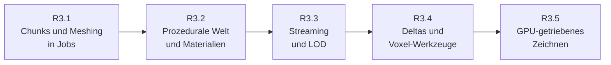
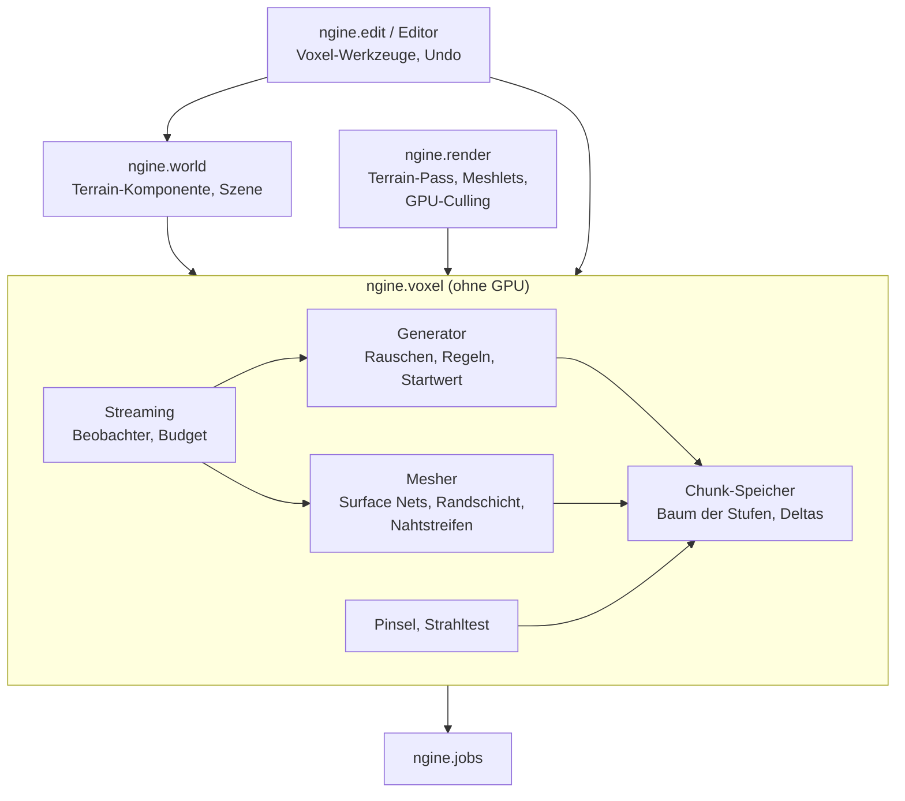

# R3: Voxel-Terrain

- **Phase:** Konstruktion
- **Status:** in Arbeit (R3.3)
- **Pull Requests:** siehe Review

R3 ist der dritte Reifegrad der Konstruktion. Wie R1 und R2 ist er zu groß für eine Iteration; wir
teilen ihn in fünf Iterationen, jede mit eigenem Dokument, eigenem PR und eigener Abnahme auf dem
PC. Dieses Dokument hält den Plan für den ganzen Reifegrad und am Ende sein Review.

## Plan

**Ziel:** Aus dem einen Chunk des Durchstichs [D1](D1-voxel-meshing.md) wird eine große, glatte
Voxel-Welt. Sie entsteht deterministisch aus einem Startwert mit Hügeln, Felsen, Höhlen und
Überhängen, lädt sich um die Kamera nach, wird in der Ferne gröber ohne Risse und lässt sich zur
Laufzeit und im Editor formen und bemalen. Änderungen werden als Deltas gegenüber der
prozeduralen Grundwelt gespeichert und überleben Entladen und Neustart. Der Renderer zeichnet
Terrain und Modelle GPU-getrieben mit Culling auf der GPU, über Mesh Shader, wo die Stufe da ist.

**Features:** VOX-01, VOX-02, VOX-03, VOX-04, VOX-05, VOX-06 (Speichern; Übertragen in R5),
VOX-07, VOX-09, WORLD-07, WORLD-08, EDIT-08, REND-10, REND-13. Dazu die Schulden mit Frist R3:
TD-16, TD-20, TD-23 und TD-34; für TD-24, TD-25, TD-29 und TD-32 schlägt der Plan eine neue Frist
vor (siehe [Zur Abstimmung](#zur-abstimmung), angenommen).

### Aufteilung

| Iteration | Inhalt | Features und Schulden | Abnahme |
| --- | --- | --- | --- |
| R3.1 Chunks und Meshing in Jobs | Terrain aus Chunks mit 32³ Voxeln (Chunk-Koordinaten als `i32`, Lage in der Welt über 64-Bit-Positionen nach [ADR 0012](../adr/0012-64bit-world-coordinates.md)); leere und volle Chunks als ein Wert. Der Mesher liest eine Randschicht der Nachbarn, damit Chunk-Grenzen nahtlos sind ([ADR 0021](../adr/0021-surface-nets-8bit-density.md)). Meshing über das Job-System, Pinsel und Strahltest über Chunk-Grenzen. Terrain als Komponente der Welt (Reflection, Szene) und als eigener Pass im Renderer mit PBR und Schatten; die Voxel-Demo zieht ganz auf den Renderer um. Gemeinsame Puffer für alle Netze mit Verwaltung freier Bereiche | VOX-01, VOX-02, VOX-03, TD-23 | Sandbox und Editor zeigen ein Terrain aus mehreren Chunks mit Licht und Schatten; Abtragen über eine Chunk-Grenze hinweg hinterlässt keine Naht (Test ohne GPU: Netz einer Kugel über acht Chunks ist geschlossen); Meshing vieler Chunks ist parallel gemessen schneller |
| R3.2 Prozedurale Welt und Materialien | Eigenes, deterministisches Rauschen (Simplex bzw. OpenSimplex2, fBm, Domain Warping) und ein Generator aus Regeln: Höhe aus 2D-Rauschen, Höhlen und Überhänge aus 3D-Rauschen, Schichten für Gras, Erde, Fels und Sand. Generieren pro Chunk in Jobs. Materialien als Tabelle mit Texturen aus der Asset-Pipeline; triplanares Mapping mit weichen Übergängen zwischen Materialien im Shader | VOX-05, VOX-07, VOX-09 | Gleicher Startwert ergibt auf Linux und Windows bitgleiche Chunks (Prüfsumme im Test, beide CI-Läufe); Hügel, Felswände, Höhlen und Überhänge sichtbar, Materialübergänge ohne harte Kanten; Zeit pro Chunk gemessen |
| R3.3 Streaming und LOD | Welt-Partitionierung als Baum von Chunks in mehreren Stufen (ein Chunk der Stufe n deckt 32·2ⁿ Voxel mit weiterhin 32³ Samples). Laden, Generieren, Meshen und Entladen nach Abstand zu einem oder mehreren Beobachtern (Kamera, später Spieler auf dem Server), Nahes zuerst, mit Budget für Jobs und Uploads pro Frame. Risse zwischen Stufen schließen Nahtstreifen an den Grenzen. Speicher bleibt begrenzt | VOX-04, WORLD-07, WORLD-08 | Flug über mehrere Kilometer ohne Ruckler (99. Perzentil der Frame-Zeit gemessen), Sichtweite rund 2 km auf dem PC; keine Risse zwischen Stufen (Test ohne GPU: keine offenen Kanten an Stufengrenzen); Speicher bleibt beim Flug konstant; `--headless` streamt um mehrere Beobachter |
| R3.4 Deltas und Voxel-Werkzeuge | Änderungen pro Chunk als Delta gegenüber der Grundwelt, kompakt kodiert; Deltas überleben Entladen und Neuladen und fließen in die groben Stufen ein. Speichern und Laden mit der Szene (Ordner mit Regionen-Dateien neben der Szene). Im Editor Werkzeuge zum Formen (Auftragen, Abtragen, Glätten, Ebnen) und Bemalen mit Material, mit Pinselvorschau und Undo über Befehle mit Delta-Bytes. „Alles kochen“ läuft im Hintergrund | VOX-06, EDIT-08, TD-34 | Krater graben, wegfliegen, bis der Chunk entladen ist, zurückkommen: Krater ist da, auch aus der Ferne; Editor neu starten: Änderungen sind da; Größe der Deltas gemessen; Formen und Bemalen mit Undo und Redo |
| R3.5 GPU-getriebenes Zeichnen | Netze in Meshlets (Modelle beim Kochen, Terrain beim Meshen); Culling auf der GPU gegen Stumpf und Verdeckung (Hi-Z aus der Tiefe des letzten Frames); gezeichnet über Mesh Shader, wo die Stufe da ist, sonst über Compute-Culling und indirektes Zeichnen. Durchsichtiges nach Entfernung sortiert; transiente Texturen des Render-Graphs teilen Speicher, wenn die Messung es lohnt | REND-10, REND-13, TD-16, TD-20 | Mesh-Shader-Pfad und Rückfallpfad (`--baseline`) zeichnen dasselbe Bild (Vergleich in der CI über lavapipe); in einer Höhle wird die Landschaft draußen nicht gezeichnet (Zähler); Dreiecke, Draws und GPU-Zeit vorher und nachher auf dem PC gemessen |

Nicht in R3, damit der Reifegrad in überschaubarer Zeit fertig wird:

- **Vegetation und Wind** (NAT-01, NAT-02): bauen auf Instanzen und GPU-Culling aus R3.5 auf.
  Vorschlag: nach R3, zusammen mit dem Rendering-Ausbau (siehe unten).
- **Globale Beleuchtung, Tag-Nacht, volumetrischer Nebel** (REND-12, NAT-03, NAT-05): gehören
  zum Rendering-Ausbau mit Raytracing (REND-14). Höhlen sind in R3 so dunkel, wie Sonne,
  Umgebungslicht und Lichter sie machen.
- **Kollision mit dem Terrain** (VOX-08): mit der Physik in R4.
- **Voxel-Deltas übers Netz** (NET-06, Übertragen aus VOX-06): in R5. Das Format der Deltas aus
  R3.4 ist dafür ausgelegt.
- **Statik** (VOX-10): später.

### Entwurf

- **Alles Terrain-Wissen bleibt in `ngine.voxel` ohne GPU**, damit der dedizierte Server Welt
  generieren, halten, bearbeiten und streamen kann. Neu hängt `ngine.voxel` am Job-System. Der
  Renderer bekommt fertige Netze und lädt sie hoch; er kennt keine Dichtefelder.
- **Chunks:** 32³ Voxel, Vorschlag 0,5 m pro Voxel (ein Chunk ist 16 m breit). Ein Chunk speichert
  nur seine eigenen Samples (2 Bytes, also 64 KiB, oder ein Wert, wenn er leer oder voll ist). Für
  das Meshing sammelt ein Job die Randschicht der Nachbarn in einen Zwischenspeicher. Netze liegen
  in gemeinsamen GPU-Puffern mit Verwaltung freier Bereiche (TD-23), damit R3.5 alles mit wenigen
  indirekten Draws zeichnen kann.
- **Determinismus:** Der Generator ist eine reine Funktion aus Startwert und Position. Server und
  Clients erzeugen dieselbe Grundwelt; übertragen und gespeichert werden nur Deltas. Dafür rechnet
  das Rauschen ohne Fremdbibliothek und ohne Unterschiede zwischen Compilern (keine
  zusammengezogenen Multiplikationen und Additionen, keine Funktionen der Standardbibliothek mit
  plattformabhängiger Genauigkeit); ein Test vergleicht Prüfsummen auf Linux und Windows.
- **LOD:** Ein Chunk der Stufe n hat 32³ Samples im Abstand 2ⁿ Voxel. Die Grundwelt liefert die
  groben Samples direkt aus dem Generator, Deltas werden nach oben verdichtet. Zwischen Chunks
  verschiedener Stufen schließt ein Nahtstreifen die Lücke: Die Zellen am Rand werden mit den
  Eckpunkten beider Seiten vermascht, ähnlich den Übergangszellen von Transvoxel, aber für Surface
  Nets. Rückfall, falls das zu aufwendig wird: Schürzen (nach innen gezogene Randstreifen).
- **Streaming** ordnet Anfragen nach Abstand und Stufe, begrenzt die Jobs im Flug und die
  Upload-Menge pro Frame (Transfer-Queue aus [ADR 0035](../adr/0035-transfer-queue-concurrent-sharing.md)).
  Das Job-System bleibt ohne Prioritäten; die Reihenfolge entscheidet das Streaming selbst.
- **Deltas:** pro Chunk die geänderten Samples als Differenz zur Grundwelt, lauflängenkodiert.
  Gespeichert in Regionen-Dateien (z. B. 16 × 16 × 16 Chunks pro Datei) neben der Szene, damit
  große Welten nicht in einer JSON-Datei landen; die Szene verweist nur auf Startwert und Ordner.
- **GPU-getriebenes Zeichnen:** Terrain und Modelle werden zu Meshlets (bis 64 Eckpunkte und 124
  Dreiecke). Ein Compute-Pass prüft Instanzen und Meshlets gegen Stumpf und Hi-Z und schreibt
  indirekte Draws; mit Mesh Shadern übernimmt der Task-Shader diese Prüfung. Beide Pfade nutzen
  dieselben Puffer.
- Voraussichtliche ADRs: Chunks und Speicher des Terrains (R3.1), deterministisches Rauschen und
  Generator (R3.2), LOD mit Nahtstreifen und Streaming (R3.3), Format der Deltas (R3.4),
  GPU-getriebenes Zeichnen mit Meshlets (R3.5).

### Leitlinien für alle fünf Iterationen

- Generator, Chunk-Speicher, Mesher, Streaming und Deltas laufen ohne Fenster und GPU und sind so
  getestet. `--headless` erzeugt, streamt und bearbeitet Terrain.
- Jede Iteration ist in Sandbox und Editor sichtbar. Die Sandbox bekommt einen Flugmodus über das
  Terrain mit Anzeige von Chunks, Stufen und Zeiten (Debug-Zeichnen und Overlay).
- Leistung wird in jeder Iteration gemessen und im Iterationsdokument festgehalten: Zeit pro Chunk
  für Generieren und Meshen, Speicher pro Chunk, Frame-Zeit beim Flug, auf dem PC mit Tracy.
- Systeme, die Terrain ändern, halten sich an die Regeln der Welt: Strukturänderungen nach
  `Schedule::run()`, Jobs schreiben nur in eigene Chunks.

**Risiken:**

- **Risse zwischen LOD-Stufen** mit Surface Nets sind aufwendig (schon in ADR 0021 vermerkt).
  Gegenmittel: Der Chunk-Speicher kennt Stufen ab R3.1; Nahtstreifen zuerst als Test ohne GPU an
  zwei Chunks, Schürzen als Rückfall.
- **Determinismus zwischen MSVC und Clang:** Gleitkomma kann je nach Compiler anders rechnen.
  Gegenmittel: eigenes Rauschen, Compiler-Optionen gegen zusammengezogene Operationen in
  `ngine.voxel`, Prüfsummen-Test in beiden CI-Läufen ab R3.2.
- **Ruckler beim Streaming:** Generieren, Meshen und Hochladen vieler Chunks auf einmal.
  Gegenmittel: Budget pro Frame, Nahes zuerst, Messung des 99. Perzentils statt des Mittels.
- **Speicher:** Volle Chunks kosten 64 KiB. Gegenmittel: leere und volle Chunks als ein Wert,
  Dichtefelder ferner Stufen nach dem Meshen verwerfen und bei Bedarf neu generieren.
- **Mesh Shader** verhalten sich auf lavapipe und NVIDIA verschieden schnell und haben andere
  Grenzen. Gegenmittel: Rückfallpfad mit demselben Bild, Grenzen aus `Capabilities` lesen.
- **Deltas und LOD:** Eine Änderung muss in alle groben Stufen darüber einfließen. Gegenmittel:
  Verdichten als eigener Job pro betroffenem Chunk, Test mit einem Krater aus der Ferne.

**Abnahme:** die Abnahmen der fünf Iterationen, dazu am Ende ein Review des ganzen Reifegrads mit
Architektur-Review und einem kurzen Szenario auf dem PC: Editor mit einer neuen Welt aus einem
Startwert öffnen, einige Kilometer fliegen, in eine Höhle gehen, dort einen Gang graben und einen
Hang mit Fels bemalen, einmal rückgängig machen und wiederholen, speichern, Editor neu starten,
Änderungen sind da; dasselbe in der Sandbox mit `--baseline` ohne Mesh Shader.

### Zur Abstimmung

1. **Reihenfolge:** Vorschlag ist Chunks, Generator, Streaming und LOD, Deltas und Werkzeuge,
   zuletzt GPU-getriebenes Zeichnen. So ist das größte Risiko (LOD) in der Mitte geklärt und der
   Generator liefert vorher genug Welt zum Testen. GPU-Culling früher zu bauen hilft erst, wenn es
   viel zu zeichnen gibt.
2. **Maße:** 0,5 m pro Voxel und 32³ Voxel pro Chunk (16 m). Feiner wird teuer, gröber macht
   Pinsel und Höhlen grob.
3. **Rauschen selbst bauen** statt FastNoise2: Vorschlag selbst, weil wir Determinismus zwischen
   Compilern brauchen und es lehrreich ist. FastNoise2 ist schneller (SIMD), garantiert aber keine
   bitgleichen Ergebnisse zwischen Plattformen.
4. **LOD mit Nahtstreifen** für Surface Nets, Schürzen als Rückfall. Ein Wechsel zu Transvoxel
   würde ADR 0021 umwerfen und kommt nur, wenn beides scheitert.
5. **Meshlets für Modelle mit meshoptimizer** beim Kochen (neue Bibliothek hinter `ngine.cook`);
   die Meshlets des Terrains baut der Mesher selbst.
6. **Neue Fristen:** Vegetation (NAT-01) nach R3. TD-24 (Clustered Shading) und TD-25 (Schatten
   für Punkt- und Spotlichter) zum Rendering-Ausbau nach R3, den das Review von R3 zusammen mit
   Raytracing (REND-14) festlegt. TD-29 (Transforms parallel) und TD-32 (Prefabs entfernen und
   verschachteln) nach R4, weil erst Gameplay viele bewegte Entities und verschachtelte Prefabs
   bringt.

**Ergebnis der Abstimmung** (viiez, mit dem Merge des Plans): Alle sechs Punkte passen wie
vorgeschlagen. Reihenfolge R3.1 bis R3.5; 0,5 m pro Voxel und Chunks von 16 m; eigenes,
deterministisches Rauschen statt FastNoise2; LOD mit Nahtstreifen, Schürzen als Rückfall;
meshoptimizer als neue Bibliothek hinter `ngine.cook`; TD-24 und TD-25 zum Rendering-Ausbau nach
R3, TD-29 und TD-32 nach R4, Vegetation (NAT-01, NAT-02) nach R3. Die neuen Fristen stehen im
[Schuldenregister](../tech-debt.md) und im [Feature-Katalog](../features.md).
