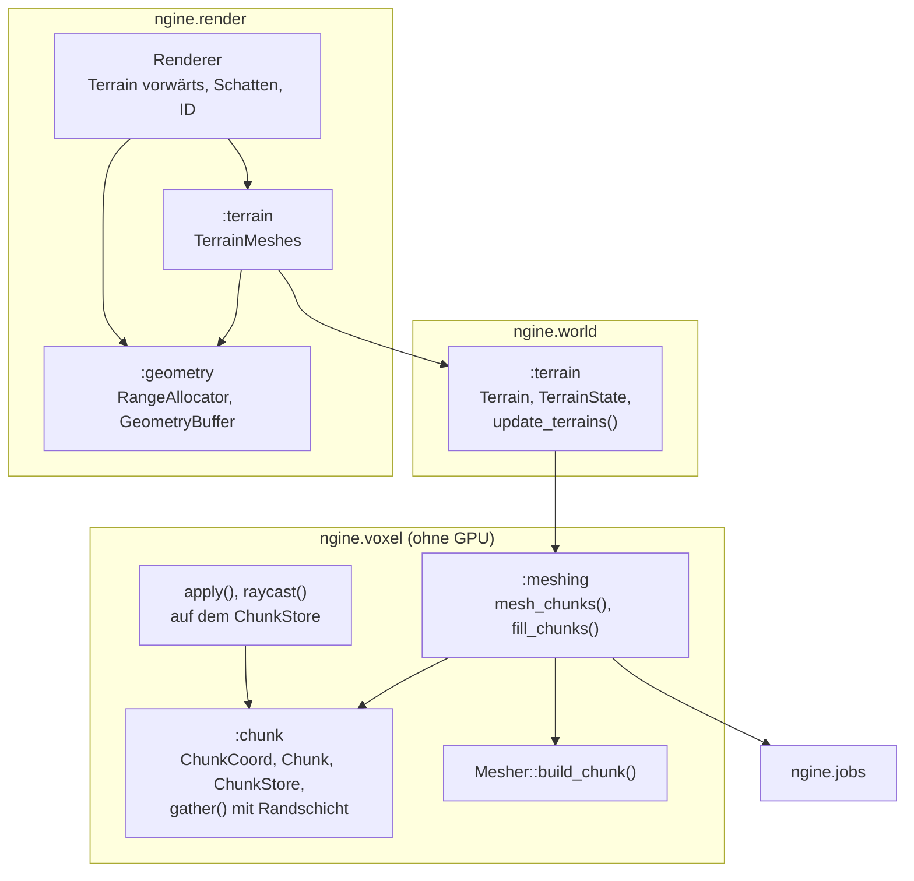

# R3.1: Chunks und Meshing in Jobs

- **Phase:** Konstruktion (Reifegrad [R3](R3-voxel-terrain.md))
- **Status:** abgeschlossen
- **Pull Requests:** [#37](https://github.com/viiez/ngine/pull/37), Review in einem eigenen PR

## Plan

**Ziel:** Aus dem einen Gitter des Durchstichs wird ein Terrain aus vielen Chunks, deren Grenzen
nahtlos sind. Meshing läuft im Job-System, Pinsel und Strahltest wirken über Chunk-Grenzen.
Terrain ist eine Komponente der Welt, die Szene speichert seine Beschreibung, und der Renderer
zeichnet es mit PBR und Schatten aus gemeinsamen Geometriepuffern.

**Features:** VOX-01 (Chunks), VOX-02 (nahtlos, Jobs), VOX-03 (über Chunk-Grenzen). Schulden: TD-23
(gemeinsame Puffer für alle Netze).

### Entwurf

**Chunks** (`ngine.voxel`, VOX-01, [ADR 0038](../adr/0038-terrain-chunks-shared-geometry.md))

- `Chunk` mit 32³ Samples zu 0,5 m; leer oder voll als ein Wert (`compact()`, `expand()`).
- `ChunkStore`: Chunks nach `ChunkCoord` (`i32` je Achse und eine Stufe für LOD), Samples über
  `i64`, Wert `outside` außerhalb aller Chunks, Vormerkung geänderter Chunks samt Randschicht.
- `gather()` kopiert einen Chunk mit je 2 Samples der Nachbarn in ein Gitter mit 36³ Samples.

**Meshing** (VOX-02)

- `Mesher::build_chunk()` legt Eckpunkte in allen Zellen ab, die Vierecke berühren, und erzeugt
  Vierecke nur für Kanten, die an eigenen Samples beginnen. `build()` bleibt für einzelne Gitter.
- `mesh_chunks()` und `fill_chunks()` verteilen die Arbeit über `parallel_for`; leere und volle
  Chunks ohne Nachbarn mit Oberfläche kürzen ab.

**Bearbeiten** (VOX-03)

- `apply(ChunkStore&, Brush)` und `raycast(const ChunkStore&, …)` mit denselben Pinseln wie auf dem
  Gitter; berührte Chunks werden geschrumpft und vorgemerkt.

**Terrain in der Welt** (`ngine.world`)

- `Terrain` (Größe in Chunks, Form Flach oder Hügel, Bodenhöhe, Hügelhöhe) ist eine gespeicherte
  Komponente und bringt `Transform` mit. `TerrainState` ist transient und hält Chunks, Netze mit
  Version und Zahlen. `update_terrains()` erzeugt neu, wenn sich die Beschreibung ändert, und
  meshet sonst nur vorgemerkte Chunks.

**Renderer** (`ngine.render`, TD-23)

- `GeometryBuffer` aus Blöcken zu 32 MiB mit `RangeAllocator`; `MeshStore` und `TerrainMeshes`
  nutzen ihn, Freigaben greifen nach `frames_in_flight + 2` Frames. `upload_async()` mit Offset.
- Terrain-Pass mit eigenem Shader (`terrain.slang`): Farben nach Material, Beleuchtung aus dem mit
  PBR geteilten `lighting.slang`, Schatten der Sonne, Auswahl über den ID-Puffer.

**Anwendungen**

- Sandbox: Die Voxel-Demo ist eine Welt mit Terrain, Sonne und Kamera und zeichnet über den
  Renderer; `--voxel-demo --headless` misst Meshing seriell und parallel.
- Editor: „Bearbeiten → Neues Terrain“ und `--terrain`.

### Schritte

1. Chunks, Store, Randschicht, nahtloser Mesher; Tests ohne GPU (Kugel über acht Chunks).
2. Meshing und Füllen in Jobs, Pinsel und Strahltest auf dem Store.
3. Terrain als Komponente mit Szene.
4. Gemeinsame Geometriepuffer, Terrain-Pass, Umzug der Voxel-Demo.
5. Editor, Doku, Messung.

**Risiken:** Nähte durch ungleich berechnete Eckpunkte an Grenzen; Verschnitt im
Geometriepuffer; Datenrennen beim parallelen Meshen (TSan prüft `[voxel]`).

**Abnahme** (aus dem Plan von R3): Sandbox und Editor zeigen ein Terrain aus mehreren Chunks mit
Licht und Schatten; Abtragen über eine Chunk-Grenze hinweg hinterlässt keine Naht (Test ohne GPU:
Netz einer Kugel über acht Chunks ist geschlossen); Meshing vieler Chunks ist parallel gemessen
schneller.

## Stand

- Umgesetzt: Schritte 1 bis 5.
- Lokal (Cloud-Container, Clang 20, lavapipe mit Validation Layers): Bauen ohne Warnungen, alle
  Tests grün. Der Test mit Pinsel über vier Chunks vergleicht die Dreiecke aller Chunk-Netze mit
  dem Netz desselben Felds aus einem einzigen Gitter: gleich, also keine Naht. Das Verschweißen
  nach Lage, mit dem der Test der Kugel prüft, ob das Netz geschlossen ist, taugt am Grund eines
  Kraters nicht: Um ein Sample mit Dichte 0 liegen Eckpunkte mehrerer Zellen an derselben Stelle.
- Meshing seriell gegen parallel (Sandbox `--voxel-demo --headless`, Terrain mit 8 × 4 × 8 Chunks,
  Release-Build, Container mit 4 Threads, drei Läufe):

  | | seriell | parallel (4 Threads) |
  | --- | --- | --- |
  | 256 Chunks füllen | 647 bis 786 ms | 159 bis 221 ms |
  | 600 Netze meshen (rund 496 000 Dreiecke) | 151 bis 165 ms | 37 bis 44 ms |

  Auf dem PC (Windows 11, NVIDIA GeForce RTX, 16 Threads, Messung von viiez bei der Abnahme):

  | | seriell | parallel (16 Threads) |
  | --- | --- | --- |
  | 256 Chunks füllen | 587 ms | 70 ms |
  | 600 Netze meshen | 193 ms | 22 ms |

  600 Netze statt 256, weil die Chunks am Rand des Terrains es nach außen schließen. 90 der 256
  Chunks sind einheitlich; die Samples brauchen 10,4 MiB statt 16 MiB. Ein Pinselstrich der Demo
  über die Grenze von vier Chunks meshet im Mittel in rund 2 ms neu (Release; Debug rund 15 ms).
- Sandbox mit Fenster (Xvfb) und offscreen: Terrain aus 4 × 2 × 4 Chunks mit Licht und Schatten,
  40 Draws und rund 88 Schatten-Draws, keine Meldung der Validation Layers.

  

- Editor unter Xvfb: `--terrain` fügt ein Terrain ein; die Szene speichert nur die Beschreibung
  (`Terrain`, kein `TerrainState`), Öffnen und Speichern sowie 30 Frames Spielen bleiben
  textgleich, auch mit `--baseline`.
- CI: Die ersten drei Läufe scheiterten unter Windows beim Bauen, jeweils an einer Stelle. MSVC
  übersetzte das vorgegebene `<=>` von `ChunkCoord` beim Import des Moduls nicht, auch nicht mit
  `<compare>` in der Partition; `ChunkCoord` hat seitdem einen eigenen `operator<`. Dazu fehlten
  `<string>` und `<utility>` im Geometriepuffer. Danach waren alle drei Jobs grün.

## Review

**Ergebnis:** Das Terrain besteht aus Chunks mit 32³ Samples zu 0,5 m; leere und volle Chunks
halten nur einen Wert. Chunk-Grenzen sind nahtlos, weil jeder Chunk eine Randschicht der Nachbarn
liest und nur Vierecke eigener Kanten erzeugt. Füllen und Meshing laufen im Job-System, auf dem PC
mit 16 Threads rund achtmal so schnell wie seriell. Pinsel und Strahltest wirken über Chunk-Grenzen,
neu gemesht werden nur die betroffenen Chunks. Terrain ist eine Komponente der Welt, die Szene
speichert seine Beschreibung. Der Renderer zeichnet es mit PBR, Schatten und Auswahl aus gemeinsamen
Geometriepuffern, die auch die Modelle nutzen (TD-23 abgebaut). Die Voxel-Demo der Sandbox zeichnet
über den Renderer, im Editor fügt man Terrain über das Menü ein.

Abnahme: Alle Kriterien sind erfüllt. Die CI war auf Linux, unter ThreadSanitizer (jetzt mit
`[voxel]`) und auf Windows mit MSVC grün, inklusive des neuen Editor-Schritts mit Terrain. Der Test
auf dem PC unter Windows 11 mit einer NVIDIA GeForce RTX verlief erfolgreich: Krater über die
Grenze von vier Chunks ohne Naht, Auftragen und Glätten, geschlossene Ränder, dasselbe mit
`--baseline`, Terrain im Editor einfügen, ändern, verschieben, speichern, neu öffnen und spielen.
Die Messung zeigt parallel deutlich schnelleres Füllen und Meshing (siehe Stand).

**Erkenntnisse:**

- Nahtlose Chunks brauchen eine klare Regel, wem was gehört: Eckpunkte entstehen in allen Zellen,
  die eigene Vierecke berühren, Vierecke nur für eigene Kanten. Mit dieser Regel ist das Netz aller
  Chunks Dreieck für Dreieck gleich dem Netz eines einzigen Gitters; das ist der stärkere Test als
  „geschlossen“.
- Verschweißen nach Lage taugt nicht als Test für Netze nach Pinselstrichen: Um Samples mit Dichte 0
  fallen Eckpunkte mehrerer Zellen auf dieselbe Stelle. Der Vergleich der Dreiecke nach Lage ihrer
  Ecken hat das Problem nicht.
- Chunks, die es nicht gibt, gehören zum Meshing dazu: Erst wenn der Store auch sie vormerkt, ist
  das Terrain am Rand geschlossen wie ein Block.
- MSVC und Module: Vorgegebene Vergleichsoperatoren (`<=>`) in exportierten Typen sind riskant; ein
  eigener `operator<` reicht für sortierte Listen und `std::map`.
- Parallel lohnt sich: Füllen und Meshing skalieren fast linear mit den Threads, weil jeder Job
  eigenen Mesher und eigenes Gitter hat und nichts teilt.

**Anpassungen:** Abstimmungsergebnis des R3-Plans eingetragen (alle sechs Punkte wie
vorgeschlagen). ADR 0038 angenommen. Feature-Katalog: VOX-01, VOX-02 und VOX-03 um R3.1 ergänzt,
bleiben bis zum Ende von R3 in Arbeit; NAT-01 und NAT-02 nach R3. Schuldenregister: TD-23 abgebaut,
TD-24 und TD-25 zum Rendering-Ausbau nach R3, TD-29 und TD-32 nach R4, TD-36 neu.

**Architektur-Review:**

- Die Abhängigkeiten passen zur [Architektur](../architecture.md): `ngine.voxel` kennt weder Welt
  noch GPU und hängt nur an `ngine.jobs` und `ngine.math`; `ngine.world` hängt an `ngine.voxel`, wie
  im Plan von R3 vorgesehen; der Renderer liest die Netze aus der Welt und kennt das Erzeugen nicht.
- Fremdbibliotheken: keine neuen.
- Schnittstellen: `upload_async()` hat einen Offset; `GpuMesh` verweist auf Bereiche im
  Geometriepuffer statt auf eigene Puffer. Pinsel und Strahltest gibt es für Gitter und Store mit
  derselben Logik (Vorlagen mit Zugriffsobjekten). Szenen bekommen die Komponente `Terrain`; alte
  Szenen laden unverändert.
- Größe: `renderer.cpp` wuchs mit dem Terrain-Pass auf rund 1 000 Zeilen und ist damit fällig zum
  Aufteilen (TD-36). `apps/common/model_scene.cppm` blieb bei rund 720 Zeilen.
- Neue Schulden: TD-36 (`renderer.cpp` aufteilen).
- Offen für R3.2 und später: Die Hügel aus Sinuswellen ersetzt der Generator aus Rauschen (R3.2);
  das Terrain nutzt nur die Position seiner Entity; Änderungen gehen beim Speichern verloren, bis
  R3.4 Deltas speichert.
