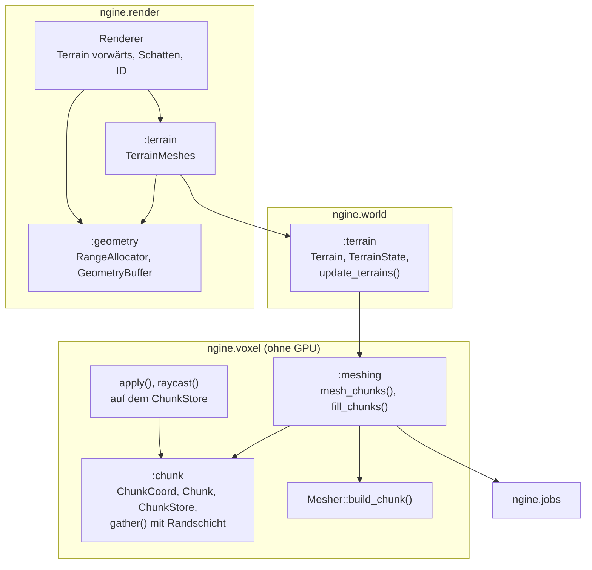
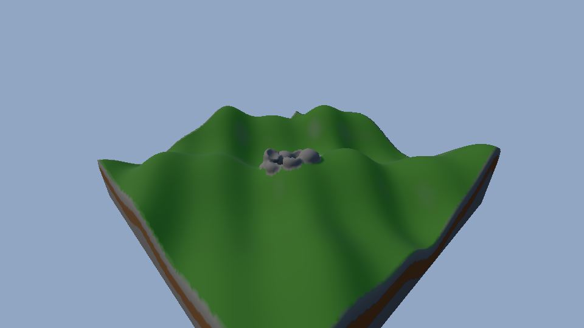

# R3.1: Chunks und Meshing in Jobs

- **Phase:** Konstruktion (Reifegrad [R3](R3-voxel-terrain.md))
- **Status:** in Arbeit
- **Pull Requests:** [#37](https://github.com/viiez/ngine/pull/37)

## Plan

**Ziel:** Aus dem einen Gitter des Durchstichs wird ein Terrain aus vielen Chunks, deren Grenzen
nahtlos sind. Meshing läuft im Job-System, Pinsel und Strahltest wirken über Chunk-Grenzen.
Terrain ist eine Komponente der Welt, die Szene speichert seine Beschreibung, und der Renderer
zeichnet es mit PBR und Schatten aus gemeinsamen Geometriepuffern.

**Features:** VOX-01 (Chunks), VOX-02 (nahtlos, Jobs), VOX-03 (über Chunk-Grenzen). Schulden: TD-23
(gemeinsame Puffer für alle Netze).

### Entwurf

**Chunks** (`ngine.voxel`, VOX-01, [ADR 0038](../adr/0038-terrain-chunks-shared-geometry.md))

- `Chunk` mit 32³ Samples zu 0,5 m; leer oder voll als ein Wert (`compact()`, `expand()`).
- `ChunkStore`: Chunks nach `ChunkCoord` (`i32` je Achse und eine Stufe für LOD), Samples über
  `i64`, Wert `outside` außerhalb aller Chunks, Vormerkung geänderter Chunks samt Randschicht.
- `gather()` kopiert einen Chunk mit je 2 Samples der Nachbarn in ein Gitter mit 36³ Samples.

**Meshing** (VOX-02)

- `Mesher::build_chunk()` legt Eckpunkte in allen Zellen ab, die Vierecke berühren, und erzeugt
  Vierecke nur für Kanten, die an eigenen Samples beginnen. `build()` bleibt für einzelne Gitter.
- `mesh_chunks()` und `fill_chunks()` verteilen die Arbeit über `parallel_for`; leere und volle
  Chunks ohne Nachbarn mit Oberfläche kürzen ab.

**Bearbeiten** (VOX-03)

- `apply(ChunkStore&, Brush)` und `raycast(const ChunkStore&, …)` mit denselben Pinseln wie auf dem
  Gitter; berührte Chunks werden geschrumpft und vorgemerkt.

**Terrain in der Welt** (`ngine.world`)

- `Terrain` (Größe in Chunks, Form Flach oder Hügel, Bodenhöhe, Hügelhöhe) ist eine gespeicherte
  Komponente und bringt `Transform` mit. `TerrainState` ist transient und hält Chunks, Netze mit
  Version und Zahlen. `update_terrains()` erzeugt neu, wenn sich die Beschreibung ändert, und
  meshet sonst nur vorgemerkte Chunks.

**Renderer** (`ngine.render`, TD-23)

- `GeometryBuffer` aus Blöcken zu 32 MiB mit `RangeAllocator`; `MeshStore` und `TerrainMeshes`
  nutzen ihn, Freigaben greifen nach `frames_in_flight + 2` Frames. `upload_async()` mit Offset.
- Terrain-Pass mit eigenem Shader (`terrain.slang`): Farben nach Material, Beleuchtung aus dem mit
  PBR geteilten `lighting.slang`, Schatten der Sonne, Auswahl über den ID-Puffer.

**Anwendungen**

- Sandbox: Die Voxel-Demo ist eine Welt mit Terrain, Sonne und Kamera und zeichnet über den
  Renderer; `--voxel-demo --headless` misst Meshing seriell und parallel.
- Editor: „Bearbeiten → Neues Terrain“ und `--terrain`.

### Schritte

1. Chunks, Store, Randschicht, nahtloser Mesher; Tests ohne GPU (Kugel über acht Chunks).
2. Meshing und Füllen in Jobs, Pinsel und Strahltest auf dem Store.
3. Terrain als Komponente mit Szene.
4. Gemeinsame Geometriepuffer, Terrain-Pass, Umzug der Voxel-Demo.
5. Editor, Doku, Messung.

**Risiken:** Nähte durch ungleich berechnete Eckpunkte an Grenzen; Verschnitt im
Geometriepuffer; Datenrennen beim parallelen Meshen (TSan prüft `[voxel]`).

**Abnahme** (aus dem Plan von R3): Sandbox und Editor zeigen ein Terrain aus mehreren Chunks mit
Licht und Schatten; Abtragen über eine Chunk-Grenze hinweg hinterlässt keine Naht (Test ohne GPU:
Netz einer Kugel über acht Chunks ist geschlossen); Meshing vieler Chunks ist parallel gemessen
schneller.

## Stand

- Umgesetzt: Schritte 1 bis 5.
- Lokal (Cloud-Container, Clang 20, lavapipe mit Validation Layers): Bauen ohne Warnungen, alle
  Tests grün. Der Test mit Pinsel über vier Chunks vergleicht die Dreiecke aller Chunk-Netze mit
  dem Netz desselben Felds aus einem einzigen Gitter: gleich, also keine Naht. Das Verschweißen
  nach Lage, mit dem der Test der Kugel prüft, ob das Netz geschlossen ist, taugt am Grund eines
  Kraters nicht: Um ein Sample mit Dichte 0 liegen Eckpunkte mehrerer Zellen an derselben Stelle.
- Meshing seriell gegen parallel (Sandbox `--voxel-demo --headless`, Terrain mit 8 × 4 × 8 Chunks,
  Release-Build, Container mit 4 Threads, drei Läufe):

  | | seriell | parallel (4 Threads) |
  | --- | --- | --- |
  | 256 Chunks füllen | 647 bis 786 ms | 159 bis 221 ms |
  | 600 Netze meshen (rund 496 000 Dreiecke) | 151 bis 165 ms | 37 bis 44 ms |

  600 Netze statt 256, weil die Chunks am Rand des Terrains es nach außen schließen. 90 der 256
  Chunks sind einheitlich; die Samples brauchen 10,4 MiB statt 16 MiB. Ein Pinselstrich der Demo
  über die Grenze von vier Chunks meshet im Mittel in rund 2 ms neu (Release; Debug rund 15 ms).
- Sandbox mit Fenster (Xvfb) und offscreen: Terrain aus 4 × 2 × 4 Chunks mit Licht und Schatten,
  40 Draws und rund 88 Schatten-Draws, keine Meldung der Validation Layers.

  

- Editor unter Xvfb: `--terrain` fügt ein Terrain ein; die Szene speichert nur die Beschreibung
  (`Terrain`, kein `TerrainState`), Öffnen und Speichern sowie 30 Frames Spielen bleiben
  textgleich, auch mit `--baseline`.
