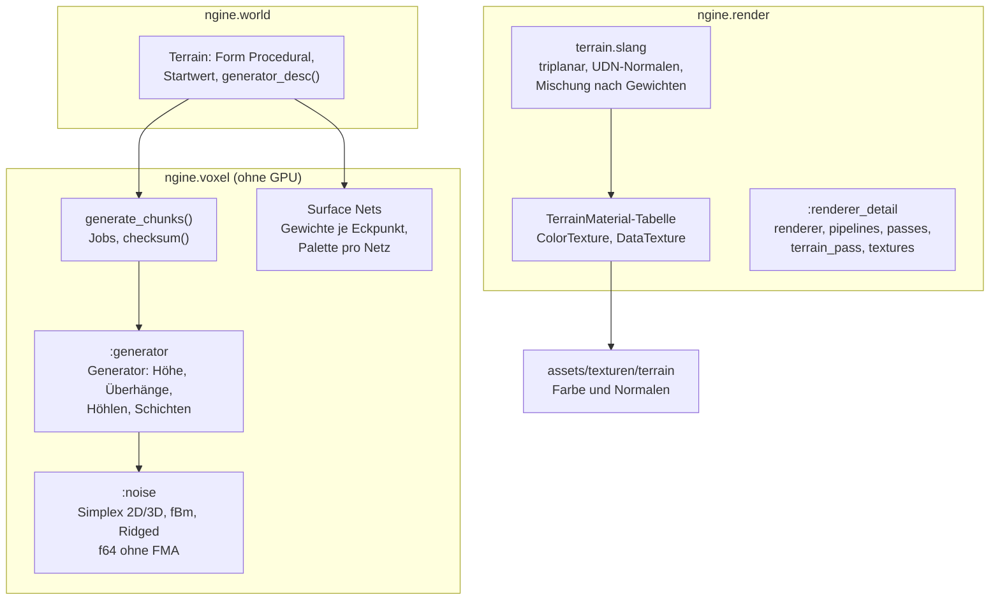

# R3.2: Prozedurale Welt und Materialien

- **Phase:** Konstruktion (Reifegrad [R3](R3-voxel-terrain.md))
- **Status:** in Arbeit
- **Pull Requests:** Umsetzung (dieser PR), Review in einem eigenen PR

## Plan

**Ziel:** Das Terrain entsteht aus einem Startwert: eigenes, deterministisches Rauschen und ein
Generator aus Regeln bringen Hügel, Felswände, Höhlen und Überhänge mit Schichten aus Gras, Erde,
Fels und Sand. Der Renderer zeichnet mehrere Materialien pro Oberfläche triplanar mit Texturen und
weichen Übergängen.

**Features:** VOX-05 (prozedurale Welt), VOX-07 (Materialien), VOX-09 (Höhlen und Überhänge).
Schulden: TD-36 (`renderer.cpp` aufteilen).

### Entwurf

**Rauschen** (`:noise`, [ADR 0039](../adr/0039-deterministic-noise-rule-generator.md))

- Simplex in 2D und 3D mit Gradienten aus einem Hash der Gitterpunkte, fBm und Ridged-Rauschen.
- Nur `f64` mit `+ − × ÷` und `sqrt`, eigenes `floor_to_int()` und `smoothstep()`; das Ziel baut
  mit `-ffp-contract=off` bzw. `/fp:precise`.

**Generator** (`:generator`, VOX-05, VOX-09)

- Höhe: verzerrte Hügel (Domain Warping), Felsrücken aus Ridged-Rauschen unter einer Maske,
  Terrassen machen daraus Felswände.
- 3D: Überhänge nach Steilheit, Tunnel und Kavernen, Schutz unter der Oberfläche, Grundgestein.
  3D-Werte auf einem globalen Gitter mit Abstand 4, trilinear interpoliert; einheitliche Chunks
  kürzen ab.
- Schichten: Gras auf flachen Stellen, Erde darunter, Fels an steilen Stellen und in der Tiefe,
  Sand unterhalb einer Höhe.
- `generate_chunks()` verteilt die Chunks über `parallel_for`; `checksum()` über alle Chunks.

**Materialien** (VOX-07, [ADR 0040](../adr/0040-terrain-materials-weights-triplanar.md))

- Der Mesher gibt jedem Eckpunkt acht Gewichte für die Palette seines Netzes.
- `render::TerrainMaterial` mit Farbe, Roughness, Maßstab und Texturen als `AssetId`; Lader
  `ColorTexture` und `DataTexture` im Ressourcen-Manager.
- `terrain.slang` liest jedes Material triplanar und mischt nach den Gewichten.

**Renderer aufteilen** (TD-36)

- `Renderer::Impl` und die Draws in die Partition `:renderer_detail`; Pipelines, Passes, Terrain
  und Texturen in eigene Dateien.

**Anwendungen**

- Sandbox: Voxel-Demo mit `--seed`, Flugmodus (F), Grenzen der Chunks (F1), Texturen aus
  `assets/texturen/terrain`; `--voxel-demo --headless` misst die Zeit pro Chunk und gibt die
  Prüfsumme aus.
- Editor: Neues Terrain mit der Form `Procedural`, Startwert und Regeln im Inspector.

### Schritte

1. Rauschen und Generator mit Tests ohne GPU, Prüfsumme.
2. Generieren in Jobs, Terrain-Komponente mit Startwert.
3. Gewichte im Mesher.
4. Renderer aufteilen (TD-36), Materialtabelle, Texturlader, triplanarer Shader.
5. Sandbox, Editor, Texturen, Doku, Messung.

**Risiken:** Unterschiede im letzten Bit zwischen MSVC und Clang (FMA, Bibliotheksfunktionen);
Kosten des Shaders mit acht Materialien und drei Projektionen; Nähte der Gewichte an
Chunk-Grenzen.

**Abnahme** (aus dem Plan von R3): Gleicher Startwert ergibt auf Linux und Windows bitgleiche
Chunks (Prüfsumme im Test, beide CI-Läufe); Hügel, Felswände, Höhlen und Überhänge sichtbar,
Materialübergänge ohne harte Kanten; Zeit pro Chunk gemessen.

## Stand

- Umgesetzt: Schritte 1 bis 5.
- Lokal (Cloud-Container, Clang 20): `ngine.voxel` mit allen Tests grün, in Debug, Release und mit
  `-march=native` (FMA-fähige CPU) dieselbe Prüfsumme `0xfdbe419ab6ba3388` (Startwert 1234,
  4 × 3 × 4 Chunks). Renderer, Welt, Anwendungen und Shader prüft in dieser Iteration die CI, weil
  der Container die Abhängigkeiten aus vcpkg nicht laden konnte.
- Zeit pro Chunk (Generator allein, Container mit 4 Threads):

  | Build | seriell | parallel (4 Threads) |
  | --- | --- | --- |
  | Release | rund 1,1 ms | rund 0,29 ms |
  | Debug | rund 7 ms | rund 1,8 ms |

- Höhenkarten und Schnitte des Generators (lokal als Bilder geprüft) zeigen Terrassen und
  Felswände, Überhänge an steilen Hängen, Tunnel und Kavernen unter der Oberfläche.
- Texturen: vier Materialien mit Farbe und Normalen (512², prozedural erzeugt) unter
  `assets/texturen/terrain/`.
- Offen: Bilder und Messung auf dem PC bei der Abnahme.
