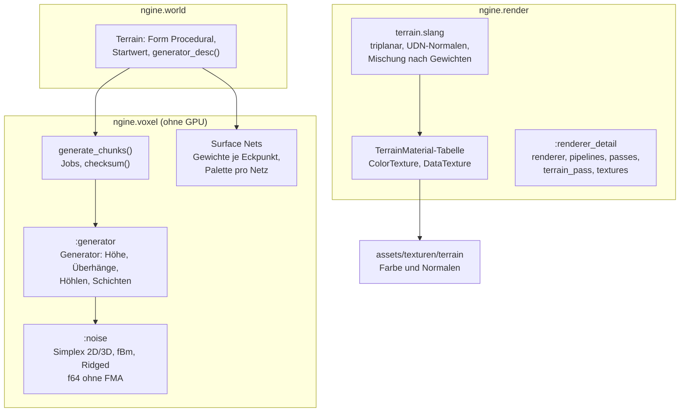
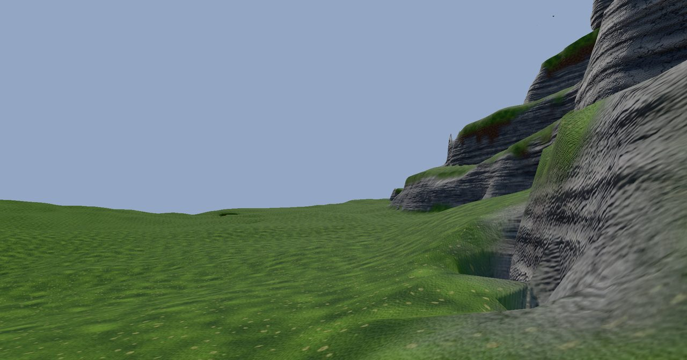
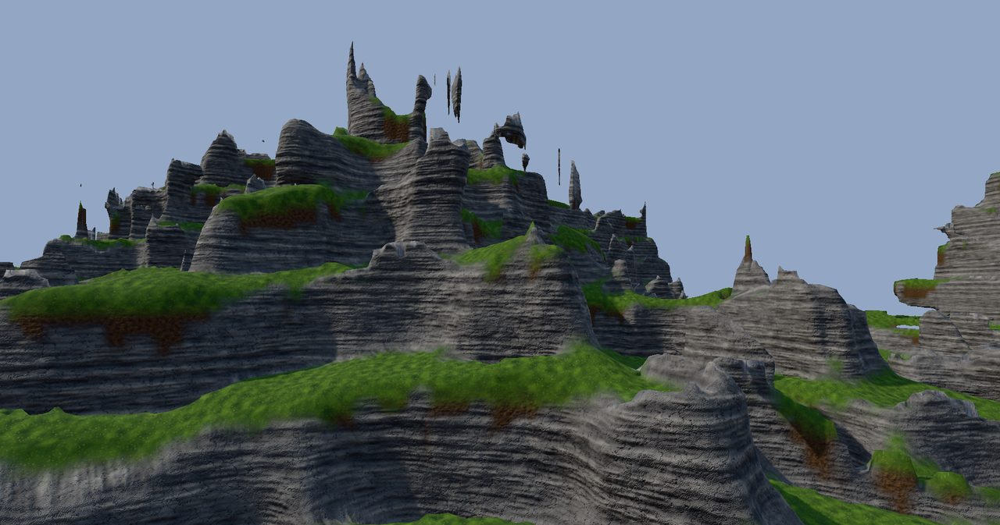
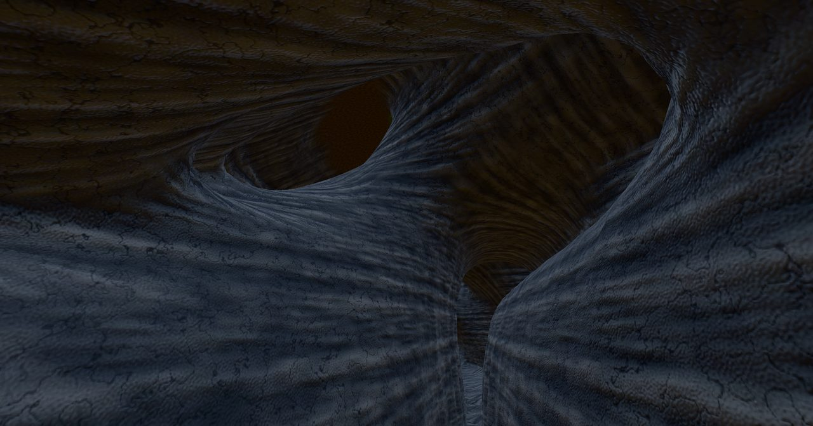
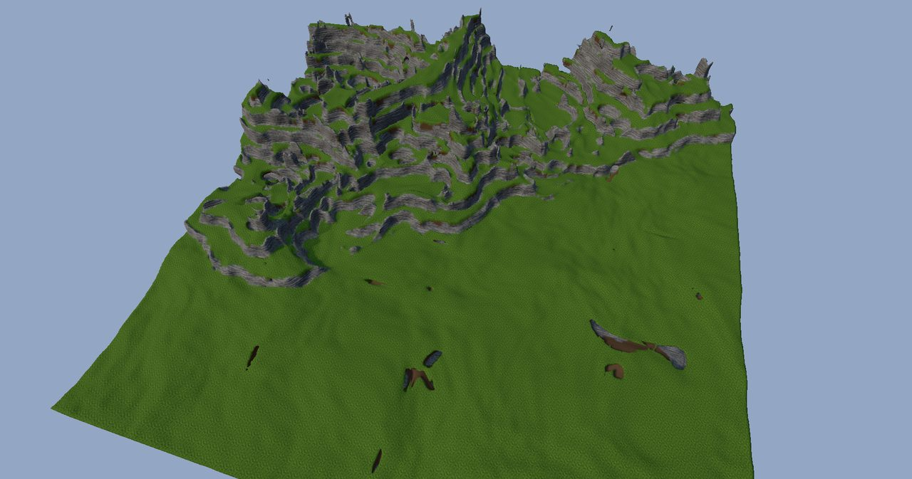

# R3.2: Prozedurale Welt und Materialien

- **Phase:** Konstruktion (Reifegrad [R3](R3-voxel-terrain.md))
- **Status:** abgeschlossen
- **Pull Requests:** [#39](https://github.com/viiez/ngine/pull/39), Review in einem eigenen PR

## Plan

**Ziel:** Das Terrain entsteht aus einem Startwert: eigenes, deterministisches Rauschen und ein
Generator aus Regeln bringen Hügel, Felswände, Höhlen und Überhänge mit Schichten aus Gras, Erde,
Fels und Sand. Der Renderer zeichnet mehrere Materialien pro Oberfläche triplanar mit Texturen und
weichen Übergängen.

**Features:** VOX-05 (prozedurale Welt), VOX-07 (Materialien), VOX-09 (Höhlen und Überhänge).
Schulden: TD-36 (`renderer.cpp` aufteilen).

### Entwurf

**Rauschen** (`:noise`, [ADR 0039](../adr/0039-deterministic-noise-rule-generator.md))

- Simplex in 2D und 3D mit Gradienten aus einem Hash der Gitterpunkte, fBm und Ridged-Rauschen.
- Nur `f64` mit `+ − × ÷` und `sqrt`, eigenes `floor_to_int()` und `smoothstep()`; Rauschen und
  Generator bauen mit `-ffp-contract=off` (MSVC zieht unter `/fp:precise` ohnehin nichts zusammen).

**Generator** (`:generator`, VOX-05, VOX-09)

- Höhe: verzerrte Hügel (Domain Warping), Felsrücken aus Ridged-Rauschen unter einer Maske,
  Terrassen machen daraus Felswände.
- 3D: Überhänge nach Steilheit, Tunnel und Kavernen, Schutz unter der Oberfläche, Grundgestein.
  3D-Werte auf einem globalen Gitter mit Abstand 4, trilinear interpoliert; einheitliche Chunks
  kürzen ab.
- Schichten: Gras auf flachen Stellen, Erde darunter, Fels an steilen Stellen und in der Tiefe,
  Sand unterhalb einer Höhe.
- `generate_chunks()` verteilt die Chunks über `parallel_for`; `checksum()` über alle Chunks.

**Materialien** (VOX-07, [ADR 0040](../adr/0040-terrain-materials-weights-triplanar.md))

- Der Mesher gibt jedem Eckpunkt acht Gewichte für die Palette seines Netzes.
- `render::TerrainMaterial` mit Farbe, Roughness, Maßstab und Texturen als `AssetId`; Lader
  `ColorTexture` und `DataTexture` im Ressourcen-Manager.
- `terrain.slang` liest jedes Material triplanar und mischt nach den Gewichten.

**Renderer aufteilen** (TD-36)

- Zustand des Renderers (`RendererCore` hinter `Renderer::Impl`) und die Draws in die interne Partition `:renderer_detail`; Pipelines, Passes, Terrain
  und Texturen in eigene Dateien.

**Anwendungen**

- Sandbox: Voxel-Demo mit `--seed`, Flugmodus (F), Grenzen der Chunks (F1), Texturen aus
  `assets/texturen/terrain`; `--voxel-demo --headless` misst die Zeit pro Chunk und gibt die
  Prüfsumme aus.
- Editor: Neues Terrain mit der Form `Procedural`, Startwert und Regeln im Inspector.

### Schritte

1. Rauschen und Generator mit Tests ohne GPU, Prüfsumme.
2. Generieren in Jobs, Terrain-Komponente mit Startwert.
3. Gewichte im Mesher.
4. Renderer aufteilen (TD-36), Materialtabelle, Texturlader, triplanarer Shader.
5. Sandbox, Editor, Texturen, Doku, Messung.

**Risiken:** Unterschiede im letzten Bit zwischen MSVC und Clang (FMA, Bibliotheksfunktionen);
Kosten des Shaders mit acht Materialien und drei Projektionen; Nähte der Gewichte an
Chunk-Grenzen.

**Abnahme** (aus dem Plan von R3): Gleicher Startwert ergibt auf Linux und Windows bitgleiche
Chunks (Prüfsumme im Test, beide CI-Läufe); Hügel, Felswände, Höhlen und Überhänge sichtbar,
Materialübergänge ohne harte Kanten; Zeit pro Chunk gemessen.

## Stand

- Umgesetzt: Schritte 1 bis 5.
- Lokal (Cloud-Container, Clang 20): `ngine.voxel` mit allen Tests grün, in Debug, Release und mit
  `-march=native` (FMA-fähige CPU) dieselbe Prüfsumme `0xfdbe419ab6ba3388` (Startwert 1234,
  4 × 3 × 4 Chunks). Renderer, Welt, Anwendungen und Shader prüft in dieser Iteration die CI, weil
  der Container die Abhängigkeiten aus vcpkg nicht laden konnte.
- Zeit pro Chunk (Generator allein, Container mit 4 Threads):

  | Build | seriell | parallel (4 Threads) |
  | --- | --- | --- |
  | Release | rund 1,1 ms | rund 0,29 ms |
  | Debug | rund 7 ms | rund 1,8 ms |

- Höhenkarten und Schnitte des Generators (lokal als Bilder geprüft) zeigen Terrassen und
  Felswände, Überhänge an steilen Hängen, Tunnel und Kavernen unter der Oberfläche.
- Texturen: vier Materialien mit Farbe und Normalen (512², prozedural erzeugt) unter
  `assets/texturen/terrain/`.
- CI: Der erste Lauf scheiterte unter Windows schon beim Planen der Module. `/fp:precise` auf
  dem ganzen Ziel `ngine_voxel` ließ CMake `ngine.math` für dieses Ziel ein zweites Mal übersetzen,
  und Ziele, die beide importieren, fanden zwei Fassungen. Seitdem gilt `-ffp-contract=off` nur für
  `noise.cpp` und `generator.cpp`. Unter Linux meldete `-Wshadow` einen Parameter, der wie ein
  Feld von `Renderer::Impl` hieß. Danach brach MSVC in allen Dateien, die `:renderer_detail`
  importieren, mit einem internen Fehler (C1001) ab, auch als interne Partition. Ursache war die
  verschachtelte Klasse `Renderer::Impl`, die in der Partition vervollständigt wurde. Der Zustand
  steht seitdem in der Klasse `RendererCore` im Namensraum; `Renderer::Impl` erbt nur von ihr und
  wird in `renderer.cpp` vervollständigt.
- CI, Voxel-Demo 10 000 km vom Ursprung: 1,4 % der Bytes wichen ab (Grenze bisher 0,1 %). Das
  neue Terrain wirft an Felswänden und Überhängen viele Schatten (rund 820 Schatten-Draws statt
  88), und fern vom Ursprung rasten die Schattenkarten auf ein anderes Texelgitter ein. Die Prüfung
  nutzt seitdem dieselben Grenzen wie die Standardszene (3 % abweichend, 0,3 % um mehr als 8).
  Danach: 21 183 von 1 555 215 Bytes abweichend, nur 107 davon um mehr als 8.
- Prüfsumme des Generators in beiden CI-Läufen (Linux, Windows) gleich: `0xfdbe419ab6ba3388`.
- CI: alle drei Jobs grün (Linux, Linux mit ThreadSanitizer, Windows).
- Auf dem PC (Windows 11, NVIDIA GeForce RTX, 16 Threads, Messung von viiez bei der Abnahme,
  `--voxel-demo --headless`):

  | | seriell | parallel (16 Threads) |
  | --- | --- | --- |
  | 256 Chunks erzeugen | 391 ms (1,53 ms pro Chunk) | 37 ms (0,15 ms pro Chunk) |
  | 600 Netze meshen | 230 ms | 28 ms |

  Das Terrain der Demo mit 576 Chunks entsteht parallel in 76 ms (0,13 ms pro Chunk).
- Bilder vom PC (viiez): Wiese mit Felswand, Felsrücken mit Terrassen und Überhängen, eine Höhle
  und das ganze Terrain von oben.

  
  
  
  

## Review

**Ergebnis:** Das Terrain entsteht aus einem Startwert. Eigenes Rauschen in `f64` ohne FMA und ein
Generator aus Regeln bringen Hügel, Felsrücken mit Terrassen und Felswänden, Überhänge, Tunnel und
Kavernen sowie Schichten aus Gras, Erde, Fels und Sand. Derselbe Startwert ergibt unter Linux und
Windows dieselbe Prüfsumme. Generieren läuft pro Chunk im Job-System, auf dem PC mit 16 Threads
rund zehnmal so schnell wie seriell. Der Mesher gibt jedem Eckpunkt acht Materialgewichte, der
Terrain-Shader liest die Materialien triplanar mit Texturen aus dem Ressourcen-Manager und mischt
sie weich. `renderer.cpp` ist in fünf Dateien aufgeteilt (TD-36 abgebaut).

Abnahme: Alle Kriterien sind erfüllt. Die CI war auf Linux, unter ThreadSanitizer und auf Windows
mit MSVC grün, die Prüfsumme in beiden Läufen gleich. Auf dem PC unter Windows 11 mit einer NVIDIA
GeForce RTX sind Hügel, Felswände, Höhlen und Überhänge zu sehen, die Übergänge zwischen Gras,
Erde und Fels haben keine harten Kanten, und die Zeit pro Chunk ist gemessen (siehe Stand). viiez
sieht das Ergebnis als guten Anfang, aber noch nicht als die Welt, die es werden soll; das Aussehen
wird in späteren Iterationen weiter abgestimmt.

**Erkenntnisse:**

- Bitgleich über Compiler und Plattformen ist mit `f64` erreichbar, wenn nur exakt festgelegte
  Operationen vorkommen und keine FMA entsteht. Die Prüfsumme im Test hat das in jedem CI-Lauf
  bestätigt, auch mit FMA-fähiger CPU lokal.
- Compiler-Optionen nur für einzelne Dateien, nicht für ein Ziel mit Modulen: Andere Optionen als
  die importierten Module lassen CMake diese ein zweites Mal übersetzen, und unter MSVC fanden
  Ziele dann zwei Fassungen von `ngine.math`.
- MSVC und Module: Eine verschachtelte Klasse (`Renderer::Impl`), die in einer anderen Partition
  vervollständigt wird, bringt den Compiler beim Lesen des Moduls zum Absturz (C1001). Eine Klasse im
  Namensraum (`RendererCore`), von der `Renderer::Impl` nur erbt, geht. Fehlende Includes
  (`<memory>`, `<string>`) fallen unter MSVC erst auf, wenn Operatoren aus der Standardbibliothek
  gebraucht werden.
- Bildvergleiche fern vom Ursprung hängen an der Szene: Mit vielen Schatten weichen mehr Bytes ab,
  aber fast alle nur leicht. Die Prüfung zählt deshalb auch die starken Abweichungen.
- Auf den Bildern fällt auf, was als Nächstes zu tun ist: Einzelne Felsstücke schweben frei in der
  Luft (dünne Grate, die das 3D-Rauschen abtrennt), die Felstextur zeigt regelmäßige Streifen, Erde
  erscheint als braune Flecken unter Grasrändern, Übergänge an Felskanten wirken teils verwaschen,
  und außerhalb der Felsrücken ist die Welt eine flache Wiese. Höhlen sind ohne indirektes Licht
  fast schwarz.

**Anpassungen:** ADR 0039 und ADR 0040 angenommen. Feature-Katalog: VOX-05, VOX-07 und VOX-09 um
R3.2 ergänzt, bleiben bis zum Ende von R3 in Arbeit. Schuldenregister: TD-36 abgebaut, TD-37 und
TD-38 neu. CLAUDE.md: Regel für bitgleiches Rechnen in `ngine.voxel`.

**Architektur-Review:**

- Die Abhängigkeiten passen zur [Architektur](../architecture.md): Rauschen und Generator liegen in
  `ngine.voxel` ohne Welt und GPU; `ngine.world` übersetzt die Beschreibung des Terrains in Regeln
  des Generators; der Renderer kennt Materialtabelle und Texturen, aber nicht den Generator.
- Fremdbibliotheken: keine neuen.
- Schnittstellen: `voxel::Vertex` trägt statt eines Materials acht Gewichte (gleiche Größe),
  `Mesh` eine Palette. `Terrain` hat die Form `Procedural` mit Startwert und Regeln; alte Szenen
  laden mit den Standardwerten. Der Renderer bekommt `set_terrain_materials()` und Lader für
  einzelne Texturen.
- Größe: Der Renderer ist aufgeteilt, `renderer.cpp` hat noch rund 470 Zeilen. Die größte neue
  Datei ist `generator.cpp`.
- Neue Schulden: TD-37 (Materialtabelle im Code, Texturen ungekocht), TD-38 (höchstens acht
  Materialien pro Chunk).
- Offen für R3.3 und später: schwebende Felsstücke entfernen und das Aussehen der Welt abstimmen
  (Regeln und Texturen), Streaming und LOD (R3.3), Deltas und Werkzeuge (R3.4).
- Richtung für die Welt (Wunsch von viiez bei der Abnahme): vom Weltgenerator von Minecraft und
  anderen starken Generatoren lernen. Ansätze dort: mehrere großräumige Rauschfelder als Parameter
  (Kontinentalität, Erosion, Gipfel und Täler, Temperatur, Feuchte), aus denen Höhe, Form und Biome
  über Kurven folgen; Dichte in 3D mit höhenabhängigem Versatz statt Höhenkarte plus Zusätzen;
  Höhlen in mehreren Arten mit Grundwasser; Regeln für die Oberfläche je Biom. Andere Spiele
  ergänzen Erosion, Flüsse und von Hand gebaute Orte. Das passt zum Generator aus Regeln
  ([ADR 0039](../adr/0039-deterministic-noise-rule-generator.md)) und wird bei der Planung der
  Iteration zum Aussehen der Welt ausgearbeitet.
