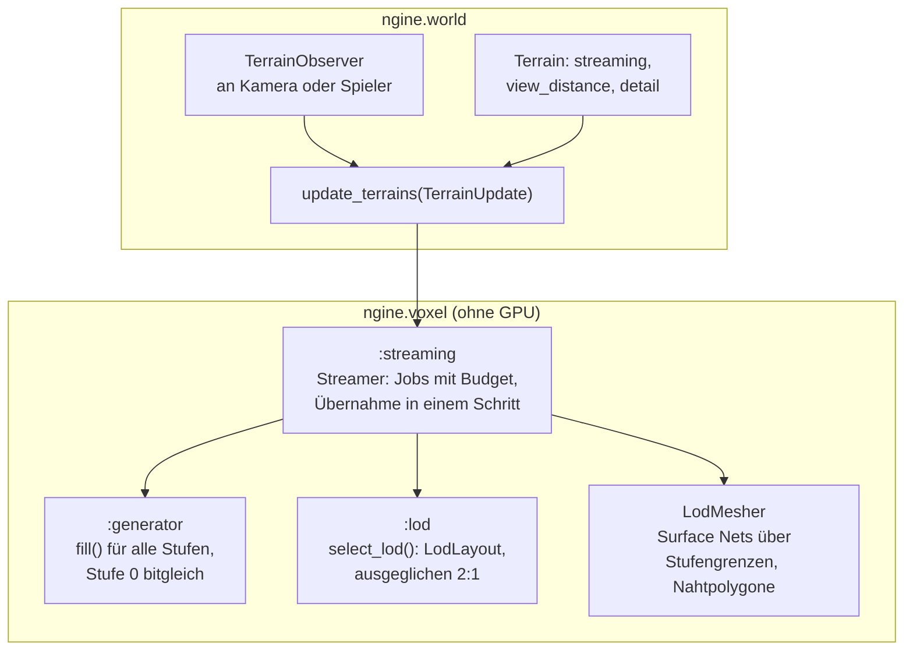
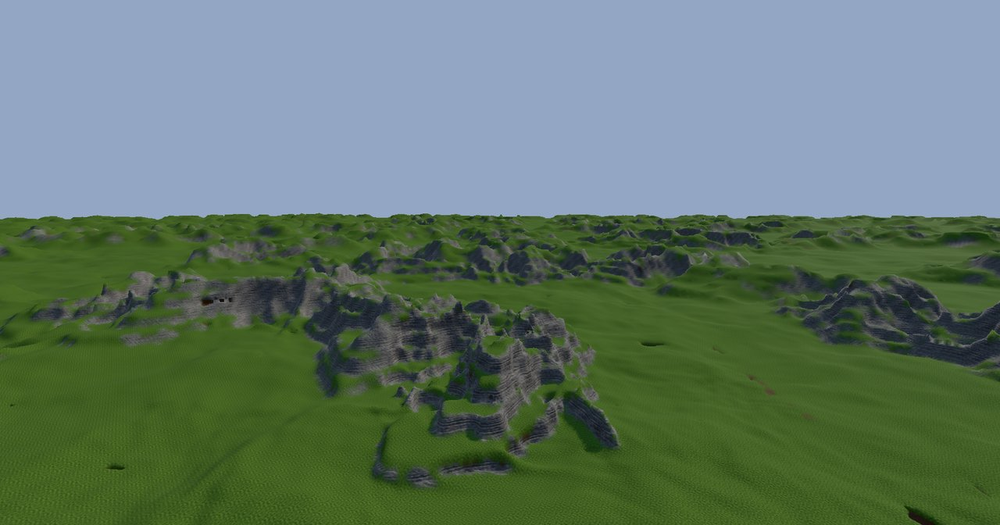
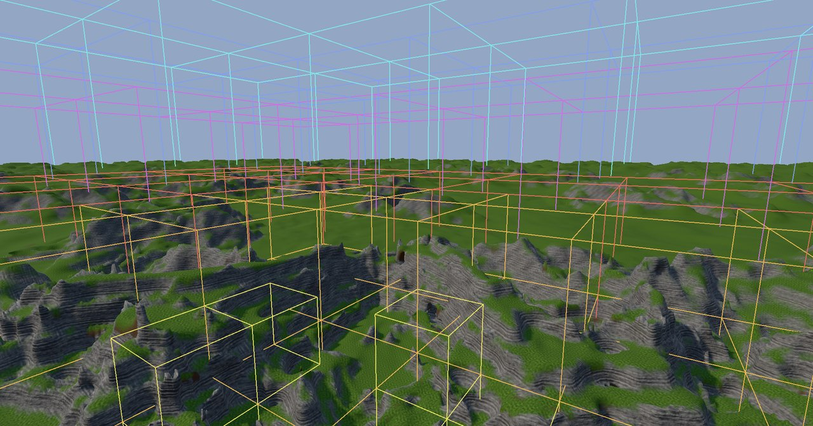

# R3.3: Streaming und LOD

- **Phase:** Konstruktion (Reifegrad [R3](R3-voxel-terrain.md))
- **Status:** abgeschlossen
- **Pull Requests:** [#41](https://github.com/viiez/ngine/pull/41), Review in einem eigenen PR

## Plan

**Ziel:** Das Terrain ist endlos. Ein Baum von Chunks in mehreren Stufen deckt die Welt um einen
oder mehrere Beobachter ab, nah fein, fern grob, bis rund 2 km weit. Chunks werden nach Abstand im
Job-System erzeugt, gemeshed und wieder entladen; zwischen den Stufen gibt es keine Risse, und der
Speicher bleibt begrenzt.

**Features:** VOX-04 (LOD), WORLD-07 (Welt-Partitionierung), WORLD-08 (Streaming).

### Entwurf

**Baum der Chunks** (`:lod`, WORLD-07, VOX-04)

- Ein Chunk der Stufe n deckt 32·2ⁿ Voxel mit weiterhin 32³ Samples ab (`ChunkCoord::level`).
- `select_lod()` teilt jeden Chunk in acht, solange ein Beobachter näher als `detail` × seine
  Breite ist, und gleicht danach aus: benachbarte Blätter (Fläche, Kante, Ecke) unterscheiden sich
  höchstens um eine Stufe. Chunks außerhalb der Sichtweite oder des senkrechten Bereichs gibt es
  nicht.
- `LodLayout` hält die Blätter, findet das Blatt zu einem Punkt (`leaf_of()`) und die
  Nachbarschaft eines Blatts. Die Nachbarschaft ist genau die Menge der Blätter, deren Samples sein
  Netz liest.

**Generator für grobe Stufen**

- `Generator::fill()` füllt Chunks jeder Stufe: Gitterabstand 4·2ⁿ für die 3D-Werte, Tiefen der
  Schichten und Abstand zur Oberfläche skaliert mit der Schrittweite. Stufe 0 bleibt bitgleich
  (Prüfsumme `0xfdbe419ab6ba3388` unverändert).

**Nähte** (`LodMesher`, [ADR 0041](../adr/0041-lod-octree-surface-nets-streaming.md))

- Surface Nets über den ganzen Baum statt Nahtstreifen: Auf einer Fläche zwischen zwei Stufen
  gelten die Samples der groben Seite, Zwischenpunkte der feinen Seite werden linear interpoliert.
  So ist das Feld überall eindeutig.
- Jede Gitterkante gehört der Zelle, die in beiden Querrichtungen oben liegt. An Stufengrenzen
  verbindet sie die Eckpunkte der drei oder vier verschiedenen Zellen um die Kante zu Vierecken
  oder Dreiecken (Nahtpolygone). Eckpunkte der Nachbarn rechnet jedes Netz selbst aus deren
  Samples, deshalb passen sie bitgenau.

**Streaming** (`:streaming`, WORLD-08)

- `Streamer::update()` einmal pro Frame schaltet nur weiter, die Arbeit läuft in Jobs: Haben
  sich die Beobachter weiter als `reselect_distance` bewegt, rechnet ein Job die neue Auswahl.
  Fehlende Chunks entstehen im Job-System, Nahes zuerst, höchstens `max_generating` gleichzeitig
  (Standard die Hälfte der Threads), in eigenen Chunks außerhalb des `ChunkStore`.
- Sind alle da, plant ein Job, welche Blätter neu zu meshen sind (neue Blätter und solche, deren
  Nachbarschaft sich ändert), dann meshen Jobs sie (`ChunkMap` als `ChunkSource` des
  `LodMesher`). Chunks der Stufe 0 lesen sie aus einem Spiegel, weil Pinsel die im Store im
  Hauptthread weiter ändern. Neue Blätter spiegeln Jobs beim Meshing, geänderte kopiert der
  Hauptthread vor dem nächsten Meshing neu.
- Erst dann übernimmt der Streamer die Auswahl in einem Schritt: Chunks in den Store, alte Blätter
  weg, die neuen Netze auf einmal. So zeigt kein Frame Risse oder Löcher. Pinsel, die während des
  Meshings wirkten, werden danach noch einmal gemeshed.
- Im Store liegen nur die Blätter der Auswahl, der Speicher bleibt also begrenzt. Pinsel wirken
  auf Blätter der Stufe 0 und werden im selben Aufruf neu gemeshed.

**Welt und Anwendungen**

- `world::Terrain` bekommt `streaming`, `view_distance` (Meter) und `detail`; die Komponente
  `TerrainObserver` macht eine Entity zum Beobachter. `update_terrains()` nimmt über
  `TerrainUpdate` weitere Beobachter (Kamera des Editors) und `wait` (Bilder, Tests).
- Sandbox: Die Voxel-Demo ist endlos (`--view <m>`, Standard 2000), F1 färbt die Grenzen der Chunks
  nach Stufe, G oder `--flight [m]` startet einen Autopiloten mit 80 m/s, der Frame-Zeiten
  (Median, 99. Perzentil) und Speicher misst. `--voxel-demo --headless` streamt um drei
  Beobachter wie ein Server mit Spielern.

### Schritte

1. Generator für grobe Stufen, Prüfsumme der Stufe 0 unverändert.
2. Baum der Chunks mit Auswahl und Ausgleich.
3. Mesher über Stufengrenzen mit Tests ohne GPU (keine offenen Kanten).
4. Streamer mit Jobs, Budget und Übernahme in einem Schritt; ThreadSanitizer.
5. Welt (`TerrainObserver`, `TerrainUpdate`), Sandbox mit Autopilot, Doku, Messung.

**Risiken:** Risse oder Löcher an Stufengrenzen; Ruckler, wenn eine Übernahme viele Netze auf
einmal meshet und hochlädt; Kosten des Meshers über Stufengrenzen; Daten-Wettläufe zwischen
erzeugenden Jobs und dem Hauptthread.

**Abnahme** (aus dem Plan von R3): Flug über mehrere Kilometer ohne Ruckler (99. Perzentil der
Frame-Zeit gemessen), Sichtweite rund 2 km auf dem PC; keine Risse zwischen Stufen (Test ohne GPU:
keine offenen Kanten an Stufengrenzen); Speicher bleibt beim Flug konstant; `--headless` streamt
um mehrere Beobachter.

## Stand

- Umgesetzt: Schritte 1 bis 5. Statt eigener Nahtstreifen schließt der Mesher die Grenzen selbst
  (Begründung im ADR 0041).
- Lokal (Cloud-Container, Clang 20, 4 Threads): `ngine.voxel` mit allen Tests grün, auch unter
  ThreadSanitizer. Welt, Renderer und Anwendungen prüft die CI, weil der Container die
  Abhängigkeiten aus vcpkg nicht laden kann.
- Tests ohne GPU: Eine Kugel über drei Stufen und das erzeugte Terrain über vier Stufen haben keine
  offenen Kanten; jede Kante gehört genau zwei Dreiecken mit entgegengesetzter Richtung. Mit nur
  einer Stufe ergibt der neue Mesher dieselben Dreiecke wie der bisherige. Der Streamer liefert nach
  jeder Übernahme dieselben Netze wie frisches Meshing der Auswahl, auch mit Pinseln, mehreren
  Beobachtern und ohne Warten; der Speicher bleibt beim Flug begrenzt.
- Messung im Container (Release, Sichtweite 2 km, `detail` 2): 540 Blätter in sechs Stufen
  (256 der Stufe 0, dann 96, 48, 48, 48, 44), rund 1,4 Millionen Dreiecke, 38 MB Netze und 27 MB
  Samples. Erstes Laden: Erzeugen rund 250 ms, Meshing rund 185 ms (parallel). Ein Netz über
  Stufengrenzen kostet rund 1,7-mal so viel wie mit dem bisherigen Mesher.
- Erste Messung auf dem PC (viiez, Windows 11, RTX, 16 Threads, Release, VSync 60 Hz): Sicht bis
  2 km in 282 ms geladen (856 Chunks in sechs Stufen); Flug über 4 km mit 80 m/s: Median 15,7 ms,
  99. Perzentil 48,2 ms, höchstens 52,9 ms; 1086 Übernahmen (höchstens 136 ms), Samples 22,6 bis
  38,2 MiB, Netze 33 bis 52 MiB, Geometrie auf der GPU bis 73,5 MiB. `--headless` mit drei
  Beobachtern: 1577 Chunks in 584 ms, `update_terrains()` 99. Perzentil 98,9 ms. Bilder ohne
  Risse.
- Die Ruckler kamen aus den Übernahmen: Auswahl, Planung und Meshing liefen im Hauptthread (mit
  `parallel_for`). Seitdem laufen alle drei in Jobs, die Übernahme selbst tauscht nur noch. Im
  Container (4 Threads, Flug mit 80 m/s, Sicht 2 km, 60 Hz) sank die Zeit von `update()` im
  99. Perzentil von 8,3 ms (nur Meshing in Jobs) auf 1,2 ms, eine Übernahme dauert höchstens
  rund 1 ms.
- Zweite Messung auf dem PC (viiez): Flug Median 16,6 ms, 99. Perzentil 32,1 ms, höchstens
  44,6 ms; 588 Übernahmen (höchstens 1,8 ms). `--headless`: `update_terrains()` 99. Perzentil
  17,9 ms bei Übernahmen bis 4,7 ms. Die restliche Zeit im Hauptthread kam aus den Kopien der
  Chunks der Stufe 0 vor dem Meshing (im Container bis 14 ms bei rund 200 Kopien mit frischem
  Speicher). Seitdem gibt es den Spiegel; im Container mit drei Beobachtern `update()` höchstens
  5,5 ms statt 14 ms. Der Spiegel kostet Speicher in Höhe der Samples der Stufe 0 und zählt in den
  Samples mit.
- Der Flug-Bericht misst seitdem auch `update_terrains()` und die Pässe des Renderers (darin das
  Hochladen neuer Netze) pro Frame, um Ruckler zuzuordnen.
- Dritte Messung auf dem PC (viiez): Flug 99. Perzentil 32,4 ms, höchstens 49,5 ms;
  `update_terrains()` 99. Perzentil 1,9 ms (höchstens 6,8 ms), Pässe des Renderers 99. Perzentil
  2,0 ms, aber höchstens 42,1 ms bei bis zu 575 Netzen in einem Frame. `--headless`:
  `update_terrains()` 99. Perzentil 12,4 ms bei Übernahmen bis 0,9 ms. Die Ruckler kamen damit aus
  dem Hochladen (TD-39) und, ohne GPU, aus dem Freigeben alter Netze im Hauptthread.
- Seitdem lädt `TerrainMeshes` höchstens 8 MiB pro Frame vorab in eigene Bereiche und tauscht
  die Draws erst, wenn alle Netze eines Terrains da sind (TD-39 abgebaut); alte Netze gibt ein Job
  frei.
- Vierte Messung auf dem PC (viiez): Flug 99. Perzentil 32,1 ms, höchstens 49,6 ms; im Hauptthread
  aber nur noch `update_terrains()` 99. Perzentil 0,39 ms (höchstens 2,9 ms) und Pässe 99.
  Perzentil 1,6 ms (höchstens 6,3 ms) bei bis zu 102 Netzen pro Frame. `--headless`:
  `update_terrains()` 99. Perzentil 1,8 ms, höchstens 2,0 ms. Streaming und Hochladen kosten im
  Hauptthread also kaum noch etwas; die verbliebenen langen Frames (rund 1 %) kommen von woanders
  (GPU oder Darstellung mit VSync).
- `--hover [s]` misst dieselben Werte ohne Flug, als Vergleich.
- Messung mit `--hover` auf dem PC (viiez): Median 16,7 ms, 99. Perzentil 18,2 ms, höchstens
  32,5 ms. Ohne Flug fehlen die langen Frames also fast ganz; sie hängen am Streaming, obwohl der
  Hauptthread dabei kaum Zeit braucht. Vermutung: Die Jobs des Streamings belegen alle Threads und
  verdrängen Hauptthread und Treiber. Seitdem nutzen Erzeugen und Meshing höchstens die Hälfte der
  Threads (`max_generating`, Standard die Hälfte; das Meshing holt sich Blätter aus einem
  gemeinsamen Zähler).
- Sechste Messung auf dem PC (viiez) mit der Begrenzung: Flug über 4 km mit 80 m/s, Median
  16,6 ms, 99. Perzentil 18,2 ms, höchstens 33,1 ms, also so gut wie im Schweben. 228 Übernahmen
  (höchstens 2,1 ms), 13262 Chunks erzeugt; Chunks 496 bis 856, Samples 23 bis 38 MiB, Netze 34
  bis 53 MiB, Geometrie auf der GPU bis 74 MiB; `update_terrains()` 99. Perzentil 0,40 ms, Pässe
  99. Perzentil 1,75 ms. Die Ruckler kamen also aus der Überlast durch Jobs des Streamings.
- CI: alle drei Jobs grün (Linux, Linux mit ThreadSanitizer, Windows).
- Bilder vom PC (viiez, erste Messung): Fernsicht bis 2 km ohne Risse und Löcher, und dieselbe
  Gegend mit F1, das die Grenzen der Chunks nach Stufe färbt.

  
  

## Review

**Ergebnis:** Das Terrain ist endlos. Ein ausgeglichener Baum von Chunks in sechs Stufen deckt die
Welt bis 2 km um einen oder mehrere Beobachter ab. Der `LodMesher` meshet über Stufengrenzen hinweg
ohne Nahtstreifen, und Tests ohne GPU finden keine offenen Kanten. Der `Streamer` erzeugt,
plant und meshet in Jobs (höchstens die Hälfte der Threads) und übernimmt eine neue Auswahl in
einem Schritt; der Renderer lädt neue Netze mit einem Budget pro Frame vorab hoch und tauscht die
Draws erst, wenn alle da sind. Im Hauptthread bleibt fast nichts: `update_terrains()` im
99. Perzentil 0,4 ms, eine Übernahme höchstens 2 ms.

Abnahme: Alle Kriterien sind erfüllt. Flug über 4 km mit 80 m/s bei 2 km Sicht auf dem PC
(Windows 11, NVIDIA GeForce RTX, 16 Threads, VSync 60 Hz): 99. Perzentil 18,2 ms, so gut wie im
Schweben ohne Flug. Keine Risse auf den Bildern und im Test ohne GPU. Der Speicher bleibt beim
Flug begrenzt (Chunks 496 bis 856, Samples höchstens 38 MiB, Netze höchstens 53 MiB).
`--headless` streamt um drei Beobachter mit `update_terrains()` im 99. Perzentil 1,8 ms. Die CI war
auf Linux, unter ThreadSanitizer und auf Windows mit MSVC grün. Bis dahin brauchte es sechs
Messungen auf dem PC (siehe Stand).

**Erkenntnisse:**

- Ruckler zuordnen, bevor man optimiert: Jede Messung hat eine andere Ursache gezeigt (Meshing im
  Hauptthread, Kopien der Stufe 0, Uploads auf einmal, Freigeben alter Netze, Überlast der
  Threads). Erst als der Flug-Bericht `update_terrains()` und die Pässe des Renderers getrennt
  maß, ließ sich jede Ursache einzeln nachweisen.
- Eine Messung ohne Bewegung (`--hover`) als Vergleich trennt die Kosten des Streamings vom Rest
  des Frames. Sie zeigte, dass die langen Frames am Streaming hingen, obwohl der Hauptthread kaum
  Zeit brauchte.
- Jobs im Hintergrund dürfen nicht alle Threads belegen: Mit 15 Workern unter Volllast verlor der
  Hauptthread mit dem Grafiktreiber Rechenzeit, und 1 % der Frames dauerte zwei Takte länger. Mit
  der Hälfte der Threads sank das 99. Perzentil von 32 auf 18 ms, und das Streaming ist trotzdem
  rechtzeitig fertig (Netze rund 0,5 s nach einer neuen Auswahl).
- Tests mit einer festen Zahl Frames scheitern unter ThreadSanitizer, der alles verlangsamt.
  Streaming-Tests warten deshalb mit einer Frist in Zeit. Ein Test für Pinsel während des
  Meshings ließ sich nicht zuverlässig zum Scheitern bringen, wenn der Fehler absichtlich
  eingebaut war; er bleibt als Stresstest, die Begründung der Lösung steht im Code.
- VSync rundet Frame-Zeiten auf Vielfache von 16,7 ms; ein 99. Perzentil von 33 oder 50 ms heißt
  also ein oder zwei verpasste Takte, kein Messfehler.

**Anpassungen:** ADR 0041 angenommen; es ersetzt die im Plan von R3 vorgesehenen Nahtstreifen
durch Surface Nets über Stufengrenzen. Feature-Katalog: VOX-02, VOX-04, VOX-05, WORLD-07 und
WORLD-08 um R3.3 ergänzt, bleiben bis zum Ende von R3 in Arbeit. Schuldenregister: TD-39 in der
Iteration entstanden und abgebaut, TD-40 neu (Pinsel gehen beim Entladen verloren, Frist R3.4).

**Architektur-Review:**

- Die Abhängigkeiten passen zur [Architektur](../architecture.md): Baum, Mesher und Streamer liegen
  in `ngine.voxel` ohne Welt und GPU und nutzen nur `ngine.jobs`; `ngine.world` führt den Streamer
  pro Terrain mit `TerrainObserver` und `TerrainUpdate`; der Renderer kennt nur Netze und lädt sie
  mit Budget.
- Fremdbibliotheken: keine neuen.
- Schnittstellen: `ChunkCoord` hat eine Stufe, `Generator::fill()` füllt jede Stufe. Neu sind
  `:lod` (`LodLayout`, `select_lod()`, `LodMesher`, `ChunkSource`) und `:streaming` (`Streamer`,
  `StreamDesc`, `StreamStats`). `world::Terrain` hat `streaming`, `view_distance` und `detail`; alte
  Szenen laden ohne Streaming wie bisher.
- Größe: `surface_nets.cpp` hat rund 930 Zeilen, weil beide Mesher darin stehen; der Mesher für den
  Baum ist eine zweite Umsetzung von Surface Nets neben `Mesher` (siehe ADR 0041). Aufteilen, wenn
  er wächst.
- Neue Schulden: TD-40.
- Offen für R3.4 und später: Deltas, die Entladen überleben und in die groben Stufen einfließen
  (TD-40); ein Blatt mit geänderter Nachbarschaft wird ganz neu gemeshed; das Aussehen der Welt
  (schwebende Felsstücke, Streifen in der Felstextur, flache Wiesen) ist weiter offen aus R3.2.
