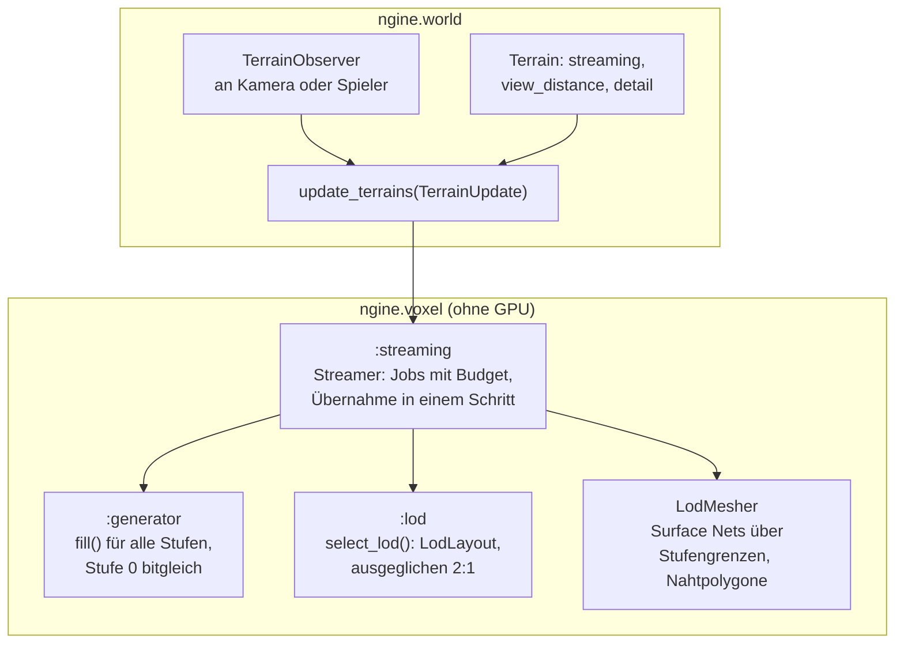

# R3.3: Streaming und LOD

- **Phase:** Konstruktion (Reifegrad [R3](R3-voxel-terrain.md))
- **Status:** in Arbeit
- **Pull Requests:** Umsetzung in einem PR, Review in einem eigenen PR

## Plan

**Ziel:** Das Terrain ist endlos. Ein Baum von Chunks in mehreren Stufen deckt die Welt um einen
oder mehrere Beobachter ab, nah fein, fern grob, bis rund 2 km weit. Chunks werden nach Abstand im
Job-System erzeugt, gemeshed und wieder entladen; zwischen den Stufen gibt es keine Risse, und der
Speicher bleibt begrenzt.

**Features:** VOX-04 (LOD), WORLD-07 (Welt-Partitionierung), WORLD-08 (Streaming).

### Entwurf

**Baum der Chunks** (`:lod`, WORLD-07, VOX-04)

- Ein Chunk der Stufe n deckt 32·2ⁿ Voxel mit weiterhin 32³ Samples ab (`ChunkCoord::level`).
- `select_lod()` teilt jeden Chunk in acht, solange ein Beobachter näher als `detail` × seine
  Breite ist, und gleicht danach aus: benachbarte Blätter (Fläche, Kante, Ecke) unterscheiden sich
  höchstens um eine Stufe. Chunks außerhalb der Sichtweite oder des senkrechten Bereichs gibt es
  nicht.
- `LodLayout` hält die Blätter, findet das Blatt zu einem Punkt (`leaf_of()`) und die
  Nachbarschaft eines Blatts. Die Nachbarschaft ist genau die Menge der Blätter, deren Samples sein
  Netz liest.

**Generator für grobe Stufen**

- `Generator::fill()` füllt Chunks jeder Stufe: Gitterabstand 4·2ⁿ für die 3D-Werte, Tiefen der
  Schichten und Abstand zur Oberfläche skaliert mit der Schrittweite. Stufe 0 bleibt bitgleich
  (Prüfsumme `0xfdbe419ab6ba3388` unverändert).

**Nähte** (`LodMesher`, [ADR 0041](../adr/0041-lod-octree-surface-nets-streaming.md))

- Surface Nets über den ganzen Baum statt Nahtstreifen: Auf einer Fläche zwischen zwei Stufen
  gelten die Samples der groben Seite, Zwischenpunkte der feinen Seite werden linear interpoliert.
  So ist das Feld überall eindeutig.
- Jede Gitterkante gehört der Zelle, die in beiden Querrichtungen oben liegt. An Stufengrenzen
  verbindet sie die Eckpunkte der drei oder vier verschiedenen Zellen um die Kante zu Vierecken
  oder Dreiecken (Nahtpolygone). Eckpunkte der Nachbarn rechnet jedes Netz selbst aus deren
  Samples, deshalb passen sie bitgenau.

**Streaming** (`:streaming`, WORLD-08)

- `Streamer::update()` einmal pro Frame schaltet nur weiter, die Arbeit läuft in Jobs: Haben
  sich die Beobachter weiter als `reselect_distance` bewegt, rechnet ein Job die neue Auswahl.
  Fehlende Chunks entstehen im Job-System, Nahes zuerst, höchstens `max_generating` gleichzeitig
  (Standard zwei pro Thread), in eigenen Chunks außerhalb des `ChunkStore`.
- Sind alle da, plant ein Job, welche Blätter neu zu meshen sind (neue Blätter und solche, deren
  Nachbarschaft sich ändert), dann meshen Jobs sie. Chunks der Stufe 0 aus dem Store lesen sie als
  Kopie, weil Pinsel diese im Hauptthread weiter ändern (`ChunkMap` als `ChunkSource` des
  `LodMesher`).
- Erst dann übernimmt der Streamer die Auswahl in einem Schritt: Chunks in den Store, alte Blätter
  weg, die neuen Netze auf einmal. So zeigt kein Frame Risse oder Löcher. Pinsel, die während des
  Meshings wirkten, werden danach noch einmal gemeshed.
- Im Store liegen nur die Blätter der Auswahl, der Speicher bleibt also begrenzt. Pinsel wirken
  auf Blätter der Stufe 0 und werden im selben Aufruf neu gemeshed.

**Welt und Anwendungen**

- `world::Terrain` bekommt `streaming`, `view_distance` (Meter) und `detail`; die Komponente
  `TerrainObserver` macht eine Entity zum Beobachter. `update_terrains()` nimmt über
  `TerrainUpdate` weitere Beobachter (Kamera des Editors) und `wait` (Bilder, Tests).
- Sandbox: Die Voxel-Demo ist endlos (`--view <m>`, Standard 2000), F1 färbt die Grenzen der Chunks
  nach Stufe, G oder `--flight [m]` startet einen Autopiloten mit 80 m/s, der Frame-Zeiten
  (Median, 99. Perzentil) und Speicher misst. `--voxel-demo --headless` streamt um drei
  Beobachter wie ein Server mit Spielern.

### Schritte

1. Generator für grobe Stufen, Prüfsumme der Stufe 0 unverändert.
2. Baum der Chunks mit Auswahl und Ausgleich.
3. Mesher über Stufengrenzen mit Tests ohne GPU (keine offenen Kanten).
4. Streamer mit Jobs, Budget und Übernahme in einem Schritt; ThreadSanitizer.
5. Welt (`TerrainObserver`, `TerrainUpdate`), Sandbox mit Autopilot, Doku, Messung.

**Risiken:** Risse oder Löcher an Stufengrenzen; Ruckler, wenn eine Übernahme viele Netze auf
einmal meshet und hochlädt; Kosten des Meshers über Stufengrenzen; Daten-Wettläufe zwischen
erzeugenden Jobs und dem Hauptthread.

**Abnahme** (aus dem Plan von R3): Flug über mehrere Kilometer ohne Ruckler (99. Perzentil der
Frame-Zeit gemessen), Sichtweite rund 2 km auf dem PC; keine Risse zwischen Stufen (Test ohne GPU:
keine offenen Kanten an Stufengrenzen); Speicher bleibt beim Flug konstant; `--headless` streamt
um mehrere Beobachter.

## Stand

- Umgesetzt: Schritte 1 bis 5. Statt eigener Nahtstreifen schließt der Mesher die Grenzen selbst
  (Begründung im ADR 0041).
- Lokal (Cloud-Container, Clang 20, 4 Threads): `ngine.voxel` mit allen Tests grün, auch unter
  ThreadSanitizer. Welt, Renderer und Anwendungen prüft die CI, weil der Container die
  Abhängigkeiten aus vcpkg nicht laden kann.
- Tests ohne GPU: Eine Kugel über drei Stufen und das erzeugte Terrain über vier Stufen haben keine
  offenen Kanten; jede Kante gehört genau zwei Dreiecken mit entgegengesetzter Richtung. Mit nur
  einer Stufe ergibt der neue Mesher dieselben Dreiecke wie der bisherige. Der Streamer liefert nach
  jeder Übernahme dieselben Netze wie frisches Meshing der Auswahl, auch mit Pinseln, mehreren
  Beobachtern und ohne Warten; der Speicher bleibt beim Flug begrenzt.
- Messung im Container (Release, Sichtweite 2 km, `detail` 2): 540 Blätter in sechs Stufen
  (256 der Stufe 0, dann 96, 48, 48, 48, 44), rund 1,4 Millionen Dreiecke, 38 MB Netze und 27 MB
  Samples. Erstes Laden: Erzeugen rund 250 ms, Meshing rund 185 ms (parallel). Ein Netz über
  Stufengrenzen kostet rund 1,7-mal so viel wie mit dem bisherigen Mesher.
- Erste Messung auf dem PC (viiez, Windows 11, RTX, 16 Threads, Release, VSync 60 Hz): Sicht bis
  2 km in 282 ms geladen (856 Chunks in sechs Stufen); Flug über 4 km mit 80 m/s: Median 15,7 ms,
  99. Perzentil 48,2 ms, höchstens 52,9 ms; 1086 Übernahmen (höchstens 136 ms), Samples 22,6 bis
  38,2 MiB, Netze 33 bis 52 MiB, Geometrie auf der GPU bis 73,5 MiB. `--headless` mit drei
  Beobachtern: 1577 Chunks in 584 ms, `update_terrains()` 99. Perzentil 98,9 ms. Bilder ohne
  Risse.
- Die Ruckler kamen aus den Übernahmen: Auswahl, Planung und Meshing liefen im Hauptthread (mit
  `parallel_for`). Seitdem laufen alle drei in Jobs, die Übernahme selbst tauscht nur noch. Im
  Container (4 Threads, Flug mit 80 m/s, Sicht 2 km, 60 Hz) sank die Zeit von `update()` im
  99. Perzentil von 8,3 ms (nur Meshing in Jobs) auf 1,2 ms, eine Übernahme dauert höchstens
  rund 1 ms.
- Offen: neue Messung auf dem PC.
