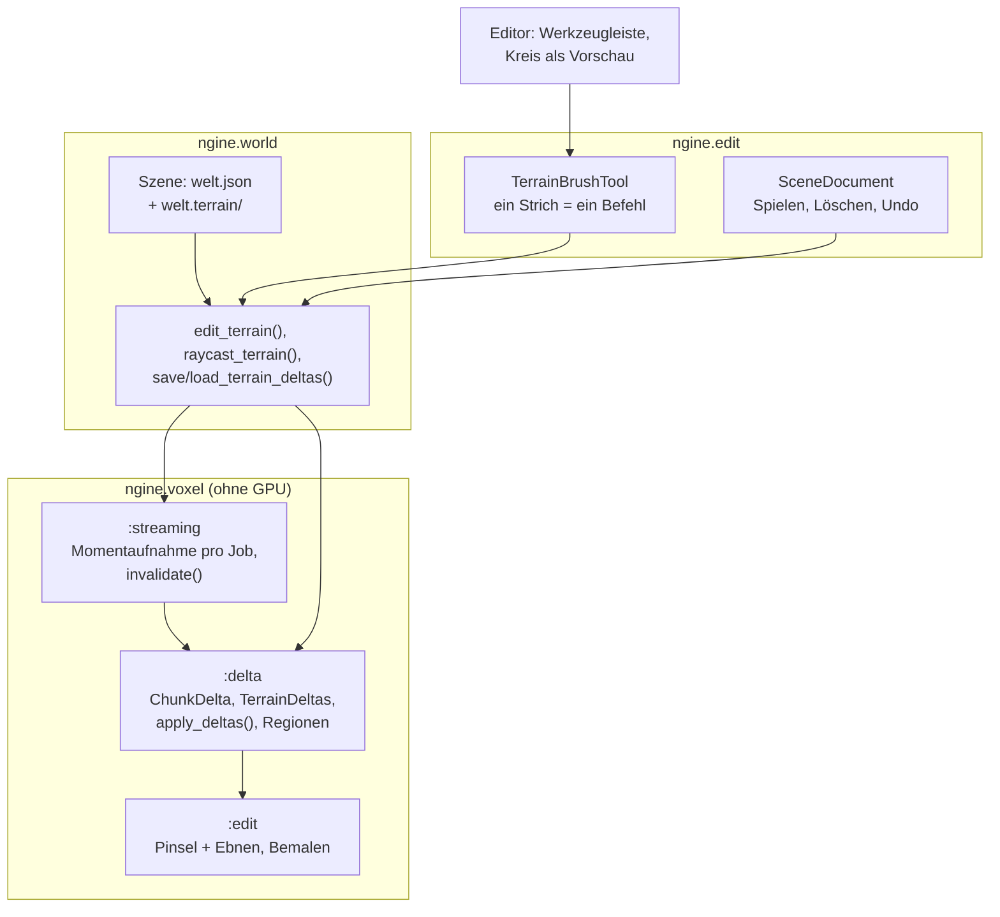

# R3.4: Deltas und Voxel-Werkzeuge

- **Phase:** Konstruktion (Reifegrad [R3](R3-voxel-terrain.md))
- **Status:** in Arbeit
- **Pull Requests:** [#43](https://github.com/viiez/ngine/pull/43), Review in einem eigenen PR

## Plan

**Ziel:** Änderungen am Terrain bleiben. Pinsel speichern pro Chunk nur die Abweichung von der
prozeduralen Grundwelt; diese Deltas überleben das Entladen, sind aus der Ferne in den groben
Stufen zu sehen und werden mit der Szene gespeichert. Im Editor lässt sich das Terrain formen und
bemalen, mit Vorschau und Undo. „Alles kochen“ hält den Editor nicht mehr an.

**Features:** VOX-06 (Deltas, Speichern; Übertragen in R5), EDIT-08 (Voxel-Werkzeuge), dazu VOX-03
(Ebnen, Bemalen). **Schulden:** TD-34 (Kochen im Hintergrund), TD-40 (Pinsel auf endlosen
Terrains). TD-37 und TD-38 mit Frist R3.4 verschiebt der Plan nach R4: Bemalen nutzt die vier
Materialien der Standardtabelle und stößt nicht an die Grenze von acht pro Chunk.

### Entwurf

**Deltas** (`:delta`, VOX-06, [ADR 0042](../adr/0042-terrain-deltas-region-files.md))

- Nur Chunks der Stufe 0 haben Deltas. Ein `ChunkDelta` kodiert die geänderten Samples als
  Lauflängen mit Varints (unverändert, geändert, Werte); Deltas sind unveränderlich und geteilt.
- `TerrainDeltas` hält die Tabelle mit dem Generator, wendet Pinsel an (fehlende Chunks entstehen
  für die Rechnung aus Grundwelt und Deltas) und liefert pro Chunk das Delta vorher und nachher.
  Jobs lesen Momentaufnahmen; der Hauptthread kopiert die Tabelle, wenn jemand sie hält.
- `apply_deltas()` rechnet die Deltas beim Erzeugen in Chunks jeder Stufe ein: grobe Chunks
  übernehmen die geänderten Samples auf ihrem Raster.

**Streaming** (TD-40)

- Der `Streamer` erzeugt Chunks mit der Momentaufnahme beim Start. Nach einem Pinsel erzeugt
  `invalidate()` überlappende grobe Blätter neu (ohne neue Auswahl) und meshet ihre Nachbarschaft.
  Chunks, die während eines Pinsels erzeugt wurden, gelten bei der Übernahme als veraltet: Stufe 0
  wird sofort aus den Deltas gebaut, grobe Stufen neu erzeugt.
- Der Strahltest läuft über alle Stufen des `LodLayout`, damit der Pinsel auch in der Ferne trifft.

**Pinsel** (VOX-03)

- Neu: Ebnen (zur waagerechten Ebene durch den ersten Treffer, mit Stärke und weichem Rand) und
  Bemalen (setzt das Material fester Samples in der Kugel, Form bleibt).

**Speichern** (VOX-06)

- `Terrain::deltas` nennt den Ordner der Regionen-Dateien relativ zur Szene, beim Speichern im
  Editor `<Szene>.terrain`. Eine Datei pro Region von 16³ Chunks mit Deltas; leere Regionen
  verschwinden. Laden liest sie, bevor das Terrain entsteht.

**Editor** (EDIT-08)

- Ist ein Terrain ausgewählt, zeigt die Werkzeugleiste über dem Viewport eine zweite Zeile: Pinsel an, Modus
  (Abtragen, Auftragen, Glätten, Ebnen, Bemalen), Radius, Stärke (Glätten, Ebnen) und Material
  (Auftragen, Bemalen). Ein Kreis auf dem Terrain unter der Maus zeigt den Pinsel. Das Menü
  „Werkzeug“ schaltet den Pinsel ebenfalls und sagt, wenn erst ein Terrain auszuwählen ist.
- Linke Maustaste formt; ein Strich über viele Frames ist ein Befehl im Verlauf (`TerrainBrushTool`,
  Deltas vorher und nachher pro Chunk). Die Stärke hängt nicht von der Bildrate ab.
- Spielen, Löschen und Undo behalten die Deltas: Die Sicherung im Dokument nimmt sie mit.
- Das Statistikfenster zeigt Chunks mit Delta und ihre Größe.

**Kochen im Hintergrund** (TD-34)

- `cook::BackgroundCook` kocht alle Modelle in einem Job nacheinander, Texturen mit der Hälfte der
  Threads (Lehre aus R3.3: Hintergrundarbeit darf nicht alle Threads belegen). Der Asset-Browser
  zeigt einen Fortschrittsbalken „Kocht X von Y“ und kann abbrechen; danach steht das Ergebnis
  neben dem Knopf und im Log.

### Schritte

1. Deltas mit Kodierung und Einrechnen in grobe Stufen; Ebnen und Bemalen.
2. Streamer mit Momentaufnahmen und Neuerzeugung grober Blätter; ThreadSanitizer.
3. Regionen-Dateien, Speichern und Laden mit der Szene.
4. Befehle und Pinsel-Werkzeug in `ngine.edit`, Werkzeugleiste und Vorschau im Editor.
5. Kochen im Hintergrund, Sandbox, Doku, Messung.

**Risiken:** Daten-Wettläufe zwischen Jobs, die Chunks erzeugen, und Pinseln im Hauptthread;
Chunks, die mit veralteten Deltas fertig werden; Ruckler, wenn ein Pinsel viele grobe Blätter neu
erzeugt; große Deltas bei großflächigen Änderungen.

**Abnahme** (aus dem Plan von R3): Krater graben, wegfliegen, bis der Chunk entladen ist,
zurückkommen: Krater ist da, auch aus der Ferne; Editor neu starten: Änderungen sind da; Größe der
Deltas gemessen; Formen und Bemalen mit Undo und Redo.

## Stand

- Umgesetzt: Schritte 1 bis 5. Tastenkürzel für die Werkzeuge fehlen noch (TD-42).
- Lokal (Cloud-Container, Clang 20): `ngine.voxel`, `ngine.world` und `ngine.edit` mit allen
  Tests grün. Editor, Sandbox und `ngine.cook` prüft die CI.
- Tests ohne GPU: Kodierung und Prüfung beim Dekodieren; Deltas in groben Stufen; Undo und Redo
  über Deltas; Ebnen und Bemalen; ein Krater überlebt das Entladen und ist aus 1,4 km in Stufe 2
  oder gröber zu sehen; Pinsel erneuern grobe Blätter ohne neue Auswahl; Pinsel während des
  Streamings ergeben dieselben Chunks wie ein Neuaufbau aus den Deltas, auch auf Chunks, die gerade
  erzeugt werden; Regionen-Dateien bitgleich hin und zurück. Im Editor: ein Strich über fünf Frames
  ist ein Schritt, Undo und Redo, Spielen und Löschen behalten die Deltas, Speichern und Öffnen über
  Regionen-Dateien.
- Größe der Deltas im Container (Abtragen auf der Oberfläche, Startwert 3): Kugel mit 2 m Radius
  4 Chunks, 668 Samples, 1,7 KB; 6 m: 4 Chunks, 7 145 Samples, 16 KB; 12 m: 10 Chunks,
  40 642 Samples, 87 KB; 24 m: 41 Chunks, 275 621 Samples, 575 KB. Rund 2,1 bis 2,5 Bytes pro
  geändertem Sample; die Regionen-Dateien sind höchstens rund 400 Bytes größer.
- Abnahme auf dem PC (viiez): Krater sind aus der Ferne zu sehen und bleiben beim Wegfliegen und
  Zurückkommen bestehen. Im Editor formen alle Pinsel das Terrain, Undo und Redo funktionieren,
  und die Änderungen sind nach Speichern und Neustart wieder da. Den Pinsel fand viiez zuerst
  nicht (die zweite Zeile erscheint nur mit ausgewähltem Terrain), und „Alles kochen“ zeigte
  keinen Fortschritt (sind alle Modelle aktuell, ist es nach einem Frame fertig und meldete sich
  nur im Log). Seitdem hat das Menü „Werkzeug“ den Eintrag „Terrain-Pinsel“, und der
  Asset-Browser zeigt einen Fortschrittsbalken und das letzte Ergebnis.
