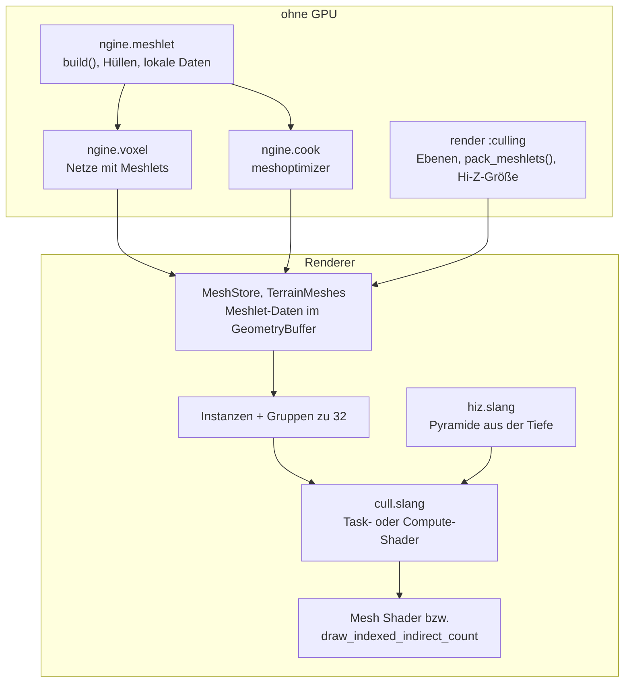

# R3.5: GPU-getriebenes Zeichnen

- **Phase:** Konstruktion (Reifegrad [R3](R3-voxel-terrain.md))
- **Status:** abgeschlossen
- **Pull Requests:** [#45](https://github.com/viiez/ngine/pull/45), Review in einem eigenen PR

## Plan

**Ziel:** Die GPU entscheidet, was gezeichnet wird. Alle Netze, Modelle wie Chunks des Terrains,
bestehen aus Meshlets, die die GPU gegen Stumpf, Normalenkegel und Verdeckung prüft. Was hinter
Bergen oder außerhalb einer Höhle liegt, wird nicht gezeichnet. Mit Mesh Shadern geht das in einem
Draw; ohne die Stufe zeichnet ein Rückfallpfad dasselbe Bild über Compute und indirekte Draws.

**Features:** REND-10 (GPU-Culling), REND-13 (Mesh Shader mit Rückfallpfad). **Schulden:** TD-16
(transiente Texturen), TD-20 (Durchsichtiges sortieren). TD-37 und TD-38 bleiben bei R4.

### Entwurf

**Meshlets** (`ngine.meshlet`, [ADR 0043](../adr/0043-gpu-driven-meshlets.md))

- Höchstens 64 Eckpunkte und 124 Dreiecke, Hüllkugel und Normalenkegel. Der Indexpuffer wird so
  umsortiert, dass die Dreiecke eines Meshlets hintereinander liegen.
- Eigener Builder: Teilung wie in einem k-d-Baum am Median entlang der längsten Achse.
  Deterministisch, für Terrain (beim Meshen) und Modelle aus Quellen (beim Laden im Hintergrund).
- Beim Kochen meshoptimizer (Vertex-Cache-Optimierung, Meshlets mit Kegelgewicht), umgerechnet in
  dasselbe Format; gekochte Modelle Version 2.

**Renderer**

- Jedes Teilnetz und jeder Chunk ist eine Instanz im Instanzpuffer des Frames; ihre Meshlets bilden
  Gruppen zu 32, sortiert nach Kategorie (Terrain, undurchsichtig, maskiert, je ein- und
  doppelseitig) und Geometrieblock.
- Aufgaben mit eigener Sicht: Vorwärts Phase 1 und 2, vier Kaskaden, Auswahl. Phase 1 prüft gegen
  das Hi-Z des letzten Frames, Phase 2 gegen das neue.
- Mesh-Shader-Pfad: Der Task-Shader prüft und startet je sichtbarem Meshlet einen Mesh-Shader.
  Rückfallpfad: Ein Compute-Shader schreibt indirekte Draws mit Zählern, gezeichnet je Bereich.
- Durchsichtiges von hinten nach vorn als einzelne Draws (TD-20).
- Zähler der GPU (geprüft, Stumpf, Kegel, verdeckt, gezeichnet, Dreiecke) für Kamera, Schatten und
  Auswahl; die der Kamera kommen in `RenderStats`.

**Render-Graph** (TD-16): Transiente Texturen kommen vor ihrem ersten Pass aus dem Vorrat und gehen
nach ihrem letzten zurück; eine Textur mit mehr Verwendungen darf eine mit weniger ersetzen.

### Schritte

1. `ngine.meshlet` mit Tests; Meshlets in Voxel-Netzen, Modellen und beim Kochen.
2. RHI: Task- und Mesh-Shader, indirekte Draws mit Zähler, Puffer füllen und kopieren.
3. Shader: gemeinsame Daten, Prüfen, Hi-Z, Mesh-Shader der Netze.
4. Renderer: Instanzen, Gruppen, Passes beider Pfade, Statistik; Sandbox und Editor zeigen sie.
5. TD-16 im Graph, Tests, CI-Bildvergleich, Doku, Messung.

**Risiken:** Unterschiede zwischen den Pfaden; Löcher nach schnellen Kamerabewegungen; Kosten des
Prüfens bei sehr vielen kleinen Instanzen; lavapipe ohne Mesh Shader (dann prüft die CI nur den
Rückfallpfad).

**Abnahme** (aus dem Plan von R3): Mesh-Shader-Pfad und Rückfallpfad (`--baseline`) zeichnen
dasselbe Bild (Vergleich in der CI über lavapipe); in einer Höhle wird die Landschaft draußen nicht
gezeichnet (Zähler); Dreiecke, Draws und GPU-Zeit vorher und nachher auf dem PC gemessen.

## Stand

- Umgesetzt: Schritte 1 bis 5.
- Lokal (Cloud-Container, Clang 20): `ngine.meshlet`, `ngine.voxel` und die Rechnungen aus
  `:culling` mit allen Tests grün. Renderer, RHI und Shader prüft die CI (vcpkg ist im Container
  nicht erreichbar).
- Tests ohne GPU: Meshlets decken das Netz ab, Hüllen umschließen ihre Dreiecke, Kegel sortieren nur
  Abgewandtes aus, lokale Daten ergeben dieselben Dreiecke; Stumpfebenen der Kamera und einer
  Parallelprojektion; gepackte Meshlet-Daten; Größe und Stufen des Hi-Z.
- Tests mit GPU (lavapipe): Höhle mit Kugel hinter der Wand, mit und ohne Mesh Shader
  (`culled_occluded` > 0, ohne Prüfung auf Verdeckung 0); eine Pool-Textur dient zwei Texturen
  mit getrennter Lebensdauer im selben Frame.
- Abnahme auf dem PC (RTX 3060 Ti, Windows): Mesh-Shader-Pfad und `--baseline` zeichnen dasselbe
  Bild; in einer Höhle steigt `verdeckt`, und die Landschaft draußen wird nicht gezeichnet.
- Messung auf dem PC in Release, Flug über 4 km (`--voxel-demo --flight --no-vsync`, 1280×720),
  `main` gegen diesen Stand:

  | | vorher | nachher |
  |---|---|---|
  | Dreiecke im Vorwärts-Pass | 1,3 bis 1,8 Mio. (alle Netze) | 0,26 bis 0,37 Mio. |
  | Draw-Aufrufe vorwärts / Schatten | rund 400 / 270 bis 450 | 2 / 4 |
  | GPU-Zeit pro Frame (Summe der Passes in Tracy) | 1,25 ms | 1,25 ms |
  | davon Vorwärts / Schatten (4 Kaskaden) | 0,91 / 0,31 ms | 0,82 / 0,32 ms |
  | Hi-Z, Statistik lesen, Zähler leeren | | 0,08 ms |

  Die GPU zeichnet rund 78 % weniger Dreiecke, ist bei diesem Terrain aber nicht schneller: Der
  Vorwärts-Pass spart gut 10 %, Hi-Z und Statistik kosten es wieder. Das 99. Perzentil der
  Frame-Zeit stieg zuerst von 2,2 auf 19 ms, weil der Hauptthread die lokalen Meshlet-Daten
  neuer Chunks mit einer linearen Suche je Eckpunkt prüfte und rechnete. Mit einer Tabelle in O(1)
  waren es noch 6,8 ms; seitdem rechnet der Job des Meshers die lokalen Daten mit
  (`voxel::Mesh::local`), und der Hauptthread prüft nur Größen: 99. Perzentil 2,7 ms (Median
  1,34 statt 1,25 ms), die Pässe im Hauptthread 1,6 statt 0,7 ms im 99. Perzentil. Den Rest
  kosten Instanzen und Gruppen je Frame.

## Review

**Ergebnis:** Die GPU entscheidet, was gezeichnet wird. Modelle und Chunks bestehen aus Meshlets mit
Hüllkugel und Normalenkegel; ein Task- bzw. Compute-Shader prüft jedes gegen den Stumpf, den Kegel
und ein Hi-Z in zwei Phasen. Mit Mesh Shadern ist eine Kategorie ein Draw, ohne zeichnet ein
indirekter Draw mit Zähler je Bereich dasselbe Bild. Auf dem Flug über 4 km zeichnet die GPU rund
78 % weniger Dreiecke (0,26 bis 0,37 statt 1,3 bis 1,8 Mio.), mit 2 statt rund 400 Draw-Aufrufen
vorwärts und 4 statt 270 bis 450 in die Schattenkarten. Die GPU-Zeit bleibt bei 1,25 ms pro
Frame. Durchsichtiges wird von hinten nach vorn gezeichnet (TD-20), transiente Texturen des
Render-Graphs teilen sich Speicher, wenn ihre Lebensdauern getrennt sind (TD-16).

Abnahme: Alle drei Kriterien sind erfüllt. Auf dem PC (viiez, RTX 3060 Ti) zeichnen
Mesh-Shader-Pfad und `--baseline` dasselbe Bild, in der CI über lavapipe weichen sie in 273 bzw.
15 von 1,56 Mio. Bytes ab (Szene bzw. Voxel-Demo). lavapipe hat die Stufe Mesh Shader, die CI
prüft also beide Pfade, nicht nur den Rückfallpfad wie befürchtet. In einer Höhle steigt
`verdeckt`, und die Landschaft draußen wird nicht gezeichnet; der GPU-Test mit einer Kugel hinter
der Wand prüft das in beiden Pfaden. Dreiecke, Draws und GPU-Zeit sind vorher und nachher
gemessen (Tabelle oben). Die CI war auf Linux, unter ThreadSanitizer und auf Windows mit MSVC grün.

**Erkenntnisse:**

- Messen auf dem PC hat einen Fehler gefunden, den kein Test zeigte: Das 99. Perzentil der
  Frame-Zeit stieg von 2,2 auf 19 ms, weil der Hauptthread beim Hochladen neuer Chunks die
  lokalen Meshlet-Daten mit einer linearen Suche je Eckpunkt prüfte und rechnete. Erst die
  Verlagerung in den Job des Meshers brachte es auf 2,7 ms. Arbeit pro Eckpunkt gehört in Jobs,
  auch wenn sie pro Chunk klein aussieht; 77 Chunks in einem Frame machen sie groß.
- Weniger Dreiecke heißt nicht weniger GPU-Zeit: Bei diesem Terrain spart der Vorwärts-Pass gut
  10 %, Hi-Z und Statistik kosten es wieder. Der Gewinn kommt erst mit dichterer Geometrie, mehr
  Modellen oder teureren Shadern, und er steckt schon jetzt in der CPU, die nicht mehr jeden Chunk
  einzeln zeichnet.
- Die Statistik muss sagen, was sie zählt: „Draws“ zählte Netze, nicht Draw-Aufrufe. Erst mit
  `forward_draws` war der Vergleich vorher und nachher ehrlich.
- Renderer, RHI und Shader ließen sich im Container nicht bauen (vcpkg nicht erreichbar). Die CI
  fand vier Fehler in Folge (fehlende Quelle im Build, unbehandelter Zustand im `switch`,
  verdecktes Feld, Reihenfolge einer Deklaration); jeder kostete einen Lauf von rund 25 Minuten.

**Anpassungen:** ADR 0043 angenommen. Feature-Katalog: REND-10 und REND-13 fertig. Schuldenregister:
TD-16 und TD-20 abgebaut, TD-43 bis TD-46 neu.

**Architektur-Review:**

- Die Abhängigkeiten passen zur [Architektur](../architecture.md): `ngine.meshlet` hängt nur an
  `ngine.core` und `ngine.math` und wird von `ngine.voxel`, `ngine.asset`, `ngine.cook` und
  `ngine.render` genutzt. Die Rechnungen ohne GPU (Stumpfebenen, Packen, Größe des Hi-Z) liegen in
  `:culling` und sind ohne GPU getestet.
- Fremdbibliotheken: meshoptimizer neu, nur im Adapter `cook/meshlets_meshoptimizer.cpp`.
- Schnittstellen: Neu sind `ngine.meshlet` (`build()`, `valid()`, `local_data()`), `:culling`
  (`GpuMeshlet`, `GpuInstance`, `GpuView`, `pack_meshlets()`), in der RHI Task- und Mesh-Shader,
  `draw_mesh_tasks()`, `draw_indexed_indirect_count()`, `fill_buffer()` und `copy_buffer()`, im
  Renderer die Schalter `use_mesh_shaders` und `occlusion_culling` und neue Felder in
  `RenderStats`. `voxel::Mesh` trägt Meshlets und ihre lokalen Daten. Gekochte Modelle haben
  Version 2; alte Einträge im Cache werden neu gekocht.
- Größe: Der Renderer ist auf `renderer.cpp` (rund 610 Zeilen), `driven.cpp` (360),
  `pipelines.cpp` (360) und `passes.cpp` (290) verteilt; `renderer_detail.cppm` (410) hält die
  gemeinsamen Typen. `cull.slang` (255 Zeilen) teilt Task- und Compute-Variante über gemeinsame
  Funktionen.
- Leistung: GPU-Zeit unverändert, Dreiecke und Draw-Aufrufe stark gesunken. Instanzen und Gruppen
  baut die CPU in jedem Frame neu; das kostet im Median rund 0,09 ms und im 99. Perzentil der
  Pässe rund 0,9 ms (TD-46).
- Neue Schulden: TD-43 (Durchsichtiges auf der CPU), TD-44 (Schatten ohne Verdeckung), TD-45
  (Statistik der GPU verspätet), TD-46 (Instanzen und Gruppen je Frame neu).
