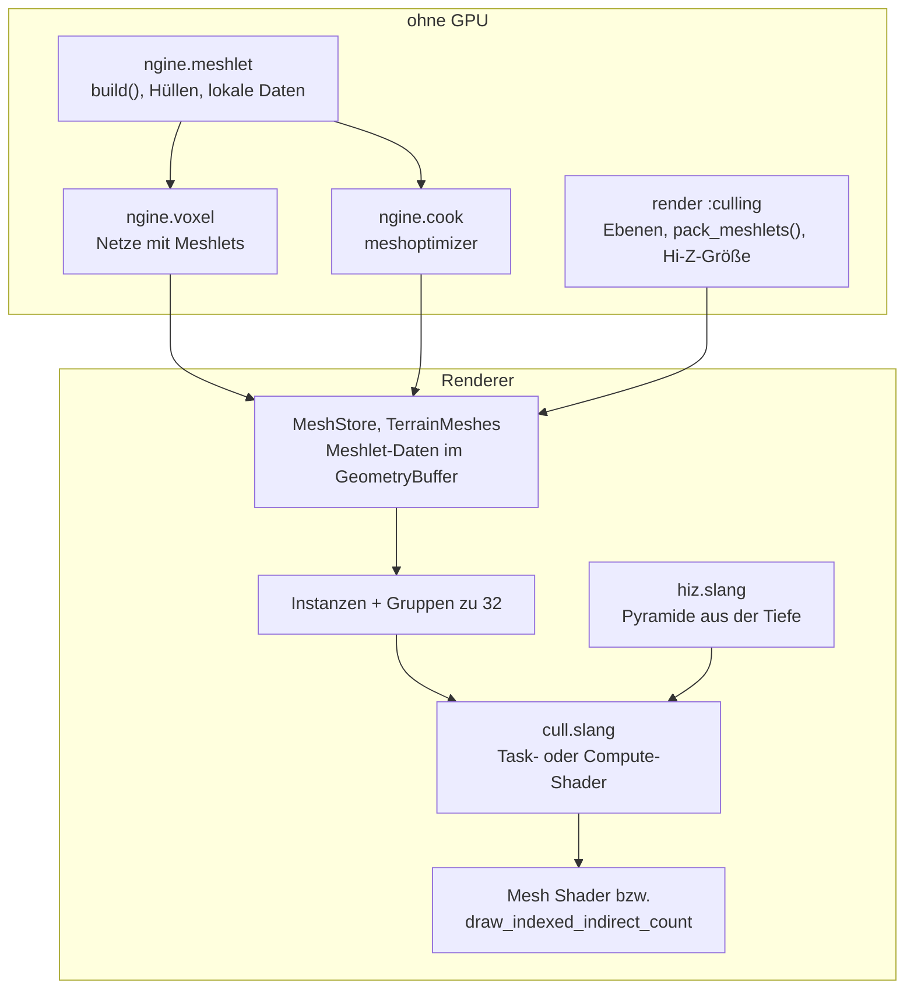

# R3.5: GPU-getriebenes Zeichnen

- **Phase:** Konstruktion (Reifegrad [R3](R3-voxel-terrain.md))
- **Status:** in Arbeit
- **Pull Requests:** [#45](https://github.com/viiez/ngine/pull/45), Review in einem eigenen PR

## Plan

**Ziel:** Die GPU entscheidet, was gezeichnet wird. Alle Netze, Modelle wie Chunks des Terrains,
bestehen aus Meshlets, die die GPU gegen Stumpf, Normalenkegel und Verdeckung prüft. Was hinter
Bergen oder außerhalb einer Höhle liegt, wird nicht gezeichnet. Mit Mesh Shadern geht das in einem
Draw; ohne die Stufe zeichnet ein Rückfallpfad dasselbe Bild über Compute und indirekte Draws.

**Features:** REND-10 (GPU-Culling), REND-13 (Mesh Shader mit Rückfallpfad). **Schulden:** TD-16
(transiente Texturen), TD-20 (Durchsichtiges sortieren). TD-37 und TD-38 bleiben bei R4.

### Entwurf

**Meshlets** (`ngine.meshlet`, [ADR 0043](../adr/0043-gpu-driven-meshlets.md))

- Höchstens 64 Eckpunkte und 124 Dreiecke, Hüllkugel und Normalenkegel. Der Indexpuffer wird so
  umsortiert, dass die Dreiecke eines Meshlets hintereinander liegen.
- Eigener Builder: Teilung wie in einem k-d-Baum am Median entlang der längsten Achse.
  Deterministisch, für Terrain (beim Meshen) und Modelle aus Quellen (beim Laden im Hintergrund).
- Beim Kochen meshoptimizer (Vertex-Cache-Optimierung, Meshlets mit Kegelgewicht), umgerechnet in
  dasselbe Format; gekochte Modelle Version 2.

**Renderer**

- Jedes Teilnetz und jeder Chunk ist eine Instanz im Instanzpuffer des Frames; ihre Meshlets bilden
  Gruppen zu 32, sortiert nach Kategorie (Terrain, undurchsichtig, maskiert, je ein- und
  doppelseitig) und Geometrieblock.
- Aufgaben mit eigener Sicht: Vorwärts Phase 1 und 2, vier Kaskaden, Auswahl. Phase 1 prüft gegen
  das Hi-Z des letzten Frames, Phase 2 gegen das neue.
- Mesh-Shader-Pfad: Der Task-Shader prüft und startet je sichtbarem Meshlet einen Mesh-Shader.
  Rückfallpfad: Ein Compute-Shader schreibt indirekte Draws mit Zählern, gezeichnet je Bereich.
- Durchsichtiges von hinten nach vorn als einzelne Draws (TD-20).
- Zähler der GPU (geprüft, Stumpf, Kegel, verdeckt, gezeichnet, Dreiecke) für Kamera, Schatten und
  Auswahl; die der Kamera kommen in `RenderStats`.

**Render-Graph** (TD-16): Transiente Texturen kommen vor ihrem ersten Pass aus dem Vorrat und gehen
nach ihrem letzten zurück; eine Textur mit mehr Verwendungen darf eine mit weniger ersetzen.

### Schritte

1. `ngine.meshlet` mit Tests; Meshlets in Voxel-Netzen, Modellen und beim Kochen.
2. RHI: Task- und Mesh-Shader, indirekte Draws mit Zähler, Puffer füllen und kopieren.
3. Shader: gemeinsame Daten, Prüfen, Hi-Z, Mesh-Shader der Netze.
4. Renderer: Instanzen, Gruppen, Passes beider Pfade, Statistik; Sandbox und Editor zeigen sie.
5. TD-16 im Graph, Tests, CI-Bildvergleich, Doku, Messung.

**Risiken:** Unterschiede zwischen den Pfaden; Löcher nach schnellen Kamerabewegungen; Kosten des
Prüfens bei sehr vielen kleinen Instanzen; lavapipe ohne Mesh Shader (dann prüft die CI nur den
Rückfallpfad).

**Abnahme** (aus dem Plan von R3): Mesh-Shader-Pfad und Rückfallpfad (`--baseline`) zeichnen
dasselbe Bild (Vergleich in der CI über lavapipe); in einer Höhle wird die Landschaft draußen nicht
gezeichnet (Zähler); Dreiecke, Draws und GPU-Zeit vorher und nachher auf dem PC gemessen.

## Stand

- Umgesetzt: Schritte 1 bis 5.
- Lokal (Cloud-Container, Clang 20): `ngine.meshlet`, `ngine.voxel` und die Rechnungen aus
  `:culling` mit allen Tests grün. Renderer, RHI und Shader prüft die CI (vcpkg ist im Container
  nicht erreichbar).
- Tests ohne GPU: Meshlets decken das Netz ab, Hüllen umschließen ihre Dreiecke, Kegel sortieren nur
  Abgewandtes aus, lokale Daten ergeben dieselben Dreiecke; Stumpfebenen der Kamera und einer
  Parallelprojektion; gepackte Meshlet-Daten; Größe und Stufen des Hi-Z.
- Tests mit GPU (lavapipe): Höhle mit Kugel hinter der Wand, mit und ohne Mesh Shader
  (`culled_occluded` > 0, ohne Prüfung auf Verdeckung 0); eine Pool-Textur dient zwei Texturen
  mit getrennter Lebensdauer im selben Frame.
- Abnahme auf dem PC (RTX 3060 Ti, Windows): Mesh-Shader-Pfad und `--baseline` zeichnen dasselbe
  Bild; in einer Höhle steigt `verdeckt`, und die Landschaft draußen wird nicht gezeichnet.
- Messung auf dem PC in Release, Flug über 4 km (`--voxel-demo --flight --no-vsync`, 1280×720),
  `main` gegen diesen Stand:

  | | vorher | nachher |
  |---|---|---|
  | Dreiecke im Vorwärts-Pass | 1,3 bis 1,8 Mio. (alle Netze) | 0,26 bis 0,37 Mio. |
  | Draw-Aufrufe vorwärts / Schatten | rund 400 / 270 bis 450 | 2 / 4 |
  | GPU-Zeit pro Frame (Summe der Passes in Tracy) | 1,25 ms | 1,25 ms |
  | davon Vorwärts / Schatten (4 Kaskaden) | 0,91 / 0,31 ms | 0,82 / 0,32 ms |
  | Hi-Z, Statistik lesen, Zähler leeren | | 0,08 ms |

  Die GPU zeichnet rund 78 % weniger Dreiecke, ist bei diesem Terrain aber nicht schneller: Der
  Vorwärts-Pass spart gut 10 %, Hi-Z und Statistik kosten es wieder. Das 99. Perzentil der
  Frame-Zeit stieg zuerst von 2,2 auf 19 ms, weil der Hauptthread die lokalen Meshlet-Daten
  neuer Chunks mit einer linearen Suche je Eckpunkt prüfte und rechnete. Mit einer Tabelle in O(1)
  waren es noch 6,8 ms; seitdem rechnet der Job des Meshers die lokalen Daten mit
  (`voxel::Mesh::local`), und der Hauptthread prüft nur Größen: 99. Perzentil 2,7 ms (Median
  1,34 statt 1,25 ms), die Pässe im Hauptthread 1,6 statt 0,7 ms im 99. Perzentil. Den Rest
  kosten Instanzen und Gruppen je Frame.
