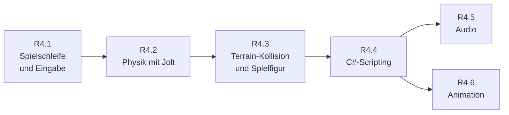
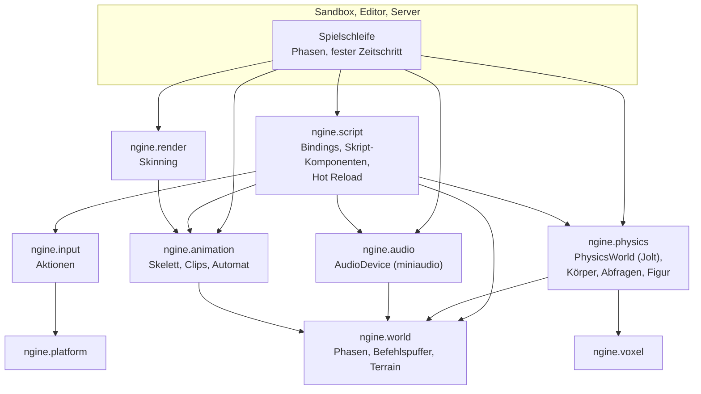

# R4: Gameplay-Systeme

- **Phase:** Konstruktion
- **Status:** geplant (Plan zur Abstimmung)
- **Pull Requests:** siehe Review

R4 ist der vierte Reifegrad der Konstruktion. Wie R1 bis R3 ist er zu groß für eine Iteration; wir
teilen ihn in sechs Iterationen, jede mit eigenem Dokument, eigenem PR und eigener Abnahme auf dem
PC. Dieses Dokument hält den Plan für den ganzen Reifegrad und am Ende sein Review.

## Plan

**Ziel:** Aus der Welt zum Ansehen wird eine Welt zum Spielen. Eine Spielfigur läuft über das
Voxel-Terrain, springt, gräbt und stößt Kisten um; starre Körper fallen und stoßen aneinander,
auch auf frisch gegrabenem Boden. Gameplay-Logik steht in C#-Skripten, die an Entities hängen, im
Inspector einstellbar sind, beim Speichern der Quelldatei neu laden und im Spielmodus des Editors
laufen. Die Welt klingt räumlich, und Figuren bewegen sich mit Skelett-Animation. Alles außer
Audio und Skinning läuft ohne Fenster und GPU, damit der dedizierte Server in R5 dieselbe
Simulation rechnet.

**Features:** PHYS-01, PHYS-02, PHYS-03, PHYS-04, VOX-08, SCR-01, SCR-02, SCR-03, SCR-04,
WORLD-02 (C#-Seite), WORLD-09, WORLD-10, EDIT-06 (Skripte im Spielmodus), PLAT-02 (Aktionen,
Gamepad), AUD-01, AUD-02, ANIM-01, ANIM-02, VOX-07 (Rest). Dazu die Schulden mit Frist R4: TD-29,
TD-32, TD-37, TD-38, TD-42, TD-45 und TD-46. Für UI-01 und UI-02 schlägt der Plan eine neue Frist
vor (siehe [Zur Abstimmung](#zur-abstimmung)).

### Aufteilung

| Iteration | Inhalt | Features und Schulden | Abnahme |
| --- | --- | --- | --- |
| R4.1 Spielschleife und Eingabe | Eine gemeinsame Spielschleife für Sandbox, Editor und Server: Phasen für Systeme (Eingabe, feste Simulation, Nachbereitung, Rendering) mit expliziter Reihenfolge, fester Zeitschritt für die Simulation mit Interpolation beim Zeichnen, Befehlspuffer für Strukturänderungen aus Systemen heraus. Eingabe als Aktionen (Tasten, Maus und Gamepad auf benannte Aktionen und Achsen abgebildet, Belegung als Datei). Fehlende Tasten in `editor_ui` und Kürzel der Voxel-Werkzeuge | WORLD-09, WORLD-10, PLAT-02, TD-42 | Ein System erzeugt und zerstört Entities über den Befehlspuffer (Test, auch unter ThreadSanitizer); die Simulation rechnet bei 30 und bei 240 Bildern pro Sekunde gleich viele Schritte pro Sekunde und dasselbe Ergebnis (Test); eine Aktion „Springen“ kommt von Tastatur und Gamepad; Kürzel der Pinsel im Editor |
| R4.2 Physik mit Jolt | Jolt hinter `ngine.physics` (`PhysicsWorld`), läuft auf dem Job-System der Engine und ohne GPU. Komponenten `RigidBody` und `Collider` (Kugel, Quader, Kapsel, konvexe Hülle und Dreiecksnetz aus dem gekochten Modell) in der Reflection, damit Editor, Szene und Prefabs sie kennen. Schritt in der festen Simulation, Lagen zurück in `Transform`. Strahl-, Form- und Überlappungsabfragen, Ebenen und Filter, Kontakt-Ereignisse über den `EventBus`. Formen als Debug-Zeichnen im Editor. Transforms parallel, wenn die Messung es lohnt | PHYS-01, PHYS-02, PHYS-04, TD-29 | Ein Stapel Kisten fällt im Editor im Spielmodus um und kommt beim Stoppen bitgenau zurück; Physik weit weg vom Ursprung (`--far`) zittert nicht; `--headless` rechnet dieselbe Szene; 2 000 bewegte Körper auf dem PC gemessen (Schritt der Physik, `update_transforms()`) |
| R4.3 Terrain-Kollision und Spielfigur | Kollisionsformen aus den Netzen der Chunks, gebaut in Jobs und nur dort, wo Körper oder Beobachter sind; nach einem Pinsel wird die Form des Chunks ersetzt und ruhende Körper wachen auf. Character Controller (Kapsel, Stufen, Hänge, Springen) und eine Spielfigur in der Sandbox mit Kamera in Ich- und Schulterperspektive, die läuft und gräbt. Materialtabelle des Terrains als Asset mit Reibung und Namen für Schrittgeräusche, im Editor bearbeitbar, Texturen über den Koch-Cache; mehr als acht Materialien pro Chunk | VOX-08, PHYS-03, VOX-07, TD-37, TD-38 | Die Figur läuft über Hügel und durch Höhlen, ohne durch den Boden zu fallen, auch beim Streamen neuer Chunks; Boden unter einer Kiste weggraben: Sie fällt; Zeit für das Bauen einer Form pro Chunk und Speicher gemessen; `--headless` lässt Körper auf Terrain fallen; ein neues Material entsteht im Editor ohne Neubauen |
| R4.4 C#-Scripting | Bindings aus der Reflection erzeugt: Komponenten als C#-Structs, Entity-API (`entity.Get<T>()`, `Set`, Hierarchie, Abfragen), dazu Eingabe-Aktionen, Physik-Abfragen, Ereignisse und Log. Skript-Komponenten: C#-Klassen hängen an Entities, ihre Felder erscheinen im Inspector und in der Szene. Hot Reload: Ändert sich eine `.cs`-Datei, baut die Engine neu, entlädt, lädt und stellt die Feldwerte wieder her. Skripte laufen im Spielmodus des Editors und auf dem Server. Prefabs mit entfernten Knoten und verschachtelt | SCR-01, SCR-02, SCR-03, SCR-04, WORLD-02, EDIT-06, TD-32 | Die Steuerung der Spielfigur und eine Laterne, die man an- und ausschaltet, sind C#-Skripte; ein Wert im Skript ändern und speichern: Im laufenden Spiel gilt er ohne Neustart, Feldwerte bleiben; eine neue Komponente in C++ ist nach dem Bauen in C# da, ohne Handarbeit; Kosten von 10 000 Skript-Updates pro Frame gemessen; Build ohne .NET-SDK geht weiter |
| R4.5 Audio | miniaudio hinter `ngine.audio` (`AudioDevice`). Klänge als Assets mit `.meta` (kurze im Speicher, lange als Strom), Komponenten `AudioSource` und `AudioListener`, 3D-Klang mit Abschwächung und Doppler, Busse für Lautstärken (Musik, Effekte). Ohne Gerät und im Server läuft ein Null-Gerät. Aus C# abspielbar | AUD-01, AUD-02 | Schritte je nach Terrain-Material, eine Klangquelle in der Welt ist geortet und wird mit Abstand leiser; `--headless` und die CI laufen ohne Audio-Gerät; kein Knacken beim Streamen des Terrains (Mischen im eigenen Thread, auf dem PC geprüft) |
| R4.6 Animation | Skelette, Skins und Clips aus glTF, gekocht. Abtasten und Mischen in Jobs, Zustandsautomat mit Übergängen und einem 1D-Blend (Stehen, Gehen, Laufen), aus C# gesteuert. Skinning auf der GPU vor dem Zeichnen, sodass Meshlets, Culling, Schatten und der Rückfallpfad unverändert bleiben. Instanzen dauerhaft auf der GPU, Zähler und GPU-Zeiten je Pass im Statistikfenster | ANIM-01, ANIM-02, TD-45, TD-46 | Eine animierte Figur läuft über das Terrain, Übergänge ohne Sprung; Mesh-Shader-Pfad und `--baseline` zeigen dasselbe Bild (CI über lavapipe); 200 animierte Figuren auf dem PC gemessen; der Server rechnet Posen nur, wo Gameplay sie braucht |

Nicht in R4, damit der Reifegrad in überschaubarer Zeit fertig wird:

- **Spiel-UI** (UI-01, UI-02): HUD und Menüs braucht erst der Prototyp. In R4 reichen der
  Debug-Text und ein Fadenkreuz über die Zeichenliste. Vorschlag: nach R5, die Evaluation
  entscheidet über Bibliothek und Zeitpunkt.
- **Replikation von Physik, Skripten und Animation** (NET-04, NET-05): in R5. R4 legt dafür nur
  die Grundlage: fester Zeitschritt, Simulation ohne GPU, Eingabe als Aktionen.
- **Hall und Verdeckung** (AUD-03), **Inverse Kinematik** (ANIM-03), **Navigation und KI**
  (AI-01, AI-02), **Statik** (VOX-10): später.
- **Schatten der Taschenlampe** (TD-25): bleibt in R6; kann als einzelne Iteration vorgezogen
  werden, wenn die Laterne aus R4.4 sie braucht.
- **Fahrzeuge, Ragdolls, Gelenke, Stoff:** Jolt kann sie; wir bauen sie, wenn das Spiel sie
  braucht.

### Entwurf

- **Spielschleife:** Bisher ruft jede App `Schedule::run()` und `update_transforms()` selbst auf.
  Neu gibt es Phasen: Eingabe, feste Simulation (keinmal oder mehrmals pro Bild, Vorschlag 60 Hz),
  Nachbereitung (Transforms, Animation, Audio), Rendering. Physik, Skripte mit `FixedUpdate` und
  später die Netzwerk-Ticks laufen in der festen Simulation; gezeichnet wird zwischen den letzten
  beiden Schritten interpoliert. Der Befehlspuffer sammelt Strukturänderungen pro Thread und führt
  sie am Ende der Phase in fester Reihenfolge aus, damit die Simulation reproduzierbar bleibt.
- **Physik:** Nur der Adapter in `ngine.physics` kennt Jolt. Die Welt bleibt die Quelle der
  Wahrheit für das, was gespeichert wird (`Transform`, `RigidBody`, `Collider`); Jolt hält den
  Zustand der Simulation. Dynamische Körper schreiben nach jedem Schritt ihre Lage in
  `Transform`, kinematische lesen sie. Jolt rechnet über einen Adapter auf `ngine.jobs`, damit
  nicht zwei Thread-Pools um die Kerne streiten (Erkenntnis aus R3.3). Positionen in 64 Bit: Jolt
  mit doppelter Genauigkeit für Positionen, passend zu [ADR 0012](../adr/0012-64bit-world-coordinates.md).
- **Terrain-Kollision:** Die Form eines Chunks ist ein Dreiecksnetz aus dem Netz der Stufe 0, das
  der Mesher ohnehin baut; ein Höhenfeld scheidet wegen Höhlen und Überhängen aus. Formen
  entstehen in Jobs und nur in einem Radius um Körper und Beobachter (Vorschlag: ein Beobachter der
  Physik wie `TerrainObserver`). Körper außerhalb geladener Kollision schlafen, statt zu fallen.
  Grobe Stufen bekommen keine Kollision.
- **Scripting:** Ein Werkzeug erzeugt beim Bauen aus der `TypeRegistry` die C#-Structs der
  Komponenten (blittable, gleiche Anordnung wie in C++, geprüft durch einen Test) und die Aufrufe
  der Engine-API über `NativeApi`. Zugriff ohne Kopie wie in D2. Skript-Klassen meldet die
  C#-Seite mit ihren Feldern bei der Engine an; die Engine führt sie als Komponente `Script` mit
  Klassenname und Feldwerten, sodass Inspector, Szene, Prefabs und Undo sie ohne Sonderweg
  behandeln. Hot Reload nutzt den `FileWatcher` und `dotnet build` im Hintergrund; Feldwerte
  überleben über dieselbe Serialisierung. Ein ausgeliefertes Spiel braucht nur die Laufzeit, kein
  SDK.
- **Audio:** miniaudio mischt in seinem eigenen Thread; die Engine schickt ihm Befehle über eine
  Warteschlange ohne Sperren. Klänge sind Assets des Ressourcen-Managers. Der Server baut
  `ngine.audio` gar nicht ein, die CI nutzt das Null-Gerät.
- **Animation:** Abtasten und Mischen rechnet `ngine.animation` ohne GPU. Ein Compute-Pass schreibt
  die verformten Eckpunkte vor dem Zeichnen in den gemeinsamen Geometriepuffer; danach sieht der
  Renderer ein gewöhnliches Netz, dessen Meshlet-Hüllen um den Bewegungsspielraum vergrößert sind.
  So bleibt es bei einem Zeichenpfad ([ADR 0043](../adr/0043-gpu-driven-meshlets.md)).
- Voraussichtliche ADRs: Spielschleife mit Phasen und festem Zeitschritt (R4.1), Physik mit Jolt
  und Weltpositionen (R4.2), Kollision des Terrains (R4.3), C#-Bindings und Skript-Komponenten
  (R4.4), Audio mit miniaudio (R4.5), Animation und Skinning (R4.6).

### Leitlinien für alle sechs Iterationen

- Spielschleife, Physik, Skripte und das Rechnen der Animation laufen ohne Fenster und GPU und
  sind so getestet. `--headless` simuliert die Demo-Szene.
- Jede Iteration ist in Sandbox und Editor sichtbar. Die Sandbox bekommt eine Szene „Spielplatz“
  auf dem endlosen Terrain, die mit jeder Iteration wächst: Kisten, Spielfigur, Skripte, Klang,
  animierte Figur.
- Jede neue Komponente steht in der Reflection und ist damit im Inspector bearbeitbar, in Szenen
  und Prefabs speicherbar, in C# sichtbar und für R5 replizierbar.
- Leistung wird in jeder Iteration auf dem PC gemessen und im Iterationsdokument festgehalten.
  Was im Hauptthread pro Entity läuft, wird mit tausenden Entities gemessen (Erkenntnis aus R3).
- Neue Systeme laufen unter ThreadSanitizer (`[physics]`, `[animation]` kommen zu den Tests des
  Presets `linux-clang-tsan`).

**Risiken:**

- **Jolt und 64-Bit-Positionen:** Der vcpkg-Port baut vielleicht nur mit einfacher Genauigkeit.
  Gegenmittel: zuerst in R4.2 prüfen; Rückfall ist ein eigener Port im Repository oder ein
  verschiebbarer Ursprung der Physik-Welt.
- **Jolt, Module und MSVC:** Die Header von Jolt sind groß und voller Makros. Gegenmittel: nur im
  Adapter einbinden, Pimpl, früh auf Windows bauen.
- **Kollision beim Streaming:** Eine Form fehlt, während ein Körper schon da ist, oder der Tausch
  nach einem Pinsel lässt Körper durchfallen. Gegenmittel: Körper schlafen ohne Kollision unter
  sich; Formen der Chunks um die Figur haben Vorrang; deterministische Tests (Körper auf Chunk,
  der gerade ersetzt wird).
- **Bindings und Anordnung im Speicher:** C#-Structs müssen Byte für Byte zu C++ passen, auch mit
  `math::Affine`, `AssetRef` und Texten. Gegenmittel: Größen und Offsets aus der Reflection in
  einem Test gegen C# prüfen; Felder, die nicht blittable sind, über Zugriffsfunktionen.
- **Hot Reload mit Zustand:** Entladen scheitert still, wenn die Engine noch Verweise auf
  Skript-Objekte hält (schon in D2). Gegenmittel: Engine hält nur Kennungen, Test auf Freigabe wie
  in D2, Neuladen im Spielmodus als eigener Test.
- **Audio in der CI und unter Linux:** Geräte fehlen oder verhalten sich je nach PipeWire,
  PulseAudio und ALSA anders. Gegenmittel: Null-Gerät in Tests, Test auf dem Notebook und dem PC.
- **Skinning und Meshlets:** Hüllen verformter Meshlets stimmen nicht, Figuren verschwinden am
  Bildrand. Gegenmittel: Hüllen vergrößern, Bildvergleich beider Pfade in der CI.
- **Umfang:** Sechs Iterationen mit drei neuen Bibliotheken sind mehr als in R3. Gegenmittel:
  R4.5 und R4.6 hängen nur an R4.4 und lassen sich tauschen oder einzeln verschieben.

**Abnahme:** die Abnahmen der sechs Iterationen, dazu am Ende ein Review des ganzen Reifegrads mit
Architektur-Review und einem kurzen Szenario auf dem PC: Editor öffnen, Szene „Spielplatz“ laden,
Spielen starten, mit der Figur über das Terrain in eine Höhle laufen, den Boden unter einer Kiste
weggraben, die Laterne schalten, Schritte und eine Klangquelle hören, ein Skript bei laufendem
Spiel ändern, stoppen: Die Welt ist wie vorher. Dasselbe mit Gamepad in der Sandbox und mit
`--headless` ohne Fehler.

### Zur Abstimmung

1. **Reihenfolge:** Vorschlag ist Spielschleife, Physik, Terrain-Kollision mit Spielfigur,
   Scripting, dann Audio und Animation. Die Spielschleife zuerst, weil Physik, Skripte und R5 den
   festen Zeitschritt brauchen. Physik vor Scripting, weil die Kollision mit dem streamenden
   Terrain das größte Risiko ist und die Bindings dann gleich etwas zum Anbinden haben. Audio und
   Animation zuletzt, weil sie am wenigsten Abhängige haben.
2. **Sechs Iterationen** statt fünf. Alternative: Animation ganz hinter R5 schieben, weil der
   Server sie kaum braucht; dann fehlt der Evaluation nach R5 aber ein Kernsystem.
3. **Fester Zeitschritt von 60 Hz** für die Simulation mit Interpolation beim Zeichnen. Der
   Netzwerk-Tick aus D3 (30 Hz) bleibt davon getrennt und wird in R5 festgelegt.
4. **Jolt mit doppelter Genauigkeit** für Positionen statt eines verschiebbaren Ursprungs. Kostet
   laut Jolt wenige Prozent, passt aber ohne Sonderfälle zu ADR 0012 und zu mehreren Spielern, die
   weit auseinander stehen. Bitgleiche Physik zwischen Plattformen schalten wir nicht ein: Der
   Server ist autoritativ ([ADR 0007](../adr/0007-server-authoritative-multiplayer.md)), und die
   Option kostet Leistung.
5. **Animation selbst bauen** (Abtasten, Mischen, Zustandsautomat) statt ozz-animation. Der Import
   aus glTF, das Kochen und das Skinning sind ohnehin eigene Arbeit, der Rest ist überschaubar
   und lehrreich; ozz-animation bleibt der Rückfall.
6. **Skript-Felder im Inspector und Hot Reload über `dotnet build`:** Zum Entwickeln braucht es
   das .NET-SDK, zum Spielen nur die Laufzeit. Alternative wäre Roslyn in der Engine; das ist
   schneller beim Neuladen, aber deutlich mehr Gewicht.
7. **Neue Fristen:** Spiel-UI (UI-01, UI-02) nach R5; die Evaluation entscheidet. TD-29
   (Transforms parallel) bauen wir in R4.2 nur ab, wenn die Messung mit 2 000 Körpern es lohnt,
   sonst wird die Frist „bei Bedarf“.
8. **Demo-Szene „Spielplatz“** in der Sandbox als roter Faden und Abnahme-Szenario. Modelle und
   Klänge dafür brauchen freie Lizenzen (CC0); Vorschläge kommen mit den Iterationen, die sie
   brauchen.
