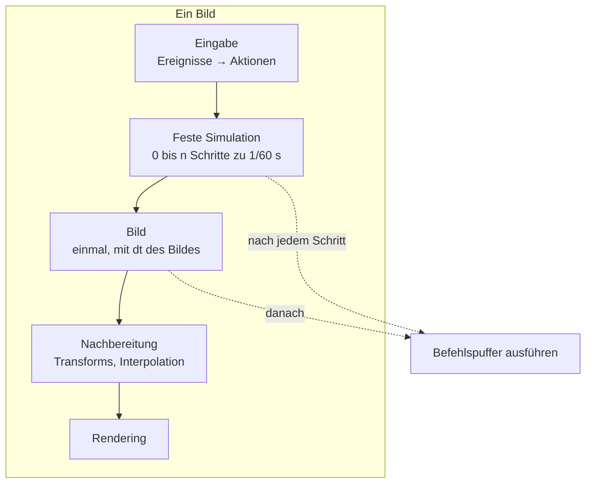

# R4.1: Spielschleife und Eingabe

- **Phase:** Konstruktion (Reifegrad [R4](R4-gameplay-systeme.md))
- **Status:** geplant (Plan zur Abstimmung)
- **Pull Requests:** folgen

## Plan

**Ziel:** Sandbox, Editor und Server treiben die Welt über dieselbe Spielschleife: Systeme laufen
in Phasen mit klarer Reihenfolge, die Simulation rechnet mit festem Zeitschritt unabhängig von der
Bildrate, und Systeme dürfen Entities über einen Befehlspuffer anlegen und zerstören. Eingaben
kommen als benannte Aktionen von Tastatur, Maus und Gamepad. Das ist die Grundlage für Physik
(R4.2), Skripte (R4.4) und die Netzwerk-Ticks (R5).

**Features:** WORLD-09 (Befehlspuffer), WORLD-10 (Phasen), PLAT-02 (Aktionen, Gamepad). Schulden:
TD-42 (Tastenkürzel der Voxel-Werkzeuge).

### Entwurf

**Phasen** (`ngine.world`, WORLD-10)

- `Schedule::add()` bekommt in `SystemOptions` eine Phase (`Phase::Fixed`, `Phase::Frame`,
  `Phase::Late`) und optional `after` mit dem Namen eines Systems. `Schedule::run(jobs, phase)`
  führt nur die Systeme einer Phase aus. Innerhalb einer Phase gilt weiter
  [ADR 0019](../adr/0019-systems-on-job-system.md): Zugriffe ergeben die Abhängigkeiten, Systeme
  ohne Konflikt laufen parallel; `after` erzwingt eine Reihenfolge auch ohne Konflikt.
- `world::Time` ist ein Wert der Welt, den Systeme lesen: Zeitschritt der Phase, Zeit seit Start,
  Nummer des festen Schritts (`tick`), Anteil `alpha` zwischen den letzten beiden Schritten. Die
  Demos fangen dafür heute eine Variable `delta` per Referenz ein; das entfällt.

**Spielschleife** (`ngine.world`, neue Partition `:simulation`)

- `Simulation` besitzt den Schedule und eine Uhr. `advance(dt)` sammelt Zeit an und rechnet so
  viele feste Schritte zu 1/60 s, wie hineinpassen, höchstens vier pro Bild (danach verfällt der
  Rest, damit ein langsames Bild nicht immer mehr Schritte nach sich zieht). Dann läuft die Phase
  `Frame` einmal, dann `Late`, dann `update_transforms()`.
- **Interpolation:** Entities mit der Komponente `Interpolated` merken sich die Lage vor dem
  letzten festen Schritt. Nach `update_transforms()` mischt ein System ihre `WorldTransform` mit
  `alpha` zwischen alter und neuer Lage. Gespeichert und später repliziert wird immer die Lage der
  Simulation, nie die gemischte. Ohne die Komponente springt eine Entity von Schritt zu Schritt;
  Physik-Körper bekommen sie in R4.2 von selbst.
- Pause, Zeitlupe (`time_scale`) und Einzelschritt gehören zur Uhr. Der Editor bekommt neben
  Spielen, Pause und Stopp einen Knopf für einen einzelnen Schritt.
- Sandbox (`scene_demo`, `model_scene`, Voxel-Demo), Editor (Spielmodus) und `--server` ziehen
  auf `Simulation` um. Kreisende Lichter und Würfel laufen in `Phase::Fixed` mit Interpolation,
  die freie Kamera in `Phase::Frame`.

**Befehlspuffer** (`ngine.world`, WORLD-09)

- Ein System nimmt `Commands&` als ersten Parameter und kann damit Entities anlegen (auch aus
  einem Prefab), zerstören, Komponenten setzen und entfernen. Angelegte Entities bekommen sofort
  einen vorläufigen Griff, den spätere Befehle desselben Systems benutzen können.
- Jeder Job schreibt in einen eigenen Puffer aus dem Frame-Allokator. Nach der Phase führt der
  Hauptthread alle Puffer aus, sortiert nach System, Chunk und Zeile, also in derselben
  Reihenfolge, egal wie die Jobs verteilt waren. Das hält die Simulation reproduzierbar (Tests,
  Vorhersage in R5).
- Werte liegen als Bytes mit `TypeInfo` im Puffer, wie bei den Befehlen des Editors
  ([ADR 0030](../adr/0030-undo-commands-reflected-values.md)).

**Eingabe** (neues Modul `ngine.input`, PLAT-02)

- `ngine.platform` meldet neu Gamepads: Anstecken und Abziehen, Tasten, Achsen und Trigger über
  die Gamepad-Schnittstelle von SDL3 (einheitliche Belegung nach Xbox-Schema). Dazu die fehlenden
  Tasten (Klammern, Komma, Punkt, Minus, Plus).
- `ActionMap` bildet Quellen auf benannte Aktionen ab: Tasten (`jump`), Achsen (`look_x`) und
  Paare von Achsen (`move`), mit toter Zone und Empfindlichkeit. Mehrere Quellen pro Aktion, z. B.
  WASD und linker Stick für `move`. Die Belegung ist eine JSON-Datei über die Reflection
  (`assets/eingabe/standard.input`), im laufenden Betrieb neu ladbar.
- `ActionState` hält pro Aktion Wert, „gedrückt“, „gerade gedrückt“ und „gerade losgelassen“. Für
  die feste Simulation bleiben Flanken stehen, bis ein fester Schritt sie gesehen hat: Ein kurzer
  Tastendruck geht bei niedriger Bildrate nicht verloren und zählt bei hoher nicht doppelt.
- `ngine.input` hängt nur an Core und den Ereignistypen der Plattform und läuft ohne Fenster:
  Tests füttern Ereignisse direkt, der Server bekommt in R5 die Aktionen der Clients übers Netz.
- Die freie Kamera von Sandbox und Editor liest Aktionen statt Tasten und fliegt damit auch per
  Gamepad.

**Editor** (TD-42)

- `editor_ui::Key` bekommt B, Ziffern und Klammern. Kürzel der Voxel-Werkzeuge: B schaltet den
  Pinsel, 1 bis 5 wählen den Modus, `[` und `]` ändern den Radius.

### Schritte

1. Phasen, `Time` und `Simulation` mit festem Zeitschritt und Interpolation; Apps ziehen um.
2. Befehlspuffer mit Tests unter ThreadSanitizer.
3. Gamepad in der Plattform, `ngine.input` mit Belegung aus Datei, freie Kamera über Aktionen,
   Tastenkürzel im Editor.
4. ADR 0044 (Spielschleife, Phasen, fester Zeitschritt, Befehlspuffer), Architektur,
   Feature-Katalog, Schuldenregister.

**Risiken:**

- **Ruckeln trotz Interpolation**, wenn Bildrate und 60 Hz knapp nebeneinander liegen oder eine
  Entity ohne `Interpolated` bewegt wird. Gegenmittel: Test mit künstlichen Bildzeiten,
  Sichtprüfung auf dem PC bei 60 und 144 Hz mit und ohne VSync.
- **Interpolation und Änderungserkennung:** Die gemischte `WorldTransform` darf die Erkennung
  geänderter Teilbäume nicht jedes Bild auslösen und Kinder müssen mitziehen. Gegenmittel:
  Mischen als eigener Schritt nach `update_transforms()` nur für bewegte Entities, Test mit
  Kind an interpoliertem Elternteil.
- **Befehlspuffer und flecs:** Vorläufige Griffe müssen beim Ausführen auf echte Kennungen
  umgeschrieben werden. Gegenmittel: Tabelle pro Puffer, Test mit Anlegen und Benutzen im selben
  System.
- **Gamepad in der CI:** Es gibt kein Gerät. Gegenmittel: `ngine.input` wird über Ereignisse
  getestet, der SDL-Teil auf dem PC und dem Notebook.
- **MSVC:** neue Vorlagen im Schedule (`Commands&` als Parameter) über Partitionsgrenzen.
  Gegenmittel: früh einen kleinen PR durch die Windows-CI schicken.

**Abnahme:**

- Ein System erzeugt und zerstört Entities über den Befehlspuffer; die Reihenfolge der
  Ausführung ist bei 1 und bei 16 Threads gleich (Test, auch unter ThreadSanitizer).
- Dieselbe Szene ergibt nach zwei Sekunden bei 30 und bei 240 Bildern pro Sekunde 120 feste
  Schritte und bitgleiche Komponenten (Test ohne GPU).
- `--headless` und `--server` laufen über dieselbe `Simulation`.
- Auf dem PC: Die kreisenden Lichter laufen bei 60 und 144 Hz gleich schnell und ohne Ruckeln;
  Einzelschritt im Editor; die freie Kamera fliegt mit Tastatur und Maus wie bisher und mit dem
  Gamepad; die Belegung in der Datei ändern wirkt ohne Neustart; Kürzel der Pinsel im Editor.

### Zur Abstimmung

1. **Ort:** Phasen, Befehlspuffer und `Simulation` in `ngine.world`, Eingabe als neues Modul
   `ngine.input`. Ein eigenes Modul für die Schleife lohnt erst, wenn sie mehr als die Welt
   treibt.
2. **Interpolation nur für Entities mit `Interpolated`** statt für alle: Die meisten Entities
   stehen still, und die Erkennung geänderter Teilbäume bleibt billig.
3. **Höchstens vier feste Schritte pro Bild**, danach läuft das Spiel langsamer statt zu hängen
   (unter 15 Bildern pro Sekunde).
4. **Gamepad:** Vorschlag ist das Xbox-Schema von SDL3. Zum Testen auf dem PC brauchst du ein
   Gamepad; hast du keines, prüfen wir den Teil nur über Tests und holen die Sichtprüfung nach.

## Review

Folgt nach dem letzten Merge.
