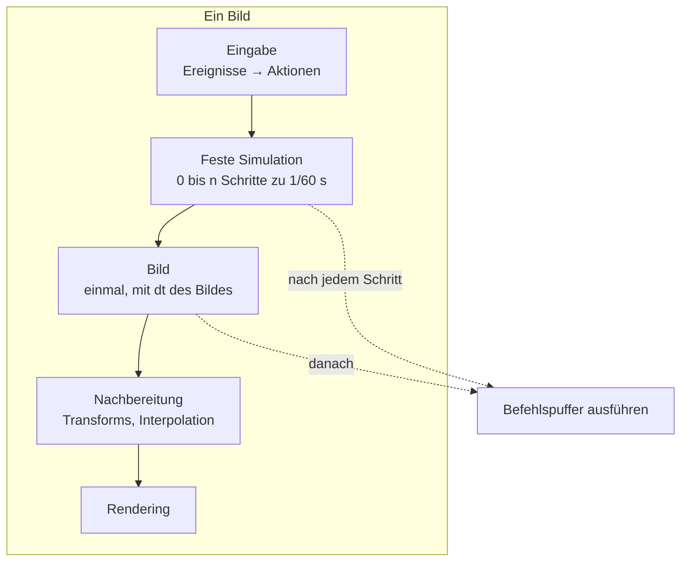

# R4.1: Spielschleife und Eingabe

- **Phase:** Konstruktion (Reifegrad [R4](R4-gameplay-systeme.md))
- **Status:** abgeschlossen (Plan abgestimmt in #47)
- **Pull Requests:** [#49](https://github.com/viiez/ngine/pull/49)

## Plan

**Ziel:** Sandbox, Editor und Server treiben die Welt über dieselbe Spielschleife: Systeme laufen
in Phasen mit klarer Reihenfolge, die Simulation rechnet mit festem Zeitschritt unabhängig von der
Bildrate, und Systeme dürfen Entities über einen Befehlspuffer anlegen und zerstören. Eingaben
kommen als benannte Aktionen von Tastatur, Maus und Gamepad. Das ist die Grundlage für Physik
(R4.2), Skripte (R4.4) und die Netzwerk-Ticks (R5).

**Features:** WORLD-09 (Befehlspuffer), WORLD-10 (Phasen), PLAT-02 (Aktionen, Gamepad). Schulden:
TD-42 (Tastenkürzel der Voxel-Werkzeuge).

### Entwurf

**Phasen** (`ngine.world`, WORLD-10)

- `Schedule::add()` bekommt in `SystemOptions` eine Phase (`Phase::Fixed`, `Phase::Frame`,
  `Phase::Late`) und optional `after` mit dem Namen eines Systems. `Schedule::run(jobs, phase)`
  führt nur die Systeme einer Phase aus. Innerhalb einer Phase gilt weiter
  [ADR 0019](../adr/0019-systems-on-job-system.md): Zugriffe ergeben die Abhängigkeiten, Systeme
  ohne Konflikt laufen parallel; `after` erzwingt eine Reihenfolge auch ohne Konflikt.
- `world::Time` ist ein Wert der Welt, den Systeme lesen: Zeitschritt der Phase, Zeit seit Start,
  Nummer des festen Schritts (`tick`), Anteil `alpha` zwischen den letzten beiden Schritten. Die
  Demos fangen dafür heute eine Variable `delta` per Referenz ein; das entfällt.

**Spielschleife** (`ngine.world`, neue Partition `:simulation`)

- `Simulation` besitzt den Schedule und eine Uhr. `advance(dt)` sammelt Zeit an und rechnet so
  viele feste Schritte zu 1/60 s, wie hineinpassen, höchstens vier pro Bild (danach verfällt der
  Rest, damit ein langsames Bild nicht immer mehr Schritte nach sich zieht). Dann läuft die Phase
  `Frame` einmal, dann `Late`, dann `update_transforms()`.
- **Interpolation:** Entities mit der Komponente `Interpolated` merken sich die Lage vor dem
  letzten festen Schritt. Nach `update_transforms()` mischt ein System ihre `WorldTransform` mit
  `alpha` zwischen alter und neuer Lage. Gespeichert und später repliziert wird immer die Lage der
  Simulation, nie die gemischte. Ohne die Komponente springt eine Entity von Schritt zu Schritt;
  Physik-Körper bekommen sie in R4.2 von selbst.
- Pause, Zeitlupe (`time_scale`) und Einzelschritt gehören zur Uhr. Der Editor bekommt neben
  Spielen, Pause und Stopp einen Knopf für einen einzelnen Schritt.
- Sandbox (`scene_demo`, `model_scene`, Voxel-Demo), Editor (Spielmodus) und `--server` ziehen
  auf `Simulation` um. Kreisende Lichter und Würfel laufen in `Phase::Fixed` mit Interpolation,
  die freie Kamera in `Phase::Frame`.

**Befehlspuffer** (`ngine.world`, WORLD-09)

- Ein System nimmt `Commands&` als ersten Parameter und kann damit Entities anlegen (auch aus
  einem Prefab), zerstören, Komponenten setzen und entfernen. Angelegte Entities bekommen sofort
  einen vorläufigen Griff, den spätere Befehle desselben Systems benutzen können.
- Jeder Job schreibt in einen eigenen Puffer aus dem Frame-Allokator. Nach der Phase führt der
  Hauptthread alle Puffer aus, sortiert nach System, Chunk und Zeile, also in derselben
  Reihenfolge, egal wie die Jobs verteilt waren. Das hält die Simulation reproduzierbar (Tests,
  Vorhersage in R5).
- Werte liegen als Bytes mit `TypeInfo` im Puffer, wie bei den Befehlen des Editors
  ([ADR 0030](../adr/0030-undo-commands-reflected-values.md)).

**Eingabe** (neues Modul `ngine.input`, PLAT-02)

- `ngine.platform` meldet neu Gamepads: Anstecken und Abziehen, Tasten, Achsen und Trigger über
  die Gamepad-Schnittstelle von SDL3 (einheitliche Belegung nach Xbox-Schema). Dazu die fehlenden
  Tasten (Klammern, Komma, Punkt, Minus, Plus).
- `ActionMap` bildet Quellen auf benannte Aktionen ab: Tasten (`jump`), Achsen (`look_x`) und
  Paare von Achsen (`move`), mit toter Zone und Empfindlichkeit. Mehrere Quellen pro Aktion, z. B.
  WASD und linker Stick für `move`. Die Belegung ist eine JSON-Datei über die Reflection
  (`assets/eingabe/standard.input`), im laufenden Betrieb neu ladbar.
- `ActionState` hält pro Aktion Wert, „gedrückt“, „gerade gedrückt“ und „gerade losgelassen“. Für
  die feste Simulation bleiben Flanken stehen, bis ein fester Schritt sie gesehen hat: Ein kurzer
  Tastendruck geht bei niedriger Bildrate nicht verloren und zählt bei hoher nicht doppelt.
- `ngine.input` hängt nur an Core und den Ereignistypen der Plattform und läuft ohne Fenster:
  Tests füttern Ereignisse direkt, der Server bekommt in R5 die Aktionen der Clients übers Netz.
- Die freie Kamera von Sandbox und Editor liest Aktionen statt Tasten und fliegt damit auch per
  Gamepad.

**Editor** (TD-42)

- `editor_ui::Key` bekommt B, Ziffern und Klammern. Kürzel der Voxel-Werkzeuge: B schaltet den
  Pinsel, 1 bis 5 wählen den Modus, `[` und `]` ändern den Radius.

### Schritte

1. Phasen, `Time` und `Simulation` mit festem Zeitschritt und Interpolation; Apps ziehen um.
2. Befehlspuffer mit Tests unter ThreadSanitizer.
3. Gamepad in der Plattform, `ngine.input` mit Belegung aus Datei, freie Kamera über Aktionen,
   Tastenkürzel im Editor.
4. ADR 0044 (Spielschleife, Phasen, fester Zeitschritt, Befehlspuffer), Architektur,
   Feature-Katalog, Schuldenregister.

**Risiken:**

- **Ruckeln trotz Interpolation**, wenn Bildrate und 60 Hz knapp nebeneinander liegen oder eine
  Entity ohne `Interpolated` bewegt wird. Gegenmittel: Test mit künstlichen Bildzeiten,
  Sichtprüfung auf dem PC bei 60 und 144 Hz mit und ohne VSync.
- **Interpolation und Änderungserkennung:** Die gemischte `WorldTransform` darf die Erkennung
  geänderter Teilbäume nicht jedes Bild auslösen und Kinder müssen mitziehen. Gegenmittel:
  Mischen als eigener Schritt nach `update_transforms()` nur für bewegte Entities, Test mit
  Kind an interpoliertem Elternteil.
- **Befehlspuffer und flecs:** Vorläufige Griffe müssen beim Ausführen auf echte Kennungen
  umgeschrieben werden. Gegenmittel: Tabelle pro Puffer, Test mit Anlegen und Benutzen im selben
  System.
- **Gamepad in der CI:** Es gibt kein Gerät. Gegenmittel: `ngine.input` wird über Ereignisse
  getestet, der SDL-Teil auf dem PC und dem Notebook.
- **MSVC:** neue Vorlagen im Schedule (`Commands&` als Parameter) über Partitionsgrenzen.
  Gegenmittel: früh einen kleinen PR durch die Windows-CI schicken.

**Abnahme:**

- Ein System erzeugt und zerstört Entities über den Befehlspuffer; die Reihenfolge der
  Ausführung ist bei 1 und bei 16 Threads gleich (Test, auch unter ThreadSanitizer).
- Dieselbe Szene ergibt nach zwei Sekunden bei 30 und bei 240 Bildern pro Sekunde 120 feste
  Schritte und bitgleiche Komponenten (Test ohne GPU).
- `--headless` und `--server` laufen über dieselbe `Simulation`.
- Auf dem PC: Die kreisenden Lichter laufen bei 60 und 144 Hz gleich schnell und ohne Ruckeln;
  Einzelschritt im Editor; die freie Kamera fliegt mit Tastatur und Maus wie bisher und mit dem
  Gamepad; die Belegung in der Datei ändern wirkt ohne Neustart; Kürzel der Pinsel im Editor.

### Zur Abstimmung

1. **Ort:** Phasen, Befehlspuffer und `Simulation` in `ngine.world`, Eingabe als neues Modul
   `ngine.input`. Ein eigenes Modul für die Schleife lohnt erst, wenn sie mehr als die Welt
   treibt.
2. **Interpolation nur für Entities mit `Interpolated`** statt für alle: Die meisten Entities
   stehen still, und die Erkennung geänderter Teilbäume bleibt billig.
3. **Höchstens vier feste Schritte pro Bild**, danach läuft das Spiel langsamer statt zu hängen
   (unter 15 Bildern pro Sekunde).
4. **Gamepad:** Vorschlag ist das Xbox-Schema von SDL3. Zum Testen auf dem PC brauchst du ein
   Gamepad; hast du keines, prüfen wir den Teil nur über Tests und holen die Sichtprüfung nach.

## Stand

- Umgesetzt: Schritte 1 bis 4 ([ADR 0044](../adr/0044-game-loop-phases-fixed-step-commands.md)).
- Lokal (Cloud-Container, Clang 20, Debug): Build ohne Warnungen, alle 355 Tests grün, dazu
  `--headless --frames 600` (600 feste Schritte, 10 s simuliert, 2018 Entities in 15 ms),
  `--scene-demo`, `--net-demo`, `--server` mit `--client` und Sandbox und Editor im virtuellen
  Fenster (lavapipe); Spielen und Stoppen im Editor lässt die Szene textgleich. ThreadSanitizer
  (`[jobs],[memory],[world],[voxel]`) dreimal ohne Befund.
- Tests ohne GPU: Befehle legen Entities mit vorläufigen Griffen an, setzen Werte (auch
  `std::string`), hängen um, zerstören, entfernen und legen Prefabs an; Befehle an zerstörte
  Entities entfallen; die Reihenfolge ist bei 1 und 16 Threads gleich. Phasen laufen getrennt,
  `after` ordnet. Dieselbe Szene ergibt bei 30, 144 und 240 Bildern pro Sekunde 120 feste Schritte
  und bitgleiche Komponenten. Höchstens vier Schritte pro Bild, Pause, Einzelschritt, Zeitlupe.
  Interpolation mischt nur `Interpolated`, Kinder ziehen mit, ein weiterer `update_transforms()`
  lässt die Mischung stehen, ruhende Entities kosten keine Neuberechnung, gespeichert wird die
  Lage der Simulation. Eingabe: Belegung aus der Datei gleich der eingebauten, unbekannte Quellen
  sind Fehler, `jump` von Tastatur und Gamepad, `move` mit toter Zone und Begrenzung, `look` von
  Maus und Stick, kurze Drücke zählen in der festen Simulation genau einmal, Fokusverlust lässt
  los, neue Belegung behält gehaltene Tasten.
- Abweichungen vom Plan:
  - Die Mischung ersetzt `Transform` kurz vor `update_transforms()` und nimmt die Ersetzung ohne
    Meldung an die Änderungserkennung zurück, statt `WorldTransform` danach zu mischen. So ziehen
    Kinder über die vorhandene Propagation mit (ADR 0044).
  - Befehlspuffer nutzen eigene Blöcke, die über Läufe erhalten bleiben, statt des
    Frame-Allokators: Der hat eine feste Kapazität, und Werte wie `std::string` dürfen nicht
    umziehen.
  - Die Reflection kennt keine Listen; die Liste der Aktionen und ihrer Quellen liest
    `ActionMap::parse()` selbst, jedes Element über die Reflection.
  - `ngine.platform` baut ohne `NGINE_WITH_WINDOW` jetzt immer, ohne SDL3 nur mit den Typen der
    Ereignisse, damit `ngine.input` und der Server ohne Fenster bauen. `.input` ist eine neue Art
    in der Asset-Datenbank.
  - Die freie Kamera rechnet weiter in `ModelScene::update()` mit der Bildzeit statt als System
    in `Phase::Frame`; als System lohnt sie mit der Spielfigur (R4.3).
  - `--headless` rechnet jetzt die Welt der Szenen-Demo über die Spielschleife (60 Bilder, mit
    `--frames` mehr) statt sich sofort zu beenden.
- Abnahme auf dem PC bestanden (siehe Review).

## Review

**Ergebnis:** Sandbox, Editor und Server laufen über eine gemeinsame Spielschleife
(`world::Simulation`). Systeme stehen in Phasen (feste Simulation, Bild, Nachbereitung) mit
expliziter Reihenfolge über `after`; die feste Simulation rechnet mit 1/60 s, höchstens vier
Schritte pro Bild, und gezeichnet wird zwischen den letzten beiden Schritten gemischt, aber nur für
Entities mit `Interpolated`. Systeme ändern die Struktur der Welt über einen Befehlspuffer
(`Commands`), der nach der Phase in fester Reihenfolge ausgeführt wird, egal wie viele Threads
gerechnet haben. Die Eingabe kommt als benannte Aktionen aus `ngine.input`: Tastatur, Maus und
Gamepad (Xbox-Schema von SDL3) auf Tasten, Achsen und 2D-Achsen, die Belegung als Datei
`eingabe/standard.input`, die ohne Neustart nachgeladen wird. Der Editor hat einen Einzelschritt
und Kürzel für die Pinsel (TD-42).

Abnahme: Alle vier Kriterien sind erfüllt. Die Tests zu Befehlspuffer (gleiche Reihenfolge bei 1
und 16 Threads, auch unter ThreadSanitizer) und fester Simulation (120 Schritte und bitgleiche
Komponenten bei 30, 144 und 240 Bildern pro Sekunde) laufen ohne GPU in der CI. Auf dem PC (viiez)
liefen alle Tests des Setups erfolgreich, auch mit einem Xbox-Controller: Springen und Fliegen über
Gamepad, Abziehen und Anstecken, Belegung ändern ohne Neustart, Kürzel der Pinsel und Einzelschritt
im Editor. Die CI war auf Linux, unter ThreadSanitizer und auf Windows mit MSVC
grün.

**Erkenntnisse:**

- Die Interpolation über die vorhandene Propagation zu führen (kurz die gemischte `Transform`
  einsetzen, `update_transforms()` rechnen, ohne Meldung zurücksetzen) war einfacher als ein
  eigener Mischschritt und lässt Kinder von selbst mitziehen. Der Haken zeigte sich erst im Test:
  Ein weiterer Aufruf von `update_transforms()` (wie im Renderer) hätte die Mischung wieder
  überschrieben, wenn das Zurücksetzen als Änderung zählt. Tests mit einem zweiten Aufruf gehören
  zu jedem Eingriff in die Änderungserkennung.
- Bitgleichheit über Bildraten hinweg hängt an der Zeit, die Systeme sehen: `delta` ist `f32`,
  die Uhr `f64`. Feste Schritte bekommen immer dasselbe `fixed_delta`, der Rest des Akkumulators
  bleibt in `f64`. Erwartete Werte in Tests brauchen deshalb Toleranzen in der Größe von `f32`.
- Der Container konnte vcpkg-Pakete nur über ein eigenes Skript laden, das Archive aus Git baut.
  Damit lief diesmal der ganze Build samt Renderer und Editor lokal, und Fehler fielen vor dem PR
  auf statt in Läufen der CI von je rund 25 Minuten (in R3.5 waren es vier). Ein lokaler Build vor dem PR lohnt den Aufwand.
- `ngine.platform` ohne SDL3 nur mit den Typen der Ereignisse macht die Eingabe auch auf dem Server
  und in Tests ohne Fenster nutzbar. Ein Gerät, das es in der CI nicht gibt, testet man über seine
  Ereignisse.

**Anpassungen:** ADR 0044 angenommen. Feature-Katalog: PLAT-02, WORLD-09 und WORLD-10 fertig.
Schuldenregister: TD-42 abgebaut, keine neuen Schulden.

**Architektur-Review:**

- Die Abhängigkeiten passen zur [Architektur](../architecture.md): `ngine.input` hängt an
  `ngine.core`, `ngine.reflect`, `ngine.serialize`, `ngine.filesystem` und `ngine.platform` (nur Typen der Ereignisse),
  nicht an der Welt. `Simulation` und `Commands` liegen in `ngine.world` und hängen nur am
  Job-System.
- Fremdbibliotheken: keine neuen. SDL3 bleibt in `window_sdl.cpp`, flecs in `world.cpp`.
- Schnittstellen: Neu sind `world::Time` an der Welt, `Phase` und `SystemOptions::after` im
  Schedule, `Commands`, `Simulation`, `SimulationOptions` und `Interpolated`, in der Plattform
  Gamepad-Ereignisse und weitere Tasten, das Modul `ngine.input` (`ActionMap`, `ActionState`) und
  die Asset-Art `Input`. `Schedule::run()` nimmt eine Phase; ohne Angabe läuft wie bisher die
  Phase `Frame`.
- Größe: `schedule.cpp` und `simulation.cpp` bleiben unter 300 Zeilen, `actions.cpp` hat rund
  500 Zeilen, davon ein großer Teil Namen der Quellen und das Lesen der Datei.
- Leistung: `--headless --frames 600` rechnet 600 feste Schritte mit 2 018 Entities in 15 ms im
  Container. Die Messung mit tausenden bewegten Körpern folgt mit der Physik in R4.2.
- Neue Schulden: keine. Die freie Kamera wird mit der Spielfigur in R4.3 ein System.
