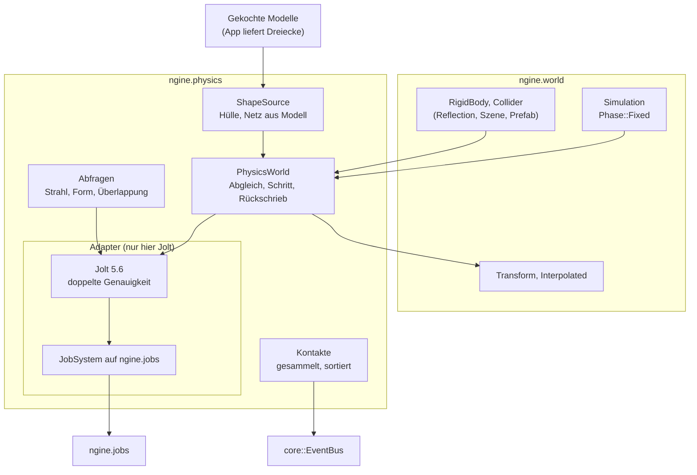

# R4.2: Physik mit Jolt

- **Phase:** Konstruktion (Reifegrad [R4](R4-gameplay-systeme.md))
- **Status:** in Arbeit (Plan abgestimmt in #50)
- **Pull Requests:** [#51](https://github.com/viiez/ngine/pull/51)

## Plan

**Ziel:** Dinge in der Welt fallen, stoßen sich und bleiben liegen. Jolt rechnet hinter einem
eigenen Modul `ngine.physics` in der festen Simulation aus R4.1, auf dem Job-System der Engine, ohne
Fenster und GPU und mit Positionen in 64 Bit. Körper und Formen sind gewöhnliche Komponenten: Der
Editor zeigt und bearbeitet sie, Szenen und Prefabs speichern sie, und Stoppen im Spielmodus stellt
die Welt bitgenau wieder her. Gameplay fragt die Physik mit Strahlen, Formen und Überlappungen ab
und bekommt Kontakte als Ereignisse.

**Features:** PHYS-01 (Physik-Welt), PHYS-02 (Starre Körper), PHYS-04 (Abfragen). **Schulden:**
TD-29 (Transforms parallel), nur wenn die Messung mit 2 000 Körpern es lohnt. PHYS-03 (Character
Controller) und die Kollision des Terrains folgen in R4.3.

### Entwurf

**Jolt** (Adapter `engine/physics/jolt_*.cpp`, ADR 0045 folgt mit dem ersten PR)

- vcpkg hat Jolt 5.6.0, aber der Port baut nur mit einfacher Genauigkeit und bietet keine Option
  dafür (geprüft am Port der Baseline). Jolts eigenes CMake kennt `DOUBLE_PRECISION`. Vorschlag:
  ein Overlay-Port im Repository (`cmake/vcpkg-ports/joltphysics`, Kopie des offiziellen Ports mit
  `-DDOUBLE_PRECISION=ON`), eingebunden über `vcpkg-configuration.json`. Jolt gibt die Definition
  `JPH_DOUBLE_PRECISION` über sein CMake-Ziel weiter; beim Start prüft `VerifyJoltVersionID()`,
  dass Bibliothek und Adapter mit denselben Schaltern gebaut sind.
- Positionen sind dann `RVec3` in `f64`, passend zu `Transform::position`
  ([ADR 0012](../adr/0012-64bit-world-coordinates.md)); Drehungen, Formen und Geschwindigkeiten
  bleiben `f32`. Ein verschiebbarer Ursprung der Physik-Welt ist damit nicht nötig.
- Jolt rechnet über einen Adapter auf `ngine.jobs` (`JobSystemWithBarrier`, Jobs als
  `JobSystem::run()`), damit nicht zwei Thread-Pools um die Kerne streiten (Erkenntnis aus R3.3).
  Speicher für den Schritt aus einem eigenen `TempAllocatorImpl` (Vorschlag 16 MiB), Jolts
  Allokator auf den der Engine umgeleitet, damit Tracy ihn sieht.
- Kein Code außerhalb des Adapters sieht einen Jolt-Header. Öffentliche Typen sind eigene
  (`physics::BodyHandle`, `RayHit`, `Contact`), die Klasse `PhysicsWorld` hält Jolt hinter einem
  Pimpl. Jolt-Header sind groß und voller Makros; sie stehen nur im globalen Modulfragment der
  Adapter-Dateien.

**Komponenten** (`ngine.physics`, in der Reflection, PHYS-02)

- `RigidBody`: Bewegung (`Static`, `Kinematic`, `Dynamic`), Masse (0 = aus der Form), Reibung,
  Rückprall, Dämpfung linear und drehend, Schwerkraft-Faktor, Ebene (`PhysicsLayer`), darf
  schlafen, Geschwindigkeit linear und drehend. Die Geschwindigkeiten stehen in der Komponente,
  damit eine Szene einen Wurf speichern kann und die Sicherung im Spielmodus alles enthält.
- `Collider`: Form (`Sphere`, `Box`, `Capsule`, `ConvexHull`, `Mesh`) mit Radius, halben Maßen,
  halber Höhe, Versatz und einem `AssetRef` auf ein Modell für Hülle und Netz; `sensor` für
  Auslöser ohne Stoß. Die Maße gelten vor der Skalierung aus `Transform`; eine andere Skalierung
  baut die Form neu. Dreiecksnetze nur für statische und kinematische Körper (Jolt rechnet
  dynamische Netze nicht).
- Ein Körper ist eine Entity mit beiden Komponenten. Statische Körper dürfen ein Elternteil haben
  und nehmen die Weltlage. Dynamische Körper hängen in R4.2 an der Wurzel der Hierarchie; hängt
  einer an einem Elternteil, schreibt die Physik die lokale Lage aus der Weltlage zurück. Mehrere
  Formen pro Körper (Kinder mit `Collider` als Compound) folgen, wenn ein Modell es braucht.
- Jede Entity mit `RigidBody` bekommt beim Anlegen des Körpers `Interpolated` (wie in R4.1
  angekündigt), damit sie bei jeder Bildrate glatt fällt.

**PhysicsWorld** (`ngine.physics`, PHYS-01)

- Die Welt ist die Quelle der Wahrheit für das, was gespeichert wird; Jolt hält nur den Zustand der
  Simulation. Vor jedem festen Schritt gleicht `PhysicsWorld` ab: neue Entities mit `RigidBody` und
  `Collider` bekommen einen Körper, entfernte verlieren ihn, geänderte Werte (Inspector, Skripte,
  Befehle) gehen über die Änderungserkennung an Jolt. Die Zuordnung Entity zu Körper liegt in
  `PhysicsWorld`, nicht in einer Komponente, damit nichts davon in Szenen landet.
- Der Abgleich legt Körper immer in der Reihenfolge der Entity-Kennungen an. Dann ist ein Lauf bei
  gleichen Eingaben auf derselben Maschine bitgleich, auch mit 1 oder 16 Threads (Jolts Zusage bei
  gleicher Reihenfolge der Aufrufe). Plattformübergreifend gleich ist er nicht
  (`CROSS_PLATFORM_DETERMINISTIC` bleibt aus, siehe Abstimmung).
- Schritt in `Phase::Fixed` als System „Physik“ nach allen Systemen, die Kräfte oder
  Geschwindigkeiten setzen (`after`). Danach schreibt ein Durchlauf die Lage aktiver dynamischer
  Körper in `Transform` und die Geschwindigkeiten in `RigidBody`; kinematische Körper lesen ihre
  Lage aus `Transform` und werden dorthin bewegt (`MoveKinematic`).
- Spielmodus im Editor: Beim Start entsteht die Physik-Welt aus den Komponenten, beim Stoppen
  stellt die binäre Sicherung die Welt her ([ADR 0032](../adr/0032-play-in-editor-binary-snapshot.md)),
  und die Physik-Welt wird verworfen. Außerhalb des Spielmodus rechnet keine Physik.
- `world::Simulation` bleibt ohne Physik; die Apps hängen die Physik als System an
  (`physics::add_systems(simulation, physics_world)`). So baut `ngine.world` weiter ohne Jolt.

**Formen aus Modellen**

- `ConvexHull` und `Mesh` brauchen die Dreiecke eines gekochten Modells. `ngine.physics` lädt keine
  Assets selbst; die App gibt eine `ShapeSource`, die zu einem `AssetId` Eckpunkte und Indizes
  liefert (in Sandbox und Editor aus dem Koch-Cache). Gebaute Formen liegen in einem Cache nach
  Asset und Skalierung, gebaut in Jobs. Hot Reload eines Modells ersetzt die Form.

**Abfragen, Ebenen, Ereignisse** (PHYS-04)

- `raycast()` (nächster Treffer und alle), `shape_cast()` (Kugel, Quader, Kapsel), `overlap()`
  (Kugel, Quader), mit Filter nach Ebene und ausgenommenen Entities. Treffer nennen Entity, Punkt
  in `f64`, Normale und Abstand. Abfragen laufen zwischen den Schritten, nicht während Jolt rechnet.
- Ebenen fest im Code: `Static`, `Moving`, `Character` (für R4.3), `Debris` (stößt nur mit
  `Static`), `Sensor` (meldet, stößt nicht); eine Tabelle sagt, welche Ebenen sich treffen.
- Kontakte: Jolt meldet Beginn, Dauer und Ende aus mehreren Threads und in wechselnder
  Reihenfolge. Der Adapter sammelt sie, sortiert nach den Kennungen beider Entities und
  veröffentlicht sie nach dem Schritt im Hauptthread über den `EventBus` (`ContactBegan`,
  `ContactEnded`, `TriggerEntered`, `TriggerLeft`). Damit bleibt auch die Reaktion des Gameplays
  reproduzierbar.

**Editor, Sandbox, Server**

- Editor: `RigidBody` und `Collider` im Inspector ohne eigenen Code (Reflection mit Enums und
  Bereichen), Formen als Drahtgitter über `DebugDraw` (ausgewählte Entity hervorgehoben, Schalter
  im Menü „Ansicht“), schlafende Körper in anderer Farbe.
- Sandbox: Szene „Spielplatz“ (`--playground`): Boden, Rampe aus einem Modell (Dreiecksnetz),
  ein Stapel aus 20 Kisten und eine Aktion `throw` (linke Maustaste, rechter Trigger), die eine
  Kugel in Blickrichtung wirft. Ein Strahl aus der Bildmitte zeigt im Debug-Text, was getroffen
  ist. Mit `--far` liegt der Spielplatz 10 000 km vom Ursprung.
- `--headless` rechnet den Spielplatz ohne Fenster und meldet am Ende eine Prüfsumme der Lagen;
  `--server` rechnet die Physik mit, repliziert wird sie erst in R5.
- `--bodies 2000` lässt 2 000 Körper auf den Boden regnen und misst Schritt der Physik,
  Rückschrieb und `update_transforms()` (Median und 99. Perzentil). Danach entscheidet sich TD-29.

### Schritte

1. **Jolt einbinden:** Overlay-Port, `ngine.physics` mit `PhysicsWorld`, Job-Adapter, Allokator,
   ein fallender Körper als Test. Früh als PR durch die Windows-CI (MSVC und Jolts Makros).
2. **Körper aus Komponenten:** `RigidBody`, `Collider` mit Kugel, Quader und Kapsel, Abgleich,
   Schritt in `Phase::Fixed`, Rückschrieb, kinematische Körper, `Interpolated`. Tests ohne GPU.
3. **Abfragen und Ereignisse:** Strahl, Form, Überlappung, Ebenen, Sensoren, Kontakte über den
   `EventBus`.
4. **Formen aus Modellen:** `ShapeSource`, Hülle und Dreiecksnetz, Cache, Hot Reload.
5. **Editor und Sandbox:** Debug-Zeichnen, Spielplatz, `throw`, `--far`, `--headless`,
   `--bodies`; Messung auf dem PC, TD-29 je nach Ergebnis; ADR, Doku.

**Risiken:**

- **Jolt, Module und MSVC:** Jolt-Header vertragen sich vielleicht nicht mit dem globalen
  Modulfragment (Makros, `JPH_NAMESPACE_BEGIN`). Gegenmittel: Jolt nur in normalen `.cpp`-Dateien
  des Adapters, die die Modulschnittstelle über Pimpl umsetzen; Schritt 1 als eigener kleiner PR.
- **Schalter von Bibliothek und Adapter passen nicht** (doppelte Genauigkeit, Asserts in Debug):
  Absturz oder falsche Lagen ohne Fehlermeldung. Gegenmittel: `VerifyJoltVersionID()` beim Start,
  Test mit einem Körper bei 10 000 km.
- **Der Overlay-Port veraltet**, wenn die Baseline ein neues Jolt bringt. Gegenmittel: Der Port
  unterscheidet sich vom offiziellen nur in einer Zeile; die Abweichung steht in
  `third-party.md`. Bekommt der offizielle Port eine Option, fällt der Overlay weg.
- **Bitgleichheit:** Jolts Zusage gilt nur bei gleicher Reihenfolge aller Aufrufe. Gegenmittel:
  Abgleich sortiert nach Kennung, Kontakte sortiert, Test mit 1 und 16 Threads unter
  ThreadSanitizer.
- **Rückschrieb bei vielen Körpern:** 2 000 Lagen pro Schritt schreiben und die Änderungserkennung
  auslösen kostet im Hauptthread (Erkenntnis aus R3). Gegenmittel: nur aktive Körper schreiben,
  Rückschrieb parallel über Chunks, messen.
- **Editor und Physik im Spielmodus:** Ein Gizmo verschiebt einen dynamischen Körper, während er
  fällt. Gegenmittel: Änderungen aus dem Editor gehen über den Abgleich, der Körper wird an die
  neue Lage gesetzt und geweckt.

**Abnahme:**

- Ein Stapel Kisten fällt im Editor im Spielmodus um, und beim Stoppen ist die Welt bitgenau wie
  vorher (Test ohne GPU über die Sicherung, Sichtprüfung auf dem PC).
- Dieselbe Szene ergibt nach fünf Sekunden mit 1 und 16 Threads bitgleiche Lagen (Test, auch unter
  ThreadSanitizer); `--headless` meldet dieselbe Prüfsumme wie der Test.
- Ein Stapel 10 000 km vom Ursprung verhält sich wie am Ursprung, bis auf weniger als 1 mm nach
  fünf Sekunden (Test), und zittert im Bild nicht (`--far`, Sichtprüfung).
- Strahl, Form und Überlappung finden die richtigen Entities, Ebenen filtern, Kontakte kommen in
  fester Reihenfolge (Tests).
- 2 000 bewegte Körper auf dem PC gemessen (Schritt der Physik, Rückschrieb,
  `update_transforms()`), Ergebnis und Entscheidung zu TD-29 im Iterationsdokument.

### Zur Abstimmung

1. **Doppelte Genauigkeit über einen eigenen Overlay-Port** im Repository statt eines
   verschiebbaren Ursprungs der Physik-Welt. Kostet laut Jolt einige Prozent Leistung, erspart
   aber das Umrechnen beim Verschieben und passt zu den 64-Bit-Positionen der Welt.
2. **Reproduzierbar nur auf derselben Plattform:** gleicher Build, gleiche Eingaben, gleiches
   Ergebnis, unabhängig von der Zahl der Threads. `CROSS_PLATFORM_DETERMINISTIC` (rund 8 %
   langsamer) bleibt aus, weil der Server in R5 die Physik bestimmt und Clients nur vorhersagen.
   Das lässt sich später einschalten, ohne die Schnittstelle zu ändern.
3. **Die Welt ist die Quelle der Wahrheit:** Körper entstehen aus `RigidBody` und `Collider`,
   Jolt hält nur den Zustand der Simulation, Geschwindigkeiten stehen in der Komponente. Damit
   brauchen Spielmodus, Szenen, Prefabs und später Replikation keinen Sonderweg für die Physik.
4. **Ebenen fest im Code** (Static, Moving, Character, Debris, Sensor) statt als Datei. Eine Datei
   lohnt, wenn das Spiel eigene Ebenen braucht.
5. **Spielplatz als eigene Szene** der Sandbox (`--playground`), auf einem Boden statt auf dem
   Terrain, weil dessen Kollision erst in R4.3 kommt. In R4.3 zieht er auf das Terrain um.

Abgestimmt in #50: alle fünf Vorschläge angenommen, Jolt über den Overlay-Port.

## Stand

Umgesetzt in [#51](https://github.com/viiez/ngine/pull/51), Entscheidungen in
[ADR 0045](../adr/0045-physics-jolt-double-precision.md). Abweichungen vom Plan:

- **Jolt nur mit SSE2.** Jolt gibt Befehlssatz-Schalter wie `-mavx2` an seine Nutzer weiter, und
  Moduldateien von Clang lassen sich nur mit denselben Schaltern laden. Der Overlay-Port schaltet
  die Befehlssätze darum ab; ob sie sich lohnen, zeigt die Messung auf dem PC (TD-48).
- **Unter ThreadSanitizer rechnet Jolt im wartenden Thread**, weil die Bibliothek aus vcpkg nicht
  instrumentiert ist (TD-47). `[physics]` läuft trotzdem im Preset `linux-clang-tsan` und in der CI.
- **`Simulation::add_fixed_stage()`** statt eines Systems in `Phase::Fixed`: Die Physik läuft nach
  allen Systemen und Befehlspuffern des festen Schritts im Hauptthread, und `ngine.world` bleibt
  ohne Physik.
- **`--headless --playground`** rechnet den Spielplatz ohne Fenster; `--headless` allein bleibt die
  Welt der Szenen-Demo. Die Prüfsumme der Lagen ist im selben Build bei jedem Lauf gleich.
- **Werfen** ist eine neue Aktion `throw` (linke Maustaste, am Gamepad die linke Taste der
  Rautentasten rechts, also X bzw. Quadrat).
- Formen bleiben bei Elternwechsel und Compound offen (TD-49).

**Messung im Container** (4 Kerne, 3 Worker, Release, Jolt mit SSE2), `--headless --playground
--bodies 2000 --frames 600`, 2 031 Körper:

| Was | Median | 99. Perzentil |
| --- | --- | --- |
| Schritt der Physik (Abgleich, Rechnen, Rückschrieb) | 8,2 ms | 12,5 ms |
| davon Abgleich | 0,47 ms | |
| davon Rückschrieb | 0,57 ms | |
| `update_transforms()` | 0,28 ms | 0,47 ms |

**Messung auf dem PC** (Windows, Release, Jolt mit SSE2), dieselbe Szene mit 2 031 Körpern, am Ende
1 975 wach:

| Was | Median | 99. Perzentil |
| --- | --- | --- |
| Schritt der Physik (Abgleich, Rechnen, Rückschrieb) | 2,89 ms | 3,90 ms |
| davon Abgleich | 0,43 ms | |
| davon Rückschrieb | 0,39 ms | |
| `update_transforms()` | 0,26 ms | 0,49 ms |

`update_transforms()` kostet neben dem Schritt der Physik wenig; TD-29 lohnt nicht und bekommt die
Frist „bei Bedarf“. Auch ohne AVX2 und FMA braucht der Schritt auf dem PC unter 3 ms von 16,7 ms
pro Bild; TD-48 bekommt darum ebenfalls die Frist „bei Bedarf“. Alle Tests aus „R4.2 testen“
sind auf dem PC bestanden (Kommentar in #51).
