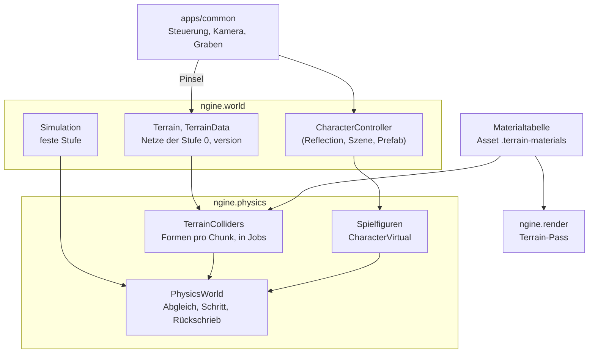

# R4.3: Terrain-Kollision und Spielfigur

- **Phase:** Konstruktion (Reifegrad [R4](R4-gameplay-systeme.md))
- **Status:** in Arbeit (Plan abgestimmt in #52)
- **Pull Requests:** folgen

## Plan

**Ziel:** Eine Spielfigur läuft über das endlose Terrain, steigt Hänge hinauf, springt, geht in
Höhlen und gräbt. Kisten liegen auf dem Terrain und fallen, wenn man den Boden unter ihnen
wegnimmt. Das Terrain bekommt dafür Kollisionsformen aus den Netzen der Chunks, gebaut in Jobs und
nur dort, wo etwas sie braucht. Die Materialien des Terrains werden ein Asset mit Reibung und
einem Namen für Schritte, im Editor bearbeitbar und gekocht. Der Spielplatz aus R4.2 zieht vom
Boden auf das Terrain um und wird eine Szene, die Sandbox und Editor laden.

**Features:** VOX-08 (Kollision), PHYS-03 (Character Controller), VOX-07 (Materialien, Rest).
**Schulden:** TD-37 (Materialtabelle als Asset, gekochte Texturen). TD-38 (mehr als acht
Materialien pro Chunk) bekommt die Frist „bei Bedarf“, siehe Abstimmung.

### Entwurf

**Kollision des Terrains** (`ngine.physics`, VOX-08, ADR 0046 folgt mit dem ersten PR)

- Die Form eines Chunks ist ein Jolt-`MeshShape` aus dem Netz der Stufe 0, das der Mesher ohnehin
  baut (`TerrainData::meshes`, Positionen in Voxeln, mal 0,5 m). Ein Höhenfeld scheidet wegen
  Höhlen und Überhängen aus. Jeder Chunk mit Form ist ein unbewegter Körper auf der Ebene
  `Static`, ohne Entity, an der Ecke des Chunks in `f64`. Grobe Stufen bekommen keine Form.
- **Nur wo sie gebraucht wird:** Formen entstehen für Chunks der Stufe 0 in einem Radius um jede
  Spielfigur, jeden wachen dynamischen Körper und jeden `TerrainObserver` (Vorschlag: 24 m, also
  die Nachbarn des Chunks und eine Reihe darüber hinaus). Außerhalb des Radius fallen sie nach
  einer Wartezeit weg. Stufe 0 gibt es bei endlosen Terrains ohnehin nur in der Nähe der
  Beobachter; ein Körper, der weiter weg liegt, hat keine Form unter sich.
- **Bauen in Jobs:** Das Bauen eines `MeshShape` kostet je nach Netz einige Millisekunden. Der
  Abgleich kopiert die Dreiecke geänderter Chunks (`ChunkMesh::version`) in Jobs auf
  `ngine.jobs`; fertige Formen setzt der nächste Abgleich im Hauptthread ein, in der Reihenfolge
  der Chunks. Formen der Chunks um eine Spielfigur haben Vorrang.
- **Körper ohne Boden:** Ein dynamischer Körper, unter dessen Chunk noch keine Form liegt, wird
  eingefroren (Jolt: deaktiviert, die Komponente behält ihre Werte), statt durch die Welt zu
  fallen. Sobald die Form da ist, wacht er auf. Dasselbe gilt für eine Spielfigur.
- **Nach einem Pinsel:** `edit_terrain()` erhöht die Fassung des Netzes; der Abgleich baut die
  Form neu und ersetzt sie am selben Körper (`SetShape`). Danach weckt er alle Körper in der
  Hülle des Chunks (`ActivateBodiesInAABox`), damit eine Kiste fällt, wenn der Boden fehlt.
  Solange die neue Form gebaut wird, bleibt die alte stehen.
- **Reibung je Material:** Jedes Dreieck bekommt das Material mit dem größten Gewicht an seinen
  Eckpunkten als `PhysicsMaterial` (Jolt erlaubt bis zu 32 pro Form; die Palette eines Chunks
  bleibt darunter). Reibung und Rückprall kommen aus der Materialtabelle. Strahl und Form melden
  das Material des Treffers (`RayHit::material`), damit Schritte und Spuren es kennen.
- **Reproduzierbar:** Wann eine Form fertig ist, hängt von den Threads ab. Für Tests,
  `--headless` und den Server wartet der Abgleich auf Wunsch, bis alle nötigen Formen fertig sind
  (`PhysicsSettings::wait_for_terrain`, wie `TerrainUpdate::wait`); dann bleibt ein Lauf bitgleich.
  Im Spiel wird nicht gewartet, weil eingefrorene Körper nichts Falsches tun.

**Spielfigur** (`ngine.physics`, PHYS-03)

- Komponente `CharacterController` in der Reflection: Radius und Höhe der Kapsel, größte
  Steigung (Vorschlag 50°), Stufenhöhe (0,4 m), Sprunghöhe, Gehen und Laufen in m/s,
  Beschleunigung am Boden und in der Luft, Schwerkraft-Faktor, Masse zum Schieben. Dazu
  Laufzeitwerte, die die Szene nicht speichert: gewünschte Bewegung (`move`, von der Steuerung
  gesetzt), Sprungwunsch, Geschwindigkeit, ob die Figur steht, Normale und Material des Bodens.
- Im Adapter ein Jolt-`CharacterVirtual` pro Entity, aktualisiert im Schritt der Physik vor dem
  Rechnen der Körper, mit `ExtendedUpdate` (Treppen, an den Boden haften, Hänge). Ein innerer
  Körper auf der Ebene `Character` macht die Figur für Strahlen, Auslöser und andere Körper
  sichtbar; Kisten schiebt sie mit ihrer Masse. Die Lage geht nach dem Schritt in `Transform`, mit
  `Interpolated` wie bei Körpern.
- Ereignisse: `CharacterLanded` (mit Fallhöhe und Material) und `CharacterStep` (Schritt mit
  Material, alle 0,7 m Weg am Boden), damit R4.5 Schritte abspielen kann, ohne die Physik zu
  kennen.
- Viele Figuren auf dem Server: 100 Figuren auf dem Terrain gemessen (Zeit pro Figur), damit R5
  weiß, was ein Server mit vielen Spielern kostet.

**Steuerung, Kamera, Graben** (`apps/common`)

- Ein System der festen Phase setzt aus den Aktionen `move`, `look`, `jump`, `fast` (Laufen) und
  `crouch` die gewünschte Bewegung relativ zur Blickrichtung. In R4.4 übernimmt das ein C#-Skript;
  bis dahin ist es C++ in `apps/common`, damit Sandbox und Editor es teilen.
- Kamera als Kind der Figur mit zwei Lagen: Ich-Perspektive (Augenhöhe) und Schulter (3 m hinter
  und 0,5 m neben der Figur, ein Strahl zieht sie vor Wänden heran). Umschalten mit der Aktion
  `camera`. `jump`, `fast` und `throw` gibt es seit R4.1 und R4.2; neu in
  `eingabe/standard.input` sind `crouch` (Strg, B), `camera` (V, rechter Stick-Klick) und `dig`
  (rechte Maustaste, linker Trigger).
- Graben: `dig` trägt mit dem Pinsel aus R3.4 eine Kugel von 0,8 m Radius dort ab, wo der Strahl
  aus der Mitte des Bildes das Terrain trifft (bis 6 m); mit Shift trägt es auf. Werfen bleibt auf
  der linken Maustaste.
- Wer fliegen will, schaltet mit F4 in den Flugmodus aus R3 um; die Figur bleibt stehen.

**Spielplatz als Szene**

- `assets/szenen/spielplatz.nscene` statt Code: endloses Terrain mit festem Startwert, eine
  Spielfigur aus dem Prefab `prefabs/spielfigur`, die Türme und Kugeln aus R4.2 auf einer Ebene am
  Hang und ein Eingang zu einer Höhle in der Nähe. `--playground` lädt sie, der Editor öffnet sie
  wie jede Szene. Der Boden aus R4.2 bleibt nur in den Tests.
- Im Spielmodus des Editors steuert man die erste Figur mit der Komponente `PlayerInput`; das
  Bild zeigt ihre Kamera, Esc gibt die Maus frei. Ohne Figur fliegt die Kamera des Editors wie
  bisher.

**Materialtabelle als Asset** (VOX-07, TD-37)

- Neue Asset-Art `TerrainMaterials` (Datei `terrain/standard.terrain-materials` mit `.meta`), JSON
  über die Reflection wie die Eingabe in R4.1: pro Material Name, Farbe, Roughness, Maßstab,
  Stärke der Normalen, Texturen als `AssetRef`, Reibung, Rückprall und ein Name für Schritte
  (`footsteps`, z. B. „gras“, „fels“). Die Reihenfolge in der Datei ist die Materialnummer der
  Voxel; ein Test prüft, dass die Standarddatei zur eingebauten Tabelle passt.
- Renderer und Physik lesen dieselbe Tabelle; Hot Reload über den `FileWatcher` (Farbe, Texturen
  und Reibung gelten sofort, ohne neues Netz).
- Editor: Fenster „Terrain-Materialien“ mit der Liste, Hinzufügen und Entfernen und den Feldern
  über den Inspector der Reflection; Speichern schreibt die Datei, der Pinsel „Bemalen“ bietet
  alle Materialien der Tabelle an. Ein neues Material entsteht so ohne Neubauen.
- Texturen des Terrains gehen durch den Koch-Cache wie die Texturen der Modelle: einzelne
  Texturen als KTX2 mit Mip-Stufen, BC7, wo die GPU es kann (ADR 0036). Die JPEG-Quellen bleiben
  im Repository.

**Mehr als acht Materialien pro Chunk** (TD-38)

- Abgestimmt: Die Palette behält 8 Plätze zu 8 Bit, TD-38 bekommt die Frist „bei Bedarf“. Die
  Tabelle darf mehr als acht Materialien haben; nur ein einzelner Chunk zeigt höchstens acht davon,
  und weitere fallen wie bisher auf Platz 0. Der Generator nutzt vier, das Bemalen selten mehr als
  zwei oder drei an einer Stelle. Erwogen war, 16 Plätze mit Gewichten zu 4 Bit; das kostet
  Feinheit der Übergänge und Arbeit an Mesher und Shader, ohne dass das Spiel es heute braucht.

**Editor, Sandbox, Server**

- `--playground` lädt die Szene mit Figur; F3 zeigt auch die Formen der Chunks (grau, im Bau
  gelb) und die Kapsel der Figur. Der Debug-Text nennt Formen, Bauzeit und Material unter der
  Figur.
- `--headless --playground` lässt die Figur 10 s lang auf einer festen Spur laufen, gräbt unter
  einer Kiste und meldet die Prüfsumme; `--server` rechnet Terrain-Kollision und Figuren mit,
  repliziert wird erst in R5.
- `--characters 100` setzt 100 Figuren auf das Terrain, die im Kreis laufen, und misst sie.

### Schritte

1. **Formen der Chunks:** Formen aus dem Netz der Stufe 0, Radius um Körper und Beobachter, Bauen
   in Jobs, Einfrieren ohne Boden, Ersetzen nach dem Pinsel. Tests ohne GPU: Kiste fällt auf ein
   festes Terrain, Kiste fällt nach dem Graben, Kiste auf einem Chunk, der gerade ersetzt wird.
2. **Spielfigur:** `CharacterController`, `CharacterVirtual`, Ereignisse; Tests: Hang hinauf bis
   zur größten Steigung, Stufe, Sprung, Höhle, Kiste schieben, zwei Läufe bitgleich.
3. **Steuerung und Kamera:** Aktionen, Ich- und Schulterperspektive, Graben; Spielplatz als Szene,
   Spielmodus im Editor mit Figur.
4. **Materialtabelle:** Asset-Art, Reibung je Dreieck, Fenster im Editor, Texturen gekocht.
5. **Messen und Doku:** Bauzeit und Speicher der Formen, 100 Figuren, auf dem PC; ADR 0046, Doku.

**Risiken:**

- **Durchfallen beim Streaming und Ersetzen:** Eine Figur steht auf einem Chunk, dessen Form
  gerade neu gebaut wird, oder läuft schneller, als Formen entstehen. Gegenmittel: alte Form
  bleibt bis zur neuen, Einfrieren ohne Form, Vorrang für die Chunks um die Figur, Tests mit
  einer Kiste auf einem Chunk mitten im Ersetzen.
- **Kosten des Bauens:** Ein Chunk mit Höhlen hat einige tausend Dreiecke; viele Formen auf einmal
  (Teleport, Start) halten den Abgleich auf. Gegenmittel: Bauen nur in Jobs, im Hauptthread nur
  Einsetzen, eine Obergrenze pro Schritt; messen.
- **Nähte zwischen Chunks:** Kanten zwischen zwei Formen lassen Kisten und Figur hängen
  („Ghost Collisions“). Gegenmittel: Jolts aktive Kanten (`ActiveEdgeCosThresholdAngle`) und
  `mEnhancedInternalEdgeRemoval` für die Figur; Test mit einer Kugel, die über eine Naht rollt.
- **Reproduzierbarkeit:** Formen, die je nach Threads früher fertig sind, ändern das Ergebnis.
  Gegenmittel: Warten in Tests und auf dem Server, Einsetzen in fester Reihenfolge.
- **Umfang:** Kollision, Figur, Kamera, Asset-Art und Kochen sind viel für eine Iteration.
  Gegenmittel: Schritt 4 lässt sich als eigener PR abtrennen; Kollision und Figur kommen zuerst.

**Abnahme:**

- Die Figur läuft über Hügel und durch Höhlen, ohne durch den Boden zu fallen, auch beim Streamen
  neuer Chunks (Sichtprüfung auf dem PC, mit Tastatur und Gamepad; Test ohne GPU mit einer festen
  Spur).
- Boden unter einer Kiste weggraben: Sie fällt (Test, Sichtprüfung).
- Zeit für das Bauen einer Form pro Chunk und Speicher der Formen gemessen, 100 Figuren auf dem PC
  gemessen; Ergebnisse im Iterationsdokument.
- `--headless --playground` lässt Körper und Figur auf das Terrain fallen und meldet bei jedem
  Lauf dieselbe Prüfsumme (Test).
- Ein neues Material entsteht im Editor ohne Neubauen und ist mit dem Pinsel malbar (Test ohne GPU
  für Laden und Speichern der Tabelle, Sichtprüfung).

### Zur Abstimmung

1. **Formen aus dem Netz der Stufe 0 als `MeshShape` pro Chunk**, gebaut in Jobs, nur in einem
   Radius von 24 m um Figuren, wache Körper und Beobachter. Alternative: Formen für alle
   geladenen Chunks der Stufe 0; einfacher, aber Speicher und Bauzeit wachsen mit der Sichtweite.
2. **Einfrieren statt Fallen:** Körper und Figuren ohne Form unter sich bleiben stehen, bis die
   Form da ist. Im Spiel kann das kurz auffallen (eine Kiste hängt einen Augenblick in der Luft);
   dafür fällt nie etwas durch die Welt.
3. **Jolts `CharacterVirtual`** statt einer eigenen Figur aus Form-Abfragen. Es kann Treppen,
   Hänge und Schieben und läuft ohne eigenen Körper in der Simulation; Jolts `Character` (ein
   echter starrer Körper) eignet sich schlechter für genaue Steuerung und Vorhersage in R5.
4. **Steuerung vorerst in C++** in `apps/common`; in R4.4 wird sie ein C#-Skript, wie im Plan für
   R4 vorgesehen.
5. **16 Plätze mit 4-Bit-Gewichten** für TD-38. Alternative: 8 Plätze behalten und TD-38 auf „bei
   Bedarf“ setzen, bis das Spiel wirklich mehr als acht Materialien an einer Stelle braucht.
6. **Spielplatz als Szene** auf dem endlosen Terrain, mit Spielfigur als Prefab. Ein Modell für
   die Figur gibt es noch nicht; bis R4.6 ist sie eine Kapsel.

**Ergebnis der Abstimmung** (viiez, in #52): Die Punkte 1 bis 4 und 6 passen wie vorgeschlagen.
Punkt 5 hat viiez an Claude abgegeben; entschieden ist die Alternative: 8 Plätze bleiben, TD-38
bekommt die Frist „bei Bedarf“, weil R4 keine Stelle mit mehr als acht Materialien braucht und
R4.3 ohnehin groß ist. Dazu gilt für alle Iterationen: Jolt und andere Fremdbibliotheken bleiben
hinter Engine-Schnittstellen austauschbar, wenn kein wichtiger Grund dagegen spricht. Für R4.3
heißt das: `CharacterController`, Formen der Chunks, Materialien und Treffer sind eigene Typen;
`CharacterVirtual` und `MeshShape` kennt nur der Adapter.
