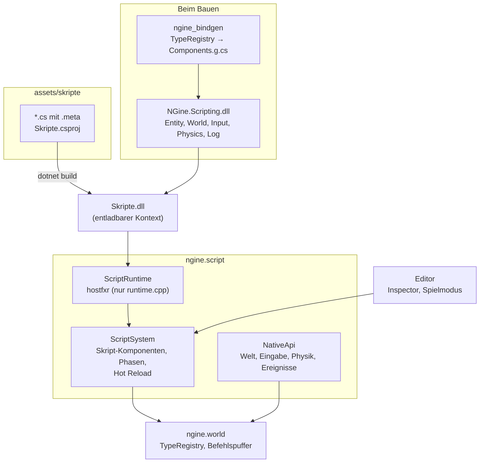

# R4.4: C#-Scripting

- **Phase:** Konstruktion (Reifegrad [R4](R4-gameplay-systeme.md))
- **Status:** Plan zur Abstimmung
- **Pull Requests:** folgen

## Plan

**Ziel:** Gameplay-Logik steht in C#. Ein Skript ist eine C#-Klasse, die an einer Entity hängt,
deren öffentliche Felder im Inspector erscheinen und mit Szene und Prefab gespeichert werden.
Skripte lesen und ändern Komponenten ohne Kopie, fragen Eingabe und Physik ab, hören auf
Ereignisse und laufen im Spielmodus des Editors, in der Sandbox und mit `--headless`. Speichert man
eine `.cs`-Datei, baut die Engine die Skripte im Hintergrund neu und lädt sie, ohne dass das Spiel
stoppt; die Feldwerte bleiben. Die Steuerung der Spielfigur aus R4.3 zieht nach C# um, dazu kommt
eine Laterne zum An- und Ausschalten.

**Features:** SCR-02 (Bindings), SCR-03 (Skript-Komponenten), SCR-04 (Hot Reload, Rest), SCR-01
(fertig), WORLD-02 (C#-Seite), EDIT-06 (Skripte im Spielmodus). **Schulden:** TD-32 (Prefabs mit
entfernten Knoten und verschachtelt), TD-52 (Steuerung in C++).

### Entwurf

**Bindings aus der Reflection** (SCR-02)

- Ein kleines Programm `ngine_bindgen` registriert beim Bauen alle Typen (Engine und
  `apps/common`) und schreibt daraus `Components.g.cs`: für jede Komponente ein C#-Struct mit
  `[StructLayout(LayoutKind.Explicit, Size = …)]` und `[FieldOffset]` aus der Reflection, für jedes
  Enum ein C#-Enum mit gleichem Grundtyp. Die Datei landet im Build-Ordner und wird in
  `NGine.Scripting` mitgebaut; im Repository liegt sie nicht.
- Mathe-Typen bekommen eigene C#-Structs (`Vec3`, `Quat`, `DVec3`) mit Operatoren und
  Umwandlungen nach `System.Numerics`.
- Felder, die nicht blittable sind (`std::string`, z. B. `Name`), fehlen im Struct; der Platz
  bleibt durch die Offsets frei. Sie sind über Zugriffsfunktionen erreichbar
  (`entity.Name`, allgemein `entity.GetString<T>("feld")`).
- Prüfung: Beim Start meldet C# Größe und Offsets jedes erzeugten Structs, die Engine vergleicht
  sie mit der Reflection und verweigert das Laden bei einer Abweichung. Ein Test prüft dasselbe in
  der CI.
- Funktionen kennt die Reflection nicht. Die API der Engine (`NativeApi`) bleibt von Hand
  geschrieben, wie in D2, mit einem Test, der die Tabelle auf beiden Seiten gleich hält.

**API für Skripte** (WORLD-02, C#-Seite)

- `Entity`: `ref T Get<T>()`, `Has<T>()`, `Set<T>(value)`, `Remove<T>()`, `Parent`, `Children`,
  `Name`, `Destroy()`. `Get` liefert eine Referenz direkt in die Spalte der Welt.
- `World`: `Create(name)`, `Spawn(prefab, lage)`, `Find(name)`, Abfragen
  `foreach (var e in World.Query<Transform, RigidBody>())` mit Spans über die Chunks der Tabelle.
- Strukturänderungen aus Skripten (`Create`, `Set` einer neuen Komponente, `Remove`, `Destroy`)
  gehen in den Befehlspuffer und gelten nach der Phase (ADR 0044). Damit bleiben Referenzen aus
  `Get` innerhalb eines Aufrufs gültig.
- `Input`: `Pressed("jump")`, `Down("fast")`, `Value("move")` auf den Aktionen aus R4.1.
- `Physics`: `Raycast`, `Overlap`, `ShapeCast` wie in `ngine.physics`, Ergebnis mit Entity und
  Material.
- Ereignisse: Kontakte, Auslöser, `CharacterLanded`, `CharacterStep` als Methoden am Skript
  (`OnContact`, `OnTrigger`, …), gesammelt pro Schritt und in fester Reihenfolge zugestellt.
- `Time` (Schritt, Bildzeit), `Log`, `Terrain.Edit(pinsel)` zum Graben.

**Skript-Komponenten** (SCR-03)

- Ein Skript ist eine Klasse, die von `NGine.Script` erbt, mit den Methoden `Start`,
  `FixedUpdate`, `Update`, `Stop` und den Ereignissen. Öffentliche Felder der Arten, die die
  Reflection kennt (Zahlen, Bool, Enum, Text, Vektoren, `AssetRef`), sind die gespeicherten Werte;
  `[Range]`, `[Color]` und `[Asset]` werden zu den Hinweisen der Reflection.
- Vorschlag (siehe Abstimmung): **Jede Skript-Klasse wird beim Laden ein eigener Typ in der
  `TypeRegistry`**, z. B. `Laterne` mit den Feldern `an` und `farbe`. Damit behandeln Inspector,
  Szene, Prefabs mit Überschreibungen, Undo, der Snapshot des Spielmodus und später die
  Replikation Skripte wie jede andere Komponente, und eine Entity kann mehrere Skripte tragen. Die
  Registry bekommt dafür Typen, die zur Laufzeit entstehen (Speicher als Bytes, Felder aus C#).
- Die Komponente in der Welt ist die Quelle der Wahrheit für die öffentlichen Felder. Das
  C#-Objekt bekommt die Werte beim Erzeugen und nach Änderungen von außen (Inspector, Undo);
  zurück in die Komponente schreibt die Engine nur, wenn sie die Werte braucht (Speichern,
  Snapshot, Inspector während des Spielens, Neuladen). Private Felder sind Laufzeitzustand.
- Die Engine hält nur Kennungen, keine Verweise auf C#-Objekte (Erkenntnis aus D2): C# führt eine
  Tabelle Entity → Skript-Objekte.
- Reihenfolge: Skripte laufen im Hauptthread in fester Reihenfolge (Typ, dann Entity), damit ein
  Lauf reproduzierbar bleibt. `FixedUpdate` in `Phase::Fixed` vor der Physik, `Update` in
  `Phase::Frame`.
- Szenen speichern ein Skript wie eine Komponente unter dem Namen der Klasse. Fehlt die Klasse beim
  Laden (Skript gelöscht, Bau gescheitert), bleiben die Werte als JSON an der Entity und werden
  unverändert zurückgespeichert, wie bei Prefabs mit fehlender Vorlage.

**Skripte als Assets und Bauen**

- Skripte liegen unter `assets/skripte/` als `.cs` mit `.meta` und einer Projektdatei
  `Skripte.csproj`, die `NGine.Scripting` referenziert. Der Asset-Browser zeigt sie; ein Skript
  zieht man auf eine Entity oder fügt es über „Komponente hinzufügen“ hinzu.
- Editor und Sandbox bauen die Skripte mit `dotnet build` (braucht das SDK). Die fertige
  `Skripte.dll` kommt in den Cache (`assets/.cache`) und ist das, was ein ausgeliefertes Spiel und
  der Server laden; dort reicht die Laufzeit.
- Ohne SDK läuft die Engine weiter: Sie lädt die letzte gebaute DLL aus dem Cache, sonst keine
  Skripte, und meldet das einmal.

**Hot Reload** (SCR-04)

- Der `FileWatcher` sieht geänderte `.cs`-Dateien; `dotnet build` läuft im Hintergrund in einen
  neuen Ausgabeordner (unter Windows sind geladene Dateien sonst gesperrt). Gelingt der Bau,
  schreibt die Engine alle Skript-Felder in die Komponenten, entlädt den Kontext, lädt die neue
  DLL, gleicht die Typen ab (Felder nach Namen, neue mit Standardwert, entfernte fallen weg) und
  erzeugt die Objekte neu. `Start` läuft erneut; privater Zustand geht verloren.
- Scheitert der Bau, laufen die alten Skripte weiter; die Fehler des Compilers stehen im Log und im
  Editor mit Datei und Zeile.
- Ein Test prüft wie in D2, dass der alte Kontext wirklich frei wird, und dass Neuladen im
  laufenden Spiel die Feldwerte behält.

**Spielfigur und Laterne in C#** (TD-52)

- `Spielersteuerung.cs` übernimmt, was heute `apply_controls()` und das Graben in
  `apps/common/player.cppm` tun: Aktionen lesen, Blick drehen, `CharacterMotion` setzen, graben.
  Die Kamera bleibt in C++ (`player_view()`), weil sie zum Zeichnen gehört; sie liest
  `PlayerInput`, das das Skript setzt.
- `Laterne.cs` schaltet mit der neuen Aktion `light` (F, am Gamepad Y bzw. Dreieck) ein
  `PointLight` an und aus und flackert leicht. Ein Prefab `prefabs/laterne` steht im Spielplatz.
- Der Spielplatz nutzt beide Skripte; `--headless --playground` lässt sie mitlaufen, die Prüfsumme
  bleibt reproduzierbar.

**Prefabs mit entfernten Knoten und verschachtelt** (TD-32)

- Überschreibungen bekommen Einträge für entfernte Knoten und entfernte Komponenten (z. B. eine
  Laterne ohne ihr Skript). Verschachtelte Instanzen bleiben in einer Vorlage erhalten statt
  aufgelöst zu werden: ein Knoten mit eigener Vorlage und eigenen Überschreibungen. Das Format
  bekommt Version 2 und liest Version 1 weiter.
- Dieser Schritt hängt nicht am Scripting und lässt sich als eigener PR abtrennen.

**Editor, Sandbox, Server**

- Inspector: Skripte erscheinen wie Komponenten, mit den Feldern aus C#. Im Spielmodus zeigt er die
  aktuellen Werte, Änderungen gehen an das laufende Skript.
- Ein Fenster „Skripte“ zeigt den Zustand des Baus, die Fehler und die geladenen Klassen.
- `--headless` und `--server` laden die Skripte aus dem Cache und rechnen sie mit; `--scripts 10000`
  misst 10 000 Skripte mit `Update` pro Bild.

### Schritte

1. **Bindings:** `ngine_bindgen`, `Components.g.cs`, Mathe-Typen, Prüfung der Anordnung; API für
   Entity, World und Abfragen; Tests ohne GPU (Komponente aus C# ändern, Abfrage über Chunks,
   Strukturänderung über den Befehlspuffer).
2. **Skript-Komponenten:** Typen zur Laufzeit in der Registry, Lebenszyklus in den Phasen, Felder
   im Inspector, in Szenen und Prefabs, Snapshot im Spielmodus; Eingabe, Physik und Ereignisse.
3. **Bauen und Hot Reload:** `assets/skripte`, `dotnet build` im Hintergrund, Neuladen mit
   Feldwerten, Fehler im Editor, DLL im Cache.
4. **Spielfigur und Laterne in C#**, Spielplatz, Messung mit 10 000 Skripten.
5. **Prefabs** (TD-32): entfernte Knoten und Komponenten, verschachtelte Instanzen.
6. **Messen und Doku:** auf dem PC; ADR 0047 (Bindings und Skript-Komponenten), Doku.

**Risiken:**

- **Typen zur Laufzeit in der Registry:** Bisher entstehen alle Typen beim Start und bleiben. Neue
  oder geänderte Skript-Typen beim Neuladen berühren Welt, Inspector, Undo und Szenen.
  Gegenmittel: Ein Skript-Typ behält seine Kennung über das Neuladen; geänderte Felder werden über
  die Serialisierung umgezogen, mit eigenen Tests (Feld hinzu, Feld weg, Typ geändert).
- **Referenzen in die Welt aus C#:** `ref T Get<T>()` zeigt in eine Spalte, die sich bei einer
  Strukturänderung verschiebt. Gegenmittel: Strukturänderungen aus Skripten nur über den
  Befehlspuffer; Referenzen nicht über einen Aufruf hinaus halten (dokumentiert, in Debug geprüft
  über einen Zähler der Strukturänderungen).
- **Entladen scheitert still,** wenn noch etwas auf Skript-Objekte zeigt (Ereignis-Handler,
  statische Felder, Lambdas). Gegenmittel: Engine hält nur Kennungen; Test auf Freigabe nach
  Neuladen mit Ereignissen; Warnung im Log, wenn der Kontext nicht frei wird.
- **Dauer von `dotnet build`:** Ein Bau dauert einige Sekunden. Gegenmittel: im Hintergrund, alte
  Skripte laufen weiter; messen. Reicht das nicht, bleibt Roslyn in der Engine der Rückfall (in
  der Abstimmung zu R4 verworfen).
- **Umfang:** Bindings, Skript-Komponenten, Hot Reload und Prefabs sind viel. Gegenmittel: Schritt
  5 als eigener PR; Schritte 1 bis 3 tragen das Feature, 4 zeigt es.

**Abnahme:**

- Die Steuerung der Spielfigur und eine Laterne, die man an- und ausschaltet, sind C#-Skripte
  (Sichtprüfung auf dem PC; Test ohne GPU mit fester Spur).
- Einen Wert im Skript ändern und die Datei speichern: Im laufenden Spiel gilt er ohne Neustart,
  Feldwerte aus dem Inspector bleiben (Test, Sichtprüfung).
- Eine neue Komponente in C++ ist nach dem Bauen in C# da, ohne Handarbeit (Test).
- Kosten von 10 000 Skript-Updates pro Bild gemessen, auf dem PC.
- Der Build ohne .NET-SDK geht weiter, die Engine startet ohne Skripte (CI).
- Eine Prefab-Instanz ohne einen Knoten der Vorlage und ein Prefab in einem Prefab lassen sich
  speichern und laden (Test).

### Zur Abstimmung

1. **Jede Skript-Klasse als eigener Typ in der Registry** (Vorschlag). Inspector, Szenen, Prefabs,
   Undo, Spielmodus und R5 behandeln Skripte dann ohne Sonderweg, und eine Entity kann mehrere
   Skripte tragen. Kostet Arbeit an der Registry (Typen zur Laufzeit, Umzug beim Neuladen).
   Alternative: eine feste Komponente `Script` mit Klassenname und Feldwerten als JSON-Text.
   Einfacher, aber Inspector und Prefab-Überschreibungen brauchen einen Sonderweg, Replikation
   sieht nur den ganzen Text, und mehrere Skripte an einer Entity gehen nur über Kinder.
2. **Werte zurück in die Komponente nur bei Bedarf** (Speichern, Snapshot, Inspector, Neuladen)
   statt nach jedem Schritt. Spart Kosten pro Bild; für R5 kommt ein Abgleich vor dem Senden dazu.
   Alternative: Skript-Felder liegen in einem Struct im Speicher der Engine und das Skript greift
   per Referenz darauf zu; ohne Kopie, aber umständlicher zu schreiben.
3. **Bindings als erzeugte Datei beim Bauen** (`ngine_bindgen`), nicht im Repository. Alternative:
   Erzeugen zur Laufzeit; dann fehlen dem Editor der IDE die Typen.
4. **Eigene Mathe-Typen in C#** (`Vec3`, `Quat`, `DVec3`) mit Umwandlung nach `System.Numerics`
   statt `System.Numerics` direkt. Grund: `DVec3` gibt es dort nicht, und die Namen bleiben wie in
   C++.
5. **Skripte unter `assets/skripte/` mit einem Projekt**, gebaute DLL im Cache. Alternative: ein
   Projekt pro Ordner oder Skript; das braucht Verweise zwischen Projekten.
6. **Privater Zustand geht beim Neuladen verloren**, nur öffentliche Felder bleiben. Alternative:
   auch private Felder umziehen; das klappt nicht für alle Typen und überrascht dann.
7. **TD-32 in R4.4** als letzter Schritt und eigener PR. Alternative: TD-32 auf „bei Bedarf“
   setzen, bis Laternen und Möbel als Prefabs es wirklich brauchen.
8. **Kamera bleibt in C++**, nur Steuerung und Graben ziehen nach C#. TD-52 schließt damit; die
   Kamera folgt, wenn Skripte zeichnen können.
