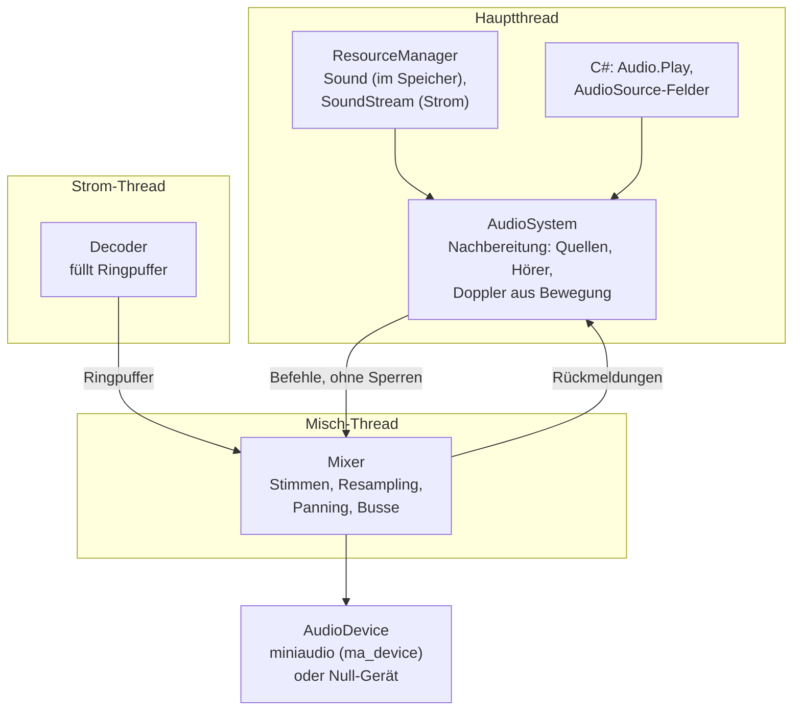

# R4.5: Audio

- **Phase:** Konstruktion (Reifegrad [R4](R4-gameplay-systeme.md))
- **Status:** in Arbeit (Plan abgestimmt in #57)
- **Pull Requests:** [#57](https://github.com/viiez/ngine/pull/57) (Plan)

## Plan

**Ziel:** Die Welt klingt. Klänge sind Assets mit `.meta` wie Modelle und Texturen; kurze liegen
im Speicher, lange (Musik, Atmosphäre) kommen als Strom von der Platte. Eine Entity mit
`AudioSource` spielt einen Klang in der Welt: geortet links und rechts, leiser mit dem Abstand und
mit Doppler, wenn sie sich bewegt. Die Kamera hört über `AudioListener`. Lautstärken laufen über
Busse (Musik, Effekte, Atmosphäre, Oberfläche). Die Spielfigur macht Schritte, die nach dem
Material des Terrains klingen, gesteuert aus einem C#-Skript. Ohne Audio-Gerät, mit `--headless`,
auf dem Server und in der CI läuft ein Null-Gerät; nichts knackt, wenn das Terrain streamt, weil
das Mischen in einem eigenen Thread läuft und nie auf den Hauptthread wartet.

**Features:** AUD-01 (Audio-Gerät), AUD-02 (3D-Klang). **Schulden:** keine mit Frist R4.5; R4.5
legt aber den Klang für die Schritte an, die R4.3 vorbereitet hat (`TerrainMaterial::footsteps`).

### Entwurf

**Modul `ngine.audio`** (AUD-01)

- Neues Modul in der Schicht Laufzeit-Systeme: hängt an `ngine.core`, `ngine.math`,
  `ngine.reflect`, `ngine.asset` und `ngine.world`, nicht an Fenster oder GPU.
- `AudioDevice` ist die schmale Schnittstelle zum Betriebssystem: öffnen mit Abtastrate und
  Kanälen, ein Rückruf füllt Blöcke mit `f32`-Samples. Zwei Umsetzungen:
  - `device_miniaudio.cpp`: miniaudio (`ma_device`), unter Linux über PipeWire, PulseAudio oder
    ALSA, unter Windows über WASAPI. Nur diese Datei und der Decoder kennen miniaudio.
  - `NullDevice`: ruft den Mixer in einem eigenen Thread im Takt der Echtzeit auf und verwirft das
    Ergebnis, oder auf Anfrage blockweise in Tests (`render(frames)`). Gewählt mit `--headless`,
    `--server`, `--no-audio`, in der CI und automatisch, wenn kein Gerät aufgeht (eine Warnung).
- `NGINE_WITH_AUDIO=OFF` baut `ngine.audio` ohne miniaudio, nur mit Null-Gerät (wie
  `NGINE_WITH_WINDOW`). Komponenten und Assets bleiben damit überall bekannt, auch auf einem
  späteren Server-Build ohne Audio; Szenen verlieren nichts.

**Mixer selbst gebaut, miniaudio nur für Gerät und Dekodieren** (siehe Abstimmung)

- Der Mixer rechnet im Thread des Geräts: Stimmen (bis 64 hörbar, weitere virtuell mit Position,
  damit sie richtig weiterlaufen), lineares Resampling auf die Rate des Geräts (auch für Doppler
  und Tonhöhe), Panning mit gleicher Leistung für Stereo, Busse mit Lautstärke und Stumm, sanftes
  Ein- und Ausblenden über wenige Millisekunden bei Start, Stopp und Sprüngen der Lautstärke,
  damit nichts knackt. Am Ende ein weicher Begrenzer gegen Übersteuern.
- Der Hauptthread schickt Befehle (Stimme starten, Parameter, stoppen, Bus) über eine
  Warteschlange mit einem Schreiber und einem Leser ohne Sperren; der Mixer schickt zurück, welche
  Stimmen fertig sind. Im Rückruf wird nie gesperrt, nie Speicher angefordert und nie gelesen.
- Abschwächung nach dem Abstand wie in den gängigen Engines: `min_distance` (bis dahin volle
  Lautstärke), `max_distance` (ab da still oder konstant) und die Kurve `Inverse`, `Linear` oder
  `Exponential` mit `rolloff`. Doppler aus der Geschwindigkeit von Quelle und Hörer entlang ihrer
  Verbindung, mit Faktor pro Quelle und Begrenzung der Tonhöhe.
- Alles, was der Mixer rechnet, ist ohne Gerät testbar: Tests mischen blockweise über das
  Null-Gerät und prüfen Pegel links und rechts, Abschwächung, Doppler, Busse und Schleifen.

**Klänge als Assets**

- Neue Asset-Art `Sound` für `.wav`, `.ogg`, `.flac` und `.mp3`, mit `.meta` wie jedes Asset
  ([ADR 0033](../adr/0033-asset-ids-meta-resource-manager.md)). Dekodiert wird mit miniaudio
  (WAV, FLAC, MP3 eingebaut) und `stb_vorbis` für Ogg Vorbis (aus dem `stb`-Paket, das schon im
  Manifest steht).
- Der Ressourcen-Manager lädt Klänge im Hintergrund wie Modelle. Kurze Klänge (Vorschlag: bis
  fünf Sekunden) liegen dekodiert als `f32` im Speicher (`Sound`); längere öffnet die Engine als
  Strom (`SoundStream`): Ein eigener Thread dekodiert voraus in einen Ringpuffer pro Stimme, der
  Mixer liest nur daraus. Läuft ein Puffer leer, wird die Stimme kurz still statt zu warten, und
  ein Zähler meldet es.
- Hot Reload wie bei Texturen: Ändert sich die Datei, lädt der Manager neu; laufende Stimmen
  spielen den alten Klang zu Ende.
- Klangsätze (`.soundset`, JSON wie die Materialtabelle): mehrere Klänge mit zufälliger Wahl und
  Streuung von Lautstärke und Tonhöhe, damit zehn Schritte nicht gleich klingen. `AudioSource` und
  `Audio.Play` nehmen einen Klang oder einen Klangsatz.
- Kochen gibt es für Klänge in R4.5 nicht: Ogg ist schon komprimiert, WAV ist klein genug. Ein
  Paket ohne Quellen (TD-35) braucht später einen Weg dafür.

**Komponenten** (AUD-02), in der Reflection und damit im Inspector, in Szenen, Prefabs und C#

- `AudioSource`: `sound` (Asset-Kennung eines Klangs oder Klangsatzes), `bus`, `volume`, `pitch`,
  `loop`, `play_on_start`, `spatial` (aus für Musik und Oberfläche), `min_distance`,
  `max_distance`, `rolloff` mit Kurve, `doppler`. Dazu die transiente `AudioPlayback` mit dem
  Zustand (spielt, Stimme, letzte Lage für die Geschwindigkeit), die das System anlegt.
- `AudioListener`: an der Kamera; bei mehreren gilt der erste aktive. Ohne Hörer hört die Engine
  am Ursprung der aktiven Kamera.
- `AudioSystem` läuft in der Nachbereitung (`Phase::Late`) nach `update_transforms()`, liest
  Weltlagen in 64 Bit relativ zum Hörer ([ADR 0012](../adr/0012-64bit-world-coordinates.md)),
  damit 3D-Klang auch weit vom Ursprung stimmt, rechnet Geschwindigkeiten aus der Bewegung
  zwischen zwei Bildern und schickt die Parameter als einen Satz pro Bild.
- Im Editor laufen Quellen nur beim Spielen; außerhalb des Spiels spielt der Inspector einen Klang
  auf Knopfdruck zum Probehören. Die gewählte Quelle zeigt `min_distance` und `max_distance` als
  Kugeln im Debug-Zeichnen. Ein Fenster „Audio“ zeigt Busse mit Schiebern, hörbare und virtuelle
  Stimmen, Leerläufe der Ströme und die Last des Misch-Threads.

**Aus C# abspielbar**

- `AudioSource` kommt wie jede Komponente automatisch in C# an (`ref AudioSource`). Dazu kleine
  Aufrufe in `NativeApi`: `entity.PlaySound()`, `entity.StopSound()`,
  `Audio.Play(klang, position, bus, lautstärke)` für Einmal-Klänge ohne Entity und
  `Audio.SetBusVolume(bus, wert)`.
- `Schritte.cs` an der Spielfigur hört auf `OnStep` und `OnLanded`, sucht in der Materialtabelle
  den Klangsatz des Bodens (`TerrainMaterial::footstep_sounds`) und spielt ihn an den Füßen, beim
  Rennen lauter. Auf Kisten gilt ein eigener Satz.

**Materialtabelle**

- `TerrainMaterial` bekommt `footstep_sounds` (Asset-Kennung eines Klangs oder Klangsatzes); das
  Textfeld `footsteps` aus R4.3 entfällt, die Datei bekommt Version 2 und liest Version 1 weiter.
  Im Fenster der Materialtabelle ist das Feld ein Asset-Feld wie die Texturen.

**Sandbox, Editor, Server**

- Spielplatz: Schritte auf Gras, Fels, Erde und Sand, ein Radio auf einem Tisch neben der Ebene als
  geortete Quelle mit Schleife (laut nah, leise fern, links oder rechts je nach Blick), eine
  rollende Kugel mit Doppler-Summen und leise Atmosphäre als Strom auf dem Bus „Atmosphäre“.
  `--no-audio` schaltet das Null-Gerät ein, `--mute` alle Busse stumm.
- `--headless --playground` rechnet die Quellen mit dem Null-Gerät mit; die Prüfsumme der Lagen
  bleibt dieselbe, denn Audio liest nur. `--server` öffnet kein Gerät.
- Messung: `--audio-voices 500` startet 500 geortete Quellen und meldet die Zeit des Mischens pro
  Block, die Zeit des `AudioSystem` im Hauptthread und Leerläufe.

**Klänge für die Demo**

- Freie Klänge brauchen eine Lizenz, die wir weitergeben dürfen (CC0, Abstimmung zu R4). Vorschlag:
  Die ersten Klänge erzeugen wir selbst mit einem kleinen Skript im Repository
  (`tools/klaenge/erzeugen.py`: Schritte aus gefiltertem Rauschen je Material, ein Radio-Brummen
  mit Melodie, Wind als Atmosphäre). Sie sind damit eigene Werke unter der Lizenz des Projekts und
  winzig. Echte Aufnahmen (z. B. Kenney oder Sammlungen auf freesound.org unter CC0) können sie
  jederzeit ersetzen, ohne dass sich Szenen ändern, weil die `.meta`-Dateien bleiben.

### Schritte

1. **Gerät und Mixer:** Modul `ngine.audio`, vcpkg-Port `miniaudio`, `AudioDevice` mit miniaudio
   und Null-Gerät, Mixer mit Stimmen, Resampling, Busse, Begrenzer, Warteschlangen ohne Sperren;
   Tests über das Null-Gerät, auch unter ThreadSanitizer (`[audio]` kommt ins Preset).
2. **Klänge als Assets:** Asset-Art `Sound`, Dekodieren (WAV, Ogg, FLAC, MP3), im Speicher oder
   als Strom mit eigenem Thread, Klangsätze, Hot Reload; Tests mit kleinen Dateien im Testordner.
3. **3D und Komponenten:** `AudioSource`, `AudioListener`, `AudioSystem` in der Nachbereitung,
   Abschwächung, Panning, Doppler, Lagen relativ zum Hörer; Tests mit fester Spur.
4. **C# und Schritte:** `NativeApi`, `Schritte.cs`, `footstep_sounds` in der Materialtabelle
   (Version 2), erzeugte Klänge.
5. **Editor und Sandbox:** Fenster „Audio“, Probehören, Kugeln im Debug-Zeichnen, Spielplatz mit
   Radio und Atmosphäre, Optionen `--no-audio`, `--mute`, `--audio-voices`.
6. **Messen und Doku:** auf dem PC; ADR 0049 (Audio mit eigenem Mixer über miniaudio), Doku.

**Risiken:**

- **Geräte unter Linux:** PipeWire, PulseAudio und ALSA verhalten sich unterschiedlich; im
  Container gibt es gar keins. Gegenmittel: miniaudio probiert die Backends der Reihe nach,
  Rückfall auf das Null-Gerät mit Warnung, Tests nur mit dem Null-Gerät, Prüfung auf dem PC und
  dem Notebook.
- **Knacken:** Der Misch-Thread wartet auf etwas (Sperre, Speicher, Platte) oder Parameter
  springen. Gegenmittel: keine Sperren und keine Anforderungen im Rückruf, Ströme in eigenem
  Thread, Rampen für jede Änderung, Zähler für Leerläufe und zu späte Blöcke im Fenster „Audio“;
  der Test auf dem PC fliegt dabei mit `--flight` über streamendes Terrain.
- **Datenrennen** zwischen Hauptthread, Mixer und Strom-Thread. Gegenmittel: nur Warteschlangen
  und Ringpuffer mit einem Schreiber und einem Leser, Tests unter ThreadSanitizer mit dem
  Null-Gerät im eigenen Thread.
- **miniaudio, Module und MSVC:** Die Bibliothek ist eine große Header-Datei mit Makros.
  Gegenmittel: nur in zwei `.cpp`-Dateien einbinden, früh auf Windows bauen.
- **Umfang:** Eigener Mixer, Ströme, Klangsätze, Editor und C#. Gegenmittel: Schritte 1 bis 3
  tragen die Features; Probehören, Fenster und Klangsätze lassen sich kürzen, ohne die Abnahme zu
  gefährden.

**Abnahme:**

- Die Spielfigur macht Schritte, die nach dem Material des Bodens klingen (Sichtprüfung auf dem
  PC; Test: `OnStep` auf Gras startet eine Stimme mit dem Klangsatz von Gras).
- Eine Klangquelle in der Welt ist geortet und wird mit dem Abstand leiser (auf dem PC gehört;
  Test: Pegel links und rechts und Abschwächung über das Null-Gerät).
- `--headless` und die CI laufen ohne Audio-Gerät, die Prüfsumme des Spielplatzes bleibt gleich.
- Kein Knacken beim Streamen des Terrains (Mischen im eigenen Thread, auf dem PC geprüft mit
  `--playground` und dem Flugmodus; null Leerläufe und zu späte Blöcke im Fenster „Audio“).
- Ein Klang lässt sich aus C# abspielen, und eine Busslautstärke ändert alle Klänge des Busses
  (Test).
- 500 geortete Quellen gemessen, auf dem PC.

### Zur Abstimmung

1. **Mixer selbst bauen, miniaudio nur für Gerät und Dekodieren** (Vorschlag). Wir behalten
   Kontrolle über Threads, Speicher und Tests, der Mixer ist ohne Gerät bitgenau prüfbar, und Hall
   und Verdeckung (AUD-03, wichtig für Horror) setzen später auf eigenem Code auf. Kostet einige
   hundert Zeilen. Alternative: `ma_engine` von miniaudio mit eingebauter Ortung, Gruppen und
   Strömen; weniger Code, aber die Bibliothek steckt dann tief im Modul und ist schwer
   auszutauschen.
2. **Formate WAV, Ogg Vorbis, FLAC und MP3**, Ogg über `stb_vorbis` aus dem vorhandenen
   `stb`-Paket. Alternative: nur WAV und Ogg.
3. **Strom ab fünf Sekunden Länge, automatisch** statt einer Einstellung in der `.meta`-Datei. Die
   `.meta` bleibt damit wie sie ist; eine Einstellung pro Asset kommt, wenn das Kochen von Klängen
   kommt.
4. **Vier Busse fest** (Musik, Effekte, Atmosphäre, Oberfläche) unter einem Hauptbus, als Enum
   in `AudioSource`. Alternative: Busse als Asset mit eigener Hierarchie; mehr, als R4 braucht.
5. **Klangsätze als eigene Asset-Art** (`.soundset`) für Variation, und `footstep_sounds` in der
   Materialtabelle statt des Textfelds `footsteps` (Datei Version 2). Alternative: Klänge nach
   Namen im Ordner suchen (`klaenge/schritte/gras_*.ogg`); das umgeht die Kennungen aus
   ADR 0033.
6. **Selbst erzeugte Klänge** für die Demo (Skript im Repository), echte CC0-Aufnahmen später.
7. **`NGINE_WITH_AUDIO=OFF` baut nur das Null-Gerät**, statt dass der Server `ngine.audio` gar
   nicht einbindet (Abweichung vom R4-Plan). So kennen Server und Werkzeuge die Komponenten, und
   Szenen bleiben vollständig; Gerät und Mischen bleiben trotzdem aus.
8. **Schritte in C#** (`Schritte.cs`) statt in C++. Zeigt die Audio-API für Skripte; ohne .NET
   (und mit `--no-scripts`) gibt es dann keine Schritte, die Radio-Quelle klingt trotzdem.

**Ergebnis der Abstimmung** (viiez, im Projekt-Thread zu #57): Alle acht Punkte passen wie
vorgeschlagen. Mixer selbst gebaut, miniaudio nur für Gerät und Dekodieren; Formate WAV, Ogg
Vorbis, FLAC und MP3; Strom automatisch ab fünf Sekunden; vier feste Busse unter dem Hauptbus;
Klangsätze als Asset-Art und `footstep_sounds` in der Materialtabelle (Version 2); selbst
erzeugte Klänge für die Demo; `NGINE_WITH_AUDIO=OFF` baut nur das Null-Gerät; Schritte in C#.

## Stand

Schritte 1 bis 5 sind umgesetzt (Code-PR folgt nach dem Plan), Entscheidungen in
[ADR 0049](../adr/0049-audio-own-mixer-miniaudio.md). Abweichungen vom Plan:

- **Keine Komponente `AudioPlayback`:** Laufende Stimmen hält das `AudioSystem` in einer Tabelle
  nach Entity statt in einer transienten Komponente; die Welt bleibt frei von Daten des Mixers
  (TD-57).
- **Probehören im Asset-Browser fehlt**, gekürzt wie im Plan vorgesehen (TD-59). Das Fenster
  „Audio“ mit Bussen, Stimmen, Last und Leerläufen und die Reichweiten im Viewport sind da.
- **Hörer** ist ohne Entity mit `AudioListener` die Kamera der Szene (`set_fallback_listener()`);
  im Spielplatz braucht es deshalb keinen `AudioListener`.
- **Das Null-Backend von miniaudio ist abgeschaltet** (`MA_NO_NULL`), damit ohne Gerät immer das
  eigene Null-Gerät mit Warnung läuft.
- **Der Spielplatz** hat ein Radio (Strom, 8 s in Schleife) auf der Ebene, Wind ohne Ortung auf dem
  Bus „Atmosphäre“ und ein Summen, das mit gut 12 m/s um die Ebene kreist (Doppler). Die Figur
  trägt `Schritte` aus dem Prefab; auf Körpern klingt Holz. `--headless --playground` rechnet ein
  Summen und die Schritte mit erzeugten Klängen über das Null-Gerät mit, `--no-audio` lässt es weg.
- **Klänge** erzeugt `tools/klaenge/erzeugen.py` aus Rauschen und Sinustönen (20 Schritte in fünf
  Klangsätzen, Radio, Wind, Summen; 564 KB).

**Ergebnisse im Container** (4 Kerne, Debug-Build, ohne Soundkarte):

- `--headless --playground --frames 420` ergibt mit Audio, mit `--no-audio` und mit `--no-scripts`
  dieselbe Prüfsumme der Lagen wie vor R4.5 (`0c413e00948f5028`); die Figur spielt dabei bis zu
  vier Schritte gleichzeitig, null Leerläufe.
- `--headless --audio-voices 500 --frames 300`: Das `AudioSystem` braucht pro Bild im Median
  0,31 ms, im 99. Perzentil 0,53 ms. Der Mixer hält 256 Stimmen (64 hörbar, 192 virtuell, die
  übrigen 244 Quellen warten auf einen Platz, TD-60), ein Block von 10 ms kostet zuletzt 1,7 ms, höchstens
  5,9 ms (Last 17 %), null Leerläufe.
- Der Editor öffnet, spielt und speichert `szenen/spielplatz.json` mit den Klangquellen textgleich.

**Befunde aus der Abnahme** (viiez, im Projekt-Thread): Der Wind war in Sandbox und Editor nicht zu
hören, weil das `AudioSystem` nur Quellen mit `WorldTransform` las und der Wind keine Lage hat;
Quellen ohne Lage spielen jetzt am Hörer. Das Summen „zitterte“ in der Sandbox ab und zu, im Editor
durchgehend: Seine Lage rückt nur in den festen Schritten zu 60 Hz weiter, die Geschwindigkeit für
Doppler kam aber aus der Differenz pro Bild und sprang bei höherer Bildrate zwischen null und dem
Doppelten. `MotionTracker` teilt den Weg jetzt durch die Zeit seit der letzten Änderung und glättet
(80 ms). Dazu beginnen Quellen in Schleife nach einem Hot Reload ihres Klangs neu, sonst hörte man
die neue Datei erst nach einem Neustart.

Offen für die Abnahme: Hören auf dem PC (Ortung, Schritte, kein Knacken im Flugmodus) und die
Messung mit 500 Quellen im Release-Build.
