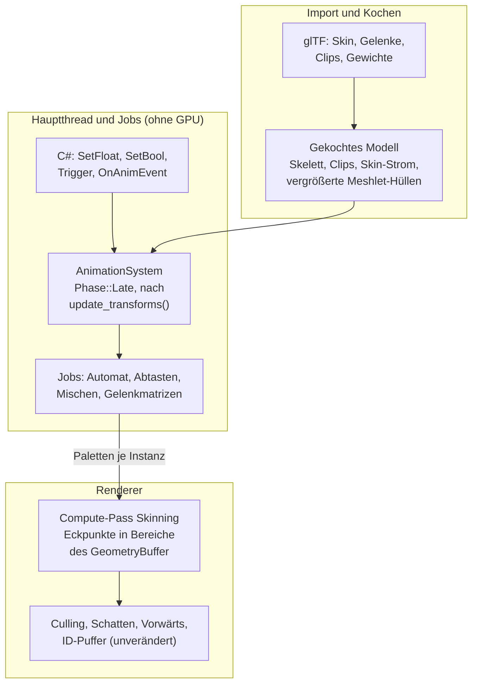

# R4.6: Animation

- **Phase:** Konstruktion (Reifegrad [R4](R4-gameplay-systeme.md))
- **Status:** in Arbeit (Plan abgestimmt in #58)
- **Pull Requests:** [#58](https://github.com/viiez/ngine/pull/58) (Plan)

## Plan

**Ziel:** Figuren bewegen sich mit Skelett-Animation. Skelette, Skins und Clips kommen aus glTF
und werden gekocht wie Netze. `ngine.animation` tastet Clips ab, mischt sie und führt einen
Zustandsautomaten mit Übergängen und einem 1D-Blend (Stehen, Gehen, Laufen), alles in Jobs und
ohne GPU. Ein C#-Skript setzt die Parameter des Automaten aus der Bewegung der Spielfigur. Ein
Compute-Pass verformt die Eckpunkte vor dem Zeichnen, sodass Meshlets, Culling, Schatten, Auswahl
per Klick und der Rückfallpfad ohne Mesh Shader nichts davon wissen. Nebenbei hält der Renderer
seine Instanzen dauerhaft auf der GPU (TD-46) und zeigt Zähler und GPU-Zeiten je Pass im
Statistikfenster (TD-45). Der Server rechnet Posen nur, wo Gameplay sie braucht.

**Features:** ANIM-01 (Skelett-Animation), ANIM-02 (Blending). **Schulden:** TD-45 (Statistik der
GPU), TD-46 (Instanzen dauerhaft auf der GPU), beide mit Frist R4.

### Entwurf

**Import und Kochen** (ANIM-01)

- `asset::Model` bekommt `skins` (Gelenke als Knotenindizes, Eltern, inverse Bindematrizen,
  Ruhelage) und `animations` (Clips mit Spuren für Verschiebung, Drehung und Skalierung je Gelenk).
  Teilnetze mit Skin bekommen einen zweiten Strom `SkinVertex` (vier Gelenke als `u16`, vier
  Gewichte als normierte `u16`, 16 Bytes), damit `Vertex` mit 48 Bytes für alle anderen Netze
  bleibt.
- `load_gltf()` liest Skins und Animationen mit fastgltf, statt sie wie bisher zu übergehen.
  Interpolation `STEP` und `LINEAR` bleiben, `CUBICSPLINE` tastet das Kochen auf 30 Hz linear ab.
  Mehr als vier Einflüsse pro Eckpunkt werden auf die vier stärksten gekürzt und neu normiert (mit
  einer Warnung). Morph Targets bleiben außen vor.
- Gekochte Modelle (`cooked.cpp`) speichern Skelett, Clips und Skin-Strom mit; die Version des
  Formats steigt, ältere Dateien im Cache werden neu gekocht. Clips sind über `AssetRef` (Modell
  und Index) erreichbar wie Netze und Materialien, ohne neue Asset-Art.
- **Meshlets verformter Netze:** Die Hüllkugeln sind für die Ruhelage gebaut. Das Kochen tastet
  alle Clips des Modells ab und vergrößert jede Kugel so, dass sie das Meshlet in jeder Pose
  umschließt; der Test am Normalenkegel ist für verformte Netze aus. Gelenke, die ein Clip eines
  anderen Modells weiter bewegt, deckt ein Zuschlag pro Gelenk ab (siehe Abstimmung).

**Modul `ngine.animation`** (ANIM-01, ANIM-02)

- Neues Modul in der Schicht Laufzeit-Systeme: hängt an `ngine.core`, `ngine.math`,
  `ngine.reflect`, `ngine.jobs`, `ngine.asset` und `ngine.world`, nicht an Fenster oder GPU.
  Selbst gebaut wie abgestimmt; ozz-animation bleibt der Rückfall.
- `Skeleton` (Gelenke in Reihenfolge Eltern vor Kindern), `Pose` (lokale Lagen als Verschiebung,
  Quaternion, Skalierung), `sample(clip, zeit, pose)` mit einem Zeiger pro Spur, der sich die
  letzte Stelle merkt, damit Abtasten fortlaufend O(1) ist. `blend(a, b, gewicht)` mischt linear
  und Quaternionen über `nlerp` auf der kürzeren Seite; Masken pro Gelenk sind vorbereitet, aber
  in R4.6 nicht genutzt. Danach Lagen im Modellraum und die Palette (Gelenk mal inverse
  Bindematrix) als 3×4-Matrizen.
- **Zustandsautomat** als Asset `.animgraph` (JSON wie die Materialtabelle, mit `.meta`):
  Parameter (`float`, `bool`, `trigger`), Zustände (ein Clip oder ein 1D-Blend über einen
  Parameter, Geschwindigkeit, Schleife), Übergänge mit Bedingungen, Dauer der Überblendung und
  „erst nach Ende“. Gehen und Laufen im 1D-Blend laufen mit gleicher normierter Zeit, damit die
  Füße beim Mischen im Takt bleiben. Übergänge mischen von der aktuellen Pose aus, auch mitten in
  einer anderen Überblendung, damit nichts springt.
- **Ereignisse in Clips:** Zeitpunkte mit Namen (z. B. `Fuss_links`) aus einer Datei neben dem
  Modell (`.animevents`, JSON), die beim Abspielen über den `EventBus` als `AnimationEvent`
  ankommen. glTF hat dafür kein Feld.
- Komponenten in der Reflection, damit Inspector, Szenen, Prefabs und C# sie kennen:
  - `Animator`: `graph` (Asset-Kennung des Automaten), `speed`, `active`, `pose_mode`
    (`Always`, `Visible`, `Never`, siehe Abstimmung) und die Parameterwerte als Liste aus Namen und
    Wert, damit Szenen sie speichern.
  - Den Laufzustand (aktiver Zustand, Zeiten, Überblendung, Paletten) hält das
    `AnimationSystem` in einer Tabelle nach Entity, wie das `AudioSystem` seine Stimmen (TD-57);
    die Welt bleibt frei von transienten Daten.
- `AnimationSystem` läuft in der Nachbereitung (`Phase::Late`) nach `update_transforms()`, verteilt
  die Animatoren über `parallel_for` auf Jobs (jeder schreibt nur seine eigene Palette) und
  sammelt Ereignisse danach in fester Reihenfolge nach Entity. Zeit kommt aus dem Bild, nicht aus
  dem festen Schritt; Parameter, die aus der Simulation kommen, glättet das Skript (Erkenntnis aus
  R4.5).
- Gelenke werden keine Entities: 60 Gelenke mal 200 Figuren wären 12 000 Entities mit
  Transforms. Wer an einem Gelenk etwas befestigen will, bekommt später eine Komponente
  `JointAttachment` (nicht in R4.6).

**Skinning auf der GPU** (ANIM-01)

- Ein Compute-Pass `skinning.slang` läuft im Render-Graph vor Culling und Schatten: Er liest Ruhe-
  Eckpunkte, Skin-Strom und Palette und schreibt verformte Eckpunkte (Position, Normale, Tangente,
  UV im gewohnten `Vertex`) in einen Bereich des `GeometryBuffer`, einen pro Instanz und Frame im
  Flug. Lineares Skinning mit vier Einflüssen.
- Die `GpuInstance` der Figur zeigt mit `vertices` auf diesen Bereich; Indizes, Meshlets und
  Wörter teilt sie mit dem Ruhe-Netz. Für Culling, Schatten, Vorwärts-Pass, ID-Puffer und
  durchsichtige Netze ist sie danach ein gewöhnliches Netz. Mesh-Shader-Pfad und indirekte Draws
  sehen dieselben Eckpunkte; ein Bildvergleich beider Pfade läuft in der CI über lavapipe.
- Die Hüllkugel der Instanz rechnet die CPU aus den Gelenken der Pose (plus Radius des Netzes um
  sein Gelenk aus dem Kochen), damit Figuren am Bildrand nicht verschwinden.
- Paletten aller Figuren kommen pro Frame in einen Puffer; der Pass verarbeitet alle Figuren in
  einem Aufruf (ein Arbeitspaket je 64 Eckpunkte, Tabelle der Instanzen).

**Renderer-Schulden**

- **TD-46, Instanzen dauerhaft auf der GPU:** Jedes Teilnetz eines `MeshRenderer` und jeder Chunk
  bekommt einen festen Platz im Instanzpuffer; geschrieben wird nur, was sich geändert hat (Lage,
  Material, Netz). Weil Instanzen bisher kamerarelativ sind und sich mit jeder Bewegung der
  Kamera ändern würden, speichert die Instanz ihre Lage künftig als Zelle eines Gitters
  (ganzzahlig, 1 km) und Versatz in `f32`; der Shader zieht die Zelle und den Versatz der Kamera
  ab und bleibt so auch weit vom Ursprung genau ([ADR 0012](../adr/0012-64bit-world-coordinates.md)).
  Gruppen der Meshlets baut der Renderer nur neu, wenn Netze dazukommen oder wegfallen.
- **TD-45, Statistik der GPU:** Zeitstempel je Pass im Render-Graph (`vkCmdWriteTimestamp2`),
  gelesen wie die Zähler aus den Puffern der Frames im Flug, ohne Warten. Die Zähler der Meshlets
  (gezeichnet, Stumpf, Kegel, Hi-Z) gibt es dann je Pass, auch für die Kaskaden der Schatten. Das
  Statistikfenster des Editors zeigt beides als Tabelle; die Sandbox schreibt es mit `--stats` ins
  Log. Ohne Zeitstempel (einige Treiber) bleiben die Spalten leer.

**Aus C# gesteuert** (ANIM-02)

- `Animator` kommt wie jede Komponente automatisch in C# an. Dazu in `NativeApi`:
  `entity.SetAnimFloat(name, wert)`, `SetAnimBool`, `SetAnimTrigger`, `GetAnimState()` und
  `OnAnimEvent(name)` als Ereignis an Skripten derselben Entity.
- `Spielersteuerung.cs` setzt `Tempo` (geglättete Geschwindigkeit auf der Ebene), `AmBoden`,
  `Geduckt` und den Trigger `Springen`. `Schritte.cs` hört auf die Ereignisse `Fuss_links` und
  `Fuss_rechts`, solange die Figur ein Modell mit Ereignissen hat, sonst wie bisher auf `OnStep`.

**Figur für die Demo**

- Wie die Klänge in R4.5 erzeugen wir die erste Figur selbst (`tools/figur/erzeugen.py`): eine
  schlichte Gliederpuppe aus abgerundeten Quadern, rund 20 Gelenke, weich gewichtet an den
  Gelenken, mit den Clips Stehen, Gehen, Laufen, Springen, Fallen, Landen und Ducken aus
  Sinuskurven und Schlüsselposen, dazu die Fußereignisse. Eigene Werke unter der Lizenz des
  Projekts, wenige hundert Kilobyte. Eine echte Figur (z. B. CC0 von Quaternius) kann sie später
  ersetzen, ohne dass sich Szenen ändern.
- Der Automat `figuren/spielfigur.animgraph`: Boden (1D-Blend über `Tempo`: Stehen 0 m/s, Gehen
  4 m/s, Laufen 7 m/s), Ducken, Springen, Fallen und Landen, Überblendungen von 0,1 bis 0,25 s.

**Sandbox, Editor, Server**

- Spielplatz: Die Spielfigur trägt die Puppe statt der Kapsel und ist in der Schulterperspektive
  zu sehen; dazu drei Figuren am Rand der Ebene, die mit Skripten im Kreis gehen, rennen und
  stehen. `--animators 200` stellt 200 Figuren mit verschiedenen Phasen auf und misst Zeit des
  `AnimationSystem`, Zeit des Skinning-Passes auf der GPU (aus TD-45) und Speicher.
- Editor: Fenster „Animation“ für die gewählte Entity (aktiver Zustand, Überblendung, Parameter
  mit Schiebern auch außerhalb des Spiels zum Ausprobieren), Skelett im Debug-Zeichnen. Den
  Automaten bearbeitet man als Datei mit Hot Reload; einen grafischen Editor gibt es nicht.
- `--headless --playground` rechnet die Automaten, aber Posen nur für `pose_mode = Always`; die
  Prüfsumme der Lagen bleibt, denn Animation schreibt keine Transforms. `--server` ebenso.

### Schritte

1. **Import und Kochen:** Skins, Clips und Skin-Strom aus glTF, gekochtes Format, vergrößerte
   Hüllen der Meshlets; Tests mit einer kleinen erzeugten glTF-Datei im Testordner.
2. **`ngine.animation`:** Skelett, Pose, Abtasten, Mischen, Palette, Automat als Asset mit Hot
   Reload, Ereignisse, `Animator` und `AnimationSystem` in Jobs; Tests mit fester Zeitspur, auch
   unter ThreadSanitizer (`[animation]` kommt ins Preset).
3. **Skinning:** Compute-Pass, Bereiche pro Frame im Flug, Hüllkugeln aus der Pose, beide
   Zeichenpfade; GPU-Test mit Bildvergleich über lavapipe.
4. **C# und Figur:** `NativeApi`, Skripte für Spielfigur und Schritte, erzeugte Puppe, Automat,
   Spielplatz.
5. **Renderer-Schulden:** Instanzen dauerhaft mit Gitterzellen (TD-46), Zeitstempel und Zähler je
   Pass im Statistikfenster (TD-45).
6. **Editor, Messen und Doku:** Fenster „Animation“, Skelett im Debug-Zeichnen,
   `--animators 200` auf dem PC; ADR 0050 (Animation und Skinning), Doku.

**Risiken:**

- **Hüllen der Meshlets:** Zu kleine Kugeln lassen Teile der Figur am Bildrand oder hinter
  Kanten verschwinden, zu große kosten Culling. Gegenmittel: Kugeln aus allen Clips beim Kochen,
  Zuschlag pro Gelenk, Debug-Zeichnen der Kugeln, Bildvergleich in der CI mit einer Figur am Rand.
- **Synchronisierung auf der GPU:** Der Skinning-Pass schreibt, was Culling und Zeichnen im selben
  Frame lesen, und ein Frame im Flug darf den Bereich des anderen nicht überschreiben.
  Gegenmittel: Barrieren über den Render-Graph, ein Bereich pro Frame im Flug, Validierungs-Layer
  mit Synchronisierungsprüfung in einem Testlauf.
- **TD-46 bricht Bekanntes:** Kamerarelative Instanzen sind die Grundlage für Genauigkeit weit vom
  Ursprung. Gegenmittel: `--far` als Testlauf, Bildvergleich bei 100 km, Umbau in einem eigenen
  Commit mit Messung vorher und nachher; scheitert er, bleibt TD-46 offen und bekommt eine neue
  Frist.
- **glTF-Vielfalt:** Skins mit Skalierung, Gelenke außerhalb der Szene, mehrere Skins pro Modell.
  Gegenmittel: unterstützt wird ein Skin pro Netz; was nicht passt, meldet eine Warnung und wird
  starr gezeichnet. Test mit der erzeugten Puppe und einer Datei aus Blender.
- **Zeitstempel auf lavapipe und Windows:** Nicht jeder Treiber kann sie in jeder Queue.
  Gegenmittel: Fähigkeit abfragen, ohne Zeitstempel leere Spalten statt Fehler.
- **Umfang:** Import, Modul, Pass, zwei Schulden aus dem Renderer, C# und Editor. Gegenmittel:
  Schritte 1 bis 4 tragen die Features; das Fenster „Animation“ und die Zähler je Pass lassen sich
  kürzen, TD-46 notfalls verschieben (siehe Risiko oben).

**Abnahme:**

- Eine animierte Figur läuft über das Terrain, Übergänge zwischen Stehen, Gehen, Laufen, Springen
  und Landen ohne Sprung (Sichtprüfung auf dem PC; Test: Pose ist über einen Übergang stetig).
- Mesh-Shader-Pfad und `--baseline` zeigen dasselbe Bild einer animierten Figur (Bildvergleich in
  der CI über lavapipe).
- 200 animierte Figuren auf dem PC gemessen: `AnimationSystem` im Hauptthread und in Jobs,
  Skinning-Pass auf der GPU, Speicher.
- Der Server rechnet Posen nur, wo Gameplay sie braucht (Test: `--headless --playground` rechnet
  keine Palette für `pose_mode = Visible`, die Prüfsumme bleibt).
- Ein C#-Skript steuert den Automaten über Parameter und bekommt Ereignisse aus Clips (Test).
- Instanzen werden nur bei Änderungen geschrieben, auch weit vom Ursprung genau (`--far`), und das
  Statistikfenster zeigt GPU-Zeiten und Zähler je Pass (TD-45, TD-46).

### Zur Abstimmung

1. **Figur selbst erzeugen** (Skript im Repository, Gliederpuppe mit erzeugten Clips) wie die
   Klänge in R4.5. Alternative: eine CC0-Figur von Quaternius mit fertigen Clips; schöner, aber
   ein paar Megabyte im Repository und Clips, die wir nicht selbst in der Hand haben.
2. **Keine Root Motion:** Die Physik bewegt die Figur wie bisher, die Animation folgt über
   `Tempo`, und der 1D-Blend ist so abgestimmt, dass die Füße bei 4 und 7 m/s kaum rutschen.
   Alternative: Root Motion aus den Clips treibt den Character Controller; genauer, aber Physik,
   Netzwerk (R5) und Skripte hängen dann an der Animation.
3. **Automat als Datei** (`.animgraph`, JSON mit Hot Reload) und ein Fenster, das ihn zeigt und
   Parameter verstellt, aber nicht grafisch bearbeitet. Alternative: Knoten-Editor mit einer
   ImGui-Erweiterung; mehr Arbeit und eine neue Bibliothek.
4. **Skinning im Compute-Pass** in eigene Bereiche des `GeometryBuffer` (wie im R4-Plan), damit es
   bei einem Zeichenpfad bleibt. Kostet pro Figur Speicher für ihre Eckpunkte je Frame im Flug
   (bei 5 000 Eckpunkten und zwei Frames rund 0,5 MB). Alternative: Skinning im Vertex- und Mesh
   Shader; spart Speicher, aber jeder Pass (Schatten, ID-Puffer, beide Phasen) skinnt neu und
   jeder Shader braucht eine zweite Fassung.
5. **Lineares Skinning mit vier Einflüssen.** Dual Quaternion Skinning (weniger Einknicken an
   Schultern) kommt, wenn eine echte Figur es zeigt.
6. **`pose_mode` pro Animator:** `Visible` (Standard) rechnet Posen nur, wenn ein Renderer sie
   braucht, `Always` auch auf dem Server (später für Trefferzonen), `Never` nur den Automaten. Der
   Automat läuft immer, damit Zustand und Ereignisse auf Server und Client gleich sind.
7. **Ereignisse in Clips** aus einer Datei neben dem Modell (`.animevents`) und Schritte aus den
   Fußereignissen statt aus `step_length`. Alternative: Schritte bleiben bei `step_length`, dann
   reicht der Automat ohne Ereignisse.
8. **TD-46 mit Gitterzellen:** Instanzen speichern Zelle und Versatz statt kamerarelativer Lage,
   der Shader rechnet relativ zur Kamera. Alternative: TD-46 auf R6 verschieben und nur die
   Instanzen der Figuren pro Frame schreiben; spart Risiko, lässt aber die 0,9 ms im 99.
   Perzentil stehen.

**Ergebnis der Abstimmung** (viiez, im Projekt-Thread zu #58): Alle acht Punkte passen wie
vorgeschlagen. Figur selbst erzeugt; keine Root Motion; Automat als Datei mit Hot Reload ohne
Knoten-Editor; Skinning im Compute-Pass in Bereiche des `GeometryBuffer`; lineares Skinning mit
vier Einflüssen; `pose_mode` pro Animator; Ereignisse in Clips für die Schritte; TD-46 mit
Gitterzellen.
