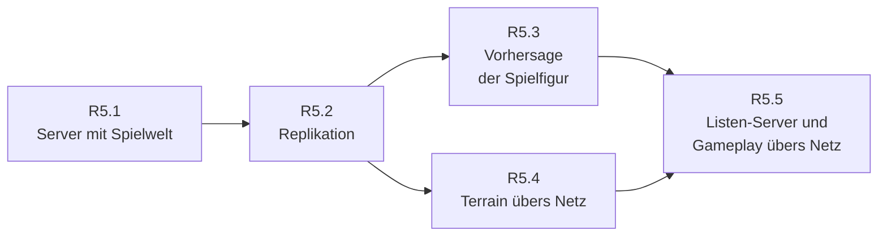
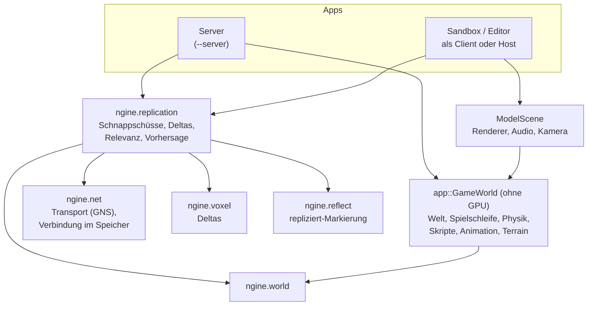

# R5: Multiplayer

- **Phase:** Konstruktion
- **Status:** in Arbeit (Plan abgestimmt mit dem Merge von #59, R5.1 bis R5.4 abgeschlossen)
- **Pull Requests:** #59 (Plan), Iterationen siehe Review

R5 ist der fünfte und letzte Reifegrad der Konstruktion vor dem Review und der Evaluation der
Engine. Wie R1 bis R4 ist er zu groß für eine Iteration; wir teilen ihn in fünf Iterationen, jede
mit eigenem Dokument, eigenem PR und eigener Abnahme auf dem PC. Dieses Dokument hält den Plan für
den ganzen Reifegrad und am Ende sein Review.

## Plan

**Ziel:** Aus der Welt für einen Spieler wird eine Welt für mehrere. Ein dedizierter Server ohne
Fenster und GPU rechnet den Spielplatz mit Terrain, Physik, Skripten und Figuren; Clients verbinden
sich, steuern ihre eigene Figur ohne spürbare Verzögerung, sehen die anderen Spieler animiert laufen,
hören ihre Schritte und graben gemeinsam im selben Terrain. Wer später beitritt, sieht die Welt, wie
sie ist. Ein Spieler kann auch selbst hosten und mitspielen. Der Server ist die Wahrheit
([ADR 0007](../adr/0007-server-authoritative-multiplayer.md)); Verlust und Latenz sind getestet,
nicht nur localhost.

**Features:** NET-01, NET-02, NET-03, NET-04, NET-05, NET-06, dazu VOX-06 (Deltas übertragen).
Schulden mit Frist R5: TD-13, TD-14, TD-41, TD-46, TD-47, TD-51, TD-54, TD-57, TD-58, TD-61, TD-63
und TD-64 (neu aus dem Review von R4). Für TD-46 schlägt der Plan eine neue Frist vor (siehe
[Zur Abstimmung](#zur-abstimmung)).

### Aufteilung

| Iteration | Inhalt | Features und Schulden | Abnahme |
| --- | --- | --- | --- |
| R5.1 Server mit Spielwelt | Ein Teil der Apps ohne GPU (Arbeitstitel `GameWorld`: Welt, Spielschleife, Physik, Terrain-Kollision, Skripte, Automaten), den Sandbox, Editor, `--headless` und Server gleich nutzen; `jolt_world.cpp` aufgeteilt. Der dedizierte Server lädt eine Szene mit Terrain, Materialtabelle, gekochten Assets und Skripten aus dem Cache, rechnet die feste Simulation und meldet sich mit einem Statusbericht. Spieler verbinden und gehen: Pro Client entsteht eine Spielfigur aus einem Prefab, die seine Eingabe-Aktionen steuert. Jolt unter ThreadSanitizer mit eigenem Triplet | NET-02, TD-64, TD-51, TD-54, TD-63, TD-47 | `--server --scene szenen/spielplatz.json` rechnet den Spielplatz mit Skripten und Figuren und dieselbe Prüfsumme wie `--headless --playground`; ein Client verbindet sich, steuert eine Figur auf dem Server (Test mit zwei Prozessen); Physik auf den Workern unter ThreadSanitizer |
| R5.2 Replikation | Komponenten und Felder werden in der Reflection als repliziert markiert. Schnappschüsse als Delta gegen den letzten bestätigten, Positionen quantisiert, Relevanz pro Client nach Abstand zu seiner Figur. Entities entstehen und verschwinden auf dem Client, Verweise auf Entities werden übersetzt. Der Client zeichnet die anderen interpoliert mit einem kleinen Puffer. Verlust und Latenz über die Simulation von GameNetworkingSockets in Tests und mit `--net-sim`. Fenster „Netzwerk“ mit Datenrate, Ping, Verlust und Größe der Schnappschüsse | NET-04, NET-01, TD-13, TD-14 | Zwei Clients sehen Kisten fallen und die Figur des anderen laufen, flüssig auch bei 150 ms Latenz und 5 % Verlust; 8 Clients mit 500 bewegten Entities bleiben unter dem Budget pro Client (Messung); ein Test mit Verlust zeigt dieselbe Welt nach dem Heilen |
| R5.3 Vorhersage der Spielfigur | Eingabe als Befehle pro festem Schritt mit Nummer, mehrfach geschickt gegen Verlust. Der Client rechnet seine eigene Figur sofort voraus, merkt sich Eingaben und Zustände, vergleicht mit dem Stand vom Server und rechnet bei Abweichung ab dem bestätigten Schritt neu. Glättung kleiner Korrekturen. Der Server prüft Eingaben (Tempo, Sprung) | NET-05 | Bei 150 ms Latenz läuft und springt die eigene Figur ohne Verzögerung, ohne Zittern auf flachem Boden und beim Springen; eine Korrektur nach einem Stoß ist sichtbar weich (Sichtprüfung auf dem PC); Test mit fester Spur: Client und Server enden am gleichen Ort |
| R5.4 Terrain übers Netz | Graben und Auftragen schickt der Client als Wunsch; der Server prüft Reichweite und Takt, wendet den Pinsel an und verteilt die geänderten Deltas der Chunks an Clients in der Nähe. Beim Beitreten bekommt ein Client die Deltas der Regionen um seine Figur zuerst, den Rest nach und nach. Kollision und Kisten auf dem Server, Gruben auf allen Clients. Deltas für grobe Stufen zwischengespeichert | NET-06, VOX-06, TD-41 | Zwei Clients graben gleichzeitig, beide sehen beide Gruben, eine Kiste fällt bei beiden; ein dritter tritt später bei und sieht alle Gruben; Datenmenge einer Grube und eines Beitritts gemessen |
| R5.5 Listen-Server und Gameplay übers Netz | Ein Spieler hostet und spielt mit (Server und Client im selben Prozess über eine Verbindung im Speicher). Skripte laufen auf dem Server, darstellende Skripte auch auf Clients (Attribut an der Klasse). Ereignisse vom Server an Clients (Einmal-Klänge, Fußschritte, Laterne), Parameter der Animation repliziert. Editor: Spielen als Listen-Server mit weiteren Clients aus der Sandbox | NET-03, TD-58, TD-57, TD-61 | Szenario des Reifegrads (siehe Abnahme) auf PC und Notebook |

Nicht in R5, damit der Reifegrad in überschaubarer Zeit fertig wird:

- **Suche und Matchmaking, Steam, Beglaubigung von Spielern:** Verbunden wird über Adresse und
  Port; die Verbindung ist verschlüsselt, aber nicht beglaubigt (wie in D3).
- **Vorhersage für Physik-Körper und Lag-Kompensation für Treffer:** Kisten und Kugeln rechnet nur
  der Server; Clients zeichnen sie interpoliert. Treffer gibt es noch nicht.
- **Speichern und Laden einer laufenden Sitzung auf dem Server** (Persistenz über Neustarts): Die
  Deltas des Terrains überleben schon heute; Entities der laufenden Welt folgen mit dem Prototyp.
- **Spiel-UI für Verbinden und Lobby** (UI-01): Kommandozeile und Editor reichen; die Evaluation
  nach R5 entscheidet über die Bibliothek.
- **Instanzen dauerhaft auf der GPU** (TD-46): Vorschlag R6, siehe Abstimmung.

### Entwurf

- **Ein Zusammenbau der Simulation (TD-64):** `GameWorld` besitzt Welt, `Simulation`,
  `PhysicsWorld`, Terrain mit Kollision, `ScriptSystem` und `AnimationSystem` und kennt weder
  Fenster noch GPU. `ModelScene` legt Renderer, Audio, Kamera und Debug-Zeichnen darüber, der
  Server die Replikation. So hängen sich Netzwerk-Stufen an einer Stelle ein.
- **Tick:** Der Server rechnet wie bisher mit 60 Hz. Schnappschüsse gehen mit 30 Hz raus, Eingaben
  der Clients mit jedem festen Schritt (60 Hz), je Paket die letzten drei, damit ein verlorenes
  Paket nichts kostet. Server und Client zählen dieselben Schritte; der Client läuft seiner
  Schätzung des Servers um die halbe Rundlaufzeit plus einen Puffer voraus.
- **Replikation:** Bleibt bei Schnappschüssen über die Reflection
  ([ADR 0024](../adr/0024-networking-gns-snapshots.md)), wird aber schlank: Komponenten und Felder
  markiert die Registrierung (`types.add<T>("T").replicated()`, einzelne Felder ausnehmbar);
  `Transform` mit Quantisierung (Positionen relativ zu einer Zelle in Millimetern, Drehung als
  kleinste drei Komponenten). Der Server hält pro Client den letzten bestätigten Schnappschuss und
  schickt nur geänderte Felder; Entities außerhalb der Relevanz (Vorschlag 150 m um die Figur, mit
  Abstufung der Rate) schickt er nicht. Ein Hash über Namen und Felder in der Willkommensnachricht
  ersetzt den Vergleich der Namen.
- **Interpolation und Vorhersage:** Fremde Entities zeichnet der Client zwischen zwei
  Schnappschüssen, rund 100 ms in der Vergangenheit, über das vorhandene `Interpolated`. Die eigene
  Figur rechnet er voraus: `CharacterVirtual` mit denselben Eingaben, ein Ringpuffer der Zustände
  pro Schritt, bei Abweichung zurück zum bestätigten Schritt und die gemerkten Eingaben neu
  rechnen. Weil Clang und MSVC nicht bitgleich rechnen (R4.3), ist eine Toleranz nötig und eine
  sanfte Korrektur der Darstellung.
- **Terrain:** Der Server ist auch hier die Wahrheit. Er schickt die Deltas der geänderten Chunks
  (Lauflängen aus [ADR 0042](../adr/0042-terrain-deltas-region-files.md), meist wenige KB),
  zuverlässig und gebündelt pro Tick. Pinsel als Befehle zu schicken wäre kleiner, verlangt aber
  bitgleiche Pinsel auf allen Plattformen; heute rechnen sie in `f32` mit `sqrt` und `floor`.
- **Skripte:** Laufen auf dem Server. Eine Klasse mit `[Client]` läuft nur auf Clients (Darstellung,
  Klänge), `[Everywhere]` auf beiden. Skripte am Server senden Ereignisse an Clients über
  `Net.Broadcast(...)` bzw. an einen Spieler; Felder replizierter Skript-Komponenten kommen mit
  den Schnappschüssen.
- **Listen-Server:** Zwei Welten im selben Prozess, Server und Client, verbunden über eine
  Verbindung im Speicher (GameNetworkingSockets kann Paare von Verbindungen ohne Netz). Kostet den
  Speicher einer zweiten Welt, aber es gibt nur einen Codepfad für Server und Client.
- Voraussichtliche ADRs: ein Zusammenbau der Simulation in den Apps (R5.1), Replikation mit Deltas,
  Relevanz und Interpolation (R5.2, ergänzt ADR 0024), Vorhersage der Spielfigur (R5.3), Terrain
  übers Netz (R5.4), Listen-Server und Skripte im Netz (R5.5).

### Leitlinien für alle fünf Iterationen

- Alles Netzwerk läuft ohne Fenster und GPU und ist in Tests mit Server und Clients im selben
  Prozess geprüft, mit zufälligen Ports auf localhost und mit simuliertem Verlust und Latenz.
- Jede Iteration ist mit zwei Prozessen sichtbar: Server und Sandbox als Client, ab R5.2 zwei
  Clients. Der Spielplatz bleibt die Szene der Abnahme.
- Jede neue Komponente sagt in der Reflection, ob und was sie repliziert.
- Bandbreite und Rechenzeit des Servers werden in jeder Iteration gemessen, mit 8 Clients aus
  einem Werkzeug (`--bots 8`), auf dem PC und mit einem zweiten Rechner über WLAN.
- Neue Systeme laufen unter ThreadSanitizer (`[net]` und `[replication]` kommen zu den Tests des
  Presets `linux-clang-tsan`).

**Risiken:**

- **Vorhersage zittert:** Kleine Unterschiede zwischen Client und Server führen zu ständigen
  Korrekturen. Gegenmittel: Toleranz, Glättung der Darstellung, Test mit fester Spur zwischen
  Clang und MSVC, Messung der Korrekturen pro Minute.
- **Bandbreite:** Volle Schnappschüsse brauchen schon heute mehr als ein Paket. Gegenmittel:
  Deltas, Quantisierung, Relevanz, Budget pro Client mit Vorrang nach Abstand; Messung mit `--bots`.
- **Terrain beim Beitreten:** Ein Spieler, der viel gegraben hat, schickt Megabytes. Gegenmittel:
  Deltas um die Figur zuerst, Rest gedrosselt im Hintergrund; Figur schläft wie Körper ohne Boden,
  bis die Kollision unter ihr steht.
- **Zwei Welten im Editor:** Spielen als Listen-Server verdoppelt Welt und Physik, und der Editor
  muss wissen, welche er zeigt. Gegenmittel: Der Editor zeigt die Welt des Clients, der Inspector
  liest beim Spielen die des Servers; Spielen ohne Netz bleibt wie heute.
- **Skripte an zwei Orten:** Ein Skript, das auf dem Client etwas ändert, was der Server bestimmt,
  verschwindet mit dem nächsten Schnappschuss. Gegenmittel: Standard ist der Server; Komponenten,
  die repliziert werden, sind auf dem Client nur lesbar (Warnung im Log, wenn ein Skript schreibt).
- **Windows und GameNetworkingSockets:** DLL, Firewall und OpenSSL. Gegenmittel: CI mit zwei
  Prozessen unter Windows, wie seit D3.

**Abnahme:** die Abnahmen der fünf Iterationen, dazu am Ende ein Review des ganzen Reifegrads mit
Architektur-Review und einem Szenario auf dem PC und dem Notebook: einen dedizierten Server
starten, mit beiden Rechnern verbinden, beide Figuren laufen über das Terrain und sehen sich
animiert, hören die Schritte des anderen, graben eine Grube unter einer Kiste (sie fällt bei
beiden), schalten die Laterne (beide sehen es). Ein dritter Client tritt später bei und sieht
alles. Mit `--net-sim 150 5` (150 ms, 5 % Verlust) läuft die eigene Figur ohne Verzögerung.
Danach dasselbe mit einem Listen-Server, den der PC im Editor startet.

### Zur Abstimmung

1. **Fünf Iterationen in dieser Reihenfolge:** Server mit Spielwelt, Replikation, dann Vorhersage
   und Terrain (unabhängig voneinander), zuletzt Listen-Server und Gameplay übers Netz. Erst der
   Zusammenbau ohne GPU (TD-64), weil jede weitere Iteration ihn an einer Stelle braucht.
2. **Schnappschüsse mit Deltas** gegen den letzten bestätigten Stand bleiben das Modell (ADR 0024),
   statt Änderungen einzeln und zuverlässig zu schicken. Markierung in der Reflection statt einer
   festen Liste von Komponenten.
3. **Tick:** Simulation mit 60 Hz auf Server und Client, Schnappschüsse mit 30 Hz, Eingaben mit 60
   Hz und den letzten drei in jedem Paket. Fremdes rund 100 ms in der Vergangenheit interpoliert.
4. **Vorhersage nur für die eigene Figur**, Körper der Physik nur auf dem Server. Alternative:
   auch Körper voraussagen, die der Spieler berührt; deutlich mehr Arbeit mit Jolt und erst nötig,
   wenn das Spiel Physik als Gameplay nutzt.
5. **Terrain als Deltas vom Server**, nicht als Pinsel-Befehle. Kostet mehr Bytes pro Grube, aber
   braucht keine bitgleichen Pinsel. Der Client darf seinen eigenen Pinsel sofort zeigen; der
   Server überschreibt ihn mit seinem Ergebnis.
6. **Skripte standardmäßig auf dem Server**, Attribute `[Client]` und `[Everywhere]` für Darstellung
   und Klang, Ereignisse vom Server über `Net.Broadcast`. Alternative: Skripte laufen überall und
   prüfen `IsServer`; einfacher anzufangen, aber jedes Skript muss daran denken.
7. **Listen-Server mit zwei Welten** im selben Prozess über eine Verbindung im Speicher, statt einer
   gemeinsamen Welt für Host und Server mit Sonderfällen.
8. **TD-46 nach R6:** Instanzen dauerhaft auf der GPU sind ein Umbau des Renderers, der jeden Shader
   berührt und nichts mit dem Netz zu tun hat. Im Rendering-Ausbau ändern wir die Shader ohnehin.
   Alternative: als eigene kleine Iteration zwischen R5.2 und R5.3.
9. **Ziel 8 Spieler** pro Server mit einem Budget von 64 KB/s pro Client (Koop wie Valheim mit bis
   zu 10). Mehr Spieler sind kein Ziel von R5.

**Ergebnis der Abstimmung** (viiez, mit dem Merge des Plans am 19.11.2026): Alle neun Punkte
passen wie vorgeschlagen; TD-46 hat damit die Frist R6.

## Review

Folgt nach der letzten Iteration. Bisher:

| Iteration | Pull Requests | Ergebnis |
| --- | --- | --- |
| [R5.1](R5.1-server-mit-spielwelt.md) Server mit Spielwelt | #59 (Plan), #60 | `app::GameWorld` für alle Apps, Server mit Spielplatz, Skripten und einer Figur pro Client, Jolt aufgeteilt und unter ThreadSanitizer |
| [R5.2](R5.2-replikation.md) Replikation | #62 | Markierung in der Reflection, Deltas gegen den bestätigten Stand, Relevanz und Budget pro Client, Interpolation, Client mit Fenster und Fenster „Netzwerk“ |
| [R5.3](R5.3-vorhersage.md) Vorhersage der Spielfigur | #63 | Nummerierte Befehle mit Warteschlange, Vorhersage der eigenen Figur mit Abgleich und Glättung, Physik auf dem Client im Modus `remote`, Korrekturen nach Ursache |
| [R5.4](R5.4-terrain-uebers-netz.md) Terrain übers Netz | #64 | Graben über den Befehl beim Server, Deltas geänderter Chunks zuverlässig nach Abstand, vorhergesagter Pinsel mit Bestätigung, Index der Deltas für grobe Stufen |
