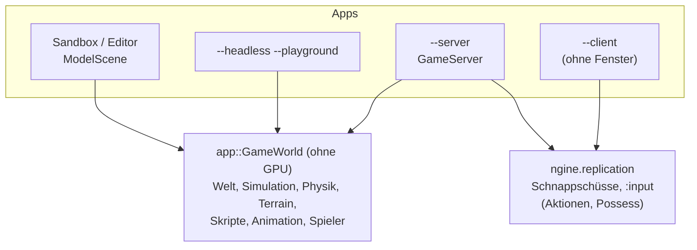

# R5.1: Server mit Spielwelt

- **Phase:** Konstruktion (Reifegrad [R5](R5-multiplayer.md))
- **Status:** abgeschlossen (Plan mit R5 abgestimmt in #59, umgesetzt in #60)
- **Pull Requests:** [#59](https://github.com/viiez/ngine/pull/59) (Plan des Reifegrads), [#60](https://github.com/viiez/ngine/pull/60) (Umsetzung)

## Plan

**Ziel:** Der dedizierte Server rechnet dieselbe Welt wie das Spiel. Ein Zusammenbau der Simulation
ohne GPU (`app::GameWorld`) ersetzt die beiden Zusammenbauten in `ModelScene` und `--headless`;
der Server lädt damit den Spielplatz aus der Szene mit Terrain, Materialtabelle, Skripten und
Figuren, rechnet im festen Takt und gibt jedem Client eine Figur, die seine Aktionen steuert.
Nebenbei zerfällt `jolt_world.cpp` in Dateien nach Aufgabe, und Jolt rechnet auch unter
ThreadSanitizer auf den Workern.

**Features:** NET-02 (dedizierter Server). **Schulden:** TD-64 (ein Zusammenbau, `jolt_world.cpp`
aufteilen), TD-51 (Materialtabelle und Texturen aus dem Cache), TD-54 (Skripte auf dem Server),
TD-63 (Automaten auf dem Server), TD-47 (Jolt unter ThreadSanitizer).

### Entwurf

- **`app::GameWorld`** (`apps/common/game_world.cppm`, [ADR 0051](../adr/0051-game-world-dedicated-server.md))
  besitzt Typen, Welt, Job-System, Ressourcen, Prefabs, `Simulation`, Physik mit den Formen der
  Modelle, Materialtabelle des Terrains, `AnimationSystem` und `ScriptSystem`. `load_playground()`
  lädt die Szene `szenen/spielplatz.json`, wenn es sie gibt, sonst die Welt aus Code;
  `load_scene()` jede andere Szene. `update(dt)` rechnet ein Bild: Ressourcen, Skripte,
  Transforms, Terrain, Spielschleife, Animation. `deterministic` wartet auf die Kollision des
  Terrains, damit Läufe gleich sind.
- **`ModelScene`** behält Renderer, Audio, Kamera, Steuerung und Debug-Zeichnen und hält ein
  `GameWorld`; Sandbox und Editor ändern sich nach außen nicht.
- **Spieler:** `bind_player(figur, aktionen)` bindet ein `ActionState` an eine Figur.
  `ScriptSystem::bind_input(entity, aktionen)` gibt Skripten dieser Entity eigene Aktionen; C#
  kennt die laufende Entity (`Host.Current`) und `Input` fragt mit ihr. Figuren ohne Skript steuert
  `steer_players()` in C++ (`apply_controls()`).
- **Server im festen Takt:** Ein Bild ist ein fester Schritt zu 1/60 s, die Uhr bestimmt nur, wann
  das nächste beginnt. Ohne Clients rechnet der Server deshalb wie `--headless --playground`;
  `--track` lässt die Figur der Szene dieselbe Spur laufen wie dort und schaltet das Warten ab.
- **Eingabe übers Netz:** Clients schicken jedes Bild alle Aktionen mit Wert und Flanken
  (`replication::encode_actions()`, mit `ActionMap::hash()` gegen eine andere Belegung geschützt).
  Der Server meldet jedem Client seine Figur (`encode_possess()`), der erste bekommt die Figur der
  Szene, weitere eine neue aus `prefabs/spielfigur.prefab`. Wer geht, verliert seine neue Figur.
- **`jolt_world.cpp`** wird zur internen Partition `ngine.physics:jolt` (Hilfen und
  `PhysicsWorld::Impl`) und den Dateien `jolt_world.cpp` (Welt, Körper, Schritt),
  `jolt_characters.cpp`, `jolt_terrain.cpp` und `jolt_queries.cpp`.
- **ThreadSanitizer:** Das Triplet `x64-linux-tsan` baut Jolt mit `-fsanitize=thread`; danach
  rechnet Jolt auch unter ThreadSanitizer auf den Workern.
- **Materialtabelle und Texturen:** `--headless` und Server lesen die Tabelle aus dem Asset-Ordner;
  „Alles kochen“ und `ngine_cook` kochen auch die Texturen, die eine Tabelle nennt.

**Risiken:**

- **Skripte im Takt des Servers:** Bisher lief nur ein Skript-Satz pro Welt mit einer Eingabe. Mit
  einer Entity pro Aufruf ändert sich die Schnittstelle zwischen C++ und C#. Gegenmittel: Tests mit
  zwei Figuren und eigenen Aktionen, Prüfsumme im Vergleich zu `--headless`.
- **Prüfsumme hängt an der Uhr:** Ein Server, der nach gemessener Zeit rechnet, wäre nie gleich.
  Gegenmittel: fester Schritt pro Bild, Aufholen ohne Pause.
- **ThreadSanitizer-Triplet:** Ein eigenes Triplet baut alle Pakete neu und verlängert die CI beim
  ersten Lauf. Gegenmittel: Nur Jolt bekommt die Flags, der Binär-Cache hält den Rest.

**Abnahme:** `--server --scene szenen/spielplatz.json` rechnet den Spielplatz mit Skripten und
Figuren und mit `--track` dieselbe Prüfsumme wie `--headless --playground`; ein Client verbindet
sich und steuert eine Figur auf dem Server (CI mit zwei Prozessen, auf dem PC in zwei Terminals);
Physik rechnet unter ThreadSanitizer auf den Workern. Schritte in
[setup.md](../setup.md#r51-testen-server-mit-spielwelt).

## Review

**Ergebnis:** Der dedizierte Server rechnet dieselbe Welt wie das Spiel. `app::GameWorld` setzt
Welt, Spielschleife, Physik, Terrain, Skripte, Animation und Spieler ohne GPU an einer Stelle
zusammen; `ModelScene` (Sandbox, Editor), `--headless --playground` und `--server` nutzen es.
Der Server lädt den Spielplatz aus `szenen/spielplatz.json` mit Materialtabelle und Skripten,
rechnet im festen Takt und gibt jedem Client eine Figur, die dessen Aktionen steuert; der erste
übernimmt die Figur der Szene, weitere bekommen eine aus dem Prefab. Skripte fragen ihre Eingabe
pro Entity. `jolt_world.cpp` ist in die interne Partition `ngine.physics:jolt` und vier Dateien nach
Aufgabe zerlegt, Jolt rechnet unter ThreadSanitizer auf den Workern, und „Alles kochen“ kocht die
Texturen des Terrains mit.

Abnahme: Alle drei Kriterien sind erfüllt. `--server --scene szenen/spielplatz.json --track`
rechnet dieselbe Prüfsumme wie `--headless --playground` (CI auf Linux `bcc711a5673b8211`, auf
Windows `d2e8b36ba34afe8a`, je beide gleich); ein Client verbindet sich in der CI mit zwei
Prozessen und läuft mit seiner Figur auf dem Server 15,5 m (Linux) bzw. 9,4 m (Windows); der Job
mit ThreadSanitizer rechnet Physik und `[game]` auf den Workern ohne Meldung. viiez hat die
Abnahme auf dem PC am 21.11.2026 bestätigt. Die CI war auf Linux, unter ThreadSanitizer und auf
Windows grün.

**Erkenntnisse:**

- Ein Server im festen Takt macht ihn vergleichbar: Ohne Clients ist ein Lauf bitgleich zu
  `--headless`, die Prüfsumme in der CI ersetzt einen eigenen Test für den Server.
- Das erste Bild wartet auf Terrain und Kollision um die Figuren (im Debug-Build mehrere
  Sekunden). Der Server lauscht deshalb erst danach; sonst bekäme ein Client in dieser Zeit keine
  Antwort.
- stdout ist gepuffert, wenn es in eine Datei geht: Die CI wartete auf „Server bereit“, bis der
  Server schon beendet war. Zeilen, auf die Werkzeuge warten, werden sofort geschrieben.
- Mit Jolt unter ThreadSanitizer meldet TSan die Zusicherung in Jolts Debug-Sperren
  (`mLockedThreadID`), die vor dem Sperren liest. `cmake/tsan.supp` blendet genau das aus; echte
  Wettläufe in unserem Code gab es nicht.
- Ein eigenes Triplet baut beim ersten Lauf alle Pakete neu. Der Download des großen Archivs von
  KTX-Software brach dabei einmal ab; der vcpkg-Cache, der auch bei Fehlschlag gespeichert wird,
  machte den zweiten Lauf kurz.
- Die Prüfsumme von `--headless --playground` ist seit R5.1 eine andere, weil die Szene mit
  Laterne, Spaziergängern und deren Skripten geladen wird; setup.md nennt beide Werte.

**Anpassungen:** ADR 0051 angenommen. Feature-Katalog: NET-02 fertig, NET-04 um Aktionen und
Possess ergänzt. Schuldenregister: TD-47, TD-51, TD-54, TD-63 und TD-64 abgebaut, TD-46 nach R6
(Abstimmung des Plans), neu TD-65 (Skript aus dem Asset-Browser ziehen, Rest von TD-54) und TD-66
(Skripte ohne Spieler sehen auf dem Server keine Eingabe, Frist R5).

**Architektur-Review:**

- Abhängigkeiten: `app.game_world` hängt an Engine-Modulen ohne Fenster und GPU (`world`,
  `physics`, `script`, `animation`, `asset`, `input`, `audio` ohne Gerät). `ModelScene`
  baut Renderer, Audio und Kamera darüber, der Server `ngine.replication`. `ngine.replication`
  hängt neu an `ngine.input` (für `:input`), `ngine.cook` an `ngine.world` (Materialtabelle).
  Passt zur [Architektur](../architecture.md).
- Fremdbibliotheken: keine neuen. Jolt bekommt im Preset `linux-clang-tsan` das Triplet
  `x64-linux-tsan`.
- Schnittstellen: Eingabe pro Figur über `GameWorld::bind_player()`, `ScriptSystem::bind_input()`
  und `ActionState::apply()`; Nachrichten des Spiels in `replication:input`. Die Eingabe geht
  jedes Bild unzuverlässig und ohne Nummer; Befehle pro Schritt kommen mit der Vorhersage (R5.3).
- Größe: `model_scene.cppm` schrumpft von rund 1 280 auf 1 100 Zeilen, `game_world.cppm` hat rund
  490, `game_server.cppm` rund 510. Aus `jolt_world.cpp` mit rund 2 260 Zeilen wurden
  `jolt.cppm` (820, gemeinsame Typen und `Impl`), `jolt_world.cpp` (800), `jolt_terrain.cpp`
  (460), `jolt_characters.cpp` (350) und `jolt_queries.cpp` (200).
- Schulden: TD-65 und TD-66 stehen im Register, keine mit Frist „jetzt“.
- Leistung: Der Server rechnet den Spielplatz im Debug-Build der CI mit rund 1,0 bis 1,1 ms pro
  Bild (Linux), lokal im Container mit 1,5 bis 1,9 ms; ein Schnappschuss mit nur der Figur hat
  89 Bytes. Messungen mit 8 Clients folgen mit `--bots` in R5.2.
