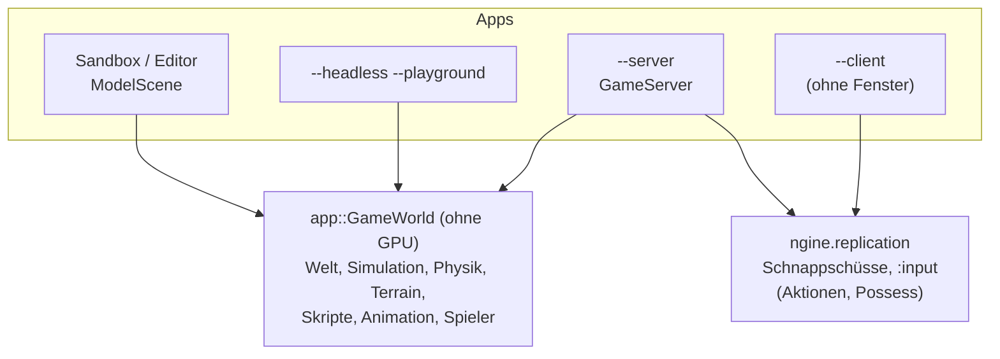

# R5.1: Server mit Spielwelt

- **Phase:** Konstruktion (Reifegrad [R5](R5-multiplayer.md))
- **Status:** in Arbeit (Plan mit R5 abgestimmt in #59, Umsetzung im PR dieser Iteration)
- **Pull Requests:** #59 (Plan des Reifegrads), PR dieser Iteration (Umsetzung)

## Plan

**Ziel:** Der dedizierte Server rechnet dieselbe Welt wie das Spiel. Ein Zusammenbau der Simulation
ohne GPU (`app::GameWorld`) ersetzt die beiden Zusammenbauten in `ModelScene` und `--headless`;
der Server lädt damit den Spielplatz aus der Szene mit Terrain, Materialtabelle, Skripten und
Figuren, rechnet im festen Takt und gibt jedem Client eine Figur, die seine Aktionen steuert.
Nebenbei zerfällt `jolt_world.cpp` in Dateien nach Aufgabe, und Jolt rechnet auch unter
ThreadSanitizer auf den Workern.

**Features:** NET-02 (dedizierter Server). **Schulden:** TD-64 (ein Zusammenbau, `jolt_world.cpp`
aufteilen), TD-51 (Materialtabelle und Texturen aus dem Cache), TD-54 (Skripte auf dem Server),
TD-63 (Automaten auf dem Server), TD-47 (Jolt unter ThreadSanitizer).

### Entwurf

- **`app::GameWorld`** (`apps/common/game_world.cppm`, [ADR 0051](../adr/0051-game-world-dedicated-server.md))
  besitzt Typen, Welt, Job-System, Ressourcen, Prefabs, `Simulation`, Physik mit den Formen der
  Modelle, Materialtabelle des Terrains, `AnimationSystem` und `ScriptSystem`. `load_playground()`
  lädt die Szene `szenen/spielplatz.json`, wenn es sie gibt, sonst die Welt aus Code;
  `load_scene()` jede andere Szene. `update(dt)` rechnet ein Bild: Ressourcen, Skripte,
  Transforms, Terrain, Spielschleife, Animation. `deterministic` wartet auf die Kollision des
  Terrains, damit Läufe gleich sind.
- **`ModelScene`** behält Renderer, Audio, Kamera, Steuerung und Debug-Zeichnen und hält ein
  `GameWorld`; Sandbox und Editor ändern sich nach außen nicht.
- **Spieler:** `bind_player(figur, aktionen)` bindet ein `ActionState` an eine Figur.
  `ScriptSystem::bind_input(entity, aktionen)` gibt Skripten dieser Entity eigene Aktionen; C#
  kennt die laufende Entity (`Host.Current`) und `Input` fragt mit ihr. Figuren ohne Skript steuert
  `steer_players()` in C++ (`apply_controls()`).
- **Server im festen Takt:** Ein Bild ist ein fester Schritt zu 1/60 s, die Uhr bestimmt nur, wann
  das nächste beginnt. Ohne Clients rechnet der Server deshalb wie `--headless --playground`;
  `--track` lässt die Figur der Szene dieselbe Spur laufen wie dort und schaltet das Warten ab.
- **Eingabe übers Netz:** Clients schicken jedes Bild alle Aktionen mit Wert und Flanken
  (`replication::encode_actions()`, mit `ActionMap::hash()` gegen eine andere Belegung geschützt).
  Der Server meldet jedem Client seine Figur (`encode_possess()`), der erste bekommt die Figur der
  Szene, weitere eine neue aus `prefabs/spielfigur.prefab`. Wer geht, verliert seine neue Figur.
- **`jolt_world.cpp`** wird zur internen Partition `ngine.physics:jolt` (Hilfen und
  `PhysicsWorld::Impl`) und den Dateien `jolt_world.cpp` (Welt, Körper, Schritt),
  `jolt_characters.cpp`, `jolt_terrain.cpp` und `jolt_queries.cpp`.
- **ThreadSanitizer:** Das Triplet `x64-linux-tsan` baut Jolt mit `-fsanitize=thread`; danach
  rechnet Jolt auch unter ThreadSanitizer auf den Workern.
- **Materialtabelle und Texturen:** `--headless` und Server lesen die Tabelle aus dem Asset-Ordner;
  „Alles kochen“ und `ngine_cook` kochen auch die Texturen, die eine Tabelle nennt.

**Risiken:**

- **Skripte im Takt des Servers:** Bisher lief nur ein Skript-Satz pro Welt mit einer Eingabe. Mit
  einer Entity pro Aufruf ändert sich die Schnittstelle zwischen C++ und C#. Gegenmittel: Tests mit
  zwei Figuren und eigenen Aktionen, Prüfsumme im Vergleich zu `--headless`.
- **Prüfsumme hängt an der Uhr:** Ein Server, der nach gemessener Zeit rechnet, wäre nie gleich.
  Gegenmittel: fester Schritt pro Bild, Aufholen ohne Pause.
- **ThreadSanitizer-Triplet:** Ein eigenes Triplet baut alle Pakete neu und verlängert die CI beim
  ersten Lauf. Gegenmittel: Nur Jolt bekommt die Flags, der Binär-Cache hält den Rest.

**Abnahme:** `--server --scene szenen/spielplatz.json` rechnet den Spielplatz mit Skripten und
Figuren und mit `--track` dieselbe Prüfsumme wie `--headless --playground`; ein Client verbindet
sich und steuert eine Figur auf dem Server (CI mit zwei Prozessen, auf dem PC in zwei Terminals);
Physik rechnet unter ThreadSanitizer auf den Workern. Schritte in
[setup.md](../setup.md#r51-testen-server-mit-spielwelt).

## Review

Folgt nach dem Merge.
