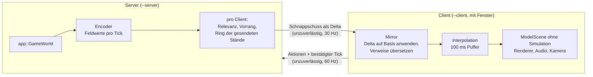

# R5.2: Replikation

- **Phase:** Konstruktion (Reifegrad [R5](R5-multiplayer.md))
- **Status:** geplant (Plan in Abstimmung)
- **Pull Requests:** folgt

## Plan

**Ziel:** Clients sehen die Welt des Servers. Statt eines vollen Schnappschusses mit Name und
Transform der Figuren schickt der Server jedem Client nur, was sich seit dessen letztem
bestätigten Stand geändert hat, Positionen quantisiert und nur aus der Umgebung seiner Figur. Was
repliziert wird, sagt die Registrierung in der Reflection. Die Sandbox wird zum Client mit Fenster:
Sie zeigt den Spielplatz, wie ihn der Server rechnet, die fremden Figuren und Kisten flüssig
interpoliert, auch bei Latenz und Verlust. Verlust und Latenz sind simuliert in Tests und auf dem
PC (`--net-sim`), und `--bots` misst Bandbreite und Rechenzeit mit acht Clients.

**Features:** NET-04 (Replikation), NET-01 (Transport: simulierter Verlust und Latenz).
**Schulden:** TD-13 (volle Schnappschüsse, ungepackt), TD-14 (kein Test mit Verlust und Latenz),
beide mit Frist R5.

### Entwurf

**Markierung in der Reflection** (NET-04)

- `types.add<T>("T").replicated()` markiert eine Komponente; einzelne Felder nimmt
  `.field(...).local()` aus (z. B. `CharacterMotion::move`, `jump`). Typen von Skripten bleiben in
  R5.2 lokal (R5.5).
- `Hint::Entity` markiert Felder mit einer Entity-Kennung (`u64`). Der Server schreibt seine
  Kennung, der Client übersetzt sie beim Anwenden in die eigene; unbekannte werden 0 und beim
  nächsten Schnappschuss nachgezogen, sobald die Entity da ist. Die Hierarchie (Elternteil) geht
  als eigener Eintrag mit, ebenfalls übersetzt.
- **Codecs:** Ein Typ kann statt der Felder einen eigenen Codec registrieren. `Transform` bekommt
  einen: Position als Zelle zu 64 m (nur bei Wechsel) plus Versatz in Millimetern (drei `u16`),
  Drehung als die drei kleinsten Komponenten mit je 15 Bit, Skalierung nur, wenn sie nicht 1 ist.
  Statt 40 Bytes rund 13 Bytes pro Transform.
- Die Liste der replizierten Komponenten ergibt sich aus der Registry (alle markierten, in
  Reihenfolge der Registrierung). Die Willkommensnachricht trägt einen Hash über Namen, Felder und
  Codecs statt der Namen; passt er nicht, trennt der Client mit der ersten abweichenden
  Komponente im Log (die Liste schickt der Server nur dann hinterher).
- In R5.2 markiert: `Name`, `Transform`, `MeshRenderer`, `DirectionalLight`, `PointLight`,
  `SpotLight`, `Terrain`, `AudioSource`, `Animator`, `RigidBody` (nur `motion`), `Collider`
  (für Debug-Zeichnen), `CharacterMotion` (nur `velocity`, `ground`, `crouched`) und die Parameter
  des Automaten (siehe Abstimmung, Punkt 6).

**Schnappschüsse als Delta** (NET-04, TD-13)

- Der Server liest einmal pro Schnappschuss die Feldwerte aller replizierten Entities in einen
  flachen Stand (Kennung, Komponenten, Bytes der kodierten Felder) und merkt sich pro Client die
  letzten 32 gesendeten Stände als Verweise (geteilter Speicher, nicht pro Client kopiert).
- Der Client bestätigt in jeder Eingabenachricht den neuesten angewendeten Tick. Der Server
  kodiert gegen diesen Stand: neue Entities voll, geänderte mit einer Bitmaske der Komponenten und
  je Komponente einer Bitmaske der Felder, entfernte als Liste der Kennungen. Ohne Bestätigung
  oder bei zu alter Basis schickt er den vollen Stand.
- Der Client hält die Stände, auf die der Server Deltas beziehen darf, ebenfalls im Ring, damit
  ein Delta auf eine ältere als die zuletzt angewendete Basis passt. Das Protokoll bekommt die
  Version 2.
- Statische Entities (Terrain, Licht, Bäume) kosten so nur beim Beitreten.

**Relevanz und Budget** (NET-04)

- Relevant ist, was höchstens 150 m von der Figur des Clients entfernt ist, dazu Entities ohne
  Lage (Terrain, Sonne). Bis 40 m jeder Schnappschuss (30 Hz), darüber jeder dritte (10 Hz).
  Verlässt eine Entity die Relevanz, gilt sie für den Client als entfernt; kommt sie zurück, geht
  sie voll mit.
- Budget pro Client: 64 KB/s, also rund 2 KB pro Schnappschuss. Passt nicht alles hinein, gehen
  Entities nach Vorrang (Nähe, wie lange nicht geschickt); der Rest wartet auf den nächsten. Der
  Beitritt mit vielen statischen Entities verteilt sich so über einige Schnappschüsse.

**Client mit Fenster und Interpolation**

- `ngine_sandbox --client adresse[:port]` öffnet das Fenster und zeigt die Welt des Servers;
  mit `--headless` bleibt es der Client ohne Fenster aus R5.1. Der Client lädt keine Szene: Alles,
  was er zeigt, kommt vom Server, Netze und Materialien aus dem eigenen Asset-Cache.
- `ModelScene` bekommt eine Art „Client“: `GameWorld` ohne Physik, Skripte und Spielschleife;
  Terrain erzeugt er selbst aus der replizierten Komponente `Terrain` (Deltas übers Netz folgen
  in R5.4), Automaten laufen mit den replizierten Parametern, Klangquellen spielen. Die Kamera
  folgt der eigenen Figur wie im Spiel; Eingaben gehen wie in R5.1 als Aktionen zum Server.
- **Interpolation:** Der Client merkt sich pro bewegter Entity die Transforms der letzten
  Schnappschüsse mit Tick und zeichnet rund 100 ms in der Vergangenheit, zwischen den beiden
  umgebenden Ständen (Position linear, Drehung über `slerp`). Die Uhr des Clients folgt den Ticks
  des Servers und gleicht Schwankungen sanft aus; fehlen Stände, rechnet er höchstens 100 ms mit
  der letzten Geschwindigkeit weiter und bleibt dann stehen. Das vorhandene `Interpolated` bleibt
  für den festen Schritt zuständig.
- Die eigene Figur ist in R5.2 ebenfalls interpoliert, also um Latenz plus Puffer verzögert. Ohne
  Verzögerung läuft sie mit der Vorhersage in R5.3.

**Verlust und Latenz** (NET-01, TD-14)

- `Transport::simulate({.lag_ms, .loss_percent})` schaltet die Simulation von GameNetworkingSockets
  ein (`FakePacketLag`, `FakePacketLoss` in beide Richtungen). Die Werte gelten für alle
  Verbindungen des Prozesses; in Tests mit Server und Client im selben Prozess also hin und
  zurück je einmal.
- `--net-sim 150 5` auf Client oder Server: 150 ms Rundlaufzeit zusätzlich, 5 % Verlust.
- Tests: Ein Client in derselben Welt bei 20 % Verlust und 100 ms; nach dem Abschalten ist seine
  Welt nach kurzer Zeit gleich der des Servers (Feld für Feld nach Quantisierung). Dazu Tests ohne
  Netz für Codec, Delta, Ring, fehlende Basis, Relevanz, Budget und Übersetzung der Verweise.

**Statistik und Messung**

- Der Client zählt Datenrate hin und zurück, Ping, Verlust (aus GameNetworkingSockets),
  Schnappschüsse pro Sekunde, deren Größe und den Puffer der Interpolation.
- **Fenster „Netzwerk“** in der Sandbox (F3) über `ngine.editor_ui`; ohne Fenster dieselben Werte
  alle drei Sekunden im Log. Der Server meldet pro Client Datenrate und Größe der Schnappschüsse
  im Statusbericht.
- `ngine_sandbox --bots 8 adresse` startet acht Clients ohne Fenster in einem Prozess, jeder mit
  eigener Verbindung und einer leicht versetzten Spur. Gemessen werden Bytes pro Client und
  Sekunde und die Zeit des Servers pro Bild, mit `--server --bodies 500` (500 bewegte Körper) auf
  dem PC und über WLAN mit dem Notebook.

**Was R5.2 nicht macht:** Vorhersage der eigenen Figur (R5.3), Terrain-Deltas übers Netz (R5.4),
Skripte und Ereignisse übers Netz, Fußschritte und Einmal-Klänge auf Clients, Listen-Server und
Editor als Client (R5.5).

**Risiken:**

- **Delta trifft keine Basis:** Gehen Bestätigungen verloren, wächst der Abstand zur Basis, und
  Schnappschüsse werden groß. Gegenmittel: Bestätigung in jeder Eingabe (60 Hz), Ring mit 32
  Ständen (gut eine Sekunde), voller Stand als Rückfall, Test mit Verlust.
- **Beitritt sprengt das Budget:** 46 Entities der Szene plus Körper voll geschickt. Gegenmittel:
  Budget mit Vorrang verteilt den Beitritt; Messung des Beitritts.
- **Zwei Arten von ModelScene:** Client ohne Simulation darf Spiel und Editor nicht verbiegen.
  Gegenmittel: Die Art ist eine Option von `GameWorld` (keine Physik, keine Skripte), der Rest
  von `ModelScene` bleibt; Sandbox ohne `--client` und Prüfsumme von `--headless` unverändert.
- **Uhr der Interpolation zittert** bei schwankender Latenz. Gegenmittel: Puffer in Ticks statt
  Millisekunden, sanftes Nachstellen, Messung des Puffers im Fenster.
- **Simulation von GameNetworkingSockets ist global:** Tests im selben Prozess beeinflussen
  sich. Gegenmittel: Tests mit Simulation setzen sie am Ende zurück, `[net]` läuft in einem
  Prozess nacheinander.

**Abnahme:**

- Zwei Clients mit Fenster am Server auf dem PC sehen Kisten fallen und die Figur des anderen
  laufen (animiert), flüssig auch mit `--net-sim 150 5` (Sichtprüfung auf dem PC).
- 8 Clients (`--bots 8`) mit 500 bewegten Entities bleiben unter 64 KB/s pro Client; Zeit des
  Servers pro Bild und Bytes eines Beitritts gemessen.
- Ein Test mit 20 % Verlust zeigt nach dem Heilen dieselbe Welt auf Client und Server.
- `--server --track` rechnet weiter dieselbe Prüfsumme wie `--headless --playground`, und die
  CI mit zwei Prozessen läuft unter Linux und Windows.

### Zur Abstimmung

1. **Der Server repliziert die ganze Szene**, der Client lädt keine. Statische Entities kosten
   nur beim Beitreten, und eine Welt, die sich ändert (Kisten weg, Figuren neu), braucht keinen
   Abgleich. Alternative: Der Client lädt dieselbe Szene und der Server schickt nur, was sich
   bewegt; spart Bytes beim Beitreten, braucht aber stabile Kennungen in der Szene und gleiche
   Dateien auf allen Rechnern.
2. **Markierung an der Registrierung** (`.replicated()`, Felder mit `.local()` ausnehmen) und
   eigene Codecs pro Typ für Quantisierung, nur `Transform` in R5.2. Alternative: Quantisierung
   pro Feld beschreiben (Bereich, Bits); allgemeiner, aber für eine Komponente zu viel.
3. **Delta gegen den bestätigten Stand** mit Bestätigung in jeder Eingabe und einem Ring von 32
   Ständen auf beiden Seiten; ohne Basis der volle Stand.
4. **Relevanz 150 m mit zwei Stufen** (30 Hz bis 40 m, 10 Hz darüber) und einem Budget von 64 KB/s
   pro Client mit Vorrang nach Nähe und Wartezeit.
5. **Interpolation 100 ms** in der Vergangenheit, auch für die eigene Figur, bis R5.3 sie
   voraussagt. Kurzes Weiterrechnen (bis 100 ms), wenn Stände fehlen.
6. **Parameter des Automaten aus R5.5 vorziehen:** Die Figur des anderen soll laut Abnahme
   sichtbar laufen; dafür müssen Tempo und Boden zum Client. Die Parameter, die Skripte auf dem
   Server setzen, gehen als replizierte Komponente mit. Alternative: in R5.2 gleitet die fremde
   Figur im Stehen, die Parameter folgen wie geplant in R5.5.
7. **Fenster „Netzwerk“ in der Sandbox** (F3) über `ngine.editor_ui`, damit man die Werte beim
   Spielen sieht; der Editor bekommt es mit dem Listen-Server in R5.5. Alternative: nur Log in
   R5.2, Fenster erst im Editor.
8. **Client mit Fenster ist die Sandbox** (`--client`), ohne Simulation auf dem Client; Terrain
   erzeugt er bis R5.4 aus Seed und Form selbst. ADR 0052 hält Markierung, Delta, Relevanz und
   Interpolation fest und ergänzt ADR 0024.
