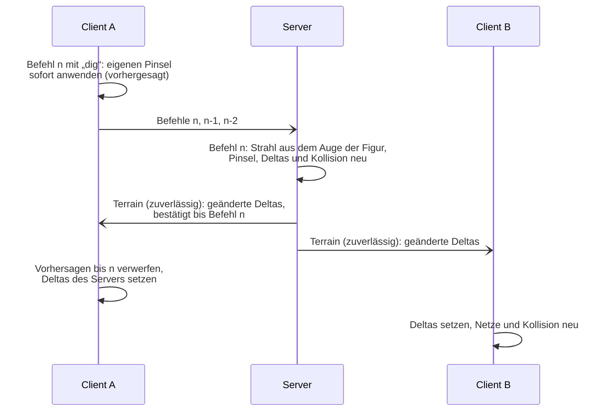

# R5.4: Terrain übers Netz

- **Phase:** Konstruktion (Reifegrad [R5](R5-multiplayer.md))
- **Status:** in Arbeit (umgesetzt, Sichtprüfung auf dem PC offen)
- **Pull Requests:** [#64](https://github.com/viiez/ngine/pull/64) (Plan und Umsetzung)

## Plan

**Ziel:** Alle graben im selben Terrain. Bis R5.3 baut jeder Client sein Terrain aus der
replizierten Komponente `Terrain` selbst (bitgleich nach
[ADR 0039](../adr/0039-deterministic-noise-rule-generator.md)), kennt aber keine Änderungen; der Server schaltet
das Graben von Clients deshalb ab. Ab R5.4 gräbt der Server, wenn ein Befehl es verlangt, und
verteilt die geänderten Deltas der Chunks ([ADR 0042](../adr/0042-terrain-deltas-region-files.md))
zuverlässig an die Clients, die nahen zuerst. Wer beitritt, bekommt alle Deltas, die um seine Figur
zuerst. Der eigene Pinsel erscheint sofort und wird vom Ergebnis des Servers ersetzt. Kollision,
Kisten und Figuren rechnet weiter der Server
([ADR 0007](../adr/0007-server-authoritative-multiplayer.md)); auf den Clients folgen Netze und
Kollision den Deltas.

**Features:** NET-06 (Voxel-Synchronisation), VOX-06 (Deltas übertragen). **Schulden:** TD-41
(grobe Stufen prüfen jedes Delta), dazu die Teilung von `snapshot.cpp` aus dem Architektur-Review
von R5.3.

### Entwurf

**Graben als Teil des Befehls** (NET-06)

- Die Aktion `dig` steckt schon heute in jedem Befehl (R5.3); der Server löscht sie nur. Ab R5.4
  gräbt er damit: Das Skript Spielersteuerung (bzw. ohne .NET derselbe Code in C++) wirft den
  Strahl aus dem Auge seiner Figur in deren Blick, so wie bisher lokal. Einen Zielpunkt vom Client
  gibt es nicht.
- **Prüfen:** Reichweite und Takt ergeben sich daraus von selbst. Der Strahl ist so lang wie
  `PlayerInput::dig_reach` auf dem Server, die Pause zwischen zwei Pinselstrichen steht im Skript
  der Szene des Servers (`Grabpause`, 0,15 s), und mehr als einen Befehl pro Schritt nimmt die
  Warteschlange nicht an. Radius und Material bestimmt ebenfalls der Server.
- Graben ohne .NET: Das Graben aus `ModelScene::update_dig()` wandert nach `app.player`
  (`DigTimer`), damit `GameWorld::steer_players()` auf dem Server ohne Skripte und die Vorhersage
  auf dem Client denselben Code nutzen.

**Deltas vom Server** (VOX-06, Plan R5, Punkt 5)

- Neue Nachricht `Terrain` (Server an Client, zuverlässig): Kennung der Terrain-Entity auf dem
  Server, Nummer des letzten verarbeiteten Befehls dieses Clients, Flags, dann je Chunk die
  Koordinate (Stufe 0, drei Varints mit Vorzeichen) und das kodierte Delta mit seiner Länge; Länge
  0 heißt „kein Delta mehr“ (zurück zur Grundwelt). Ein Delta geht immer ganz, nicht als Differenz
  zur vorigen Fassung: Ein Krater kostet nur seine Oberfläche, und Zuverlässigkeit hält die
  Reihenfolge.
- **Was der Server schon geschickt hat:** `replication::TerrainSender` merkt sich pro Client und
  Terrain den Zeiger des zuletzt geschickten Deltas jedes Chunks. Deltas sind unveränderlich und
  geteilt (`DeltaMap`), also reicht ein Zeigervergleich. Ändert sich die Version eines Terrains,
  vergleicht der Sender die neue Momentaufnahme mit der vorigen (unveränderte Einträge teilen den
  Zeiger) und merkt die geänderten Chunks bei allen Clients vor. Ein neuer Client hat alle Chunks
  mit Delta vorgemerkt.
- **Gebündelt mit den Schnappschüssen** (30 Hz): eine Nachricht pro Client und Terrain, nur wenn
  es etwas zu schicken gibt oder der Client seit der letzten Nachricht gegraben hat (dann trägt
  sie nur die Bestätigung, rund 12 Bytes).
- **Vorrang und Drossel:** Vorgemerkte Chunks gehen nach Abstand zur Figur des Clients. Chunks in
  der Relevanz (150 m, wie die Entities) gehen sofort und ohne Budget; ein Pinselstrich ändert nur
  wenige Chunks, und das Graben ist getaktet. Alles andere (Beitritt, ferne Änderungen) teilt sich
  ein eigenes Budget von 128 KB/s pro Client, zusätzlich zu den 64 KB/s der Schnappschüsse. Ein
  Spieler, der 1 MB Deltas gegraben hat, ist so nach rund acht Sekunden ganz übertragen, die Umgebung
  der Figur zuerst.
- **Beitritt:** Die erste Nachricht, nach der für diesen Client in der Relevanz nichts mehr
  vorgemerkt ist, trägt das Flag „Umgebung vollständig“. Bis dahin hält der Client die Vorhersage
  seiner Figur an und übernimmt nur den Stand des Servers (wie beim Laden der Welt in R5.3), damit
  sie nicht auf Boden steht, den der Server längst weggegraben hat.

**Auf dem Client**

- `replication::TerrainReceiver` liest die Nachrichten, übersetzt die Kennung über den Spiegel und
  hält Deltas für Terrains zurück, die der Client noch nicht kennt oder noch nicht gebaut hat
  (Nachrichten sind zuverlässig, Schnappschüsse nicht; die Entity kann später kommen).
- Gesetzt werden die Deltas über `world::restore_terrain()`, wie beim Undo im Editor: Chunks der
  Stufe 0 entstehen neu aus Grundwelt und Delta, grobe Stufen folgen beim Streamer, die Physik baut
  die Kollision der geänderten Chunks neu (R4.3).
- Der Client hält die Deltas des Servers als bestätigten Stand getrennt von seinen Vorhersagen.

**Eigener Pinsel sofort** (Plan R5, Punkt 5)

- Gräbt der vorhergesagte Befehl n, wendet der Client denselben Pinsel sofort auf sein Terrain an
  und merkt sich Befehl, Terrain und Pinsel. Die Vorhersage der Figur sieht die Grube damit im
  selben Schritt wie der Server.
- Kommt eine Nachricht `Terrain` mit der Bestätigung k, verwirft er alle Pinsel bis k: Ihre Chunks
  gehen zurück auf den bestätigten Stand (der Server hat sie in dieser oder einer früheren Nachricht
  geschickt, wenn er dort gegraben hat), dann wendet er die noch offenen Pinsel nach k erneut an.
  Weil die Nachricht zuverlässig und geordnet ist und der Server Änderungen in der Relevanz nie
  drosselt, kommt die Grube des Servers nie nach ihrer Bestätigung an; ein Flackern gibt es nur,
  wenn der Server anders gräbt als der Client (z. B. eine Kiste stand im Weg des Strahls).
- Neurechnen der Figur (R5.3) nutzt das Terrain, wie es gerade ist; gräbt der Client unter sich,
  stimmt das mit dem Server überein, weil beide den Pinsel im selben Befehl anwenden.

**Grobe Stufen schneller** (TD-41)

- `apply_deltas()` läuft heute für jeden groben Chunk über alle Deltas und liest jedes überlappende
  Delta Sample für Sample; ein Chunk der Stufe 5 deckt 32³ Chunks der Stufe 0 ab. Ein Client, der
  beim Beitritt viele Deltas bekommt, baut dann viele grobe Chunks neu.
- Neu hält `TerrainDeltas` neben der `DeltaMap` einen Index pro grober Stufe: für jeden groben
  Chunk die geänderten Samples, die auf seinem Raster liegen (Lage im groben Chunk und Wert),
  getrennt nach dem Chunk der Stufe 0, aus dem sie kommen. Er wird beim Setzen eines Deltas für
  dessen Vorfahren aktualisiert, ist unveränderlich wie die Tabelle und wird mit der Momentaufnahme
  geteilt. `apply_deltas()` liest für einen groben Chunk nur noch seinen Eintrag.
- Das Ergebnis bleibt bitgleich; ein Test vergleicht mit dem bisherigen Weg, eine Messung zeigt die
  Zeit für einen groben Chunk mit vielen Deltas vorher und nachher.

**Aufräumen**

- `snapshot.cpp` (rund 1 290 Zeilen) teilt sich in `encoder.cpp` (Schnappschüsse des Servers) und
  `mirror.cpp` (Spiegel des Clients), wie im Review von R5.3 vorgemerkt. Die neue Partition
  `ngine.replication:terrain` hält Nachricht, Sender und Empfänger.

**Statistik und Messung**

- Server: Bytes der Deltas pro Client und Sekunde, vorgemerkte Chunks, Bytes des Beitritts bis
  „Umgebung vollständig“ und bis alles da ist; im Statusbericht.
- Client: im Fenster „Netzwerk“ Deltas (Chunks, Bytes), Pinsel offen und verworfen, Zeit bis zur
  vollständigen Umgebung.
- Gemessen werden die Bytes einer Grube (ein Pinselstrich und zwei Sekunden gehaltenes Graben), die
  eines Beitritts nach 50 Gruben auf dem Spielplatz und die Zeit für grobe Chunks mit vielen Deltas
  (TD-41).

**Tests**

- Ohne Netz: Kodierung der Nachricht `Terrain` (leeres Delta, Rückkehr zur Grundwelt, kaputte
  Längen, falsche Koordinaten), `TerrainSender` (nur geänderte Zeiger, Vorrang nach Abstand,
  Budget außerhalb der Relevanz, Flag „Umgebung vollständig“, neuer Client bekommt alles),
  `TerrainReceiver` (Deltas für unbekannte Terrains warten), Verwerfen und Neuanwenden vorhergesagter
  Pinsel.
- Voxel: Index der groben Stufen ergibt dieselben Chunks wie der bisherige Weg, auch nach Ändern
  und Entfernen von Deltas.
- **Mit Netz** (localhost, im selben Prozess): Server und zwei Clients; beide graben gleichzeitig,
  danach haben Server und beide Clients dieselben Deltas. Eine Kiste über der Grube fällt auf dem
  Server und in beiden Spiegeln. Ein dritter Client tritt später bei und hat danach dieselben
  Deltas. Dasselbe mit 100 ms und 5 % Verlust.
- `--server --track` rechnet weiter dieselbe Prüfsumme wie `--headless --playground`; die CI mit
  zwei Prozessen läuft unter Linux und Windows.

**Was R5.4 nicht macht:** Pinsel als Befehle statt Deltas (Plan R5, Punkt 5), Speichern der
Deltas einer laufenden Sitzung auf dem Server (nicht in R5), Werkzeuge des Editors übers Netz
(R5.5 mit dem Listen-Server), Komprimieren der Deltas über die Lauflängen hinaus.

**Risiken:**

- **Beitritt nach viel Graben:** Megabytes an Deltas. Gegenmittel: Umgebung zuerst, Rest mit eigenem
  Budget, Vorhersage hält an, bis die Umgebung steht; Messung des Beitritts.
- **Flackern des eigenen Pinsels**, wenn der Server anders gräbt. Gegenmittel: Der Server gräbt im
  selben Befehl mit derselben Lage (Abweichung unter 1 cm, R5.3); Zählung verworfener Pinsel, die
  der Server nicht bestätigt hat.
- **Netze und Kollision hinken:** Viele Deltas auf einmal lassen den Client viele Chunks meshen.
  Gegenmittel: Meshen läuft schon parallel; TD-41 macht grobe Stufen billig; Messung der Bildzeit
  beim Beitritt.
- **Kisten auf dem Client:** Fällt eine Kiste auf dem Server in eine Grube, die der Client noch
  nicht kennt, zeichnet er sie kurz im Boden. Gegenmittel: Änderungen in der Relevanz kommen im
  selben Tick wie der Schnappschuss, der die fallende Kiste zeigt.

**Abnahme:**

- Zwei Clients graben gleichzeitig, beide sehen beide Gruben; eine Kiste über einer Grube fällt bei
  beiden (Sichtprüfung auf dem PC).
- Ein dritter Client tritt später bei und sieht alle Gruben.
- Datenmenge einer Grube und eines Beitritts gemessen; Zeit für grobe Chunks mit vielen Deltas
  vorher und nachher (TD-41).

### Zur Abstimmung

1. **Graben als Aktion im Befehl:** Der Server wirft den Strahl selbst aus dem Auge seiner Figur;
   Reichweite, Takt, Radius und Material bestimmt er. Alternative: eigene Nachricht `Dig` mit
   Zielpunkt, die der Server gegen die Reichweite prüft; trifft genau, was der Client sah, vertraut
   ihm aber mehr und braucht eine zweite Prüfung des Takts.
2. **Nachricht `Terrain`** mit ganzen Deltas pro Chunk, zuverlässig, gebündelt mit den
   Schnappschüssen (30 Hz) und mit der Bestätigung des letzten Befehls. Der Server merkt sich pro
   Client den geschickten Zeiger jedes Chunks. Protokoll Version 4.
3. **Vorrang und Budget:** Änderungen in der Relevanz (150 m) sofort und ohne Budget, alles andere
   nach Abstand mit eigenen 128 KB/s pro Client neben den 64 KB/s der Schnappschüsse. Alternative:
   ein gemeinsames Budget von 64 KB/s für alles; Beitritte dauern dann länger.
4. **Vorhersage hält an**, bis die Umgebung der Figur vollständig ist (Flag in `Terrain`).
5. **Eigener Pinsel sofort** mit Verwerfen und Neuanwenden über die Bestätigung in `Terrain`.
   Alternative: kein vorhergesagter Pinsel; die Grube erscheint nach der Rundlaufzeit, und die
   vorhergesagte Figur steht kurz auf Boden, den es beim Server nicht mehr gibt.
6. **TD-41 über einen Index pro grober Stufe** mit den Samples auf dem Raster, geteilt mit der
   Momentaufnahme. Alternative: nur ein räumlicher Index der Chunks mit Delta (weniger Speicher,
   aber grobe Chunks lesen weiter jedes Sample).
7. **`snapshot.cpp` teilen** in `encoder.cpp` und `mirror.cpp` in diesem PR.
8. **ADR 0054** hält Nachricht, Vorrang, Budget und vorhergesagte Pinsel fest und ergänzt ADR 0042
   und ADR 0053.

**Ergebnis der Abstimmung** (viiez, im Projekt-Thread zu #64 am 24.11.2026): Alle acht Punkte
passen wie vorgeschlagen. Graben als Aktion im Befehl; Nachricht `Terrain` mit ganzen Deltas,
zuverlässig und mit Bestätigung, Protokoll 4; Änderungen in der Relevanz sofort, Rest mit eigenen
128 KB/s; Vorhersage hält bis zur vollständigen Umgebung an; eigener Pinsel sofort; TD-41 über einen
Index pro grober Stufe; `snapshot.cpp` geteilt; ADR 0054.

## Abnahme

**Automatisch geprüft:** Der Test „Two clients see both pits, a box falls for both and a late joiner
sees all“ lässt Server und drei Clients im selben Prozess über localhost laufen. Zwei Gruben
entstehen gleichzeitig, eine unter einer Kiste; beide Clients haben danach dieselben Deltas wie der
Server, die Kiste fällt auf dem Server und in beiden Spiegeln, und ein später beitretender Client hat
alle Gruben. Derselbe Test läuft mit 80 ms und 10 % Verlust pro Richtung.

**Erste Sichtprüfung** (viiez, 24.11.2026, Windows, `--server`, ein Client mit und einer ohne
`--net-sim`): Gruben beider Clients erscheinen beim jeweils anderen, ein später beitretender Client
bekommt alle Änderungen. Ein Befund: Hält man die rechte Maustaste zum Dauergraben, ist der Server
überlastet. Die anderen Clients sehen den grabenden nicht mehr, Graben wirkt nicht mehr; danach
steht der grabende Client weit weg, und ein langer Graben führt in seine Laufrichtung. Mit und ohne
Drosselung nachstellbar.

**Ursachen und Änderungen:**

- **Warten nach jedem Pinsel:** Der Server rechnet bitgleich (R5.1) und wartete deshalb nach jedem
  Pinsel, bis Netze aller Stufen und neue Formen der Kollision fertig waren. Im Debug-Build kostete
  das rund 350 ms je Pinsel; der Server fiel hinter die Uhr zurück. Jetzt wartet `app::GameWorld`
  nur noch beim Start (`TerrainUpdate::wait_for_edits`, `PhysicsSettings::wait_for_rebuilds`):
  Bis die neuen Formen und groben Stufen fertig sind, gelten die alten. Editor und Tests warten
  weiter. Test „Without waiting for rebuilds the old terrain shape holds until the new one is
  built“.
- **Zu viele Netze je Pinsel:** Ein geänderter Chunk meshte seine ganze Nachbarschaft neu, bis zu 27
  Blätter, obwohl der Store schon weiß, welche feinen Chunks die Samples lesen. Jetzt kommen nur
  diese und gröbere Nachbarn dazu; das hilft auch Clients und dem Spiel ohne Netz. Test „Streaming
  around several observers and remeshing brush edits“ erweitert, die Netze bleiben gleich.
- **Graben und Weglaufen:** Nach dem Stau holte der Server auf und wiederholte dabei fehlende
  Befehle unter ihren Nummern. So lief seine Schlange dem Client davon, verwarf alle echten Befehle
  als zu alt, und die Figur lief und grub mit dem letzten Befehl weiter. Jetzt gilt nach 15
  Wiederholungen (250 ms) der letzte ohne Eingabe und ohne neue Nummer, und der nächste echte Befehl
  gilt wieder (ergänzt ADR 0053). Test „Command queue stops repeating input after a long gap“.

Gemessen mit einem Client ohne Fenster, der mit gehaltener rechter Maustaste über den Spielplatz
läuft (Debug-Build, Linux): Ein Bild mit Pinsel kostet 30 bis 50 ms statt rund 350 ms, der Server
bleibt im Takt, und der Client hat danach wieder 4 offene Befehle statt 64.

**Offen:** Zweite Sichtprüfung durch viiez auf dem PC mit Dauergraben.

**Messungen** (Debug-Build, Linux):

| Was | Ergebnis |
| --- | --- |
| Zwei Gruben (Radius 1,6 m und 1,2 m) an einen Client | 1 943 B in 4 Chunks |
| Beitritt mit diesen zwei Gruben | 1 943 B in 4 Chunks |
| Grober Chunk der Stufe 5 mit 193 Deltas (TD-41) | vorher 4,30 ms, mit Index 0,29 ms |

## Review

**Ergebnis:** Alle graben im selben Terrain. Die Aktion `dig` steckt im Befehl; der Server wirft den
Strahl aus dem Auge seiner Figur (Skript oder `GameWorld::dig_players()`), im Takt von
`app::DigTimer`, und wendet den Pinsel an. `replication::TerrainSender` vergleicht die
Momentaufnahmen der Deltas über Zeiger und schickt geänderte Chunks ganz in der zuverlässigen
Nachricht `Terrain` (Protokoll 4), in der Relevanz sofort, sonst nach Abstand mit 128 KB/s pro
Client. `replication::TerrainReceiver` setzt sie in das Terrain des Spiegels, sagt den eigenen
Pinsel voraus und gleicht ihn über die Bestätigung in der Nachricht ab. Die Vorhersage der Figur
wartet auf „Umgebung vollständig“. Grobe Stufen lesen die Deltas über einen Index (TD-41), und
`snapshot.cpp` ist in `:wire`, `encoder.cpp` und `mirror.cpp` geteilt.

**Abweichungen vom Plan:**

- Der Server gräbt ohne Skript in `GameWorld::dig_players()` in der Phase nach den Skripten, damit
  der Takt zum Skript passt; der Client sagt im festen Schritt voraus. Kleine Unterschiede im
  Zeitpunkt fängt die Bestätigung ab.
- Hat der Client gegraben, schickt der Server die Bestätigung auch ohne Chunks, damit ein Pinsel,
  den der Server nicht ausführte (Takt, Kiste im Strahl), sicher zurückgenommen wird.
- Der Zwei-Prozess-Test der CI gräbt nicht; die Wege prüfen die Tests im Prozess, auch unter
  Verlust.

**Erkenntnisse:**

- Weil Deltas unveränderlich und geteilt sind, reicht ein Zeigervergleich, um geänderte Chunks zu
  finden; der Sender braucht keine eigene Kopie.
- Zuverlässig und geordnet plus „nahe Änderungen warten nie“ macht die Bestätigung einfach: Wenn
  sie ankommt, ist alles bis dahin da.
- Ein berührter Chunk kostet rund 500 B, eine kleine Grube also knapp 1 KB; die Lauflängen der
  Deltas sind schon dicht genug, eine Kompression darüber lohnt sich noch nicht.
- Der Test im Prozess grub zwei Mal; die Last zeigte erst Dauergraben auf dem PC. Ein Client ohne
  Fenster, der mit gehaltener Taste gräbt, stellte den Fehler nach, die Stapel aus gdb zeigten die
  Ursache. Ein Stau des Servers darf nicht in einen Zustand führen, aus dem er nicht herausfindet.
- Zwei Fehler fanden erst die Tests: ZigZag mit 64-Bit-Maske für 32-Bit-Werte und ein Test, der
  dieselbe Stelle zweimal grub und dann keine Änderung sah.

**Anpassungen:** ADR 0054 angenommen. Feature-Katalog: NET-06 und VOX-06 fertig. TD-41 abgebaut.
Keine neuen Schulden mit Frist.

**Architektur-Review:**

- Abhängigkeiten: `ngine.replication` bekommt `:terrain` und kennt dafür `ngine.voxel` über
  `ngine.world` (Deltas, `restore_terrain()`); `ngine.voxel` kennt nichts vom Netz. Die Apps
  verbinden Graben, Vorhersage und Empfang. Passt zur [Architektur](../architecture.md).
- Fremdbibliotheken: keine neuen.
- Schnittstellen: `GameMessage::Terrain`, `encode_terrain()`, `decode_terrain()`, `TerrainSender`,
  `TerrainReceiver`, `voxel::CoarseDeltas`, `voxel::DeltaState`, `TerrainDeltas::state()`,
  `app::figure_dig_target()`, `app::dig_brush()`, `app::DigTimer`,
  `GameWorld::dig_players()`, `PlayerPrediction::set_terrain()`, `TerrainUpdate::wait_for_edits`,
  `PhysicsSettings::wait_for_rebuilds`, `CommandQueueStats::idle` und `max_repeats` der
  `CommandQueue`. `:wire` ist eine Partition ohne
  Exporte für Encoder und Spiegel.
- Größe: `snapshot.cpp` hat noch rund 120 Zeilen, `encoder.cpp` rund 320, `mirror.cpp` rund 490,
  `wire.cppm` rund 490, `terrain.cpp` rund 570. `game_server.cppm` wächst auf rund 800 Zeilen; die
  Teilung in Verbindungen und Spiellogik steht mit R5.5 (Listen-Server) an.
- Leistung: Grobe Chunks mit vielen Deltas bauen über den Index gut zehnmal schneller. Der Index
  kostet pro geändertem Chunk der Stufe 0 für jede Stufe die Samples auf ihrem Raster.
