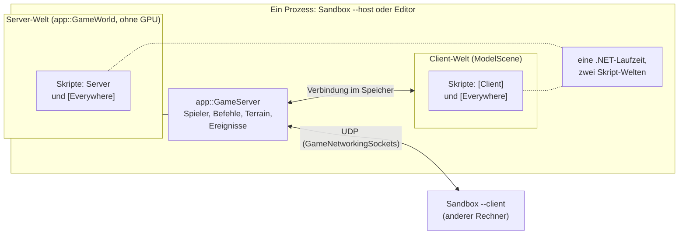

# R5.5: Listen-Server und Skripte im Netz

- **Phase:** Konstruktion (Reifegrad [R5](R5-multiplayer.md))
- **Status:** in Arbeit
- **Pull Requests:** [#65](https://github.com/viiez/ngine/pull/65) (Plan und Umsetzung)

## Plan

**Ziel:** Aus der Technik von R5.1 bis R5.4 wird ein Spiel für mehrere. Ein Spieler hostet und
spielt mit: Server und Client laufen im selben Prozess, verbunden über eine Verbindung im Speicher,
und weitere Clients kommen über das Netz dazu. Skripte wissen, wo sie laufen: Standard ist der
Server, darstellende Skripte laufen auch oder nur auf Clients. Was nur der Server erlebt, erreicht
die Clients als Ereignis (Einmal-Klänge, Ereignisse aus Skripten), Schritte hört jeder Client aus
den Automaten der Figuren, die er ohnehin rechnet, und Auslöser der Animation gehen mit. Der Editor
spielt als Listen-Server, Clients aus der Sandbox treten bei. Damit ist das Szenario des Reifegrads
vollständig ([R5, Abnahme](R5-multiplayer.md#plan)).

**Features:** NET-03 (Listen-Server), neu SCR-05 (Skripte im Netz). **Schulden:** TD-57, TD-58,
TD-61 (Teil für R5), TD-66, dazu die Teilung von `game_server.cppm` aus dem Architektur-Review von
R5.4.

### Entwurf

**Verbindung im Speicher** (NET-03, Plan R5, Punkt 7)

- `net::Transport::connect_local(Transport& server)` legt mit `CreateSocketPair` von
  GameNetworkingSockets ein Paar Verbindungen an: eine landet beim lauschenden Transport des
  Servers wie ein neuer Client, die andere beim Transport des Clients. Beide melden sofort
  `event::Connected`; Nachrichten, Zuverlässigkeit, Trennung und Statistik laufen wie über UDP. So
  gibt es für den Host keinen eigenen Codepfad: Er ist ein Client mit Vorhersage, Spiegel und
  Terrain-Empfänger wie jeder andere.
- Ohne Netz dazwischen gibt es keine Latenz; `--net-sim` gilt für diese Verbindung nicht. Tests,
  die Latenz brauchen, nehmen das Paar über die Loopback-Schicht der Bibliothek
  (`bUseNetworkLoopback`), die die Simulation kennt.

**Server als Baustein** (Aufräumen aus R5.4)

- Die Spiellogik des Servers wandert aus `apps/sandbox/game_server.cppm` (rund 800 Zeilen) nach
  `apps/common` als `app::GameServer`: Spieler und ihre Figuren, Befehle, Stand der eigenen Figur,
  Terrain und die neuen Ereignisse. Dazu `app::ServerSession`: Transport, `replication::Server`,
  `GameServer` und ein Bild des Servers (`frame()`: Nachrichten, Befehle, fester Schritt,
  Schnappschüsse mit 30 Hz). Der dedizierte Server, der Listen-Server und die Tests nutzen sie;
  in der Sandbox bleiben Takt, Kommandozeile, Client ohne Fenster und Bots.
- `app::ListenServer` besitzt die Server-Welt (`GameWorld` mit `deterministic`), die
  `ServerSession` und die Verbindung im Speicher und rechnet pro Bild des Hosts so viele Bilder des
  Servers, wie 1/60 s in die vergangene Zeit passen (höchstens vier, wie die Spielschleife). Der
  Client des Hosts ist die Szene, die die Sandbox ohnehin zeigt.
- **Ein Job-System:** `GameWorldDesc::jobs` nimmt ein fremdes `JobSystem`; im Listen-Server teilen
  sich beide Welten die Worker der Client-Welt, statt doppelt so viele Threads zu starten.
- Sandbox: `--host [port]` hostet den Spielplatz (oder `--scene`) und spielt mit Fenster mit;
  `--host --headless` läuft ohne Fenster, die eigene Figur geht die feste Spur (für die CI mit einem
  zweiten Prozess als Client).

**Skript-Welten** (SCR-05)

- Heute gibt es eine .NET-Laufzeit pro Prozess (ADR 0023) und für sie genau eine gebundene Welt:
  Die Tabellen der nativen Seite (`world_api`, `game_api`, `script_api`) und die Instanzen in
  `Host.cs` sind statisch. Ein Listen-Server braucht zwei Welten mit Skripten.
- Neu ist jedes `ScriptSystem` eine **Skript-Welt** der Laufzeit: eigene Bindungen (Welt, Aktionen,
  Physik, Audio, Animation, Ereignisse), eigene Instanzen, eigene Zeit, eigene Typ-Indizes in der
  Registry ihrer Welt. Vor jedem Aufruf in .NET wählt die Laufzeit die Welt aus (ein Zeiger auf der
  nativen Seite, eine Kennung auf der verwalteten); Skripte merken davon nichts.
- **Bauen und Hot Reload bleiben einmal pro Prozess:** Es gibt nur einen Ladekontext der Skripte.
  Die erste Skript-Welt baut und beobachtet die Dateien; beim Neuladen sichert die Laufzeit die
  Felder aller Welten, lädt die Assembly und meldet die Klassen in jeder Registry neu an.

**Wo Skripte laufen** (Plan R5, Punkt 6)

- Jede Skript-Welt hat eine **Rolle**: `Local` (ohne Netz, alle Skripte wie bisher), `Server`
  (Klassen ohne `[Client]`) oder `Client` (Klassen mit `[Client]` oder `[Everywhere]`). Die
  Attribute stehen an der Klasse; ohne Attribut läuft ein Skript nur auf dem Server.
- In C# fragt `Net.Role` (bzw. `Net.IsServer`, `Net.IsClient`) die Rolle ab, für Skripte mit
  `[Everywhere]`.
- Clients laden dieselbe Assembly wie der Server (aus dem Cache, mit SDK gebaut), damit ihre
  Registry dieselben Skript-Typen in derselben Reihenfolge hat. Bisher liefen auf Clients gar keine
  Skripte.
- Die Skripte des Spielplatzes: `Spielersteuerung`, `Spaziergang` und `Laterne` bleiben auf dem
  Server, `Schritte` wird `[Client]` (siehe unten).

**Replizierte Skript-Komponenten**

- `[Replicated]` an der Klasse markiert die Skript-Komponente in der Reflection als repliziert,
  `[Local]` an einem Feld nimmt es aus (wie `.replicated()` und `.local()` in C++). Die Felder
  gehen mit den Schnappschüssen.
- Die Werte laufender Skripte leben in den Instanzen. Der Server schreibt die Felder replizierter
  Klassen vor jedem Schnappschuss in ihre Komponenten; der Client sichert sie vor dem Anwenden
  eines Schnappschusses und liest sie danach zurück, so dass nur die replizierten Felder vom Server
  kommen.
- **Nur lesbar auf dem Client** (Risiko aus Plan R5): Schreibt ein Client-Skript in eine
  replizierte Komponente einer gespiegelten Entity, steht eine Warnung im Log (einmal pro Typ und
  Klasse); der nächste Schnappschuss überschreibt den Wert ohnehin.
- Hat der Server replizierte Skript-Typen und der Client keine Skripte (ohne .NET), passt das
  Schema nicht; der Client bekommt beim Verbinden eine klare Meldung statt eines kaputten
  Schnappschusses.

**Ereignisse vom Server** (TD-58)

- Neue Nachricht `Event` (Server an Client, zuverlässig): Tick des Servers, Kennung der Entity,
  Name und ein Wert. In C# schicken Skripte auf dem Server `Net.Broadcast(entity, name, value)` an
  alle Clients, die die Entity kennen (Relevanz wie bei den Schnappschüssen), bzw.
  `Net.Send(player, entity, name, value)` an den Spieler, dem eine Figur gehört. Auf dem Client
  bekommen die Skripte der Entity `OnNetEvent(name, value)`.
- **Einmal-Klänge:** `Audio.Play` auf dem Server (kein Audio-Gerät) wird zur Nachricht `Sound`
  (unzuverlässig, ein verlorener Klang kostet nichts): Klang, Ort, Bus, Lautstärke, Tonhöhe. Sie geht
  an Clients, deren Figur in Hörweite ist (Reichweite des Busses, Standard 50 m); ohne Ort an alle.
- **Im Takt der Bilder:** Beide Nachrichten tragen den Tick. Der Client stellt sie zu, wenn seine
  Interpolation diesen Tick erreicht (rund 100 ms nach Ankunft), damit Klang und Bild der fremden
  Welt zusammenpassen; kommt eine zu spät, gilt sie sofort.
- Protokoll Version 5.

**Schritte und Laterne**

- **Schritte auf jedem Client:** Der Client rechnet die Automaten aller Figuren (Parameter vom
  Server seit R5.2, die eigene Figur aus der Vorhersage); ihre Ereignisse `Fuss_links` und
  `Fuss_rechts` treffen das Skript `Schritte` als `[Client]` auch dort. So hört jeder die eigenen
  Schritte ohne Verzögerung und die fremden im Takt ihrer Animation, ohne ein Byte im Netz. Dafür
  geht `CharacterMotion::ground_material` mit den Schnappschüssen (heute lokal).
- **Laterne (TD-66):** Auf dem Server sieht die Laterne keine Taste, weil keine Aktionen für sie
  gebunden sind. Neu fragt `Input.For(entity)` die Aktionen einer Figur ab (auf dem Server die des
  Spielers, ohne Netz die allgemeinen). Die Laterne prüft für jede Figur in Reichweite deren
  Taste `light`. Ihr Licht (`PointLight`, schon repliziert) sehen alle Clients mit dem nächsten
  Schnappschuss; ein Klick beim Schalten kommt als Einmal-Klang.

**Animation und Audio** (TD-61, TD-57)

- **Auslöser gehen mit:** `AnimatorParameters` bekommt einen Zähler pro Auslöser (vier mal acht
  Bit). Der Server zählt hoch, wenn ein Skript auslöst; der Client löst aus, wenn sich der Zähler
  ändert. So springen fremde Figuren auf Clients auch, wenn zwischen zwei Schnappschüssen
  ausgelöst wurde. Der Rest von TD-61 (2D-Blends, Ebenen, `.animevents`) bekommt die Frist „mit dem
  ersten Kampf“.
- **Klänge freigeben:** Das `AudioSystem` zählt Stimmen pro Klang und Klangsatz und gibt einen
  Klang frei, der 30 s keine Stimme hatte; das Fenster „Audio“ zeigt geladene Klänge. Auf Clients
  mit vielen Einmal-Klängen wächst der Speicher sonst ohne Ende.

**Editor: Spielen als Listen-Server**

- Neben „Spielen“ gibt es „Spielen als Listen-Server“ (mit Port, Standard 27020). Wie beim Spielen
  sichert der Editor die Welt im Dokument (ADR 0032). Die Server-Welt entsteht aus dieser
  Sicherung in einem eigenen `GameWorld` (mit Deltas des Terrains), die Welt des Dokuments wird
  leer und zum Spiegel des Clients: Viewport, Audio, Vorhersage und Client-Skripte arbeiten wie in
  der Sandbox. Beim Stoppen endet der Server, und die Welt kommt bitgenau zurück.
- Szenenbaum und Inspector zeigen beim Spielen als Listen-Server wahlweise die Welt des Clients
  oder die des Servers (Umschalter, beide nur lesbar), so sieht man Skriptfelder dort, wo sie
  rechnen. Das Fenster „Netzwerk“ zeigt die Spieler des Servers.
- Weitere Clients verbinden sich mit `ngine_sandbox --client <adresse>`. Spielen ohne Netz bleibt
  wie heute.

**Statistik und Messung**

- Server: Ereignisse und Klänge pro Client und Sekunde im Statusbericht; Listen-Server: Zeit der
  Server-Bilder pro Host-Bild und Speicher der zweiten Welt.
- Gemessen werden der Listen-Server auf dem Spielplatz (Bildzeit des Hosts mit und ohne
  Server-Welt, Speicher), die Bandbreite der Ereignisse mit `--bots 8` und das Szenario des
  Reifegrads auf PC und Notebook.

**Tests**

- Netz: Paar im Speicher (Nachrichten in beide Richtungen, zuverlässig und unzuverlässig, Trennung
  auf beiden Seiten, Server mit Paar und UDP-Client zugleich).
- Replikation: Kodierung von `Event` und `Sound` (kaputte Längen, unbekannte Entities), Auswahl der
  Empfänger nach Relevanz und Hörweite, Zustellung im Takt der Interpolation, Zähler der Auslöser.
- Skripte (`[script]`): zwei Skript-Welten in einer Laufzeit mit getrennten Instanzen und Rollen;
  `[Client]` läuft nur auf dem Client, `[Everywhere]` auf beiden; Felder mit `[Replicated]` kommen
  an, `[Local]` nicht; `Net.Broadcast` erreicht `OnNetEvent`; `Input.For()` auf dem Server; Warnung
  beim Schreiben einer replizierten Komponente; Hot Reload mit zwei Welten.
- Audio: Freigabe von Klängen ohne Stimme (TD-57).
- **Mit Netz** (im selben Prozess): Listen-Server mit Host über das Paar und einem Client über
  localhost; beide sehen die Figur des anderen, der Client schaltet die Laterne und beide sehen es,
  Schritte des einen erzeugen Klänge beim anderen (Null-Gerät), ein Sprung löst bei beiden aus.
  Dasselbe mit 100 ms und 5 % Verlust für den UDP-Client.
- CI: `--host --headless` mit einem zweiten Prozess als Client unter Linux und Windows;
  `--server --track` rechnet weiter dieselbe Prüfsumme wie `--headless --playground`.

**Was R5.5 nicht macht:** Suche, Lobby und Spiel-UI zum Verbinden (nicht in R5), Ereignisse vom
Client an den Server außer den Befehlen, Vorhersage von Skripten auf dem Client, Wechsel des Hosts,
Werkzeuge des Editors (Terrain, Gizmos) während des Spielens als Listen-Server.

**Risiken:**

- **Skript-Welten:** Statische Tabellen auf beiden Seiten und Hot Reload mit zwei Registries.
  Gegenmittel: Tests mit zwei Welten und Neuladen, Welt-Auswahl an einer Stelle der Laufzeit;
  ohne Netz bleibt es bei einer Welt.
- **Zwei Welten kosten:** Speicher und Rechenzeit der Server-Welt auf dem Host. Gegenmittel: ein
  Job-System, Server ohne Renderer und Audio, Messung auf dem Notebook.
- **Editor:** Die Welt des Dokuments wird zum Spiegel; die Kennungen der Entities sind danach
  andere. Gegenmittel: Sicherung und Wiederherstellung wie beim Spielen, Auswahl und Werkzeuge sind
  beim Spielen ohnehin gesperrt.
- **Umfang:** Die Iteration ist breit. Gegenmittel: Reihenfolge Paar im Speicher und Server als
  Baustein, Skript-Welten, Rollen und Ereignisse, Sandbox `--host`, zuletzt der Editor. Wird es zu
  viel, fällt zuerst der Umschalter Client/Server im Editor (dann zeigt er die Welt des Clients).

**Abnahme:**

- Szenario des Reifegrads auf PC und Notebook: dedizierter Server, beide verbinden, Figuren laufen
  animiert, man hört die Schritte des anderen, eine Grube unter einer Kiste (sie fällt bei beiden),
  die Laterne schalten (beide sehen es), ein dritter Client tritt später bei und sieht alles; mit
  `--net-sim 150 5` läuft die eigene Figur ohne Verzögerung. Danach dasselbe mit einem
  Listen-Server, den der PC im Editor startet (Sichtprüfung).
- Listen-Server und Bandbreite der Ereignisse gemessen.

### Zur Abstimmung

1. **Verbindung im Speicher** über `CreateSocketPair` von GameNetworkingSockets hinter
   `Transport::connect_local()`; der Host ist ein gewöhnlicher Client mit Vorhersage. Alternative:
   eine eigene Verbindung im Speicher ohne die Bibliothek (mehr Code, aber unabhängig von ihr).
2. **Server als Baustein** in `apps/common` (`app::GameServer`, `app::ServerSession`,
   `app::ListenServer`) und `game_server.cppm` damit geteilt; ein Job-System für beide Welten;
   Sandbox `--host [port]`, mit `--headless` für die CI.
3. **Skript-Welten:** eine .NET-Laufzeit, ein `ScriptSystem` pro Welt mit eigenen Bindungen und
   Instanzen; Bauen und Hot Reload einmal pro Prozess für alle Welten. Alternative: Der Host startet
   den dedizierten Server als zweiten Prozess und verbindet sich über localhost (keine
   Skript-Welten nötig, aber kein Blick in die Server-Welt im Editor und zwei Prozesse zum Debuggen).
4. **Rollen:** ohne Attribut nur auf dem Server, `[Client]` nur auf Clients, `[Everywhere]` auf
   beiden, ohne Netz alle; Clients laden dieselbe Assembly; `Net.Role` für `[Everywhere]`.
5. **Replizierte Skript-Komponenten** über `[Replicated]` und `[Local]`, Felder vor jedem
   Schnappschuss in die Komponenten; auf dem Client nur lesbar mit Warnung.
6. **Ereignisse:** `Net.Broadcast()` und `Net.Send()` zuverlässig an Clients, die die Entity
   kennen, `OnNetEvent` auf dem Client; `Audio.Play` auf dem Server wird unzuverlässig zum
   Einmal-Klang in Hörweite; Zustellung im Takt der Interpolation; Protokoll 5.
7. **Schritte als `[Client]`** aus den Automaten, die jeder Client rechnet, mit repliziertem
   `ground_material`. Alternative: Der Server spielt die Schritte und schickt sie als Einmal-Klänge
   (einfacher, aber die eigenen Schritte kämen eine Rundlaufzeit zu spät, und 8 Spieler kosten
   dauernd Bandbreite).
8. **Laterne über `Input.For(figur)`** auf dem Server (TD-66), Licht über die vorhandene
   Replikation von `PointLight`, Klick als Einmal-Klang. Alternative: Ereignis „benutzen“ vom
   Client an den Server (eigene Nachricht, eigene Prüfung).
9. **Auslöser als Zähler** in `AnimatorParameters`; Rest von TD-61 mit dem ersten Kampf. TD-57 mit
   Zählung und Freigabe nach 30 s ohne Stimme.
10. **Editor:** Die Welt des Dokuments wird beim Spielen als Listen-Server zum Spiegel des Clients,
    die Server-Welt entsteht aus der Sicherung; Umschalter Client/Server für Szenenbaum und
    Inspector. Alternative: Der Editor zeigt die Server-Welt und steuert die Figur direkt (ein Weg
    mit Sonderfällen, den Punkt 7 von R5 ausgeschlossen hat).
11. **ADR 0055** hält Listen-Server, Skript-Welten, Rollen und Ereignisse fest und ergänzt ADR 0023,
    ADR 0047 und ADR 0052.

**Ergebnis der Abstimmung** (viiez, im Projekt-Thread zu #65 am 27.11.2026): Alle elf Punkte
passen wie vorgeschlagen. Verbindung im Speicher über `CreateSocketPair`; Server als Baustein in
`apps/common` mit einem Job-System und `--host`; Skript-Welten in einer Laufzeit; Rollen mit
`[Client]` und `[Everywhere]`; replizierte Skript-Komponenten mit `[Replicated]` und `[Local]`;
Ereignisse und Einmal-Klänge vom Server im Takt der Interpolation, Protokoll 5; Schritte als
`[Client]`; Laterne über `Input.For()`; Auslöser als Zähler und Freigabe von Klängen; Editor mit der
Welt des Dokuments als Spiegel und Umschalter Client/Server; ADR 0055.

## Abnahme

**Automatisch geprüft:**

- „Listen server serves an in-memory host and a UDP client“: `app::ListenServer` mit einem Host
  über das Paar im Speicher und einem Client über localhost. Beide bekommen eine Figur, sehen die
  des anderen, die Figuren stehen auf dem Terrain des Servers; `Net.Broadcast` erreicht beide,
  `Net.Send` nur den Besitzer, ein Klang in Hörweite beide und einer 5 km entfernt niemanden. Geht
  der UDP-Client, bleibt der Host verbunden. Derselbe Test läuft mit 40 ms und 5 % Verlust, im Takt
  der Uhr.
- „Server and client script worlds share one runtime with roles“: zwei Skript-Domänen in einer
  Laufzeit; Klassen ohne Attribut laufen nur auf dem Server, `[Client]` nur auf dem Client,
  `[Everywhere]` auf beiden; gleiche Typ-Indizes in beiden Registries, `[Replicated]` und `[Local]`
  in der Reflection; Warnung beim Schreiben einer replizierten Komponente einmal; `Net.Broadcast`,
  `Net.Send` und `Audio.Play` ohne Gerät gehen ans Netz, `OnNetEvent` kommt auf dem Client an;
  `Input.For()` schaltet die Laterne auf dem Server (TD-66); Hot Reload mit beiden Domänen ohne
  falsche Warnung.
- Paar im Speicher neben einem UDP-Client („Transport pairs connect in memory next to a UDP
  client“), Kodierung, Empfänger und Zustellung von `Event` und `Sound`, Zähler der Auslöser,
  Freigabe von Klängen ohne Stimme (TD-57).
- CI: `--host --headless` mit einem zweiten Prozess als Client (die Figur des Clients läuft, der
  Host meldet ihn); der Editor spielt mit `--host-play 90` als Listen-Server, die gespeicherte
  Szene ist danach bitgleich. `--server --track` rechnet weiter dieselbe Prüfsumme wie
  `--headless --playground`.

**Sichtprüfung:** offen. Szenario des Reifegrads auf PC und Notebook mit dediziertem Server, danach
mit einem Listen-Server aus dem Editor (siehe Plan).

**Messungen** (Debug-Build, Linux, Spielplatz; Server, Host und Clients auf einem Rechner):

| Was | Ergebnis |
| --- | --- |
| Server-Schritt, dedizierter Server mit einem Client | 1,8 bis 2,1 ms |
| Server-Schritt im Listen-Server mit dem Host als einzigem Client | 2,1 bis 2,3 ms |
| Server-Schritt im Listen-Server mit Host und 8 Bots | 21,9 ms im Mittel (12 Figuren) |
| Speicher: dedizierter Server / Client ohne Fenster / Listen-Server ohne Fenster | 203 MB / 208 MB / 404 MB |
| Ereignisse und Klänge mit 8 Bots, die laufen | 0 B/s (Schritte entstehen auf jedem Client) |
| Ein Einmal-Klang mit Ort / ein Ereignis | 47 B / 18 B plus Name |
| Schnappschüsse an die Bots | 16,6 KB/s im Mittel, höchstens 30,3 KB/s pro Client |

Der Host braucht so viel Speicher wie Server und Client zusammen; .NET-Laufzeit und Job-System
teilen sich beide Welten, der Rest ist doppelt. Der Server-Schritt im Listen-Server kostet so viel
wie im dedizierten Server.

## Review

**Ergebnis:** Ein Spieler hostet und spielt mit. `net::Transport::connect_local()` verbindet den
Host über ein Paar im Speicher (`CreateSocketPair`), er ist ein gewöhnlicher Client mit Spiegel,
Vorhersage und Terrain-Empfänger. Die Spiellogik des Servers liegt als `app::GameServer`,
`app::ServerSession` und `app::ListenServer` in `apps/common`; dedizierter Server, Listen-Server,
Sandbox `--host` und Tests nutzen sie, beide Welten teilen ein Job-System. Jedes `ScriptSystem` ist
eine Domäne der einen .NET-Laufzeit mit Rolle `Local`, `Server` oder `Client`; `[Client]` und
`[Everywhere]` legen fest, wo ein Skript läuft, `[Replicated]` und `[Local]`, welche Felder mit den
Schnappschüssen gehen. Skripte auf dem Server schicken mit `Net.Broadcast()`/`Net.Send()`
Ereignisse, `Audio.Play` wird zum Einmal-Klang in Hörweite; der Client stellt beide im Takt der
Interpolation zu (Protokoll 5). `Schritte` läuft als `[Client]` aus den Automaten, die jeder Client
rechnet, die Laterne liest die Taste jeder Figur über `Input.For()`, Auslöser der Animation gehen
als Zähler mit (Teil von TD-61), Klänge ohne Stimme werden nach 30 s freigegeben (TD-57). Der
Editor spielt als Listen-Server, mit Umschalter für Szenenbaum und Inspector zwischen Client- und
Server-Welt und dem Fenster „Netzwerk“. ADR 0055.

Abnahme: offen, bis zur Sichtprüfung durch viiez.

**Abweichungen vom Plan:**

- Die Skript-Welten heißen im Code Domänen (`ScriptRuntime::create_domain()`), weil „Welt“ schon
  die `world::World` ist.
- Klassen, die auf Clients laufen (`[Client]`, `[Everywhere]`), sind immer repliziert, auch ohne
  `[Replicated]`: Ohne die Komponente auf dem Client hätten sie dort keine Instanz.
- Auf Clients übernimmt kein Skript die Steuerung der Figur (`scripted_player` gilt nur ohne Rolle
  `Client`); die eigene Figur steuert die Vorhersage.
- Der Test mit Netz im selben Prozess schickt Ereignisse und Klänge direkt über die
  `ServerSession` statt über Laterne und Schritte, weil er ohne .NET läuft. Die Wege der Skripte
  prüft der Test der Skript-Domänen, Laterne und Schritte im Netz die Sichtprüfung.
- Der Start von „Spielen als Listen-Server“ wartet auf das erste Server-Bild (TD-69).

**Neue Schulden:** TD-67 (Laterne flackert und schickt ihr Licht in jedem Schnappschuss), TD-68
(Warnung beim Schreiben trifft auch `Get<T>()` ohne Schreiben), TD-69 (Start im Editor blockiert).
Abgebaut: TD-57, TD-58, TD-66; TD-61 bleibt mit Frist „mit dem ersten Kampf“.

**Erkenntnisse:**

- Das Paar im Speicher macht den Host zu einem Client wie jeder andere. Fehler im Client-Pfad
  zeigen sich schon beim Hosten, und es gibt keinen Sonderweg zu pflegen.
- Zwei Domänen in einer Laufzeit waren weniger Arbeit als befürchtet, weil die Auswahl an einer
  Stelle vor jedem Aufruf in .NET sitzt. Fallen gab es beim Neuladen: Das Sichern der Felder
  schrieb in Komponenten und löste die Warnung für Client-Skripte aus.
- Der Test mit Netz war wackelig, weil die Figuren in der kleinen Testwelt neben dem Terrain
  standen und fielen (das Terrain liegt um den Ursprung). Brauchte der UDP-Client unter Verlust
  lange zum Verbinden, waren sie schon Hunderte Meter tief, und die Prüfungen danach scheiterten. Der Test prüft jetzt,
  dass die Figuren stehen, und läuft im Takt der Uhr wie der Test von R5.4.
- Weil die Schritte auf jedem Client aus den Automaten entstehen, kosten sie kein Byte im Netz;
  Ereignisse und Klänge vom Server sind selten und klein.
