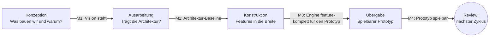

# Entwicklungsprozess: vereinfachter Unified Process

Wir arbeiten nach einem schlanken Unified Process (UP): iterativ und inkrementell, risikogetrieben und
architekturzentriert. Vom klassischen UP übernehmen wir Phasen, Meilensteine und Iterationen; die
umfangreichen Artefakte und Rollen lassen wir weg. Entscheidung: [ADR 0011](adr/0011-unified-process.md).

## Grundsätze

1. **Iterativ und inkrementell:** Jede Iteration liefert etwas Lauffähiges und Getestetes.
2. **Risikogetrieben:** Was das Projekt am ehesten scheitern lässt, kommt zuerst auf den Tisch. Große
   Unbekannte (Voxel-Meshing, C#-Hosting, Netzwerk) prüfen wir früh mit kleinen Durchstichen.
3. **Architekturzentriert:** Bevor wir in die Breite bauen, steht eine ausführbare Architektur, an der
   alle großen Systeme mindestens einmal angedockt haben.
4. **Feature-getrieben:** Statt eines Use-Case-Modells pflegen wir den [Feature-Katalog](features.md).
   Wo Abläufe wichtig sind (Editor, Multiplayer-Sitzung), beschreiben wir sie dort als kurze Szenarien.
5. **Moving Target:** Vision, Feature-Katalog und Roadmap ändern sich. Jedes Review prüft sie und passt
   sie an; Änderungen landen per Pull Request im Repository.

## Phasen

| Phase | Ziel | Typische Arbeit | Meilenstein am Ende |
| --- | --- | --- | --- |
| Konzeption (Inception) | Ziel, Rahmen und große Entscheidungen klären | Vision, Feature-Katalog, erste ADRs, Werkzeugwahl | **M1 Vision steht:** Vision und Katalog abgestimmt, Projektgerüst baut auf Linux und Windows |
| Ausarbeitung (Elaboration) | Ausführbare Architektur bauen und die größten Risiken ausräumen | Core, Plattform, RHI, Job-System, ECS, Durchstiche für Voxel, C# und Netzwerk | **M2 Architektur-Baseline:** jedes Kernsystem existiert als dünne, getestete Schicht; keine großen Unbekannten mehr |
| Konstruktion (Construction) | Features in die Breite bauen | Rendering, Editor, Voxel-Terrain, Physik, Audio, Scripting, Multiplayer | **M3 Feature-komplett:** alles, was der Spiel-Prototyp braucht, ist da |
| Übergabe (Transition) | Engine an einem echten Spiel erproben | Spiel-Prototyp, Leistung auf schwacher Hardware, Pakete für Linux und Windows | **M4 Prototyp spielbar:** danach beginnt ein neuer Zyklus mit neuer Vision |

Die Phasen überlappen: Auch in der Konstruktion entstehen noch ADRs, und schon in der Ausarbeitung
wird getestet. Die Phase sagt nur, wo der Schwerpunkt liegt.

## Iterationen

Eine Iteration hat **ein klares Ziel** und besteht aus einem oder mehreren kleinen Pull Requests. Sie
ist nicht an feste Wochen gebunden, soll aber in wenigen Abenden machbar sein.

1. **Planen:** Iterationsplan unter `docs/iterations/` anlegen: Ziel, Features aus dem Katalog,
   Risiken, Abnahmekriterien. Den Plan stimmen wir im Projekt ab.
2. **Umsetzen:** Pull Requests mit Code, Tests und Doku. CI baut auf Linux und Windows.
3. **Prüfen:** viiez testet auf echter Hardware (Linux-Notebook mit Intel-Grafik, Windows mit RTX 3060 Ti)
   und merged.
4. **Review:** Ergebnis und Erkenntnisse im Iterationsdokument festhalten. Dann Vision, Roadmap und
   Feature-Katalog anpassen und neue Entscheidungen als ADR aufschreiben.

## Disziplinen und wo sie im Repository leben

| UP-Disziplin | Bei uns |
| --- | --- |
| Geschäftsmodellierung | entfällt |
| Anforderungen | [vision.md](vision.md), [features.md](features.md) |
| Analyse und Design | [architecture.md](architecture.md), [ADRs](adr/README.md) |
| Implementierung | `engine/`, `apps/` |
| Test | `tests/`, CI, Tests auf echter Hardware |
| Verteilung | CI-Builds, später Pakete für Linux und Windows |
| Projektmanagement | [roadmap.md](roadmap.md), [iterations/](iterations/README.md) |
| Konfigurationsmanagement | Git, Pull Requests, vcpkg-Manifest |

## Rollen

| Rolle | Wer | Aufgaben |
| --- | --- | --- |
| Produktverantwortung und Architektur | viiez | Vision und Prioritäten, Entscheidungen, Abnahme, Merge |
| Entwicklung und Doku-Pflege | Claude | Vorschläge, Implementierung, Tests, Doku aktuell halten |
| Test auf Hardware | viiez | Builds auf Linux und Windows ausprobieren, Rückmeldung im PR |

## Definition of Done (pro Pull Request)

- [ ] Baut ohne Warnungen auf Linux (Clang) und Windows (MSVC), CI ist grün.
- [ ] Neue Logik hat Tests, soweit ohne GPU testbar; `--headless` startet weiterhin.
- [ ] Betroffene Doku ist im selben PR aktualisiert: Feature-Status, Architektur, ADR bei Entscheidungen.
- [ ] Fremdbibliotheken stecken hinter einer Engine-Schnittstelle.
- [ ] Code ist mit `.clang-format` formatiert.
