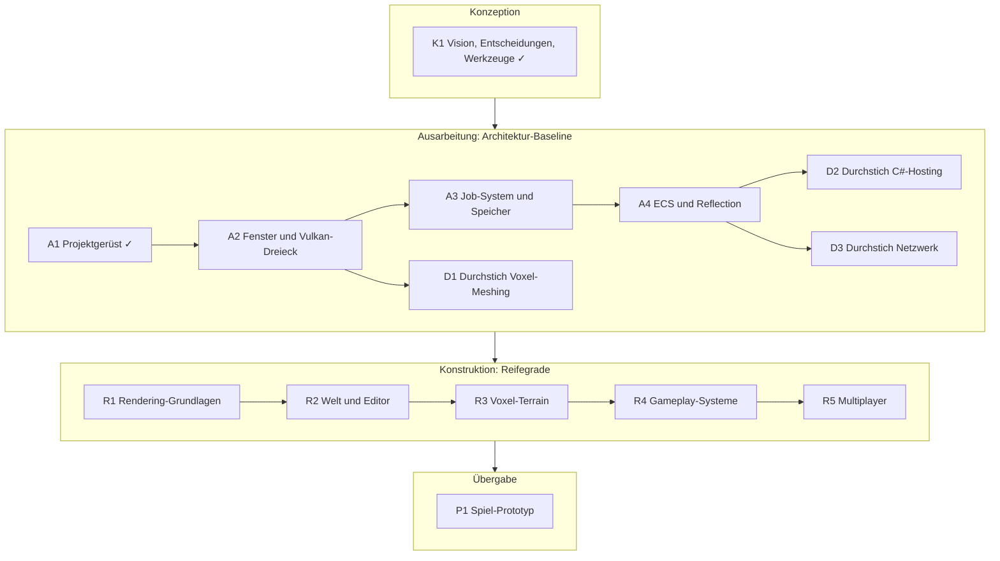

# Roadmap

Die Roadmap ordnet die Arbeit in die Phasen des [Prozesses](process.md). Sie ist ein Plan, kein
Versprechen: Nach jeder Iteration prüfen wir sie und schieben Iterationen, wenn sich Erkenntnisse ändern.

**Aktuell:** Phase Ausarbeitung, Iteration A2 (Fenster und Vulkan-Dreieck) in Arbeit.

## Phasen und Iterationen

## Ausarbeitung im Detail

Ziel der Ausarbeitung ist eine **ausführbare Architektur**: Jedes Kernsystem existiert als dünne,
getestete Schicht, und die drei größten Risiken sind durch Durchstiche geklärt.

| Iteration | Ziel | Abnahme |
| --- | --- | --- |
| A1 Projektgerüst | CMake, Module, Core mit Logging, CI | Erledigt, siehe [Iteration A1](iterations/A1-projektgeruest.md) |
| A2 Fenster und Vulkan-Dreieck | SDL3-Fenster, Vulkan 1.4 über volk und VMA, erste RHI-Schnittstelle | Dreieck auf Windows (RTX) und Linux (CI mit lavapipe); `--headless` ohne GPU |
| A3 Job-System und Speicher | Task-System mit Abhängigkeiten, Frame- und Pool-Allokatoren | Parallele Jobs in Tests; Tracy zeigt die Threads |
| A4 ECS und Reflection | flecs hinter `World`/`Entity`, Reflection-Grundlage, Szene speichern | Szene mit Entities speichern und laden |
| D1 Durchstich Voxel-Meshing | Ein Chunk mit Dichtefeld, Surface Nets, gerendert | Glatter Hügel sichtbar und zur Laufzeit veränderbar |
| D2 Durchstich C#-Hosting | .NET über hostfxr starten, C#-Methode aus C++ aufrufen und zurück | C#-Skript loggt über die Engine |
| D3 Durchstich Netzwerk | Headless-Server und Client über GameNetworkingSockets | Eine Komponente wird zum Client repliziert |

Die Durchstiche sind bewusst klein und dürfen Wegwerf-Code enthalten. Ihr Ergebnis ist vor allem
Wissen: ein ADR oder eine Anpassung der Architektur.

## Konstruktion: Reifegrade

| Reifegrad | Inhalt |
| --- | --- |
| R1 Rendering-Grundlagen | Render-Graph, Bindless, Meshes aus glTF, PBR-Materialien, Kamera, Licht und Schatten |
| R2 Welt und Editor | Szenenbaum, Inspector, Viewport, Spielen im Editor, Asset-Pipeline |
| R3 Voxel-Terrain | Chunks, LOD, Streaming, prozedurale Grundwelt, Änderungen als Deltas |
| R4 Gameplay-Systeme | Physik (Jolt), C#-Scripting vollständig, Audio, Animation |
| R5 Multiplayer | Listen- und dedizierter Server, Replikation, Vorhersage, Voxel-Deltas übers Netz |

Details zu jedem Feature stehen im [Feature-Katalog](features.md).
