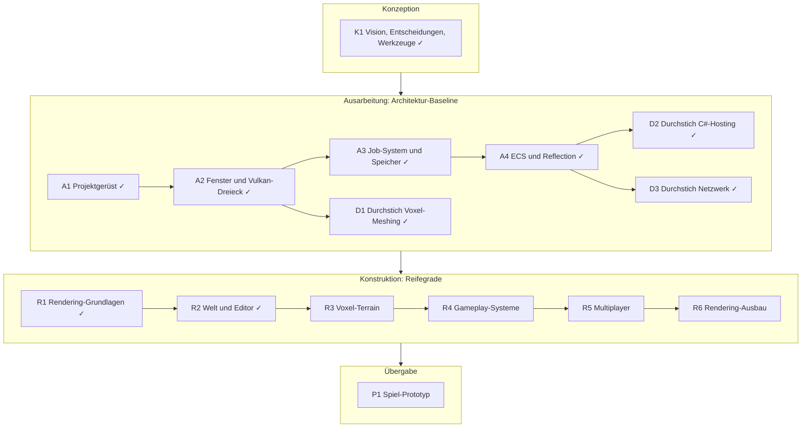

# Roadmap

Die Roadmap ordnet die Arbeit in die Phasen des [Prozesses](process.md). Sie ist ein Plan, kein
Versprechen: Nach jeder Iteration prüfen wir sie und schieben Iterationen, wenn sich Erkenntnisse ändern.

**Aktuell:** Die Phase Ausarbeitung ist abgeschlossen (A1 bis A4, Durchstiche D1 bis D3). In der
Konstruktion ist der erste Reifegrad [R1](iterations/R1-rendering-grundlagen.md)
(Rendering-Grundlagen) mit seinen Iterationen
[R1.1](iterations/R1.1-mathematik-und-transforms.md) (Mathematik und Transforms),
[R1.2](iterations/R1.2-render-graph-bindless-gpu-speicher.md) (Render-Graph, Bindless,
GPU-Speicher), [R1.3](iterations/R1.3-meshes-materialien-kamera.md) (Meshes, Materialien, Kamera)
und [R1.4](iterations/R1.4-licht-und-schatten.md) (Licht und Schatten) abgeschlossen. Ebenso
ist [R2](iterations/R2-welt-und-editor.md) (Welt und Editor) abgeschlossen; seine fünf Iterationen
[R2.1](iterations/R2.1-editor-geruest-und-viewport.md) (Editor-Gerüst und Viewport),
[R2.2](iterations/R2.2-szenenbaum-inspector-undo.md) (Szenenbaum, Inspector, Undo),
[R2.3](iterations/R2.3-gizmos-und-spielen.md) (Gizmos und Spielen im Editor),
[R2.4](iterations/R2.4-asset-ids-ressourcen-hot-reload.md) (Asset-IDs, Ressourcen, Hot Reload) und
[R2.5](iterations/R2.5-kochen-ktx2-prefabs.md) (Kochen, KTX2, Prefabs) sind abgeschlossen, das
Review des Reifegrads ebenfalls. Danach kam [R3](iterations/R3-voxel-terrain.md)
(Voxel-Terrain); seine fünf Iterationen [R3.1](iterations/R3.1-chunks-und-meshing.md) (Chunks und
Meshing in Jobs), [R3.2](iterations/R3.2-prozedurale-welt-und-materialien.md) (Prozedurale Welt
und Materialien), [R3.3](iterations/R3.3-streaming-und-lod.md) (Streaming und LOD),
[R3.4](iterations/R3.4-deltas-und-voxel-werkzeuge.md) (Deltas und Voxel-Werkzeuge) und
[R3.5](iterations/R3.5-gpu-getriebenes-zeichnen.md) (GPU-getriebenes Zeichnen) sind
abgeschlossen. Das Review von R3 wartet noch auf das Szenario auf dem PC; danach folgt R4
(Gameplay-Systeme). Der Rendering-Ausbau kommt als eigener Reifegrad R6 nach R5.

## Phasen und Iterationen

## Ausarbeitung im Detail

Ziel der Ausarbeitung ist eine **ausführbare Architektur**: Jedes Kernsystem existiert als dünne,
getestete Schicht, und die drei größten Risiken sind durch Durchstiche geklärt.

| Iteration | Ziel | Abnahme |
| --- | --- | --- |
| A1 Projektgerüst | CMake, Module, Core mit Logging, CI | Erledigt, siehe [Iteration A1](iterations/A1-projektgeruest.md) |
| A2 Fenster und Vulkan-Dreieck | SDL3-Fenster, Vulkan 1.4 über volk und VMA, erste RHI-Schnittstelle | Erledigt, siehe [Iteration A2](iterations/A2-fenster-und-dreieck.md) |
| A3 Job-System und Speicher | Task-System mit Abhängigkeiten, Frame- und Pool-Allokatoren, Tracy | Erledigt, siehe [Iteration A3](iterations/A3-jobs-und-speicher.md) |
| A4 ECS und Reflection | flecs hinter `World`/`Entity`, Reflection-Grundlage, Dateisystem, Szene speichern | Erledigt, siehe [Iteration A4](iterations/A4-ecs-und-reflection.md) |
| D1 Durchstich Voxel-Meshing | Ein Chunk mit Dichtefeld, Surface Nets, gerendert | Erledigt, siehe [Durchstich D1](iterations/D1-voxel-meshing.md) |
| D2 Durchstich C#-Hosting | .NET über hostfxr starten, C#-Methode aus C++ aufrufen und zurück | Erledigt, siehe [Durchstich D2](iterations/D2-csharp-hosting.md) |
| D3 Durchstich Netzwerk | Headless-Server und Client über GameNetworkingSockets, eine Komponente wird zum Client repliziert | Erledigt, siehe [Durchstich D3](iterations/D3-netzwerk.md) |

Die Durchstiche sind bewusst klein und dürfen Wegwerf-Code enthalten. Ihr Ergebnis ist vor allem
Wissen: ein ADR oder eine Anpassung der Architektur.

## Konstruktion: Reifegrade

| Reifegrad | Inhalt |
| --- | --- |
| R1 Rendering-Grundlagen | Render-Graph, Bindless, Meshes aus glTF, PBR-Materialien, Kamera, Licht und Schatten; Mathematik, 64-Bit-Positionen und Transform-Propagation. Iterationen R1.1 Mathematik und Transforms, R1.2 Render-Graph, Bindless, GPU-Speicher, R1.3 Meshes, Materialien, Kamera, R1.4 Licht und Schatten ([Plan](iterations/R1-rendering-grundlagen.md)) |
| R2 Welt und Editor | Szenenbaum, Inspector, Viewport, Spielen im Editor, Asset-Pipeline. Iterationen R2.1 Editor-Gerüst und Viewport, R2.2 Szenenbaum, Inspector, Undo, R2.3 Gizmos und Spielen im Editor, R2.4 Asset-IDs, Ressourcen, Hot Reload, R2.5 Kochen, KTX2, Prefabs ([Plan](iterations/R2-welt-und-editor.md)) |
| R3 Voxel-Terrain | Chunks, LOD, Streaming, prozedurale Grundwelt, Änderungen als Deltas; dazu Mesh Shader und GPU-Culling aus R1. Iterationen R3.1 Chunks und Meshing in Jobs, R3.2 Prozedurale Welt und Materialien, R3.3 Streaming und LOD, R3.4 Deltas und Voxel-Werkzeuge, R3.5 GPU-getriebenes Zeichnen ([Plan](iterations/R3-voxel-terrain.md)) |
| R4 Gameplay-Systeme | Physik (Jolt), C#-Scripting vollständig, Audio, Animation |
| R5 Multiplayer | Listen- und dedizierter Server, Replikation, Vorhersage, Voxel-Deltas übers Netz |
| R6 Rendering-Ausbau | Raytracing (REND-14), globale Beleuchtung, Tag-Nacht und Nebel (REND-12, NAT-03, NAT-05), Vegetation und Wind (NAT-01, NAT-02), Clustered Shading und Schatten für Punkt- und Spotlichter (TD-24, TD-25), Durchsichtiges auf der GPU (TD-43). Schatten der Taschenlampe können vorher als einzelne Iteration kommen, wenn das Gameplay sie braucht |

**Raytracing** (REND-14) stand ursprünglich in R2 und kommt mit dem Rendering-Ausbau in R6. So hat
viiez es im Review von R3 entschieden: Die GPU ist nach den Messungen nicht der Engpass, und für
den Prototyp sind Physik, Scripting und Multiplayer dringender.

Details zu jedem Feature stehen im [Feature-Katalog](features.md).
