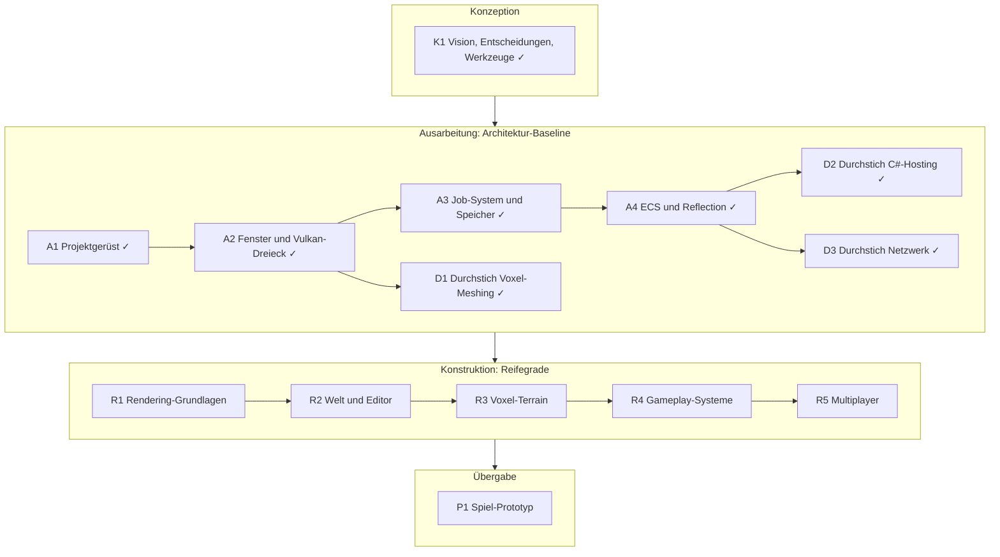

# Roadmap

Die Roadmap ordnet die Arbeit in die Phasen des [Prozesses](process.md). Sie ist ein Plan, kein
Versprechen: Nach jeder Iteration prüfen wir sie und schieben Iterationen, wenn sich Erkenntnisse ändern.

**Aktuell:** Die Phase Ausarbeitung ist abgeschlossen: Die Iterationen A1 bis A4 und die Durchstiche
[D1](iterations/D1-voxel-meshing.md) (Voxel-Meshing), [D2](iterations/D2-csharp-hosting.md)
(C#-Hosting) und [D3](iterations/D3-netzwerk.md) (Netzwerk) sind fertig. Als Nächstes folgt die
Konstruktion mit R1 (Rendering-Grundlagen), aufgeteilt in vier Iterationen
([Plan](iterations/R1-rendering-grundlagen.md)); [R1.1](iterations/R1.1-mathematik-und-transforms.md)
(Mathematik und Transforms) ist abgeschlossen, als Nächstes folgt R1.2 (Render-Graph, Bindless,
GPU-Speicher).

## Phasen und Iterationen

## Ausarbeitung im Detail

Ziel der Ausarbeitung ist eine **ausführbare Architektur**: Jedes Kernsystem existiert als dünne,
getestete Schicht, und die drei größten Risiken sind durch Durchstiche geklärt.

| Iteration | Ziel | Abnahme |
| --- | --- | --- |
| A1 Projektgerüst | CMake, Module, Core mit Logging, CI | Erledigt, siehe [Iteration A1](iterations/A1-projektgeruest.md) |
| A2 Fenster und Vulkan-Dreieck | SDL3-Fenster, Vulkan 1.4 über volk und VMA, erste RHI-Schnittstelle | Erledigt, siehe [Iteration A2](iterations/A2-fenster-und-dreieck.md) |
| A3 Job-System und Speicher | Task-System mit Abhängigkeiten, Frame- und Pool-Allokatoren, Tracy | Erledigt, siehe [Iteration A3](iterations/A3-jobs-und-speicher.md) |
| A4 ECS und Reflection | flecs hinter `World`/`Entity`, Reflection-Grundlage, Dateisystem, Szene speichern | Erledigt, siehe [Iteration A4](iterations/A4-ecs-und-reflection.md) |
| D1 Durchstich Voxel-Meshing | Ein Chunk mit Dichtefeld, Surface Nets, gerendert | Erledigt, siehe [Durchstich D1](iterations/D1-voxel-meshing.md) |
| D2 Durchstich C#-Hosting | .NET über hostfxr starten, C#-Methode aus C++ aufrufen und zurück | Erledigt, siehe [Durchstich D2](iterations/D2-csharp-hosting.md) |
| D3 Durchstich Netzwerk | Headless-Server und Client über GameNetworkingSockets, eine Komponente wird zum Client repliziert | Erledigt, siehe [Durchstich D3](iterations/D3-netzwerk.md) |

Die Durchstiche sind bewusst klein und dürfen Wegwerf-Code enthalten. Ihr Ergebnis ist vor allem
Wissen: ein ADR oder eine Anpassung der Architektur.

## Konstruktion: Reifegrade

| Reifegrad | Inhalt |
| --- | --- |
| R1 Rendering-Grundlagen | Render-Graph, Bindless, Meshes aus glTF, PBR-Materialien, Kamera, Licht und Schatten; Mathematik, 64-Bit-Positionen und Transform-Propagation. Iterationen R1.1 Mathematik und Transforms, R1.2 Render-Graph, Bindless, GPU-Speicher, R1.3 Meshes, Materialien, Kamera, R1.4 Licht und Schatten ([Plan](iterations/R1-rendering-grundlagen.md)) |
| R2 Welt und Editor | Szenenbaum, Inspector, Viewport, Spielen im Editor, Asset-Pipeline |
| R3 Voxel-Terrain | Chunks, LOD, Streaming, prozedurale Grundwelt, Änderungen als Deltas |
| R4 Gameplay-Systeme | Physik (Jolt), C#-Scripting vollständig, Audio, Animation |
| R5 Multiplayer | Listen- und dedizierter Server, Replikation, Vorhersage, Voxel-Deltas übers Netz |

Details zu jedem Feature stehen im [Feature-Katalog](features.md).
